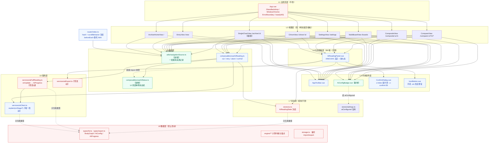
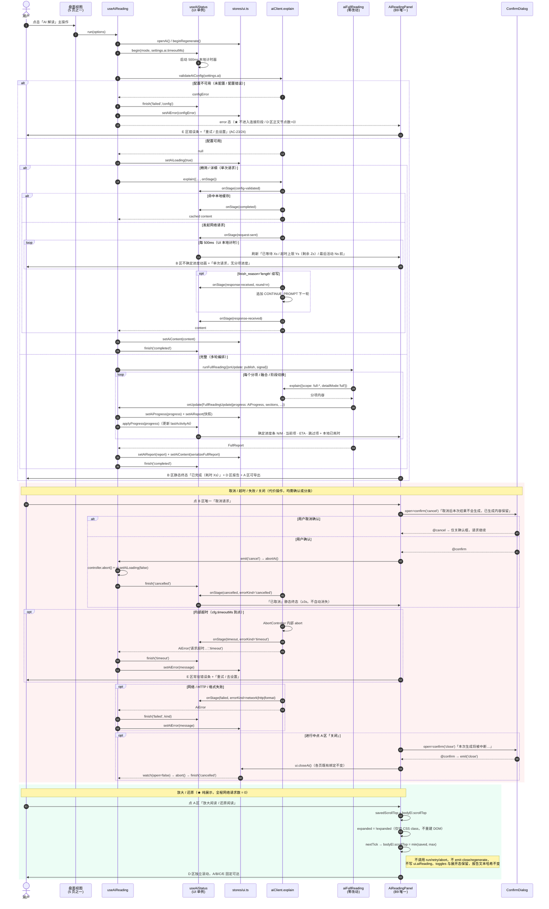
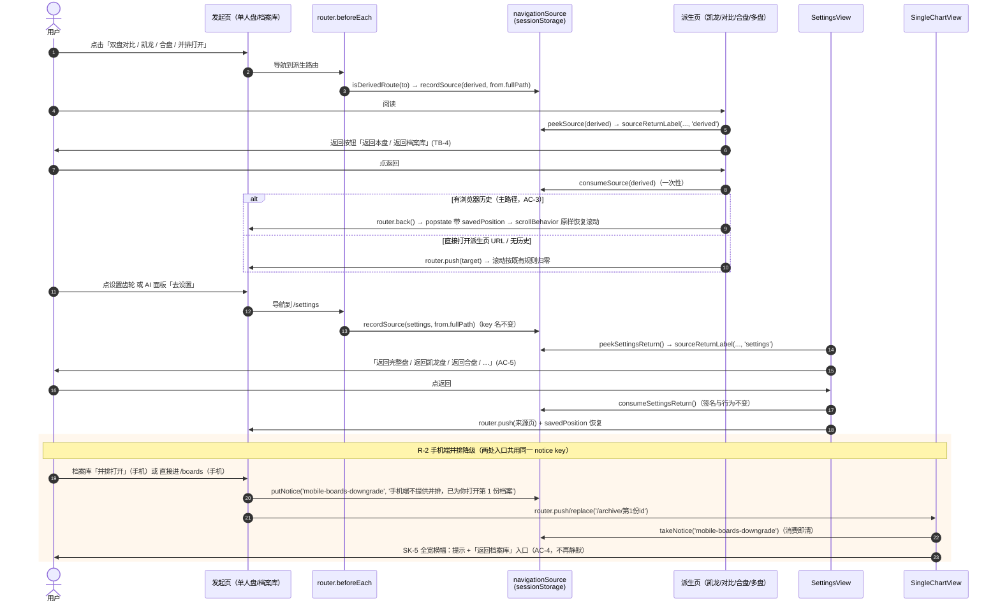
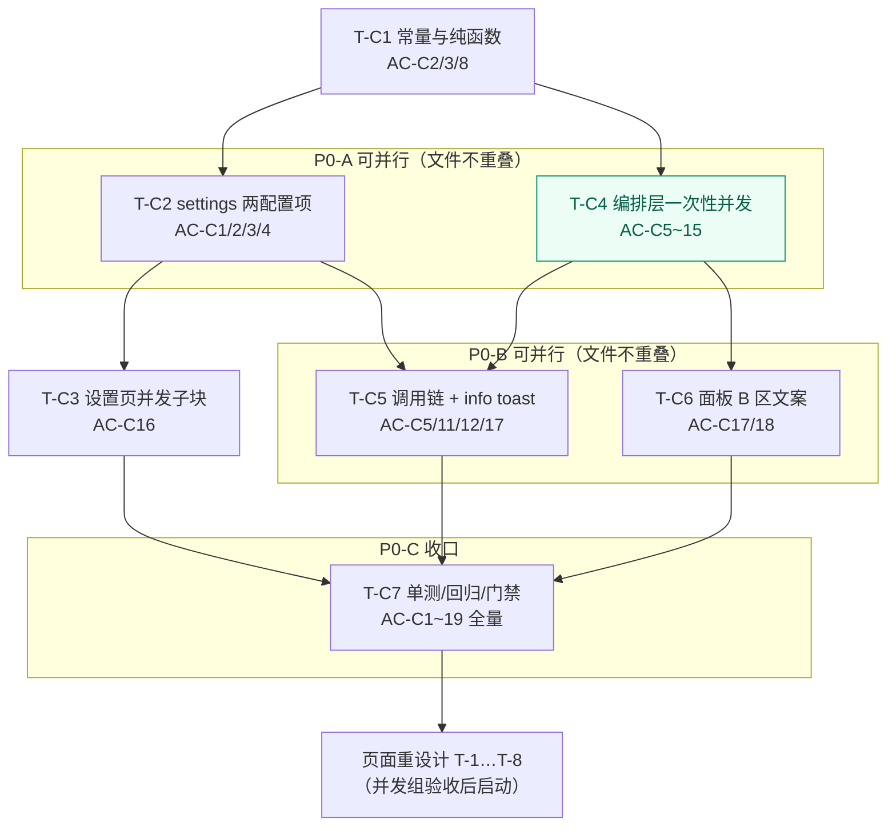
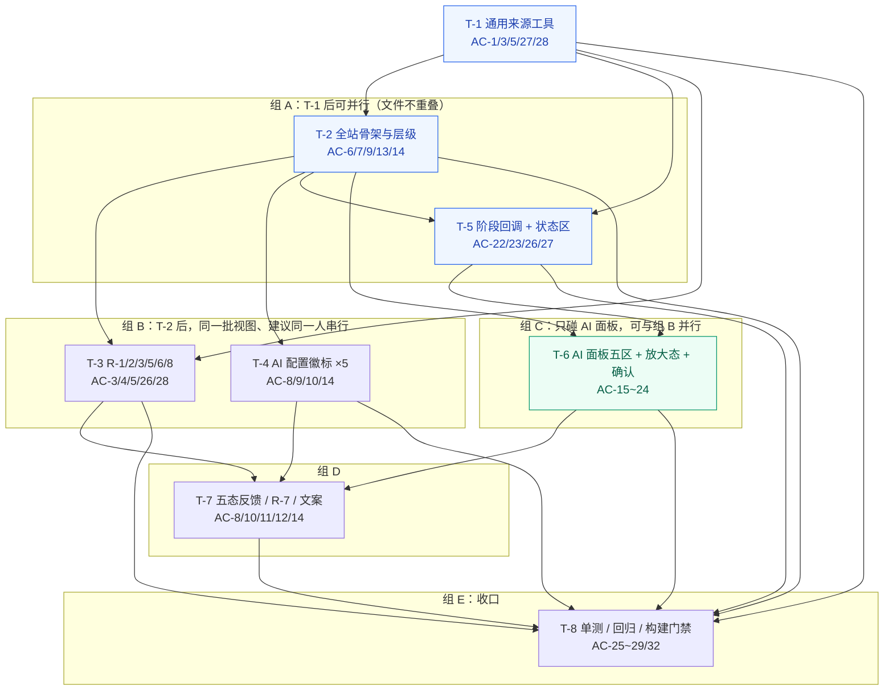
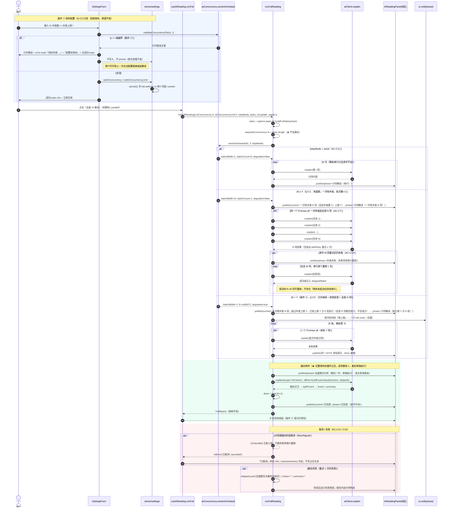
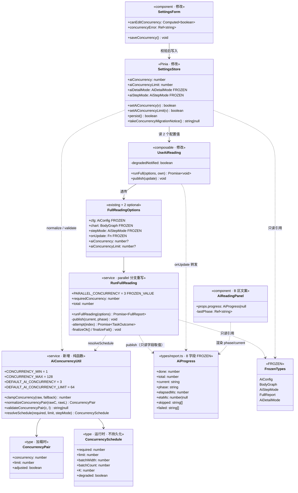

# HumanDesignTool v2.3.0 · 全站页面重设计 系统架构与任务分解

> **文档性质**：架构设计与工程实施输入（本阶段**仅产出文档，未修改任何现有代码或配置**）
> **撰写人**：架构师 高见远（Gao）
> **上游输入**：`docs/design/PRD-v2.3.0-全站页面重设计.md`（709 行，产品经理 许清楚）
> **目标版本**：v2.3.0（当前 v2.2.1；版本号单一来源为根 `package.json`，发布前由主理人统一处理）
> **技术栈（锁定）**：Vue 3.5 + TypeScript 5.6 + Vite 5 + vue-router 4（**hash 模式**）+ Pinia 2；桌面壳 / Android WebView 双端
> **测试环境**：Vitest 2，`environment: 'node'`，`include: ['tests/**/*.test.ts']`——**无 jsdom、无 @vue/test-utils**，新增测试必须是纯逻辑/服务层测试
> **下游读者**：工程师 寇豆码 → QA → 主理人（编译 / apk+exe / GitHub Release）
> **适用语言**：简体中文

---

## 0. 决策基线与文档结构说明

### 0.1 主理人已确认的 4 条决策（本文件不再列为待确认）

| 编号 | 决策 | 本架构的落实位置 |
| --- | --- | --- |
| **Q-1** | 批准新增「放大 / 还原阅读模式」纯展示控件。硬边界：不触发任何 AI 请求、不改写报告内容、不重置已展开状态、不丢失滚动位置（或按明确规则归位且首屏可见） | §4.4 放大态 DOM/CSS 契约、§4.6 展示态状态管理、T-6、AC-21 |
| **Q-2** | 批准在 `aiClient` 增加客户端计时与阶段回调，仅呈现客户端可观测事实；**不得新增业务数据结构**（不改 `BodyGraph` / `AiConfig` / 存储 schema / 备份格式）；精简/详细档用不确定进度动画并显式标注「单次请求，无分项进度」，禁止假百分比；完整档保留既有 `AiProgress` 与确定进度条 / ETA / 跳过项 | §4.5 状态模型、§4.7 `explain()` 签名、T-5、AC-22 / AC-23 |
| **Q-3** | 批准新增轻量来源记录，但**必须与设置页 `SETTINGS_RETURN_KEY` 合并为一套通用「来源记录」工具**（保留现有 key 名与设置页行为不变），供全部派生页复用；不得改 `createWebHashHistory` 与 `scrollBehavior` 现有语义 | §4.1 通用来源工具、T-1 / T-3、AC-3 / AC-5 |
| **Q-4** | 构建脚本、Android 签名、GitHub 仓库与 Release 凭据本机与仓库齐备，由主理人在发布环节执行；工程侧只需保证 `npm run build` 与测试全绿。**架构与实现阶段不要改构建脚本与版本号** | §8 不改清单、T-8、AC-29～AC-32 |

### 0.2 P2 边界与历史审计文档

- 本次**不做**：Penta、行运 / 流日、分享、出生时间不确定分支、AI 记录页、关系落库、导入校验链改造、合盘 / 凯龙字段删改、`BodyGraph` 类型拆分、构建脚本与版本号策略改动、**新增路由 / 页面 / AI 配置项 / 导出格式**、修改 router hash 模式与 scrollBehavior 语义。
- `docs/review/业务流程审计与体系合规校验-2026-10-27.md` 中的 **PF-xxx 大多属业务规则 / 体系修正，一律不纳入范围**；仅吸收与「页面顺序、跳转、状态反馈」相关且**不改业务功能**的部分（R-1 / R-2 / R-3 / R-6 的文案与反馈）。

### 0.3 文档结构与增量已落地

本文件按「架构 → 信息架构 → 接口与状态 → 时序 → **任务（并发优先）** → 约定 → 风险 → 不改清单 → **并发编排（第 11 章）**」组织。

- **第 11 章已从「增量预留位」改写为完整的「AI 并发编排（优先实施 · P0）」章节**，依据 `docs/design/PRD-v2.3.0-AI并发增量.md`（325 行，CH-1～CH-7、AC-C1～AC-C19、N-1～N-8）与主理人 Q-C1～Q-C3 决策。
- **任务列表已按实施优先级重排**：`T-C1…T-C7`（并发）置于第 5 章**最前面**，`T-1…T-8`（页面重设计）原编号不变、排在其后；两组共用一份有序列表，不重排、不重编号。
- 为保持页面重设计章节编号与全文交叉引用（§3.1.2 等）稳定，并发内容集中于第 11 章；**实施优先级以第 5 章任务列表顺序为准**。

### 0.5 优先级与实施顺序（主理人 2026 指令）

> 用户明确要求「**首先优先补全并实现 AI 并发能力**」。因此：
> 1. **实施顺序**：`T-C1 → T-C7`（并发能力可独立闭环）→ 再进入 `T-1…T-8`（页面重设计）。
> 2. **回报顺序**：并发章节与 T-C 列表优先回报；页面重设计部分已于上一轮回报，本轮不重复。
> 3. **范围例外**：原 PRD **P2-7「不新增 AI 配置项」被用户新需求显式覆盖**，**仅允许新增 `aiConcurrency` / `aiConcurrencyLimit` 两个配置项**；其余 P2 条目（含 P2-8 构建脚本、P2-9 hash/scrollBehavior）继续生效。
> 4. **Q-C1～Q-C3 已由主理人确认，不得再列为待确认**（见 §11.0）。
> 5. 并发能力**不依赖**页面重设计的 T-1…T-8，两条链路可分别独立编译与验收；但 `AiReadingPanel.vue` 的 B 状态区在 T-C6 与 T-6 都会改动，**须按 T-C6 先、T-6 后的顺序串行修改同一文件**（见 §5.1 并行组说明）。

### 0.4 架构核对中发现的 6 个重要现状（直接影响实施）

| # | 现状 | 对设计的影响 |
| --- | --- | --- |
| F-1 | `ArchiveHomeView.vue:43-44` **已实现** R-6 的 `n > 2` 提示「合盘只能选 2 份，当前已选 N 份，请先取消多余的档案」 | **R-6 不需要改代码**，只做回归；工程师误改反而破坏 AC-28 |
| F-2 | `IconButton.vue` 的 `.icon-btn.sm` 为 28×28px；`@media(max-width:768px)` 只覆盖 `.icon-btn`（44×44），**特异性低于 `.icon-btn.sm`** | AI 面板头部 4 个 `size="sm"` 按钮在手机端仍是 28×28 → **AC-9 必挂**，须在面板内 `:deep(.icon-btn.sm)` 显式覆盖 |
| F-3 | `AiReadingPanel.vue` 的 `.body { flex:1; overflow-y:auto }` **缺 `min-height:0`**；`.report-item { overflow:hidden }`；面板固定 520px | 这是「放大 / 全部展开后只显示一小部分」的**双重根因**；必须同时修 `min-height:0` 与 `overflow:hidden` |
| F-4 | `.rise` 过渡使用 `transform: translateX/Y(24px)` | 放大态**禁止**用 `transform: translate(-50%,-50%)` 居中，否则过渡与定位冲突；改用 `inset` 定位 |
| F-5 | `SettingsView.vue:105` 的 `clearAll()` 用原生 `window.confirm`；项目已有 `ConfirmDialog.vue`（`--z-dialog:50` / `+1`） | 统一改用 `ConfirmDialog`；但确认框与 AI 面板同层，**必须新增 `--z-confirm:55`** 提升层级，否则确认框可能被 AI 面板遮住 |
| F-6 | `vite.config.ts` 测试环境为 `node`（无 DOM） | 新增单测只能是纯函数 / 服务层；`sessionStorage` 需 `vi.stubGlobal`；**禁止**写 Vue 组件挂载测试 |

---

# 第 1 章　系统架构设计

## 1.1 分层模型与本次改动落点

| 层 | 目录 / 文件 | 职责 | 本次改动 | 约束 |
| --- | --- | --- | --- | --- |
| **L1 全局壳层** | `src/App.vue`、`WindowChrome.vue`、`GlassBackdrop.vue`、`FloatingDock.vue`、`ErrorBoundary.vue` | 全局背景 / 自绘标题栏 / dock / 错误边界 / toast | **不改**（已满足 SK-1 全局层） | toast 层级 `--z-toast:60` 保持最高 |
| **L2 视图层** | `src/views/*.vue`（8 个路由页） | 页面骨架、工具栏、区块顺序、返回、五态入口 | **改**：骨架对齐 SK、返回文案 / 目标、R-2/R-3/R-5/R-7、AI 配置徽标、五态补齐 | 不新增路由、不新增页面、不改业务计算 |
| **L3 共用面板层** | `src/components/panel/AiReadingPanel.vue` | **B9 唯一实现**：AI 报告展示与全过程状态 | **重构（核心）**：A/B/C/D/E 五区、放大态、统一状态区、二次确认、遮罩去关闭 | 单一组件，禁止 5 份实现漂移；5 个视图的 `<AiReadingPanel>` 事件绑定**保持原样** |
| **L4 共用组件层** | `src/components/base/*` | 设计令牌消费、按钮 / 对话框 / 工具栏 | **改**：新增 `AiConfigBadge.vue`；`ConfirmDialog` 层级；`IconButton` 手机热区；`AppToolbar` 骨架 / 文案 | 复用既有组件，不新造同类组件 |
| **L5 编排层** | `src/composables/useAiReading.ts`、新增 `useAiStatus.ts`、新增 `src/utils/navigationSource.ts` | 请求编排、UI 状态机、路由级来源记录 | **改 / 新增**：接入阶段回调、终态通知、来源记录统一工具 | `useAiStatus` 为 **UI 局部单例状态**，不进 Pinia、不持久化 |
| **L6 服务层** | `src/services/aiClient.ts`、`aiFullReading.ts`、`aiExport.ts`、`markdown.ts` 等 | AI 请求、多轮编排、导出、Markdown | **仅 `aiClient.ts` 一处**：`explain()` 增加**可选** `onStage` 回调 | `aiFullReading.ts` **零改动**；缓存键 / 提示词版本 / 续写逻辑 / 导出格式全部不动 |
| **L7 状态层** | `src/stores/ui.ts`、`settings.ts`、`archive.ts`、`board.ts` | Pinia 业务 / UI 状态 | **不改数据结构**；`settings.aiConfigured` 被复用为 R-4 数据源 | 禁止给 `AiReadingState` 加字段（Q-2） |
| **L8 数据层** | `src/types/**`、`src/engine/**`、`src/utils/storage.ts`、备份服务 | 类型、计算内核、锚点、持久化 schema、备份格式 | **禁止改动（黑名单）** | `MANDALA_OFFSET=29.875`、Gate 41 = `302.000°` 冻结 |
| **L9 路由层** | `src/router/index.ts` | 8 条业务路由 + hash + scrollBehavior | **仅** `beforeEach` 与 3 个导出函数改为委托通用工具 | `createWebHashHistory()` / `scrollBehavior` **两行语义零改动**（P2-9） |
| **L10 样式层** | `src/styles/tokens.css`、`base.css` | 设计令牌、全局原子 | **仅新增变量与基线类**，不改任何既有变量值 | 新增 `--z-confirm`、`--ai-*` |

### 1.2 禁止改动的层（硬边界）

> 计算内核、数据结构、锚点、备份格式、路由模式、构建脚本、版本号、提示词版本、导出格式、AI 配置项 —— **全部冻结**。详见第 8 章「本次不改清单」。

### 1.3 改动后的组件关系图（Mermaid）



## 1.4 文件列表（相对路径，穷举本次涉及）

### 新增文件（12 个：并发 4 + 页面重设计 8）

| 路径 | 用途 | 所属任务 |
| --- | --- | --- |
| `src/services/aiConcurrency.ts` | 并发常量与 4 个纯函数（中立模块，不依赖 store / 组件） | **T-C1** |
| `tests/aiConcurrency.test.ts` | 并发纯函数 + 编排集成单测 | **T-C1 / T-C7** |
| `docs/concurrency-class-diagram.mermaid` | 并发增量类图 | **T-C6** |
| `docs/concurrency-sequence-diagram.mermaid` | 并发增量时序图 | **T-C6** |
| `src/utils/navigationSource.ts` | 一套通用「来源记录」工具（设置返回 / 派生返回 / 降级提示三合一） | T-1 |
| `src/composables/useAiStatus.ts` | 三档统一状态区 UI 局部单例状态机 | T-5 |
| `src/components/base/AiConfigBadge.vue` | 5 个盘面页共用「AI 配置状态标识 + 去设置」 | T-4 |
| `src/components/panel/AiStatusZone.vue` | （可选）B 状态区拆分子组件；若不拆分则并入 `AiReadingPanel.vue` | T-6 |
| `tests/navigationSource.test.ts` | 来源记录 / 文案映射 / 一次性消费单测 | T-8 |
| `tests/aiStage.test.ts` | `explain()` 可选阶段回调与向后兼容单测 | T-8 |
| `tests/aiStatus.test.ts` | 状态机阶段 / 计时 / 终态保持 / 合并规则单测 | T-8 |
| `docs/design/ARCH-v2.3.0-页面重设计.md` | 本文件 | — |

### 修改文件（限定改动区域；并发组 5 个 + 页面重设计 13 个）

| 路径 | 允许改动区域 | 所属任务 |
| --- | --- | --- |
| `src/stores/settings.ts` | `SettingsState` / `DEFAULTS` / `state()` 3 分支 / `persist()` / 2 setter / 迁移提示（**并发组，详见 §8.4**） | **T-C2** |
| `src/components/settings/SettingsForm.vue` | `.step-mode` 之后追加「并发设置」子块（**并发组**） | **T-C3** |
| `src/services/aiFullReading.ts` | **并发组**：`FullReadingOptions` +2 可选 number、parallel 分支、`divisor`、融合 phase（serial 分支/融合位置逐字不动）；页面重设计零改动 | **T-C1 / T-C4** |
| `src/composables/useAiReading.ts` | **并发组**：`runFull()` 透传 2 参数 + 一次 info toast；**页面重设计**：接入 `useAiStatus` | **T-C5** / T-5 |
| `src/components/panel/AiReadingPanel.vue` | **并发组（T-C6 先）**：B 区 `phase`/`current` 文案；**页面重设计（T-6 后）**：五区重构/放大态/确认 | **T-C6** / T-6 |
| `src/router/index.ts` | 仅 `beforeEach` + `peekSettingsReturn` / `consumeSettingsReturn` 委托化；**`createWebHashHistory()` 与 `scrollBehavior` 两行禁止改** | T-1 |
| `src/views/SettingsView.vue` | `returnLabel` 改用 `sourceReturnLabel()`；`clearAll()` 的 `window.confirm` → `ConfirmDialog`；内容区骨架；R-5 文案 | T-1 / T-2 / T-7 |
| `src/styles/tokens.css` | **仅新增** `--z-confirm`、`--ai-panel-*`、`--page-max-w` 等变量 | T-2 |
| `src/styles/base.css` | **仅新增** `.page-shell` / `.content-shell` 骨架基线与 SK-5 横幅原子类 | T-2 |
| `src/components/base/ConfirmDialog.vue` | `.mask` / `.dialog` 的 z-index 改用 `--z-confirm` | T-2 |
| `src/components/base/IconButton.vue` | 手机端 `.icon-btn.sm` 热区 ≥44px（或由面板 `:deep()` 覆盖） | T-2 |
| `src/components/base/AppToolbar.vue` | 骨架高度 / 返回文案透传 / 右侧分组间距 / 手机底部条安全区 | T-2 / T-7 |
| `src/views/ArchiveHomeView.vue` | 骨架；`openBoards()` 手机降级提示（R-2）；R-5 文案；**R-6 逻辑不动** | T-2 / T-3 / T-7 |
| `src/views/EntryView.vue` | 骨架、SK-3 宽度、五态反馈落位 | T-2 / T-7 |
| `src/views/SingleChartView.vue` | 骨架；`goBack`；`back-label`；AI 徽标；降级横幅（R-2 落地页）；五态 | T-2 / T-3 / T-4 / T-7 |
| `src/views/ChironView.vue` | 骨架；`goBack` / `@settings`；AI 徽标；扩展层常驻标注 | T-2 / T-3 / T-4 / T-7 |
| `src/views/MultiBoardView.vue` | 骨架；`goBack`；手机静默降级改明示（R-2）；AI 徽标；单栏失败提示 | T-2 / T-3 / T-4 / T-7 |
| `src/views/CompositeView.vue` | 骨架；SK-3 宽度 1560→1280；`goBack`；AI 徽标 | T-2 / T-3 / T-4 / T-7 |
| `src/views/CompareView.vue` | 骨架；`goBack`；R-3「当前对比：A × B」明示；AI 徽标 | T-2 / T-3 / T-4 / T-7 |
| `src/composables/useAiReading.ts` | 接入 `useAiStatus.begin/applyStage/applyProgress/finish`；`run()` 传 `onStage`；失败分类透出 | T-5 |
| `src/services/aiClient.ts` | **仅** `AiExplainArgs` 新增可选 `onStage` + `explain()` 内 6 个可观测点回调；其余全部不动 | T-5 |
| `src/components/panel/AiReadingPanel.vue` | 五区重构、放大态、状态区、确认、遮罩、CSS 契约（主体） | T-6 |

## 1.5 数据结构与接口类图（Mermaid classDiagram）

```mermaid
classDiagram
    direction TB

    class NavigationSource {
        <<utility · 新增>>
        +SETTINGS_RETURN_KEY: string = "hdt.settings.returnTo"
        +SOURCE_KEYS: Record~SourceKind,string~
        +recordSource(key, fromFullPath) void
        +peekSource(key) string
        +consumeSource(key) string
        +clearSource(key) void
        +sourceReturnLabel(path, fallback) string
        +putNotice(kind, payload) void
        +takeNotice(kind) NavNotice|null
        +isDerivedRoute(name) boolean
    }
    class NavNotice {
        <<type · UI 局部>>
        +kind: "mobile-boards-downgrade"
        +text: string
        +createdAt: number
    }
    class RouterIndex {
        <<existing · 限定改动>>
        +createWebHashHistory() FROZEN
        +scrollBehavior() FROZEN
        +beforeEach(to, from) void
        +peekSettingsReturn() string
        +consumeSettingsReturn() string
    }

    class AiStageEvent {
        <<type · 仅函数签名用途>>
        +stage: AiStage
        +at: number
        +elapsedMs: number
        +timeoutMs: number
        +round: number?
        +errorKind: AiErrorKind?
    }
    class AiClient {
        <<service · 唯一改动>>
        +PROMPT_VERSION = "3.1" FROZEN
        +validateAiConfig(cfg) string|null
        +cacheKey(cfg,args) string FROZEN
        +explain(args: AiExplainArgs) Promise~string~
        -emitStage(event) void
    }
    class AiExplainArgs {
        <<existing + 1 optional>>
        +cfg: AiConfig
        +scope: string
        +offline: string
        +signal: AbortSignal?
        +onStage: (e: AiStageEvent) => void?
    }

    class useAiStatus {
        <<composable · 单例 · 新增>>
        -snapshot: Ref~AiStatusSnapshot~
        -timer: number|null
        +begin(mode, timeoutMs) void
        +applyStage(e: AiStageEvent) void
        +applyProgress(p: AiProgress) void
        +finish(phase, kind?) void
        +reset() void
        +snapshot$ Readonly~Ref~AiStatusSnapshot~~
    }
    class AiStatusSnapshot {
        <<UI 局部状态 · 不入库>>
        +phase: AiStatusPhase
        +startedAt: number|null
        +elapsedMs: number
        +timeoutMs: number
        +lastActivityAt: number|null
        +mode: AiDetailMode
        +progress: AiProgress|null
        +terminal: boolean
        +terminalAt: number|null
        +label: string
    }
    class useAiReading {
        <<composable · 修改>>
        -lastOptions: RunOptions|null
        -controller: AbortController|null
        +state: Computed~AiReadingState~
        +configured: Computed~boolean~
        +run(options, signal?) Promise~void~
        +runFull(options, own) Promise~void~
        +retry(signal?) Promise~void~
        +abort() void
        +clearError() void
    }

    class AiReadingPanel {
        <<component · B9 唯一实现 · 重构>>
        +props: open,title,content,loading,error,configured,mode,report,progress,meta
        +emits: close,copy,save,regenerate,cancel,settings
        -expanded: Ref~boolean~
        -toggles: Ref~Record~string,boolean~~
        -bodyEl: Ref~HTMLElement~
        -confirm: Ref~ConfirmKind|null~
        +toggleExpanded() void
        +toggleSection(s) void
        +setAll(open) void
        +requestClose() void
        +requestCancel() void
        +requestRegenerate() void
        +doExport(format) void
    }
    class AiConfigBadge {
        <<component · 新增>>
        +props: compact?
        +emits: settings
        +configured: Computed~boolean~
    }
    class ConfirmDialog {
        <<existing · z-index 调整>>
        +props: open,title,desc,confirmText,cancelText,danger
        +emits: confirm,cancel
        -onKeydown(e) void
    }
    class AppToolbar {
        <<existing · 骨架调整>>
        +props: title,showSearch,searchValue,backLabel
        +emits: new,settings,help,back,update:searchValue
    }

    class UiStore {
        <<Pinia · 结构冻结>>
        +aiReading: AiReadingState
        +openAi() void
        +setAiProgress() void
        +setAiReport() void
        +setAiContent() void
        +setAiError() void
        +closeAi() void
        +notify() void
    }
    class AiReadingState {
        <<FROZEN · 禁止加字段>>
        +open: boolean
        +content: string
        +loading: boolean
        +error: string|null
        +progress: AiProgress|null
        +report: FullReport|null
    }
    class SettingsStore {
        <<Pinia · 只读复用>>
        +aiConfigured: boolean
        +aiDetailMode: AiDetailMode
        +aiStepMode: AiStepMode
        +ai: AiConfig
        +timeoutMs: number
    }
    class AiProgress {
        <<types/report.ts · FROZEN>>
        +done: number
        +total: number
        +current: string
        +phase: string
        +elapsedMs: number
        +etaMs: number|null
        +skipped: string[]
        +failed: string[]
    }
    class EngineTypes {
        <<FROZEN · 禁止改动>>
        BodyGraph
        AiConfig
        AiDetailMode
        FullReport
        MANDALA_OFFSET
    }

    RouterIndex ..> NavigationSource : 委托（签名不变）
    NavigationSource --> NavNotice : 产生/消费
    AiReadingPanel ..> NavigationSource : 去设置路径由视图处理
    AiClient ..> AiExplainArgs : 参数
    AiClient ..> AiStageEvent : 回调发出
    AiExplainArgs o-- AiStageEvent : onStage 可选
    useAiReading --> AiClient : explain(onStage)
    useAiReading --> useAiStatus : begin/applyStage/finish
    useAiReading --> UiStore : 写业务状态
    useAiReading ..> AiProgress : runFullReading.onUpdate
    useAiStatus o-- AiStatusSnapshot : 持有
    useAiStatus ..> AiProgress : 完整档合并展示（只读）
    AiReadingPanel ..> useAiStatus : 直接 import 单例读取
    AiReadingPanel --> ConfirmDialog : 三种确认
    AiReadingPanel --> AppToolbar : 无（同属 UI 层）
    AiConfigBadge ..> SettingsStore : 读 aiConfigured
    UiStore o-- AiReadingState : 冻结
    UiStore ..> AiProgress : 引用（不改）
    AiClient ..> EngineTypes : 只读引用
    useAiReading ..> SettingsStore : 读 cfg / mode
```



---

# 第 2 章　信息架构与逐页设计

## 2.1 全站统一骨架（SK-1～SK-5 落地）

```
WindowChrome(桌面) / GlassBackdrop ── 全局层，不改
  └─ <div class="page page-shell">
       ├─ <AppToolbar />                 sticky，桌面 56px / 手机 52px，z-toolbar(20)
       ├─ [SK-5 全宽横幅]              紧贴工具栏下方，全宽、不覆盖、不自动消失、不随内容滚动
       ├─ <main class="content content-shell">   ★ 唯一滚动区
       │     max-width: var(--page-max-w); margin:0 auto; box-sizing:border-box
       │     L1 页面容器（无边框）→ L2 区块卡 → L3 卡内条目
       ├─ [底部固定操作条 · 手机]       env(safe-area-inset-bottom)，main padding-bottom ≥ 条高 + 安全区
       └─ 浮层（Teleport to body）      z-drawer(41) < z-dialog(50) < z-confirm(55) < z-toast(60)
```

**实施策略（最小变更）**：在 `base.css` **新增**非 scoped 的 `.page-shell` / `.content-shell` 基线类与 `--page-max-w` 变量；8 个视图根节点追加该 class，并**删除或对齐**各自 scoped 中与全局冲突的 `width / max-width / overflow` 声明。不重写各页布局，只做「收敛」。

**SK-3 逐页宽度对照表（现状 → 目标）**

| 页面 | 现状 max-width | 目标 | 处理 |
| --- | --- | --- | --- |
| `/` 档案库 | 1400px | 1400px | 已符合，收敛为变量 |
| `/new` 录入 | 1200px | 1200px | 已符合 |
| `/archive/:id` 单人盘 | `max(840px, --graph-max-width)` | 840px（自定义布局 ≤1400px） | 已符合，保留 `min(1400px,100%)` 兜底 |
| `/chiron/:id` 凯龙 | 1500px | 840px | 收敛为 840（PRD 8.1 为单列），需 QA 双视口核对 |
| `/boards` 多盘 | 1500px | 1500px | 已符合 |
| `/composite/:a/:b` 合盘 | **1560px** | **1280px** | 按 SK-3 调整；三栏挤压用 CD-4 换行处理，**不回退宽度** |
| `/compare/:a?/:b?` 对比 | 1280px | 1280px | 已符合 |
| `/settings` 设置 | 880px | 880px | 已符合 |

## 2.2 逐页「骨架 → 区块顺序 → 信息层级 → 操作落位 → 五态落位」详表

> 「一级 / 二级 / 三级」严格对应 PRD 3.1；「主 / 次 / 危险」对应 PRD 3.1 与 TB-2 / BT-1；五态对应 FB-1～FB-6。编号列是与 PRD 第 5 / 8 章的一一对应索引。

| 页面 | 骨架 → 区块顺序（从上到下） | 一级 / 二级 / 三级信息 | 主 / 次 / 危险操作落位 | 五态反馈落位 | 对应规范 |
| --- | --- | --- | --- | --- | --- |
| **B1 `/` 档案库** | 顶栏 → SK-5 横幅（数据读取失败 / 降级提示）→ 搜索 → 空态 / 卡片画布 → 桌面批量条 / 手机底部固定条 | ①「档案库」+ 搜索 + 卡片集合；② 画布 / 已选 N/2 / 批量条；③ 卡片内姓名・出生信息・类型摘要・示例提示 | 主：顶栏右「新建档案」(≤1)；次：搜索、载入示例、打开卡片、多选、并排打开、生成合盘、清除选择、设置、主题；危险：删除单份 / 批量删除（独立分组 + `ConfirmDialog` + 5 秒撤销） | 加载：卡片骨架；空态：区分「还没有档案」/「没有匹配的档案」；错误：持久化失败 toast + 顶部横幅；成功：载入 / 删除 / 撤销 toast；进行中：删除后 5 秒常驻撤销条 | SK-1/3/4/5、TB-1/2/3/4、CD-1/2/4、BT-1～5、FB-1～6、MB-1/2、TX-3、R-2/R-5/R-6 |
| **B2 `/new` 录入** | 顶栏 → 模式切换 → 表单四卡（身份证 / 基本信息 / 出生时间 / 出生地）→ 提交条；桌面右侧 sticky 实时预览 | ① 标题 + 模式切换 + 预览；② 四卡 + 预览卡；③ 分钟精度警告、DST、经纬度说明、隐私同意、字段级错误 | 主：提交条「生成人类图」（防重复）；次：解析身份证、切换模式、时区 / 省市、返回、设置；危险：无 | 加载：按钮 loading +「生成中…」；空态：预览区提示；错误：字段行内 + 首个错误滚动高亮 + toast、预览计算失败**红字原因（禁止静默降级）**、保存失败 toast；成功：toast + 跳单人盘；进行中：实时预览（轻量，不阻塞） | SK-1/3/4、TB-1/3/4、CD-1/2/4、BT-5、FB-1～4、MB-1/2、TX-1/3 |
| **B3 `/archive/:id` 单人盘【枢纽】** | 顶栏 → SK-5 横幅（DST 告警 / 重算失败 / **R-2 降级提示**）→ AI 综合解读组合条 → 人体图卡（含两翼星列）→ 盘面信息 → 激活清单 → 轮回交叉 → 人生轨迹 → 对象详情 | ① 档案名 + 人体图主图 + 显 / 潜两翼；② 盘面信息、通道 / 闸门 / 九中心清单、交叉、轨迹、AI 组合条、对象详情卡；③ 小度数 / 色下调基开关、闸门释义、星体洞察、DST 黄条、模块拖拽顺序 | 主：顶栏右「全盘 AI 解读」+ **AI 配置徽标**（R-4，紧邻主操作）；次：编辑、复制副本、凯龙回归、双盘对比、点闸门 / 通道 / 中心、批量选中后 AI 解读、设置、主题；危险：删除档案（确认 + 5 秒撤销） | 加载：盘面补算骨架 + AI 面板状态区；空态：档案不存在 / 重算失败（含原因 + 修复路径）；错误：计算异常、AI 分类错误（面板 E 区）；成功：复制 / 撤销 / AI 完成；进行中：AI 面板 B 区常驻 | SK-1/3/4/5、TB-1/2/3/4、CD-1～4、BT-1～5、FB-1～6、MB-1～5、TX-1～3、R-1/R-4/R-7 |
| **B4 `/chiron/:id` 凯龙** | 顶栏 → **扩展层常驻标注（SK-5 横幅）** → 回归时刻信息 → 人体图 → 结构清单 → 详情 | ① 标题「凯龙回归图 · 档案名」+ 扩展层标注 + 回归时刻；② 人体图、结构卡、清单、AI 入口；③ 本命凯龙落点、回归年龄、口径约束小字 | 主：顶栏右「凯龙图 AI 解读」+ AI 配置徽标；次：返回本盘、设置、新建、点闸门看释义；危险：无 | 加载：回归时刻求解骨架；空态：档案不存在 / 求解失败（提示检查出生时间）；错误：计算异常降级为空态 + **可见原因**；成功：AI 完成；进行中：AI 面板 B 区 | SK-1/3/5、TB-1/2/4、CD-1～3、FB-1～5、MB-1、TX-3、R-1/R-4 |
| **B5 `/boards` 多盘** | 顶栏 → N 栏网格（栏头 / 图 / 星体表 / 盘面信息）→ 对象详情侧面板 | ① 标题 + 并列栏头；② 每栏四段；③ 收起状态、单栏重算失败提示 | 主：无（入口在档案库，符合 TB-2）；次：收起 / 展开星体表、关闭单盘（不删数据，无需确认）、点闸门、AI 深度解读 + 徽标、返回、设置；危险：无 | 加载：各栏补算骨架；空态：「没有可显示的盘」+ 返回档案库；错误：单栏「重算失败：原因」**就地提示，不整栏消失**；成功：关闭栏后 URL 同步；进行中：AI 面板 B 区；**手机降级明示（R-2）** | SK-1/3/5、TB-1/4、CD-1/3、FB-1～6、MB-1/2/4、R-1/R-2/R-4 |
| **B6 `/composite/:a/:b` 合盘** | 顶栏 → 工具栏（过滤器 + AI 主操作）→ 解读维度条 → 三栏主图 → 四张结论卡（关系主题 / 四象限 / 通道动力学 / 行星落点）→ 对象详情 | ① 标题 + A｜B｜合图 三栏（手机 Tab + 单图）；② 维度条、过滤器、四张结论卡；③ 共享通道计数、读取内容、独立缓存说明、每类通道释义 | 主：「生成「当前维度」解读」+ AI 配置徽标；次：切换维度、A/B/合图 Tab、仅看共享通道、点闸门、单对象 AI、返回、设置；危险：无 | 加载：合盘计算骨架 + AI 状态区；空态：同一人合盘「需要两位不同的人」、档案缺失「无法生成合盘」；错误：AI 分类错误（面板 E 区）；成功：解读完成；进行中：AI 面板 B 区 | SK-1/3/5、TB-1/2/4、CD-1～4、FB-1～5、MB-1/2、R-1/R-4 |
| **B7 `/compare/:a?/:b?` 对比** | 顶栏 → **R-3「当前对比：A × B」明示条** → 左右两栏（选择器 + 元信息 + 完整人体图） | ① 标题 + 两栏选择器与盘面元信息；② 两张完整人体图、双盘 AI 入口；③ 单栏缺失提示、同人自动规避提示 | 主：「双盘 AI 解读」（条件：两份可用盘面）+ AI 配置徽标；次：左右档案下拉（就地更换，**不新增选择器**）、返回、设置、点闸门；危险：无 | 加载：两栏补算骨架；空态：档案不足 2 份「请先新建或载入示例」、单栏缺失就地提示；错误：AI 分类错误、未选两份可用盘面 toast；成功：解读完成；进行中：AI 面板 B 区 | SK-1/3/5、TB-1/2/4、CD-1/3、FB-1～5、MB-1/2、R-1/R-3/R-4 |
| **B8 `/settings` 设置** | 顶栏（返回文案随来源，TB-4）→ 单栏七分节：AI 配置 → 详细度 → 步模式 → 超时 → 自定义布局 → 外观 → 数据 | ① 标题 + 返回；② 七个分节；③ 字段级校验、探测结果、导入被拒明细、版本号小字 | 主：各分节「保存 / 新增并启用当前 AI 配置」；次：测试连接、切换档位 / 步模式、布局与字号、导入、**「导出备份（档案 JSON，不含身份证号与 AI Key）」**（R-5）、返回、新建；危险：删除 AI 配置 / 清空 AI 缓存 / 清空全部数据（**`window.confirm` → `ConfirmDialog`**） | 加载：配置探测中；空态：无 AI 配置引导「不填也能排盘与看离线释义」；错误：字段级 + toast、被拒明细面板、持久化失败；成功：配置已更新 / 已导入 N 份（跳过 M 份）/ 已导出备份；进行中：测试连接状态 | SK-1/3/5、TB-1/4、CD-1/2、BT-1～3、FB-1～5、MB-1、TX-3、R-5/R-7/R-8 |
| **B9 AI 解读面板（子界面）** | **A 固定头部 → B 状态区 → C 报告工具区 → E 错误区（按需，固定）→ D 只读展示区（唯一独立滚动）**；放大态为居中大窗 | ① 档位标识 + 报告标题 + 固定操作区；② 状态区、导出区、工具条、报告分组（一～五）；③ 分项正文、跳过项、ETA、已耗时、字数、页眉上下文 | 主（展示）：A 区「放大 / 还原阅读」；次：A 区查看类（复制 / 保存 / 四格式导出）、C 区全部展开 / 收起、分项展开 / 收起、关闭；危险：A 区代价类（重新生成 / 关闭）、B 区唯一「取消请求」、E 区「去设置」 | 加载：B 区状态 + D 区骨架；空态：D 区「暂无内容」；错误：**E 区常驻错误条**（原因 + 预留配置说明 + 重试 / 去设置）；成功：B 区终态 + 可导出；进行中：B 区常驻、不可被滚动隐藏 | SK-2、TB-2、CD-3、BT-1～5、FB-1～6、MB-3/4/5/6、TX-1/2/3、AI-01～11、6.2 / 6.4 / 6.5 |

> **架构细化说明（不改需求语义）**：PRD 6.5 示意图把 E 错误区画在 D 之后；本设计把 **E 上移到 C 与 D 之间并固定**，理由是 FB-3「错误条常驻直到用户处理」与 AI-11「重新生成失败时旧内容保留在下方并带常驻标注」要求错误条**不被正文滚动隐藏**。D 区顶部在 `error && hasContent` 时插入一行「以下为上一次结果」标注。这是对布局的落地细化，五区划分（6.2）与安全边界（6.4）完全不变。

## 2.3 R-1～R-8 在「不新增功能」前提下的落地方式

| 编号 | 落地方式（含文件级动作） | 为什么不是新功能 | AC |
| --- | --- | --- | --- |
| **R-1** | `navigationSource.ts` + `router.beforeEach` 在**目标为派生路由**时记录 `from.fullPath` 到 `hdt.nav.derivedFrom`；4 个派生页 `goBack()` 改为 `consumeSource` 返回；`back-label` 改为 `sourceReturnLabel(peekSource(...))` | 只改返回目标与文案；无新页面 / 无新数据实体 / 无业务状态 | AC-3 |
| **R-2** | **两处**静默降级（`ArchiveHomeView.openBoards()` 手机分支、`MultiBoardView` 的 `isMobile` watch）改为：先 `putNotice('mobile-boards-downgrade', ...)` 再跳转；`SingleChartView` 读 `takeNotice` 渲染 SK-5 全宽横幅「手机端不提供并排，已为你打开第 1 份档案」+「返回档案库」按钮 | 只把「静默」改为「明示」；横幅复用既有 `.notice` 样式与 SK-5 规范 | AC-4 |
| **R-3** | `CompareView.vue` 在两栏选择器上方加一行只读明示「当前对比：A × B」+「可直接在下方下拉框更换任一侧」；`pairNames` 已有，直接渲染；两个 `<select>` 不动 | 仅状态说明；不新增选择器、不改 bId 兜底逻辑 | AC-28 |
| **R-4** | 新增 `AiConfigBadge.vue`（读 `settings.aiConfigured`），5 个盘面页在 AI 主操作旁各插入 1 行；未配置时显示「去设置」次操作，`@settings` 接到各页既有 `goSettings` | 只增加状态可见性；不改配置功能、不新增配置项 | AC-8 / AC-10 |
| **R-5** | 面板 A 区导出文案固定「导出报告 · MD / Word / HTML / PDF」；设置页固定「导出备份（档案 JSON，不含身份证号与 AI Key）」（现已有此 toast 文案，仅统一按钮 / 分节标题）；`aiExport.ts` **不动** | 仅文案与分组；导出实现零改动 | AC-26 |
| **R-6** | **已实现，不改代码**（见 F-1）；仅在 `tests/` 或 QA 清单中加回归断言：`length > 2` →「合盘只能选 2 份，当前已选 N 份…」、`length === 1` →「请再选择一份」 | 无需改动；避免误改破坏既有校验 | AC-28 |
| **R-7** | AI 面板内把代价操作收拢到 A 区独立分组 + B 区唯一取消 + 三种 `ConfirmDialog` 二次确认；遮罩去 `@click`；设置页 `window.confirm` → `ConfirmDialog` | 仅布局与安全边界；操作语义（复制 / 保存 / 导出 / 重试 / 取消 / 关闭）完全不变 | AC-8 / AC-15 / AC-16 / AC-17 |
| **R-8** | R-1 的机制推广到全部派生页；设置页 `peekSettingsReturn` / `consumeSettingsReturn` **签名与行为保持不变**（内部委托通用工具） | 复用既有机制，零新增 | AC-5 |

---

# 第 3 章　关键接口与状态设计（不新增任何业务字段）

## 3.1 通用「来源记录」工具（Q-3 合并方案）

### 3.1.1 存储键与兼容性

| 常量 | 值 | 用途 | 生命周期 |
| --- | --- | --- | --- |
| `SETTINGS_RETURN_KEY` | `'hdt.settings.returnTo'` | **保持现有 key 名不变**；设置页来源 | `sessionStorage`，消费一次即清除 |
| `SOURCE_KEYS.settings` | 同上（同一常量别名） | 通用工具统一入口 | 同上 |
| `SOURCE_KEYS.derived` | `'hdt.nav.derivedFrom'` | 派生页返回发起页（R-1 / R-8） | 同上 |
| `SOURCE_KEYS.notice` | `'hdt.nav.notice'` | 一次性跨页提示（R-2 手机降级） | 同上，`takeNotice` 消费即清 |

**兼容方式（硬约束）**：
1. `router/index.ts` **继续导出** `peekSettingsReturn()` / `consumeSettingsReturn()`，**签名与返回语义完全不变**；`SettingsView.vue` 的 `import` 与调用方式不动。
2. `SETTINGS_RETURN_KEY` 常量从 `navigationSource.ts` 导出，router 内 `import { SETTINGS_RETURN_KEY, ... }`；若外部有引用（当前无），可 `export { SETTINGS_RETURN_KEY } from '../utils/navigationSource'` 再导出。
3. `beforeEach` **保留**原有的「直接打开 / 刷新设置页清掉旧来源」判断（`!from.name` → `clearSource`），行为 100% 不变。
4. **不改** `createWebHashHistory()` 与 `scrollBehavior: (_to,_from,savedPosition) => savedPosition ?? { top: 0 }` 两行及其语义（P2-9）。

### 3.1.2 函数签名（`src/utils/navigationSource.ts`）

```ts
/** 来源记录类别：一套工具，三类用途（Q-3） */
export type SourceKind = 'settings' | 'derived' | 'notice'

/** key 名常量；SETTINGS_RETURN_KEY 保持与 v2.2.1 完全一致 */
export const SETTINGS_RETURN_KEY = 'hdt.settings.returnTo'
export const SOURCE_KEYS: Record<SourceKind, string> = {
  settings: SETTINGS_RETURN_KEY,
  derived: 'hdt.nav.derivedFrom',
  notice: 'hdt.nav.notice',
}

/** 派生路由名（与 router 的 name 一致），供 beforeEach 与单测共用 */
export const DERIVED_ROUTE_NAMES = [
  'chiron-return', 'multi-board', 'composite', 'compare',
] as const
export function isDerivedRoute(name: unknown): boolean

/** 写入来源；隐私模式下 sessionStorage 不可写时静默忽略（与现状一致） */
export function recordSource(key: string, fromFullPath: string): void
/** 只读，不消费（用于返回按钮文案） */
export function peekSource(key: string): string
/** 读取并清除，只消费一次，避免从别处进入时串到旧来源 */
export function consumeSource(key: string): string
export function clearSource(key: string): void

/** 返回按钮文案映射（把 SettingsView 现有 20–28 行逻辑抽出复用）
 *  variant='settings' 保持设置页 v2.2.1 文案逐字不变；variant='derived' 供 4 个派生页使用 */
export function sourceReturnLabel(
  path: string,
  fallback = '返回档案库',
  variant: 'settings' | 'derived' = 'settings',
): string

/** 一次性跨页提示（R-2）；kind 用于避免不同提示互相串台 */
export interface NavNotice { kind: string; text: string; createdAt: number }
export function putNotice(kind: string, text: string): void
export function takeNotice(kind: string): NavNotice | null
```

**`sourceReturnLabel` 映射表（TB-4 / AC-5）**

| `path` 前缀 | 返回文案 |
| --- | --- |
| `/archive/` | 返回本盘（**派生页**口径；设置页沿用既有「返回完整盘」） |
| `/chiron/` | 返回凯龙盘 |
| `/composite/` | 返回合盘 |
| `/compare` | 返回双盘对比 |
| `/boards` | 返回多盘 |
| 其他 / 空 | `fallback`（派生页默认「返回档案库」；设置页默认「返回档案库」） |

> 为保持设置页行为**完全不变**，`SettingsView.returnLabel` 改为 `sourceReturnLabel(peekSettingsReturn(), '返回档案库')`，且映射表中 `/archive/` → **「返回完整盘」**（与现状第 22 行一致）；派生页调用时通过可选第 3 参数 `variant: 'derived'` 取「返回本盘」。签名定为：
> `sourceReturnLabel(path: string, fallback = '返回档案库', variant: 'settings' | 'derived' = 'settings'): string`

### 3.1.3 `router.beforeEach` 目标逻辑（唯一改动的路由逻辑）

```ts
router.beforeEach((to, from) => {
  // ① 设置页：保持 v2.2.1 原语义
  if (to.name === 'settings') {
    if (from.name && from.name !== 'settings') recordSource(SOURCE_KEYS.settings, from.fullPath)
    else if (!from.name) clearSource(SOURCE_KEYS.settings)
    return
  }
  // ② 派生页：记录发起页 fullPath（R-1），不覆盖派生页之间的内部跳转
  if (isDerivedRoute(to.name)) {
    if (from.name && !isDerivedRoute(from.name)) recordSource(SOURCE_KEYS.derived, from.fullPath)
    else if (!from.name) clearSource(SOURCE_KEYS.derived) // 直接打开/刷新 → 回退到 '/'
  }
})
```

### 3.1.4 各派生页调用点与返回文案映射

| 页面 | 文件 | `goBack()` 改为 | `back-label` 改为 | 预期返回 |
| --- | --- | --- | --- | --- |
| 凯龙 | `ChironView.vue` | `goDerivedBack()` | `derivedBackLabel` | `/archive/:id`（现状已正确，统一机制后保持） |
| 多盘 | `MultiBoardView.vue` | `goDerivedBack()` | `derivedBackLabel` | `/`（从单人盘进则回该单人盘） |
| 合盘 | `CompositeView.vue` | `goDerivedBack()` | `derivedBackLabel` | `/` |
| 对比 | `CompareView.vue` | `goDerivedBack()` | `derivedBackLabel` | 从单人盘来 → `/archive/原id`；从档案库来 → `/` |

**统一返回函数**（建议放 `navigationSource.ts` 旁的组合式 `useDerivedBack()`，或直接内联 3 行，避免多抽象）：

```ts
function goDerivedBack() {
  const target = consumeSource(SOURCE_KEYS.derived) || '/'
  // 主路径：走浏览器历史，popstate 会带 savedPosition → scrollBehavior 原样恢复滚动（不改其语义）
  if (target && window.history.state?.back) router.back()
  else router.push(target)   // 直接打开派生页 / 无历史时兜底，滚动按既有规则归零
}
const derivedBackLabel = computed(() =>
  sourceReturnLabel(peekSource(SOURCE_KEYS.derived), '返回档案库', 'derived'),
)
```

> **AC-3 滚动位置的实现策略（重要）**：`router.push()` 不产生 `savedPosition`，`scrollBehavior` 会走 `{top:0}`。在**不改 scrollBehavior** 的硬约束下，采用「`router.back()` 优先（触发 popstate → `savedPosition` 生效）+ 无历史时 `push` 兜底」的双路径。QA 验收 AC-3 请走主路径（从单人盘点进派生页再点返回）；直接粘贴派生页 URL 时按兜底规则滚动归零，属明确且可接受的规则。

### 3.1.5 设置页与「去设置」路径

- `SettingsView.goBack()` = `router.push(consumeSettingsReturn() || '/')` **保持现状不变**（Q-3 要求设置页行为不变）。
- AI 面板 `@settings="goSettings"` → 各页 `router.push('/settings')` → `beforeEach` 记录来源 → 设置页返回来源页（AC-5）。5 个视图的 `goSettings` **无需改动**。

## 3.2 5 个盘面页统一的「AI 配置状态标识 + 未配置去设置」（R-4）

### 3.2.1 共用组件签名（`src/components/base/AiConfigBadge.vue`）

```ts
// props
defineProps<{ compact?: boolean }>()       // compact=true 用于手机底部固定条
// emits
defineEmits<{ settings: [] }>()            // 「去设置」点击；由视图接到既有 goSettings
// 内部（唯一实现，5 页零逻辑重复）
const settings = useSettingsStore()
const configured = computed(() => settings.aiConfigured)   // 复用现有 getter，不改 settings.ts
```

渲染契约：
- 已配置：`AI 已配置`（`--status-success` 圆点 + 文字，`aria-label="AI 配置状态：已配置"`）
- 未配置：`AI 未配置`（`--status-warning` 圆点）+ 次操作按钮「去设置」（`emit('settings')`，`aria-label="前往设置页配置 AI"`）
- 手机端热区 ≥44×44px；文字不换行、不挤压主操作。

### 3.2.2 5 个视图的接入点（各 +2 行，零逻辑重复）

| 视图 | 插入位置 | 事件绑定 |
| --- | --- | --- |
| `SingleChartView.vue` | `AppToolbar #right` slot 内，「全盘 AI 解读」按钮左侧 | `@settings="goSettings"` |
| `ChironView.vue` | 工具栏 AI 主操作旁 | `@settings="goSettings"` |
| `MultiBoardView.vue` | 工具栏 / 底部条 AI 入口旁 | `@settings="goSettings"` |
| `CompositeView.vue` | 「生成「当前维度」解读」旁 | `@settings="goSettings"` |
| `CompareView.vue` | 「双盘 AI 解读」旁 | `@settings="goSettings"` |

> **边界说明**：`settings.aiConfigured` 是 `Boolean(baseUrl && apiKey && model)` 的 getter，**不校验 timeout / URL 合法性**。R-4 只要求「已配置 / 未配置」状态可见性，用它足够；更严格的 `validateAiConfig(settings.ai)` 仍在 `useAiReading.run()` 中执行（现状第 142 行），**不重复、不替换、不改**。AI 面板错误态的「去设置」由既有 `configured === false` 分支保留（AC-24）。

## 3.3 AI 面板五区（A/B/C/D/E）DOM 结构与 CSS 契约

### 3.3.1 DOM 契约

```html
<Teleport to="body">
  <Transition name="fade">
    <div v-if="open" class="ai-mask" aria-hidden="true" />   <!-- ★ 无 @click，AI-01 -->
  </Transition>
  <Transition name="rise">
    <section v-if="open" class="ai-panel" :class="{ 'is-expanded': expanded }"
             role="dialog" aria-modal="true" :aria-label="title" data-zone-root>
      <!-- A 固定头部区（可交互）-->
      <header class="zone zone-a" data-zone="A">
        <div class="a-title">…档位标识 + 报告标题…</div>
        <div class="a-actions">
          <div class="group group-view">复制 · 保存 · 导出报告（4 格式）· 放大/还原</div>
          <div class="group group-cost">重新生成 · 关闭</div>   <!-- 组间距 ≥12px -->
        </div>
      </header>
      <!-- B 状态区（只读 + 唯一取消）-->
      <section class="zone zone-b" data-zone="B" role="status" aria-live="polite">…</section>
      <!-- C 报告工具区（展示控制）-->
      <div class="zone zone-c" data-zone="C">共 N 个分项 · 约 X 字 ｜ 全部展开 / 全部收起</div>
      <!-- E 错误区（按需，固定常驻）-->
      <section v-if="error" class="zone zone-e" data-zone="E" role="alert">…</section>
      <!-- D 展示区（只读，唯一独立滚动）-->
      <main ref="bodyEl" class="zone zone-d" data-zone="D">
        <p v-if="error && hasContent" class="stale-note">以下为上一次结果</p>
        …Markdown / 模块化报告…
      </main>
      <!-- 二次确认（复用 ConfirmDialog）-->
      <ConfirmDialog :open="…" :title="…" :desc="…" :danger="…" @confirm="…" @cancel="…" />
    </section>
  </Transition>
</Teleport>
```

**硬规则**：
- `data-zone` 属性供 QA / E2E 定位与 AC-18 检查；D 区内**破坏性 / 业务可点击控件数 = 0**。
- A/B/C/E 全部 `flex: none`，**不随 D 滚动**；D 是**唯一** `overflow-y: auto` 的容器。
- `.ai-mask` **无任何事件监听**；`pointer-events: auto` 阻断下层交互；点击 10 次不关闭、不中断。
- Esc **仅**由 `ConfirmDialog` 监听（已实现），面板层不监听 Escape（AI-07 / 6.4）。

### 3.3.2 CSS 契约（`tokens.css` 仅新增变量，不改既有值）

```css
:root {
  --z-confirm: 55;                 /* dialog(50) 与 toast(60) 之间，★新增 */
  --ai-panel-w: 520px;            /* 常态右侧抽屉，沿用现状 */
  --ai-panel-expanded-inset-x: 4vw;   /* 放大态左右 4vw → 宽 92vw ≥ 90vw */
  --ai-panel-expanded-inset-y: 2vh;   /* 放大态上下 2vh → 高 ≈ 96vh - chrome ≥ 85vh */
  --ai-zone-gap: var(--sp-2);
  --ai-hit: 44px;
  --page-max-w: 1400px;           /* 各页 scoped 覆盖 */
}
```

```css
/* 常态：右侧抽屉（与现状一致） */
.ai-panel {
  position: fixed;
  top: calc(var(--chrome-h) + env(safe-area-inset-top, 0px));
  right: 0; bottom: 0;
  width: var(--ai-panel-w); max-width: 92vw;
  display: flex; flex-direction: column;
  background: var(--surface);
  box-shadow: var(--elev-dialog);
  z-index: calc(var(--z-dialog) + 1);
  overflow: hidden;                       /* ★ 只让 D 滚动 */
}
/* 放大态：★ 不用 transform 居中（避免与 .rise 过渡冲突，见 F-4） */
.ai-panel.is-expanded {
  top: calc(var(--chrome-h) + env(safe-area-inset-top, 0px) + var(--ai-panel-expanded-inset-y));
  left: var(--ai-panel-expanded-inset-x);
  right: var(--ai-panel-expanded-inset-x);
  bottom: var(--ai-panel-expanded-inset-y);
  width: auto; max-width: none;
  transform: none;
  border: 1px solid var(--border);
  border-radius: var(--radius-lg);
}
.ai-mask { position: fixed; inset: 0; background: rgba(0,0,0,.4); z-index: var(--z-dialog); }

/* ★ 五区核心：min-height:0 是 flex 子项能独立滚动的关键（修 F-3） */
.zone-a, .zone-b, .zone-c, .zone-e { flex: none; }
.zone-d {
  flex: 1 1 auto;
  min-height: 0;                          /* ★ 必加 */
  overflow-y: auto; overflow-x: hidden;
  overscroll-behavior: contain;
  padding: var(--sp-4);
  background: var(--surface);
}
/* A 与 D 分隔：≥1px 线 + ≥8px 间距 + 不同背景（AC-18 二选一即可，这里全给） */
.zone-a { border-bottom: 1px solid var(--border); background: var(--surface); }
.zone-b { background: var(--surface-2); border-bottom: 1px solid var(--border); }
.zone-c { background: var(--surface-2); border-bottom: 1px solid var(--border); }
.zone-e { background: rgba(217,45,32,.06); border-bottom: 1px solid var(--border); }
/* ★ 修 F-3：分项正文不得被截断（AI-05 / AC-20） */
.report-item { overflow: visible; }        /* 原为 hidden */
.text { line-height: 1.75; }               /* ≥1.7 已满足 */
/* A 区代价类分组（AI-02 / AC-16） */
.group-cost { margin-left: var(--sp-3); padding-left: var(--sp-3);
              border-left: 1px solid var(--border-strong); }
/* ★ 修 F-2：IconButton .sm 的手机热区（特异性必须 ≥ .icon-btn.sm） */
@media (max-width: 768px) {
  .ai-panel { top: env(safe-area-inset-top, 0px); left: 0; right: 0; bottom: env(safe-area-inset-bottom, 0px);
              width: 100%; max-width: 100%; border-radius: 0; }
  .ai-panel.is-expanded { top: env(safe-area-inset-top, 0px); left: 0; right: 0;
                          bottom: env(safe-area-inset-bottom, 0px); border-radius: 0; }
  .zone-a :deep(.icon-btn.sm) { width: var(--ai-hit); height: var(--ai-hit); }
  .zone-a :deep(.export-btn)   { min-height: var(--ai-hit); }
}
```

### 3.3.3 放大态尺寸预算（对齐 AI-06 / AC-19，桌面 1280×800）

| 区 | 高度预算 | 说明 |
| --- | --- | --- |
| 容器 | `96vh - chrome(34px) ≈ 734px ≈ 91.8vh`，宽 `92vw`（≥90vw ✓） | 高 ≥85vh ✓ |
| A 头部 | ≤ 88px（标题行 48 + 操作 / 导出行 40） | 两行合并，导出并入 A 区 |
| B 状态区 | ≤ 64px（**行数 ≤ 3**） | 阶段行 / 进度行 / 计时行；手机 ≤3 行 |
| C 工具区 | ≤ 36px（单行，手机可折叠） | 共 N 项 · 约 X 字 + 全部展开 / 收起 |
| E 错误区 | 0（常规态）/ ≤ 64px（错误态，最多 2 行） | 条件渲染 |
| **固定区合计** | **≤ 188px ≈ 23.5vh（常规态）** | 目标 ≤26vh |
| **D 展示区** | **≈ 546px ≈ 68.3vh ≥ 65vh ✓** | `flex:1` 占满余量；`scrollWidth - clientWidth ≤ 0` |

> 错误态下 E 占 64px，D ≈ 60vh。**口径**：AC-19 的 ≥65vh 在**常规态（无错误条）**验证；错误态以「D 独立可滚动 + 首尾内容可达 + 无横向溢出」为主判据（AC-24 优先）。此取舍列入第 7 章风险 R-2。

**手机放大态（默认，MB-3）**：`inset` 全视口 + `env(safe-area-inset-*)`，A/B/C 固定、D 占剩余全部高度，图标 ≥44×44，`--font-scale` 对所有区域同步生效且放大态**不覆盖用户字号**（MB-6 / AC-14）。

### 3.3.4 放大态与展开态的状态管理（AI-07 / AC-21）

| 状态 | 存放位置 | 生命周期 | 禁止行为 |
| --- | --- | --- | --- |
| `expanded` | `AiReadingPanel.vue` 局部 `ref` | `ref(isMobile.value)` **初始化一次性取值**；之后完全由用户控制，**不随 resize 自动切换** | 不得写入 `ui.aiReading`、不得持久化 |
| `toggles` | 组件局部 `ref`（现状已有） | **仅** `watch(() => props.report?.generatedAt)` 重置（现状已有，不改） | 放大 / 还原**不得**触发该 watch |
| `bodyEl.scrollTop` | DOM 自身 | 见下方 `toggleExpanded()` | 不得因切换重建 DOM |

**实现策略：纯 class 切换，零 DOM 重建、零请求、零 store 写入**——这是满足 AI-07 / AI-10 / AC-21 的核心。放大与还原共用**同一棵 DOM 树**（只用 `:class="{ 'is-expanded': expanded }"`），因此 `toggles` 与展开状态天然保留。

```ts
const bodyEl = ref<HTMLElement | null>(null)
const expanded = ref(isMobile.value)          // MB-3：手机默认放大态
let savedScrollTop = 0

function toggleExpanded() {                   // ★ 纯展示：不得调用 run/retry/abort，不得 emit('close'/'regenerate')
  const el = bodyEl.value
  if (el) savedScrollTop = el.scrollTop
  expanded.value = !expanded.value
  nextTick(() => {
    if (!el) return
    const max = Math.max(0, el.scrollHeight - el.clientHeight)
    el.scrollTop = Math.min(savedScrollTop, max)   // 明确规则：保留；超出新容器时归位到末尾且首屏可见
  })
}
```

- `toggleSection` / `setAll` 保持现状纯展示逻辑（不触发请求 ✓，AC-20）。
- 明确规则写入代码注释：「若 `scrollTop` 超出新容器最大可滚动值，归位到最大值（末尾可见）」——满足 AC-21 的「或按明确规则归位且首屏可见」。

### 3.3.5 二次确认的复用方式（项目内已有 `ConfirmDialog.vue`）

**存在且有完整能力**：`src/components/base/ConfirmDialog.vue` —— `Teleport to="body"`、`role="dialog" aria-modal`、Esc 取消、打开时焦点落在「取消」、遮罩点击 → `emit('cancel')`、`danger` 样式。**直接复用，不新造**。

**调用约定（AiReadingPanel 内单一实例，三种 kind）**：

```ts
type ConfirmKind = 'close' | 'cancel' | 'regenerate' | null
const confirm = ref<ConfirmKind>(null)

const CONFIRM_TEXT: Record<Exclude<ConfirmKind, null>, { title: string; desc: string; danger: boolean }> = {
  close:      { title: '关闭 AI 解读面板？', desc: '本次生成将被中断，已生成内容保留。你可以稍后重新生成。', danger: true },
  cancel:     { title: '取消本次 AI 请求？', desc: '取消后本次结果不会生成，已生成内容保留。', danger: true },
  regenerate: { title: '重新生成 AI 解读？', desc: '将覆盖当前报告；生成期间旧内容仍保留在下方。', danger: true },
}

function requestClose() {
  if (props.loading) confirm.value = 'close'     // 进行中才确认（6.4）
  else emit('close')                              // → 各页 ui.closeAi() → useAiReading watch → abort
}
function requestCancel()      { confirm.value = 'cancel' }
function requestRegenerate()  { if (hasContent.value) confirm.value = 'regenerate'; else emit('regenerate') }
function confirmApply() {
  const k = confirm.value; confirm.value = null
  if (k === 'close') emit('close')
  else if (k === 'cancel') emit('cancel')        // → 各页 abortAi()
  else if (k === 'regenerate') emit('regenerate')// → 各页 retryAi()
}
```

```html
<ConfirmDialog :open="confirm !== null" :title="…" :desc="…" :danger="true"
               confirm-text="确认" cancel-text="返回"
               @confirm="confirmApply" @cancel="confirm = null" />
```

**★ 必须同时改 `ConfirmDialog.vue` 的层级（F-5）**：`.mask { z-index: var(--z-confirm) }`、`.dialog { z-index: calc(var(--z-confirm) + 1) }`。否则确认框（50/51）与 AI 面板（51）同层，可能被面板遮挡，AC-15 / AC-17 失败。`--z-confirm:55` 位于 `--z-dialog:50` 与 `--z-toast:60` 之间，语义正确；会影响全站其他确认框（档案删除等），需回归 AC-11。

**双遮罩行为说明（避免误判违反 AI-01）**：确认框打开时存在两层遮罩。点**确认框遮罩** → `emit('cancel')` → 仅关闭确认框，**AI 面板保持打开、请求不中断**；点 **AI 面板遮罩** → 无任何行为。两者都符合 6.4「点遮罩一律不关闭（面板）」。

**三处「取消」收拢**：删除 `.progress-top` 与 `.skeleton-block` 内的两个「取消」按钮，B 状态区保留**唯一**入口（AC-17）。骨架块与重新生成条内只保留状态文案与骨架，不放操作按钮。

## 3.4 三档统一状态区数据模型（Q-2：UI 局部状态，非业务数据）

### 3.4.1 存放位置与硬边界

**`src/composables/useAiStatus.ts` 为模块级单例 composable**（模块作用域 `shallowRef` + 导出 getter），`useAiReading` 写入、`AiReadingPanel.vue` **直接 import 读取**。

> ★ **为什么用模块级单例**：若做成每实例 composable + props 透传，就要改 5 个视图的 `<AiReadingPanel>` props 绑定（5 份改动、易漂移）。单例方案让 **5 个视图零改动**，且仍满足 Q-2「UI 层状态即可」——**不进 Pinia、不进 `AiReadingState`、不持久化、不进备份、不进 `types/report.ts`**。同一时刻只挂载 1 个盘面视图 / 1 个面板，单例安全。

### 3.4.2 数据模型与签名

```ts
/** 阶段枚举：全部为客户端可观测事实，禁止服务端状态表述 */
export type AiStatusPhase =
  | 'idle' | 'config-validated' | 'request-sent' | 'waiting' | 'receiving'
  | 'completed' | 'failed' | 'timeout' | 'cancelled'

/** UI 局部状态快照（★ 不是业务数据，不入库、不持久化） */
export interface AiStatusSnapshot {
  phase: AiStatusPhase
  mode: AiDetailMode                 // 'concise' | 'detailed' | 'full'
  startedAt: number | null          // Date.now()，客户端本地时钟
  elapsedMs: number
  timeoutMs: number                 // 来自 settings.ai.timeoutMs（3–3600 秒）
  lastActivityAt: number | null
  progress: AiProgress | null       // 完整档确定进度；精简/详细恒为 null
  terminal: boolean
  terminalAt: number | null
  errorKind?: AiError['kind']       // 复用既有分类，不新增类型
  label: string                     // 由 §3.4.4 文案模板生成
}

export function useAiStatus(): {
  snapshot: Readonly<Ref<AiStatusSnapshot>>
  begin(mode: AiDetailMode, timeoutMs: number): void
  applyStage(e: AiStageEvent): void
  applyProgress(p: AiProgress): void
  finish(phase: 'completed'|'failed'|'timeout'|'cancelled', kind?: AiError['kind']): void
  reset(): void
}
```

### 3.4.3 计时器来源与刷新频率

| 项 | 规则 |
| --- | --- |
| 时间源 | `Date.now()`（**客户端本地时钟**），`startedAt` 由 `begin()` 记录 |
| 计时器 | `window.setInterval(tick, 500)`（**≤1s**，满足 AC-22「每 ≤1s 刷新一次」，500ms 留余量）；**不因 `visibilitychange` 暂停**，避免时间失真 |
| 刷新内容 | `elapsedMs = now - startedAt`、`remainingMs = max(0, timeoutMs - elapsedMs)`、`lastActivityAgo = floor((now - lastActivityAt)/1000)`、`label` 重算 |
| 完整档额外时间源 | `AiProgress.elapsedMs` 由 `aiFullReading.publish()` 已提供（**零改动**）；状态区 **以本地 `startedAt` 为准**显示已耗时，`AiProgress.elapsedMs` 仅用于 ETA 展示，两者不互相覆盖 |
| `lastActivityAt` | 单次档 = 最近一次 `onStage` 到达时间；完整档 = 最近一次 `onUpdate` 到达时间（由 `useAiReading.publish` 调 `applyProgress` 时更新） |
| 清理 | `onScopeDispose` / 面板卸载时 `clearInterval`；`begin()` 先 `reset()` |
| 终态保持 | `finish()` 记录 `terminalAt`，**状态区不自动消失**，保留静态终态行直到下一次 `begin()`（≥3s 自然满足，且优于「3 秒后消失」）。失败 / 超时 / 取消态同时由 E 区常驻错误条承接（FB-3 / AC-17 / AC-23 / AC-24） |

### 3.4.4 阶段文案模板（TX-1 / TX-2，硬性禁止词表）

| phase | 显示文案 | 允许的数据 |
| --- | --- | --- |
| `config-validated` | `配置校验通过` | — |
| `request-sent` | `请求已发出，等待响应` | — |
| `waiting` | `已等待 {X}s ｜ 超时上限 {Y}s（剩余 {Z}s）｜ 最后一次活动 {N}s 前` | X/Y/Z/N 全部来自本地计时 |
| `receiving` | `已收到响应，正在整理内容` | 可附 `round`（续写轮次，客户端可观测） |
| `completed` | `已完成（耗时 {X}s）` | — |
| `failed` | `请求失败：{AiError.message}` | 复用既有错误文案，不裸堆栈 |
| `timeout` | `已超时（超时上限 {Y}s）` | — |
| `cancelled` | `已取消（本次结果不会生成，已生成内容保留）` | — |

**进度条语义（AC-22 / AC-23）**：
- `mode === 'full' && progress !== null` → **确定进度条** + 百分比（`Math.min(100, round(done/total*100))`，单调不回退） + `第 done/total 项 · 当前项 · ETA` + 跳过项；阶段行仍只写客户端事实。
- 精简 / 详细（`progress === null`）→ **不确定进度动画**（条纹循环） + **必须显式标注「单次请求，无分项进度」** + 阶段 + 已耗时 + 超时剩余 + 最后活动 + 取消入口；**禁止任何百分比**。
- **禁止词表（代码注释 + QA 全文检索）**：「AI 正在思考」「服务端已连接」「模型正在生成第 N 段」「正在连接大模型」「服务端处理中」及任何暗示服务端内部状态的表述。
- 完整档状态区的「超时上限」文案固定为 **`单项超时上限 {Y}s`**（见第 7 章风险 R-5），不得写成「整体剩余」。

### 3.4.5 与现有 `AiProgress` 的合并展示规则

| 条件 | 阶段行 | 进度行 | 计时行 | 取消 |
| --- | --- | --- | --- | --- |
| 精简 / 详细，进行中 | `请求已发出，等待响应` | 不确定动画 +「单次请求，无分项进度」 | 已等待 Xs ｜ 超时上限 Ys（剩余 Zs）｜ 最后活动 Ns 前 | B 区唯一按钮（需确认） |
| 完整，进行中 | 同上 | 确定进度条 + 第 N/M 项 · 当前项 · ETA · 已跳过 K 项 | 同上（Y = 单项超时上限） | B 区唯一按钮（需确认） |
| 任一档，终态 | 静态终态文案 | 完整档保留 100% 或最后进度；单次档隐藏动画 | 保留最终耗时 | **隐藏** |
| 未配置 / 配置错误 | **不进入连接阶段**（AC-23） | 不渲染进度 | 不渲染计时 | 不渲染 |

> **FB-6 状态唯一源**：进行中时，D 区骨架与 B 区状态区**不同时**表达「进行中」——`loading && !hasContent` 时 D 区只放骨架（无「正在请求…」文案、无取消按钮），所有「正在做什么」由 B 区独占；toast 不用于进行中表达。

## 3.5 `explain()` 新增可选回调的函数签名（Q-2，向后兼容）

### 3.5.1 类型定义（`src/services/aiClient.ts` 内导出，不进 `types/`）

```ts
/** 客户端可观测阶段（v2.3.0 新增，仅用于 UI 状态区） */
export type AiStage =
  | 'config-validated' | 'request-sent' | 'response-received'
  | 'completed' | 'failed' | 'timeout' | 'cancelled'

export interface AiStageEvent {
  stage: AiStage
  at: number                    // Date.now()
  elapsedMs: number             // 距本次 explain 起点
  timeoutMs: number             // cfg.timeoutMs
  round?: number                // 仅 response-received：finish_reason='length' 续写轮次
  errorKind?: AiError['kind']   // 仅终态；复用既有 6 类分类
}

export interface AiExplainArgs {
  /* …既有 9 个字段全部原样保留，顺序不变… */
  cfg: AiConfig
  scope: string
  ref?: string
  offline: string
  chartSummary?: string
  detailMode?: AiDetailMode
  angle?: string
  signal?: AbortSignal
  /** v2.3.0：可选阶段回调，仅用于 UI 状态区。★ 不传时行为与 v2.2.1 逐字一致 */
  onStage?: (event: AiStageEvent) => void
}
```

### 3.5.2 6 个回调观测点（在 `explain()` 内，**其余逻辑逐字不动**）

| # | 位置（对应现有行号） | 触发 stage | 说明 |
| --- | --- | --- | --- |
| 1 | `validateAiConfig` 返回 `null` 后、`cacheKey` 之前（~536） | `config-validated` | 配置校验通过 |
| 2 | **缓存命中分支**（~540-542） | `completed` 后直接 `return hit` | ★ **不进入 `request-sent`**——命中缓存时确实没有发请求，不能谎报（见风险 R-4） |
| 3 | 第一轮 `fetch(...)` 调用前（~559，**仅 round===0**） | `request-sent` | 请求已发出；续写轮不再重复发此阶段 |
| 4 | `response.json()` 解析成功、`piece` 非空后（~596） | `response-received`（带 `round`） | 已收到响应；续写轮次为客户端可观测事实 |
| 5 | `return content` 前（~627） | `completed` | 已完成 |
| 6 | `catch` 分类后 `throw` 前（~629-639） | `cancelled` / `timeout` / `failed`（带 `errorKind`） | 复用既有 `AiError.kind` 判定 |

**辅助**：`const startedAt = Date.now()`、`const emit = (stage, extra?) => args.onStage?.({ stage, at: Date.now(), elapsedMs: Date.now()-startedAt, timeoutMs: cfg.timeoutMs, ...extra })`。`emit` 用 `try/catch` 包裹，**回调抛错不得影响请求结果**（UI 层错误不应破坏业务）。

### 3.5.3 向后兼容保证（不破坏现有调用与测试）

| 保证 | 说明 |
| --- | --- |
| 可选字段 | `onStage?` 为可选，**现有全部 `explain({...})` 调用点零改动**：`aiFullReading.ts` 的 `callTask` / 融合 / `withRetry`、15 个既有测试中的 `args` 对象、`probeAiConfig`（不走 explain） |
| 缓存键不变 | `onStage` **不进入** `cacheKey()`；`PROMPT_VERSION='3.1'` 不动（动了会导致旧缓存串档） |
| 提示词 / 续写 / 分类不动 | `PROMPT_*` 常量、`MAX_CONTINUATIONS`、`resolveRequestParams`、`validateAiReplyFacts`、`AiError` 6 类分类、`finally` 里的 `clearTimeout` / `removeEventListener` 逐字不动 |
| 返回值不变 | 仍为 `Promise<string>`，不包裹、不改异常类型 |
| 无新数据结构落库 | `AiStageEvent` 只是回调参数类型，**不进 `types/`、不进 Pinia、不进 storage、不进备份、不进 `AiReadingState`**（Q-2 硬约束） |
| `aiFullReading.ts` 零改动 | 完整档状态区的计时 / 阶段完全由 `useAiStatus` 本地计时 + 既有 `AiProgress.onUpdate` 驱动，**不需要给 `runFullReading` 加 `onStage` 透传** |

### 3.5.4 `useAiReading.ts` 的接入点（T-5）

| 位置 | 改动 |
| --- | --- |
| `run()` 开头（`lastOptions` 之后） | `status.begin(options.full ? 'full' : (options.detailMode ?? settings.aiDetailMode), settings.ai.timeoutMs)` |
| `validateAiConfig` 失败分支 | `status.finish('failed', 'config')` 后 `ui.setAiError(configError); return`（**未配置不进入连接阶段**，AC-23） |
| 单次档 `explain({...})` 参数 | 增加 `onStage: (e) => status.applyStage(e)` |
| 单次档成功 | `ui.setAiContent(content)` 后 `status.finish('completed')`（`explain` 内部已发 `completed`，此处幂等兜底） |
| 单次档 `catch` | `const kind = err instanceof AiError ? err.kind : 'network'`；`status.finish(kind === 'timeout' ? 'timeout' : kind === 'cancelled' ? 'cancelled' : 'failed', kind)`；`ui.setAiError(message)` |
| `runFull()` 的 `publish` | 增加 `status.applyProgress(update.progress)`（**仅此一行**，不动 `runFullReading` 调用与 `setAiReport` 逻辑） |
| `runFull()` 成功 / 失败 | `status.finish('completed')` / `status.finish('failed', kind)` |
| `abort()` | `status.finish('cancelled')`（**仅当确实存在在途 controller**，避免空闲时误标）；保留 `ui.setAiLoading(false)` |
| `watch(open)` 关闭即中断 | **保留不动**（6.4 要求关闭确实中断在途）；误触根因由「遮罩不再 emit close + A 区关闭需确认」解决，不靠改 watch |

> **最小变更原则的核心结论**：所有交互安全逻辑（遮罩、三种确认、唯一取消入口、放大/还原、五区）**全部内聚在唯一共用组件 `AiReadingPanel.vue`**；5 个视图的 `<AiReadingPanel>` props 与 6 个事件绑定 **保持原样**，`goSettings` / `retryAi` / `abortAi` / `ui.closeAi()` 均不改。5 个视图本次只加 `AiConfigBadge` 一行、改 `goBack` / `back-label`、改骨架 class。

---

# 第 4 章　程序调用流程（Mermaid 时序图）

## 4.1 主时序：单次解读（精简 / 详细）与完整版多轮编排



## 4.2 辅助时序：来源记录 / 返回 / 降级提示（Q-3 一套工具）



> 完整 Mermaid 源码同时落盘到 `docs/sequence-diagram.mermaid`（主时序）与 `docs/class-diagram.mermaid`（类图），供 QA 直接渲染核对 AC-1。

---

# 第 5 章　有序任务列表（**T-C1…T-C7 优先** + T-1…T-8）

> **实施顺序（主理人 2026 指令）**：用户要求「首先优先补全并实现 AI 并发能力」，因此 **`T-C1…T-C7` 为第一优先组，全部完成并验收后再进入 `T-1…T-8`**。两组共用一份有序列表，页面重设计任务编号 T-1…T-8 **不变、不重排**。
>
> **执行优先级：T-C\* 全部先于 T-1～T-8 实施与验收。**（逐字口径，供工程师与 QA 排期核对；并发组可独立编译、独立验收 AC-C1～AC-C19，之后再启动页面重设计。）
> **并发组独立性**：T-C 组**不依赖** `useAiStatus.ts` / `navigationSource.ts` / `AiConfigBadge.vue` 等 T-1…T-8 的新建文件，可独立编译与验收（详见 §11.9）。
> **文件冲突提示**：`AiReadingPanel.vue` 在 **T-C6（B 区并发文案）与 T-6（五区重构）都会改动**，必须 **T-C6 先、T-6 后串行修改**；T-6 须保留 T-C6 的并发文案与 toast 去重逻辑（已写入 T-6 具体改动点）。

## 5.0　第一优先组：AI 并发能力（T-C1…T-C7）

> 并发改动天然集中在少量核心文件，按**职责**拆任务而非按文件数；「涉及文件」列只列**需要改动 / 新建**的文件，只读引用文件在「具体改动点」中注明。
> **并行组（并发组）**：`P0-A = {T-C2, T-C4}`（都只依赖 T-C1，文件不重叠，可并行）；`P0-B = {T-C5, T-C6}`（依赖 T-C2/T-C4，文件不重叠，可并行）；`P0-C = {T-C7}`（收口）。**T-C3 依赖 T-C2，须在 T-C2 之后**。

| 任务 | 目标 | 涉及文件（相对路径） | 具体改动点 | 依赖 | 对应 AC | 风险 |
| --- | --- | --- | --- | --- | --- | --- |
| **T-C1** | 建立并发常量与纯函数中立模块，废止「固定 3 个一批」的常量语义 | `src/services/aiConcurrency.ts`（新）、`src/services/aiFullReading.ts`（**仅** `:43` 常量定义处）、`tests/aiConcurrency.test.ts`（新，纯函数单测） | ① 新模块导出 `CONCURRENCY_MIN=1` / `CONCURRENCY_MAX=128` / `DEFAULT_AI_CONCURRENCY=3` / `DEFAULT_AI_CONCURRENCY_LIMIT=64`，以及 `clampConcurrency()` / `normalizeConcurrencyPair()` / `validateConcurrencyPair()` / `resolveSchedule(required, limit, stepMode)`（签名见 §11.2）；② `aiFullReading.ts:43` 改为 `export const PARALLEL_CONCURRENCY = DEFAULT_AI_CONCURRENCY`，**保留导出名与值 3 不破坏既有引用**，注释「仅作 `aiConcurrency` 默认值来源，不再参与任何分批计算」；③ 纯函数单测：范围 1–128、小数/非数字/越界回落默认值、存量非法对的 `adjusted` 标记、`resolveSchedule` 的批次数/K 值（AC-C2/C3/C8） | — | AC-C2、AC-C3、AC-C8、AC-C19 | 新增模块不得 import 任何 store / 组件，避免循环依赖；`PARALLEL_CONCURRENCY` 仍被导出但内部不得再用于 `splice`；`resolveSchedule` 的 `stepMode` 只做 `'serial'\|'parallel'` 分支，**不新增枚举值** |
| **T-C2** | 在 `hdt.settings.v1` 顶层新增并持久化两个并发配置项 | `src/stores/settings.ts` | ① `SettingsState`(`:28–42`) 加 `aiConcurrency: number` / `aiConcurrencyLimit: number`；② `DEFAULTS`(`:52`) 加两个默认值（取自 T-C1 常量）；③ `state()` **3 个 return 分支**（`:149` / `:170` / `:182`）都加 `...normalizeConcurrencyPair(saved.aiConcurrency, saved.aiConcurrencyLimit)` 产出的两个字段；④ `persist()`(`:203–215`) 字段清单加 2 个**顶层** number 字段；⑤ 新增 `setAiConcurrency(v)` / `setAiConcurrencyLimit(v)`，沿用 `setAiDetailMode/setAiStepMode` 范式：先 `validateConcurrencyPair()`，**违反条件 ① 直接 `return false`、不写 store、不 persist、原值不变**；⑥ 模块级一次性迁移提示 `takeConcurrencyMigrationNotice()`：`normalizeConcurrencyPair` 返回 `adjusted=true` 时设置标记（AC-C3「一次可见提示、不静默改值」）；⑦ **不改 `AiConfig` / `AiProfile` / `aiStepMode` 枚举 / 备份格式** | T-C1 | AC-C1、AC-C2、AC-C3、AC-C4、AC-C19 | **3 个 return 分支漏改任一都会导致旧配置迁移后字段丢失**；`load` 归一化（宽松回落，AC-C3）与 `setter` 校验（严格拒绝，AC-C4）语义不同，不得混用；迁移提示标记**不得**写进 `SettingsState`（否则违反 AC-C1「仅存在两个新增顶层字段」）；`persist()` 返回 false 时由调用方显示错误而非成功 |
| **T-C3** | 设置页「并发设置」子块（条件 ① 的 UI 落位与反馈） | `src/components/settings/SettingsForm.vue` | ① 在 `.step-mode`(`:528–545`) **之后**、`<p v-if="detailModeError">`(`:546`) 之前插入「并发设置」子块：两个 `HdField` + `type="number" inputmode="numeric" min=1 max=128` + 范围提示「1–128 的整数」+ 关系说明「AI 并发数不得超过并发上限」；② `canEditConcurrency = computed(() => settings.aiDetailMode !== 'concise' && settings.aiStepMode === 'parallel')`，否则**显示但禁用**并标注「仅并发档生效」（不隐藏）；③ 失焦 / 保存时调 `validateConcurrencyPair()`：违反 → 行内错误 `AI 并发数不能超过并发上限（当前上限 Y），请调小并发数或调大上限` + `ui.notify('保存失败：AI 并发数不能超过并发上限','error')` + **无成功 toast** + 明确显示「配置未保存」；保存按钮**不禁用**；④ 合法 → 调两个 setter + 成功 toast ≤3s + 立即生效；⑤ `onMounted` 取 `takeConcurrencyMigrationNotice()` 显示一次 info 提示；⑥ 手机 390×844 无横向溢出、输入热区 ≥44px（沿用既有 `.dm-options` / `HdField` 范式） | T-C2 | AC-C1、AC-C2、AC-C4、AC-C16、AC-C19 | 不新增分节 / 页面 / 路由（N-5）；禁用而非隐藏；「配置未保存」状态不得被后续成功 toast 覆盖；`detailModeError` 与新增 `concurrencyError` 分开管理避免串台 |
| **T-C4** | 编排层一次性并发、超限降级、失败项串行重跑、ETA、融合 phase 映射（核心） | `src/services/aiFullReading.ts` | ① `FullReadingOptions`(`:80–88`) 新增**恰好 2 个可选 number**：`aiConcurrency?` / `aiConcurrencyLimit?`，**不改 `AiConfig`**；② 入口 `tasks` 确定后(`:312`)、`total` 计算处算 `requiredConcurrency = tasks.length`（**不含融合**），调 `resolveSchedule()` 得 `batchWidth / batchCount / degraded`（§11.3）；③ **serial 分支(`:408–419`) 逐字不动**；④ **parallel 分支(`:421–443`) 重写**：按 `batchWidth` 预切 `batches`，未超限时 `batches.length===1` 且一个 `Promise.all(batch.map(attempt))` 发全部 N 项（**不再 `splice(0,3)`、不留 pending 队列**）；降级时 K=ceil(N/Y) 批、批宽=Y、N 项一个不少；⑤ 失败补救：批次结束后**仅对 `failedIdx`（重试 1 次仍失败项）串行逐个 `attempt()` 重跑 1 次**，成功项不重跑、**不存在「剩余未启动任务改串行」**；取消优先；⑥ `divisor`(`:345`) 改 `batchWidth`（N 或 Y），`Math.max(1,…)` 兜底；⑦ 在 `publish()` **函数体(`:337–363`，融合段之前)** 内加 §11.5.1 的标签映射，使写入 `AiProgress.phase` 的值带「最后一步，单独执行」；**融合段(`:445` 之后) 与 `buildFusionInput()` 逐字不改**（位置 / 请求数恒 1 / 输入 / `done=N→N+1` / 所有调用点实参原样保留）；`phase`/`current` 其余场景按 §11.5 扩展；⑧ 只读核对 `aiRelationshipReading.ts:280–290` 的 `fullPlan.tasks` 注入（**不改**）、`types/report.ts` 的 `AiProgress`（**不改**） | T-C1 | AC-C5、AC-C6、AC-C7、AC-C8、AC-C9、AC-C10、AC-C11、AC-C12、AC-C13、AC-C14、AC-C15、AC-C19 | **既有测试 `tests/aiFullReading.test.ts:233` 断言 `phase === '分项解读（串行）'` 会失败**（新口径无此阶段），须在 T-C7 按新口径更新为 `phase.includes('失败项改串行重跑')`，属口径变更**不是削弱**；`durations` 采样需按实际批次大小归一，避免 ETA 失真；一次性并发下 `withRetry` 仍生效（失败项 2 次 + 串行重跑最多 2 次）；融合必须在**所有批次 + 失败项重跑完成之后**才发起 |
| **T-C5** | 打通 settings → `useAiReading.runFull` → `runFullReading` 调用链，并触发条件 ② 的一次 info toast | `src/composables/useAiReading.ts` | ① `runFull()`(`:101–109`) 的 `runFullReading({...})` 增加 `aiConcurrency: settings.aiConcurrency` / `aiConcurrencyLimit: settings.aiConcurrencyLimit` 两个参数（**`RunOptions` 不加字段**，配置从 settings 读）；② 在 `publish(update)` 内检测 `update.progress.phase` **首次**含「按上限」→ `ui.notify(降级长文案, 'info')` **一次**（闭包内 `degradedNotified` 变量，每次 `runFull` 开始重置）；③ `run()` 的单次档分支(`:170–180`) **不读取并发配置**（AC-C12）；④ `runFull()` 的 `onUpdate: publish` / `signal` / `...(options.fullPlan ?? {})` 顺序不变 | T-C2、T-C4 | AC-C5、AC-C11、AC-C12、AC-C17、AC-C19 | toast 去重变量必须在每次 `runFull` 重置，否则第二次降级不提示；不得在单次档 / `concise` / `detailed` 档读取两个配置；不改变 `lastOptions` 重试语义 |
| **T-C6** | AI 面板 B 状态区承载并发文案（不改 `AiProgress` 结构） | `src/components/panel/AiReadingPanel.vue`、`docs/concurrency-sequence-diagram.mermaid`（新）、`docs/concurrency-class-diagram.mermaid`（新） | ① 既有 `.progress-wrap`(`:203–221`) 的 `.progress-top` 已渲染 `progress.current`、`.progress-note` 已渲染 `progress.phase` → **直接复用**，把 §11.6 的长文案（N/Y/K、设定并发数 X / 上限 Y、融合「最后一步，单独执行」）渲染出来；② 终态保留静态 `phase` 行（配合既有 `useAiStatus` 终态保持设计，或本次先用组件局部 `lastPhase` ref 保留，**不依赖 T-5**）；③ B 区**不新增任何破坏性控件**，唯一「取消」入口不变；④ 放大态下 B 区仍固定可见（不依赖 T-6，先用现有 `.progress-wrap` 的 `flex:none` 布局保证）；⑤ **新增**两张并发专用 Mermaid 图（内容取 §11.7 / §11.8；原有的 `docs/sequence-diagram.mermaid` / `docs/class-diagram.mermaid` 保持不变）；⑥ 连接状态文案仍只含客户端可观测事实（TX-2），禁止「服务端已并发处理 N 项」 | T-C4 | AC-C5、AC-C9、AC-C10、AC-C17、AC-C18、AC-C22、AC-C23、AC-C19 | **不得给 `AiProgress` 加字段、不得改 `types/report.ts`**；所有 N/Y/K/X 只通过 `phase`/`current` 的**字符串取值**承载；T-6 后续重构五区时须**原样保留**本任务的两处文案绑定（已写入 T-6 改动点）；本任务不依赖 `useAiStatus.ts`（T-5），保证并发组独立闭环 |
| **T-C7** | 并发单元测试、既有断言口径更新、全量回归与构建门禁 | `tests/aiConcurrency.test.ts`（补集成断言）、`tests/aiFullReading.test.ts`（**更新 `:233` 断言** + 新增并发用例）、`tests/aiRelationshipReading.test.ts`、`tests/aiClientContinuation.test.ts`、`tests/dataManagement.test.ts` | ① 新增集成断言（纯逻辑 + `vi.stubGlobal('fetch')` / `vi.mock('explain')`，**`environment:'node'` 无 DOM**）：**批次数=1 且 N 个 `explain()` 同属一个 `Promise.all`**（AC-C7）、N=10 不是 `3+3+3+1`（AC-C8）、融合调用时刻晚于全部分项且请求数=1（AC-C9）、`total=N+1` / `done` 由 N→N+1（AC-C10）、降级 K 批且 N 项一个不少（AC-C5/C6）、serial 逐项顺序与 v2.2.1 一致（AC-C11）、单次解读只发 1 次 `explain()` 且不读并发配置（AC-C12）、M 项失败仅这 M 项串行重跑且成功项不重跑（AC-C13）、取消不重跑 / 不产融合（AC-C14）、融合失败不伪造（AC-C15）；② **将 `tests/aiFullReading.test.ts:233` 的 `phase === '分项解读（串行）'` 更新为 `phase.includes('失败项改串行重跑')`，并新增「不存在『剩余未启动任务改串行』」断言**；③ 回归 `aiRelationshipReading` / `aiClientContinuation` / `dataManagement`（备份格式不变）；④ `npm run test` 全绿 + `npm run build`（`vue-tsc` 零错误 + `dist/`）；⑤ 按 §8.4 做 AC-C19 / AC-27 diff 自查，核对 `.workbuddy/` 完好 | T-C1…T-C6 全部 | AC-C1～AC-C19 全量、AC-25～AC-29、AC-32 | **`:233` 断言更新是口径变更，不是删除断言**；`tests/aiFullReading.test.ts:234` 的 `growthCalls===3` 在新口径下仍成立（并发 2 次含重试 + 串行重跑第 3 次成功），须保留；Vitest 无 jsdom，不得写组件挂载测试；**不改 `vite.config.ts` / `package.json` / 构建脚本** |

### 5.0.1　并发组依赖图（Mermaid）



### 5.0.2　并发组任务 ↔ AC-C 覆盖矩阵

| AC-C | 覆盖任务 | AC-C | 覆盖任务 |
| --- | --- | --- | --- |
| AC-C1 | T-C2 / T-C3 / T-C7 | AC-C11 | T-C4 / T-C5 / T-C7 |
| AC-C2 | T-C1 / T-C2 / T-C3 / T-C7 | AC-C12 | T-C4 / T-C5 / T-C7 |
| AC-C3 | T-C1 / T-C2 / T-C3 / T-C7 | AC-C13 | T-C4 / T-C7 |
| AC-C4 | T-C2 / T-C3 / T-C7 | AC-C14 | T-C4 / T-C7 |
| AC-C5 | T-C4 / T-C5 / T-C6 / T-C7 | AC-C15 | T-C4 / T-C7 |
| AC-C6 | T-C4 / T-C7 | AC-C16 | T-C3 / T-C7 |
| AC-C7 | T-C4 / T-C7 | AC-C17 | T-C5 / T-C6 / T-C7 |
| AC-C8 | T-C1 / T-C4 / T-C7 | AC-C18 | T-C6 / T-C7 |
| AC-C9 | T-C4 / T-C6 / T-C7 | AC-C19 | T-C1～T-C7 全部 + T-C7 回归 |
| AC-C10 | T-C4 / T-C6 / T-C7 | | |

## 5.1　第二组：页面重设计任务（T-1…T-8，并发组验收后启动）

> **总原则**：能抽共用组件就不改 5 份视图；共用面板 `AiReadingPanel.vue` 是唯一实现；5 个视图的 `<AiReadingPanel>` props 与 6 个事件绑定**保持不变**。**T-6 必须保留 T-C6 已落地的 B 区并发文案与 toast 去重逻辑**。
> **并行组**：`组 A = {T-2, T-5}`（T-1 完成后可并行，文件不重叠）；`组 B = {T-3, T-4}`（T-2 完成后，**同一批视图文件、不同区域，建议同一人串行，不建议两人并行**）；`组 C = {T-6}`（依赖 T-2+T-5，可与组 B 并行，只碰 `AiReadingPanel.vue` / `AiStatusZone.vue`）；`组 D = {T-7}`；`组 E = {T-8}`。

| 任务 | 目标 | 涉及文件（相对路径） | 具体改动点 | 依赖 | 对应 AC | 风险 |
| --- | --- | --- | --- | --- | --- | --- |
| **T-1** | 建立**一套**通用「来源记录」工具，打通设置页兼容与派生页 / 降级提示 | `src/utils/navigationSource.ts`（新）、`src/router/index.ts`、`src/views/SettingsView.vue` | ① 按 §3.1.2 实现全部签名与 `SOURCE_KEYS` / `DERIVED_ROUTE_NAMES` / `sourceReturnLabel` / `putNotice` / `takeNotice`；② `beforeEach` 按 §3.1.3 双分支重写，**`createWebHashHistory()` 与 `scrollBehavior` 两行逐字不动**；③ `peekSettingsReturn` / `consumeSettingsReturn` 签名不变、内部委托 `peekSource/consumeSource`；④ `SettingsView.returnLabel` 改用 `sourceReturnLabel(..., 'settings')`，**`goBack()` 不动** | — | AC-1、AC-3、AC-5、AC-27、AC-28 | 设置页返回行为必须 100% 不变；`sessionStorage` 隐私模式写入失败需静默忽略；`sourceReturnLabel` 的 settings/derived 变体不能串 |
| **T-2** | 全站骨架与工具栏 / 样式 / 层级基线 | `src/styles/tokens.css`、`src/styles/base.css`、`src/components/base/ConfirmDialog.vue`、`src/components/base/IconButton.vue`、`src/components/base/AppToolbar.vue`、`src/views/*.vue`（8 个） | ① `tokens.css` **仅新增** `--z-confirm:55`、`--ai-*` 变量、`--page-max-w`；② `base.css` **仅新增** `.page-shell` / `.content-shell` / SK-5 横幅原子类；③ 8 个视图根 / main 追加 class，按 §2.1 表收敛 `max-width`（**合盘 1560→1280**、凯龙 1500→840）；④ `ConfirmDialog` 的 `.mask/.dialog` z-index → `--z-confirm` / `+1`；⑤ `IconButton` 手机端 `.icon-btn.sm` ≥44px（或由 T-6 面板 `:deep()` 覆盖，二选一，**必须落地其一**）；⑥ `AppToolbar` 保持 56/52px、右侧分组间距、标题省略、底部条安全区、`main` 的 `padding-bottom` ≥ 条高 + safe-area | T-1（`sourceReturnLabel`） | AC-6、AC-7、AC-9、AC-13、AC-14、AC-27 | 改 `ConfirmDialog` z-index 影响全站确认框（需回归 AC-11）；合盘收窄到 1280 后三栏可能挤压，用 CD-4 换行处理，**不回退宽度**；`base.css` 全局类与各视图 scoped 规则可能冲突，需逐页目视 |
| **T-3** | 派生页返回发起页 + R-1 / R-2 / R-3 / R-5 / R-6 / R-8 | `src/views/SingleChartView.vue`、`ChironView.vue`、`MultiBoardView.vue`、`CompositeView.vue`、`CompareView.vue`、`ArchiveHomeView.vue`、`SettingsView.vue` | ① 4 个派生页 `goBack()` → `goDerivedBack()`（`router.back()` 优先 + `consumeSource(derived)` 兜底），`back-label` → `derivedBackLabel`（§3.1.4）；② **R-2 两处**：`ArchiveHomeView.openBoards()` 手机分支与 `MultiBoardView` 的 `isMobile` watch 降级前 `putNotice`，`SingleChartView` 用 `takeNotice` 渲染 SK-5 横幅 +「返回档案库」；③ R-3：`CompareView` 两栏上方加「当前对比：A × B」只读明示 +「可直接在下方下拉框更换任一侧」，两个 `<select>` 不动；④ R-5：面板侧导出文案在 T-6 处理，设置页「导出备份」文案统一；⑤ **R-6 不改代码**，仅列入回归清单；⑥ R-8 由 ① 覆盖 | T-1、T-2 | AC-3、AC-4、AC-5、AC-28、AC-26 | `router.back()` 在多层历史栈下可能回退过头，兜底 `push` 时滚动归零（已在 §3.1.4 明确规则）；R-6 误改会破坏 AC-28 校验一致性；`ChironView` 的 `@settings="router.push('/settings')"` 保持可用 |
| **T-4** | 5 个盘面页统一「AI 配置状态标识 + 未配置去设置」（R-4） | `src/components/base/AiConfigBadge.vue`（新）、`src/views/SingleChartView.vue`、`ChironView.vue`、`MultiBoardView.vue`、`CompositeView.vue`、`CompareView.vue` | ① 按 §3.2.1 实现共用组件（读 `settings.aiConfigured`，`compact` prop，`settings` emit，`aria-label` 齐备）；② 5 个视图按 §3.2.2 表在 AI 主操作旁各插入 1 行，`@settings="goSettings"`；③ 手机底部条用 `compact`；④ **不改 `settings.ts`、不新增加密 / 探测逻辑** | T-2 | AC-8、AC-9、AC-10、AC-14、AC-27 | `aiConfigured` 只判三项非空，不校验合法性——这是有意边界，不得在此组件内补 `validateAiConfig`（否则与 `run()` 重复且可能误报）；5 页插入位置需与 T-3 的 script 改动分区提交 |
| **T-5** | `explain()` 可选阶段回调 + 三档统一状态区（Q-2） | `src/services/aiClient.ts`、`src/composables/useAiStatus.ts`（新）、`src/composables/useAiReading.ts` | ① 按 §3.5.1 在 `aiClient.ts` 导出 `AiStage` / `AiStageEvent` / `AiExplainArgs.onStage?`，按 §3.5.2 在 6 个观测点 `emit`（`try/catch` 包裹、回调异常不影响请求）；**缓存命中不发 `request-sent`**；`PROMPT_VERSION` / `cacheKey` / 续写 / 分类逐字不动；② 按 §3.4 实现 `useAiStatus` 单例（500ms 计时、阶段映射、终态保持、进度合并、禁止词表注释）；③ 按 §3.5.4 表接入 `useAiReading.run / runFull / abort / catch`；④ **`aiFullReading.ts`、`stores/ui.ts`、`types/report.ts` 零改动** | T-1（可并行，实际无强依赖） | AC-22、AC-23、AC-27、AC-26 | 给 `AiReadingState` 加字段即违反 Q-2（**禁止**）；完整档「超时上限」必须写「单项超时上限」；`abort()` 仅在存在在途 controller 时 `finish('cancelled')`；单例在 5 视图各自 `useAiReading` 实例下需确保只由当前挂载视图 `begin()` |
| **T-6** | AI 面板五区重构 + 放大态 + 状态区 + 连接状态 + 二次确认（核心） | `src/components/panel/AiReadingPanel.vue`、`src/components/panel/AiStatusZone.vue`（可选新）、`src/components/base/ConfirmDialog.vue`（层级已在 T-2 改） | ① 按 §3.3.1 重排 A/B/C/E/D 五区 + `data-zone` 属性；② 按 §3.3.2 落地 CSS 契约：**`.zone-d` 加 `min-height:0`**、`.report-item` 改 `overflow:visible`、`.ai-panel` 加 `overflow:hidden`、放大态用 `inset` 且 `transform:none`、手机默认放大态、`:deep(.icon-btn.sm)` ≥44px、A 区两组间距 ≥12px；③ 遮罩去 `@click`（AI-01）、面板层不监听 Esc；④ 三处「取消」收拢到 B 区唯一入口；⑤ 按 §3.3.5 复用 `ConfirmDialog` 实现 `close/cancel/regenerate` 三种确认与文案；⑥ 按 §3.3.4 实现 `toggleExpanded()` 纯 class 切换 + 滚动保留；⑦ B 区直接 import `useAiStatus` 单例渲染（阶段 / 不确定动画 +「单次请求，无分项进度」/ 确定进度条 + ETA + 跳过项 / 已耗时 / 超时剩余 / 最后活动 / 唯一取消）；⑧ E 区常驻错误条 +「预留配置」说明 +「重试 / 去设置」；D 区 `error && hasContent` 时加「以下为上一次结果」；⑨ 导出 / 复制 / 保存 / 四格式逻辑与 `buildReportInput()` **不动**，仅调整到 A 区与文案；⑩ `toggles` 的 `generatedAt` watch **不动** | T-2、T-5 | AC-15、AC-16、AC-17、AC-18、AC-19、AC-20、AC-21、AC-22、AC-23、AC-24、AC-26 | `.rise` 过渡与放大态定位冲突（F-4，已用 `inset` 规避）；E 区占高导致错误态 D < 65vh（§3.3.3 口径）；**5 个视图的 props / 6 个事件绑定必须保持不变**；`progressPct` / `formatEta` / `reportGroups` 等既有 computed 保留复用；E 区从 D 后上移到 C/D 之间属落地细化，需知会 PM |
| **T-7** | 五态反馈补齐、R-7 收拢、文案统一、防重复提交 | `src/views/EntryView.vue`、`ArchiveHomeView.vue`、`SettingsView.vue`、`MultiBoardView.vue`、`CompositeView.vue`、`CompareView.vue`、`src/components/base/AppToolbar.vue`、`src/components/base/ConfirmDialog.vue` | ① 按 §2.2 逐页核对 FB-1～FB-6（加载 / 空态区分「无数据 vs 搜索无结果」/ 错误三段式 / 成功 toast ≤3s / 进行中常驻 / 状态唯一源），补齐**禁止静默降级**：预览计算失败红字、单栏重算失败就地提示、导入被拒明细；② SK-5 全宽横幅统一（DST 告警、扩展层常驻标注、数据读取失败）；③ `SettingsView.clearAll()` 的 `window.confirm` → `ConfirmDialog`；④ 危险操作与常用操作分组间距 ≥12px、危险操作独立分组；⑤ 所有触发请求 / 写入的按钮 `loading` 时 `disabled` + 300ms 防重复提交（BT-5 / AC-12）；⑥ TX-1/2/3 全站文案统一（尤其 R-5 两处「导出」）；⑦ 删除类 5 秒撤销 toast 常驻不被新 toast 覆盖（AC-11，现状已具备，回归） | T-2、T-3、T-6 | AC-8、AC-10、AC-11、AC-12、AC-14、AC-26、AC-28 | 防抖不得改变既有业务触发次数语义（只拦重复点击）；`window.confirm` 替换后需回归清空全部数据路径；文案改动不得触碰 `aiExport.ts` / 备份实现 |
| **T-8** | 单元测试 / 全量回归 / 构建门禁 | `tests/navigationSource.test.ts`（新）、`tests/aiStage.test.ts`（新）、`tests/aiStatus.test.ts`（新）、`tests/aiClientContinuation.test.ts`、`tests/aiFullReading.test.ts`、`tests/aiExport.test.ts`、`tests/pageLayout.test.ts`、`tests/layout.test.ts` | ① **纯逻辑单测**（`environment:'node'`，`vi.stubGlobal('sessionStorage'/'fetch')`，**禁止 DOM / 组件挂载测试**）：`navigationSource` 的写入/只读/一次性消费/文案映射/隐私模式降级；`explain()` 不传 `onStage` 时行为等价、6 个阶段按序触发、缓存命中不发 `request-sent`、超时/取消/失败分类；`useAiStatus` 的 500ms 计时（用 `vi.useFakeTimers`）、终态保持、单次档无百分比、完整档进度单调、禁止词表断言；② 回归既有 15 个测试全绿（重点 `aiClientContinuation` / `aiFullReading` / `aiExport` / `pageLayout`，验证 P1 不回归）；③ `npm run test` 全绿 + `npm run build`（`vue-tsc --noEmit` 零错误 + Vite 产出 `dist/`）；④ 按第 8 章白名单/黑名单做一次 **AC-27 diff 自查**；⑤ 核对 `.workbuddy/` 完好（AC-32） | T-1…T-7 全部 | AC-25、AC-26、AC-27、AC-28、AC-29、AC-32 | Vitest 无 jsdom，`sessionStorage` / `window` 需 stub；`useAiStatus` 单例跨测试用例需 `reset()`；**不得改 `vite.config.ts` / `package.json` / 任何构建脚本**（Q-4 / P2-8） |

## 5.3 页面重设计任务依赖图（Mermaid）



## 5.4 页面重设计任务 ↔ AC 覆盖矩阵（自查用）

| AC | 覆盖任务 | AC | 覆盖任务 |
| --- | --- | --- | --- |
| AC-1 | T-1 | AC-17 | T-6 |
| AC-2 | PRD 第 3 章（文档交付，无需实现） | AC-18 | T-6 |
| AC-3 | T-1 / T-3 | AC-19 | T-6 |
| AC-4 | T-3 | AC-20 | T-6 |
| AC-5 | T-1 / T-3 | AC-21 | T-6 |
| AC-6 | T-2 | AC-22 | T-5 / T-6 |
| AC-7 | T-2 | AC-23 | T-5 / T-6 |
| AC-8 | T-2 / T-4 / T-7 | AC-24 | T-6 |
| AC-9 | T-2 / T-4 | AC-25 | T-8（冻结回归） |
| AC-10 | T-4 / T-7 | AC-26 | T-3 / T-5 / T-6 / T-7 / T-8 |
| AC-11 | T-7 / T-2 | AC-27 | T-1 / T-2 / T-4 / T-5 / T-8 |
| AC-12 | T-7 | AC-28 | T-1 / T-3 / T-7 / T-8 |
| AC-13 | T-2 | AC-29 | T-8 |
| AC-14 | T-2 / T-4 / T-6 / T-7 | AC-30/31 | 主理人发布环节（Q-4，工程侧不改脚本） |
| AC-15 | T-6 | AC-32 | T-8 |
| AC-16 | T-6 | | |

---

# 第 6 章　共享知识 / 跨文件约定

### 6.1 命名

| 项 | 约定 |
| --- | --- |
| 新增文件 | `src/utils/navigationSource.ts`、`src/composables/useAiStatus.ts`、`src/components/base/AiConfigBadge.vue`、`src/components/panel/AiStatusZone.vue`（可选） |
| 新增测试 | `tests/navigationSource.test.ts`、`tests/aiStage.test.ts`、`tests/aiStatus.test.ts`（`*.test.ts`，与 `vite.config.ts` 的 include 一致） |
| 区域标记 | 五区统一 `data-zone="A|B|C|D|E"`，根节点 `data-zone-root`；**QA 按此属性做 AC-18 检查** |
| CSS 类 | 新增统一前缀 `.ai-` / `.zone-`；既有 `.panel/.body/.head/.export-bar/.report-item` 可在重构中保留或迁移，**不得与全局原子类同名冲突** |
| 来源 key | `hdt.settings.returnTo`（**冻结**）、`hdt.nav.derivedFrom`、`hdt.nav.notice`；一律 `sessionStorage` |
| 阶段 / 状态枚举 | 全小写连字符：`config-validated` / `request-sent` / `response-received` / `completed` / `failed` / `timeout` / `cancelled` |

### 6.2 CSS 变量（只新增，不改既有值）

| 变量 | 值 | 用途 |
| --- | --- | --- |
| `--z-confirm` | `55` | 确认框层级（`--z-dialog:50` < 55 < `--z-toast:60`） |
| `--ai-panel-w` | `520px` | 常态宽度 |
| `--ai-panel-expanded-inset-x` | `4vw` | 放大态左右 → 宽 92vw |
| `--ai-panel-expanded-inset-y` | `2vh` | 放大态上下 → 高 ≈96vh - chrome |
| `--ai-zone-gap` | `var(--sp-2)` | 区间距（8px） |
| `--ai-hit` | `44px` | 手机热区 |
| `--page-max-w` | 逐页 scoped 覆盖 | SK-3 宽度单一来源 |

**z-index 全序（AC-7）**：`--z-canvas:10` < `--z-toolbar:20` < `--z-panel:30` < `--z-drawer-mask:40` < `--z-drawer:41` < `--z-dialog:50`（AI 面板 mask） < `calc(--z-dialog + 1)=51`（AI 面板 panel） < **`--z-confirm:55`（确认框 mask）/ `56`（确认框 dialog）** < `--z-toast:60`。

### 6.3 `aria-label` 清单（AC-9，图标按钮 100% 覆盖）

`放大阅读` / `还原阅读` / `复制内容` / `保存到本地记录` / `重新生成 AI 解读` / `关闭 AI 解读面板` / `取消请求` / `前往设置页配置 AI` / `导出为 Markdown 格式` / `导出为 Word 格式` / `导出为 HTML 格式` / `导出为 PDF 格式` / `全部展开` / `全部收起` / `展开分项` / `收起分项` / `AI 配置状态：已配置` / `AI 配置状态：未配置`。B 状态区 `role="status" aria-live="polite"`，E 错误区 `role="alert"`，面板 `role="dialog" aria-modal="true" :aria-label="title"`。

### 6.4 状态文案模板（TX-1 / TX-2）

```
进行中：正在{动作}…（已等待 {X}s，超时设置 {Y}s）
连接阶段：配置校验通过 → 请求已发出，等待响应 → 已收到响应，正在整理内容 → 已完成
计时行：已等待 {X}s ｜ {单项}超时上限 {Y}s（剩余 {Z}s）｜ 最后一次活动 {N}s 前
终态：已完成（耗时 {X}s） / 请求失败：{AiError.message} / 已超时（超时上限 {Y}s） /
      已取消（本次结果不会生成，已生成内容保留）
不确定进度必须标注：单次请求，无分项进度
```

**禁止词表**（写入代码注释，QA 全文检索）：`AI 正在思考`、`服务端已连接`、`模型正在生成第 N 段`、`正在连接大模型`、`服务端处理中`，以及任何暗示服务端内部进度的表述。

### 6.5 禁用 / 确认规则（BT-3 / BT-5 / 6.4 安全边界）

| 操作 | 区 | 二次确认 | `loading` 时 | 触发请求 | 禁用条件 |
| --- | --- | --- | --- | --- | --- |
| 放大 / 还原 | A | 否 | 随时可用 | **否** | 无 |
| 全部展开 / 收起、分项展开 / 收起 | C | 否 | 随时可用 | **否** | 无 |
| 复制 / 保存到本地记录 | A | 否 | 可用 | 否 | `!hasContent` |
| 导出 MD / Word / HTML / PDF | A | 否 | **禁用** | 否 | `!canExport || loading || exporting` |
| 重新生成 | A（代价） | **是**（有内容时） | **禁用** | 是 | `loading`（300ms 防抖） |
| 重试 | E | 否 | 禁用 | 是（复用 `lastOptions`） | `loading` |
| 取消请求 | **B（唯一）** | **是** | 可用 | 否（中断） | 终态隐藏 |
| 关闭面板 | A（代价） | **进行中是 / 空闲否** | 可用 | 否（中断在途） | 无 |
| 点遮罩 | — | — | — | — | **完全无行为** |
| 去设置 | E / A | 否 | 可用 | 否 | 无 |

### 6.6 其他跨文件约定

- **所有 API / 状态响应格式**：本项目为纯前端本地应用，无后端；`ui.aiReading` 是唯一跨组件状态契约，**结构冻结**；`AiProgress` / `FullReport` 来自 `types/report.ts`，**只读引用**。
- **时间**：一律 `Date.now()` 客户端本地毫秒；展示秒数用 `Math.round/floor`；**ISO 8601 仅用于 `FullReport.generatedAt` / 导出文件名（既有，不改）**。
- **测试命名**：`describe('…')` 用中文模块名，`it('…')` 用「条件 → 期望」句式（沿用 `tests/aiClientContinuation.test.ts` 风格）；`vi.stubGlobal('fetch' | 'sessionStorage')` + `afterEach(vi.unstubAllGlobals)`；单例状态每个用例前 `reset()`。
- **不可伪造三红线**（PRD 2.3）：未配置不渲染正文；失败 / 超时 / 取消不写占位文本；连接状态不宣称服务端状态。
- **注释约定**：每个「纯展示」函数必须带注释 `// 纯展示：不触发请求、不改写内容、不重置展开状态`，便于 QA 与后续增量（并发编排） reviewer 快速识别边界。
- **增量已落地**：`useAiStatus.applyProgress` / `finish` 与 `explain(onStage?)` 均为「可选、可叠加」设计；第 11 章并发编排**不需要**扩展阶段枚举，也不需要改 5 个视图或任何数据结构——并发文案全部由既有 `AiProgress.phase` / `current` 的字符串取值承载。

### 6.7 并发组跨文件约定（T-C1…T-C7 必读）

| 项 | 约定 |
| --- | --- |
| 字段名（唯一） | `aiConcurrency`（中文「AI 并发数」）、`aiConcurrencyLimit`（中文「并发上限」）；不得出现 `concurrency` / `maxConcurrency` / `parallelLimit` 等别名 |
| 常量名 | `CONCURRENCY_MIN` / `CONCURRENCY_MAX` / `DEFAULT_AI_CONCURRENCY` / `DEFAULT_AI_CONCURRENCY_LIMIT`；`PARALLEL_CONCURRENCY` **保留导出名与值 3** 但内部不得再被引用作批宽 |
| 运行时值命名 | `requiredConcurrency`（不持久化）、`schedule.batchWidth` / `batchCount` / `K` / `degraded`；`N` = required、`Y` = limit、`X` = 设定并发数、`M` = 失败项数（仅用于文案与注释） |
| 状态文案 | 完整表见 **§11.5**；`serial` 的 `分项解读（串行）` 与完成态 `已完成` **逐字不动**；串行 / 单次档不出现任何「一次性并发」字样 |
| 禁止词（追加） | 在 §6.4 禁止词表基础上追加：`服务端已并发处理 N 项`、`模型正在同时生成`、`AI 正在并行思考`；准确表述为「客户端一次性发起 N 个请求」 |
| 校验分工 | 加载用 `normalizeConcurrencyPair`（宽松 + `adjusted` 提示）；保存用 `validateConcurrencyPair`（严格拒绝）；**不得混用** |
| toast | 条件 ② 降级 **一次** info toast，由 `useAiReading.runFull()` 的 `publish` 去重；条件 ① 只有 error toast、无成功 toast |
| 测试命名 | `tests/aiConcurrency.test.ts` 的 `describe('AI 并发调度')`，`it('N ≤ 上限时批次数=1 且 N 个 explain 同属一个 Promise.all')` 等「条件 → 期望」中文句式；沿用 `vi.mock` / `vi.stubGlobal` + `afterEach(vi.unstubAllGlobals)` |
| 注释约定 | `aiFullReading.ts` 的 parallel 分支必须带注释「★ Q-C1：`aiConcurrency` 不切片，唯一闸门 `N ≤ limit`」；融合段带「★ 位置保持在循环之后，请求数恒 1，最后单独执行」 |
| 与 T-6 冲突 | `AiReadingPanel.vue` 必须 **T-C6 先、T-6 后**串行；T-6 保留 `.progress-top` / `.progress-note` 的并发文案绑定 |

---

# 第 7 章　风险与待明确事项

> Q-1～Q-4 已由主理人确认，**不再列为待确认**。以下为架构实施风险与已定口径，**不需要再决策**，供工程师与 QA 提前规避。

| # | 风险 / 约束 | 已定口径与规避 |
| --- | --- | --- |
| R-1 | **AC-3 滚动恢复**：`router.push()` 不产生 `savedPosition`，而 P2-9 禁止改 `scrollBehavior` | 采用 `router.back()` 优先（popstate 带 `savedPosition`）+ 无历史时 `push` 兜底（滚动按既有规则归零，属明确规则）。QA 按主路径（从单人盘点进派生页再返回）验收；直接粘贴派生页 URL 走兜底 |
| R-2 | **D 区 65vh 与 E 区常驻冲突**：错误态 E 占 64px，D ≈60vh | AC-19 的 ≥65vh 在**常规态（无错误条）**验证（§3.3.3 预算：D ≈68vh）；错误态以「D 独立可滚动 + 首尾可达 + 无横向溢出」为主（AC-24 优先）。不通过压缩 E 区牺牲常驻错误条 |
| R-3 | **`useAiStatus` 模块级单例**：5 个视图各有 `useAiReading` 实例 | 同一时刻只挂载 1 个路由视图 / 1 个面板，`begin()` 会重置；当前设计安全。若未来并行打开多面板，需改 props 注入（**本次不做**） |
| R-4 | **缓存命中不进入 `request-sent`**：`cacheEnabled` 默认 `true`，命中缓存直接返回 | 这是真实客户端事实，状态区会「秒完成」。文案不得写「请求已发出」；单测需覆盖该分支（T-8）。**不得**为让进度条「好看」而伪造等待 |
| R-5 | **完整档超时语义**：每个分项 `explain()` 独立计时（60s 默认），整体无单一超时上限 | 状态区固定写「**单项**超时上限 {Y}s」，禁止写「整体剩余 / 总超时」。ETA 仍取 `AiProgress.etaMs`（既有） |
| R-6 | **`ConfirmDialog` z-index 全局提升**（50→55）影响全站确认框 | 55 位于 dialog 与 toast 之间，语义正确；T-8 需回归档案删除 / 清空数据等路径（AC-11） |
| R-7 | **合盘 1560→1280 收窄**可能挤压三栏 | 按 SK-3 执行，用 CD-4 的换行 / `overflow-wrap` 处理，**不回退宽度**；QA 在 1280×800 与 1560 宽双视口验证无横向溢出（AC-13） |
| R-8 | **E 区位置相对 PRD 6.5 示意图调整**（D 之后 → C 与 D 之间并固定） | 为满足 FB-3「错误条常驻」与 AI-11「旧内容带常驻标注」的落地细化，五区划分（6.2）与安全边界（6.4）语义不变；**知会 PM / 主理人即可，不需再确认** |
| R-9 | **R-6 已实现**（F-1） | 不改代码，仅回归。工程师误改会破坏 AC-28 的校验一致性 |
| R-10 | **`.workbuddy/` 保护**（AC-32） | 交付前后由 T-8 核对目录完好；构建 / 发布过程不写任何伪造 AI 内容 |
| R-11 | **E 区与 `error` 状态在「重新生成」期间的并存** | `beginRegenerate()` 会清 `error`，E 区消失；失败后 `setAiError` 再出现，D 区旧内容保留 + 「以下为上一次结果」。需 QA 验证旧内容全程不被清空（AC-24 / U-20） |
| R-12 | **并发能力已并入本文件**（主理人指令：优先实施） | 第 11 章为完整并发编排设计；`T-C1…T-C7` 置于第 5 章任务列表最前；Q-C1～Q-C3 已确认。并发专项风险见 **§11.10 R-C1～R-C11**，其中 **R-C1（`tests/aiFullReading.test.ts:233` 断言需按新口径更新）为最高优先** |
| R-13 | **T-C6 与 T-6 都会改 `AiReadingPanel.vue`** | 必须 **T-C6 先、T-6 后**串行修改；T-6 改动点已写入「保留 T-C6 的 `.progress-top` / `.progress-note` 并发文案绑定与终态保留逻辑」（§11.9） |

---

# 第 8 章　本次不改清单（供 QA 做 AC-27 diff 检查）

## 8.1 黑名单（绝对禁止改动，逐文件 / 逐符号）

| 类别 | 路径 / 符号 |
| --- | --- |
| 计算内核与锚点 | `src/engine/**` **全部**（含 `version.ts` / 星历 / 曼陀罗映射 / `gateData.ts` / `composite.ts`）；`MANDALA_OFFSET=29.875`、Gate 41 = `302.000°` |
| 数据结构 / 类型 | `src/types/hd.ts`、`src/types/report.ts`（`BodyGraph`、`AiConfig`、`AiDetailMode`、`AiStepMode`、`AiProgress`、`FullReport`、`FullReportSection`、`ReportInput`、`ReportMeta`、`ReportFormat`） |
| 存储 / 备份 | `src/utils/storage.ts`、`src/services/backupImport.ts`、备份导出相关服务、`SCHEMA_VERSION`、备份 JSON 结构、导入 5 层校验链 |
| AI 编排 / 导出 / 释义 | **页面重设计对 `src/services/aiFullReading.ts` 零改动**；并发增量按 §8.4 / §11.11 白名单**仅**改写 parallel 调度分支、`FullReadingOptions` +2 可选参数、`divisor` 与融合 `phase` 文案，**serial 分支 / 融合位置 / 请求数 / 输入 / `done` 语义逐字不动**。`aiRelationshipReading.ts`（只读核对 `fullPlan.tasks`）、`readingAngles.ts`、`gateInsight.ts`、`interpretations.ts`、`markdown.ts`、`aiExport.ts`（四格式与序列化）**一律零改动** |
| `aiClient.ts` 冻结部分 | `PROMPT_VERSION='3.1'`、`PROMPT_SYSTEM_*` 四套提示词正文、`MAX_CONTINUATIONS`、`CONTINUE_PROMPT`、`cacheKey()`、`resolveEndpoint()`、`resolveRequestParams()`、`validateAiConfig()` 语义、`validateAiReplyFacts()`、`AiError` 6 类分类、`clearAiCache()`、`probeAiConfig()`、`explain()` 的 fetch / 续写 / 错误分类 / `finally` 主体 |
| Pinia 状态 | `src/stores/ui.ts` 的 `AiReadingState` 接口与全部 action 签名；`src/stores/settings.ts` 的 `aiConfigured` getter 与**既有**配置项 / 取值范围（并发增量**仅**允许新增 §8.4 白名单的两个字段）；`archive.ts` / `board.ts` / `composite.ts` store |
| 路由冻结 | `src/router/index.ts` 的 `createWebHashHistory()` 与 `scrollBehavior: (_to,_from,savedPosition) => savedPosition ?? { top: 0 }` **两行及语义**；8 条业务路由的 path / name / component 映射；`peekSettingsReturn` / `consumeSettingsReturn` 的导出签名 |
| 布局画布契约 | `src/components/layout/CustomLayoutCanvas.vue` 的 7 模块 slot 契约；`src/components/chart/bodyGraphLayout.ts`、`layouts.ts`、`src/components/archive/canvasLayout.ts` 的几何计算 |
| 构建 / 配置 / 版本 | `package.json`（version / scripts / dependencies）、`vite.config.ts`、`tsconfig*.json`、`index.html`、`scripts/**`（`build-exe.py` / `build-apk.py` / `push-api.py` / `publish-release.py`）、`.env`、`.toolchain`、`.github/**` |
| 文档与工作区 | `docs/review/**`（历史审计文档，PF-xxx 不纳入）、`docs/design/PRD-v2.3.0-全站页面重设计.md`（上游输入，不改）、`.workbuddy/**`（AC-32） |
| 明确不做 | 新增路由 / 页面 / 弹层 / 分节 / 导出格式；**除 `aiConcurrency` / `aiConcurrencyLimit` 外不新增任何 AI 配置项**（原 PRD P2-7 被用户并发需求显式覆盖，**仅此 2 项例外**，见 §0.5 / §11.11）；Penta、行运、分享、时间不确定分支、AI 记录页、关系落库；`BodyGraph` 拆分；hash 模式与 scrollBehavior 语义改动 |

## 8.2 白名单（允许改动 / 新增，穷举；不在此表内的文件一律视为禁止改动）

**页面重设计新增（8）**：`src/utils/navigationSource.ts`、`src/composables/useAiStatus.ts`、`src/components/base/AiConfigBadge.vue`、`src/components/panel/AiStatusZone.vue`（可选）、`tests/navigationSource.test.ts`、`tests/aiStage.test.ts`、`tests/aiStatus.test.ts`、`docs/design/ARCH-v2.3.0-页面重设计.md`（+ `docs/class-diagram.mermaid`、`docs/sequence-diagram.mermaid`）。

**并发增量新增（4）**：`src/services/aiConcurrency.ts`、`tests/aiConcurrency.test.ts`、`docs/concurrency-class-diagram.mermaid`、`docs/concurrency-sequence-diagram.mermaid`（并发组完整允许清单见 §8.4）。

**修改（限定区域）**：下表 18 个文件为页面重设计；并发增量另见 §8.4 的 5 个文件。

| 文件 | 允许区域 |
| --- | --- |
| `src/router/index.ts` | 仅 `beforeEach` + `peekSettingsReturn` / `consumeSettingsReturn` 函数体（委托化） |
| `src/services/aiClient.ts` | 仅 `AiExplainArgs` 新增可选 `onStage`、`AiStage` / `AiStageEvent` 类型导出、`explain()` 内 6 个 `emit` 观测点 |
| `src/composables/useAiReading.ts` | `run` / `runFull.publish` / `abort` / 两处 catch 接入 `useAiStatus`；`watch(open)` 保留 |
| `src/components/panel/AiReadingPanel.vue` | 五区重构、放大态、状态区、确认、CSS（主体） |
| `src/components/base/ConfirmDialog.vue` | `.mask` / `.dialog` 的 z-index 两处 |
| `src/components/base/IconButton.vue` | 手机端 `.icon-btn.sm` 热区（若未由面板 `:deep()` 覆盖） |
| `src/components/base/AppToolbar.vue` | 高度 / 分组间距 / 返回文案透传 / 底部条安全区 |
| `src/styles/tokens.css` | **仅新增**变量 |
| `src/styles/base.css` | **仅新增**骨架基线类与横幅原子类 |
| `src/views/ArchiveHomeView.vue` | 骨架 class、`openBoards()` 手机降级提示、R-5 文案（**R-6 逻辑不动**） |
| `src/views/EntryView.vue` | 骨架 class、宽度、五态反馈 |
| `src/views/SingleChartView.vue` | 骨架 class、`goBack` / `back-label`、AI 徽标、降级横幅、五态 |
| `src/views/ChironView.vue` | 骨架 class、`goBack` / `back-label`、AI 徽标、扩展层标注 |
| `src/views/MultiBoardView.vue` | 骨架 class、`goBack` / `back-label`、手机降级提示、AI 徽标、单栏失败提示 |
| `src/views/CompositeView.vue` | 骨架 class、宽度 1560→1280、`goBack` / `back-label`、AI 徽标 |
| `src/views/CompareView.vue` | 骨架 class、`goBack` / `back-label`、R-3 明示条、AI 徽标 |
| `src/views/SettingsView.vue` | `returnLabel` 委托、`clearAll()` 确认框、骨架 class、R-5 文案 |
| `tests/*.test.ts`（既有 15 个） | 仅 T-8 回归时补充断言，**不得删除或削弱既有断言**；**唯一例外**：`tests/aiFullReading.test.ts:233` 由 T-C7 按并发新口径更新（见 §11.10 R-C1），属口径变更而非削弱 |

## 8.3 AC-27 / AC-C19 diff 检查命令建议（QA）

```
git diff --name-only <v2.2.1-tag>..HEAD | sort
# 期望结果 ⊆ §8.2 白名单 ∪ §8.4 并发白名单；出现任何黑名单路径即判 AC-27 / AC-C19 失败
# 另需人工核对：router/index.ts 的 hash 与 scrollBehavior 两行、package.json version、
#               PROMPT_VERSION、SCHEMA_VERSION、MANDALA_OFFSET、Gate41 锚点、
#               AiProgress 8 字段、AiConfig/AiProfile 未新增并发字段、备份 JSON 结构
```

## 8.4 并发增量白名单 / 黑名单增补（AC-C19 / AC-27）

### 8.4.1 并发组允许改动 / 新增文件（穷举，共 9 个；不在此表内一律视为禁止改动）

| 文件 | 允许区域 | 任务 |
| --- | --- | --- |
| `src/services/aiConcurrency.ts`（新） | 常量 + 4 个纯函数（§11.2.1），不得 import store / 组件 | T-C1 |
| `src/services/aiFullReading.ts` | **仅** `FullReadingOptions` +2 可选 number、`:43` 常量改为引用默认值、`:345` `divisor`、`:337–363` `publish()` 内标签映射、`:421–443` parallel 分支重写；**`serial` 分支 / 融合段（`:445` 之后全部调用点）/ `buildFullTasks()` / `buildFusionInput()` / `splitFusion()` / 请求数 / 输入 / `done` 逐字不动** | T-C1 / T-C4 |
| `src/stores/settings.ts` | `SettingsState` +2 顶层 number、`DEFAULTS`、`state()` 3 个 return 分支、`persist()` 字段清单、2 个 setter、模块级迁移提示；**不进 `AiConfig` / `AiProfile` / 备份** | T-C2 |
| `src/components/settings/SettingsForm.vue` | `.step-mode` 之后追加「并发设置」子块 + 校验 / 禁用 / toast / 迁移提示；不新增分节 | T-C3 |
| `src/composables/useAiReading.ts` | `runFull()` 透传 2 参数 + 降级 info toast 一次；**单次档不读取并发配置**、`RunOptions` 不加字段 | T-C5 |
| `src/components/panel/AiReadingPanel.vue` | 既有 `.progress-wrap` 的 `phase` / `current` 渲染与终态保留；**不改 `AiProgress`、不新增破坏性控件**（与 T-6 串行） | T-C6 |
| `tests/aiConcurrency.test.ts`（新） | 纯函数 + 编排集成断言 | T-C1 / T-C7 |
| `tests/aiFullReading.test.ts` | 更新 `:233` 断言 + 新增并发用例；**保留 `:194` / `:232` / `:234`** | T-C7 |
| `docs/concurrency-class-diagram.mermaid`、`docs/concurrency-sequence-diagram.mermaid`（新） | 并发两张独立图 | T-C6 |

> 另有 `tests/aiRelationshipReading.test.ts` / `aiClientContinuation.test.ts` / `dataManagement.test.ts` **仅回归执行，不改断言**（T-C7）。

### 8.4.2 并发组黑名单（在第 8.1 节基础上追加，完整口径见 §11.11）

`src/engine/**` 全部 · `MANDALA_OFFSET=29.875` · Gate 41 `302.000°` · `src/types/hd.ts`（`AiConfig` / `AiProfile` / `AiStepMode` / `AiDetailMode` / `BodyGraph`）· `src/types/report.ts`（**`AiProgress` 8 字段结构**、`FullReport`、`FullReportSection`、`ReportInput`）· 提示词正文四套 / `PROMPT_VERSION` / `aiClient.ts` 的 `explain()` 主体 · `aiRelationshipReading.ts` / `readingAngles.ts` / `gateInsight.ts` / `interpretations.ts` / `markdown.ts` / `aiExport.ts` · 备份 JSON 结构 / `SettingsView.exportAll()` / `parseBackup()` / `SCHEMA_VERSION` · 8 条路由与 hash / scrollBehavior · `package.json` / `vite.config.ts` / `scripts/**` / 版本号 · `.workbuddy/**` · `docs/review/**` · **除 `aiConcurrency` / `aiConcurrencyLimit` 外任何新增配置项**（N-6）· 新增路由 / 页面 / 弹层 / 分节 / 导出格式（N-5）。

---

# 第 9 章　验收映射与交付衔接

- 工程侧**先**完成 `T-C1…T-C7`（并发能力，AC-C1～AC-C19 验收）并跑一次 `npm run test` + `npm run build`，**再**完成 `T-1…T-8`（页面重设计，AC-1～AC-32）并复跑门禁；最终 `npm run test` 全绿与 `npm run build`（`vue-tsc --noEmit` 零错误 + `dist/` 产出）→ **AC-29 / AC-C19**。
- **Q-4**：apk / exe 构建、Android 签名、GitHub Release 创建与上传由**主理人**在发布环节执行；工程侧**不改构建脚本、不动版本号**（版本号由主理人统一从 `package.json` 升级）。发布说明注明「纯 UI 与交互重设计，计算结果不变」（AC-31）。
- 交付前后核对 `.workbuddy/` 完好（AC-32）。

---

# 第 10 章　架构自检结论

1. **PRD 五区 / 五态 / SK/TB/CD/BT/FB/MB/TX / R-1～R-8 / AI-01～11 / AC-1～32 已逐条映射到文件与任务**，无遗漏项；AC-2 为 PRD 文档自身交付，无需实现。
2. **「AI 面板单一组件」硬约束满足**：所有交互安全逻辑内聚于 `AiReadingPanel.vue`，5 个视图的 `<AiReadingPanel>` props 与 6 个事件绑定保持原样；R-4 通过 1 个共用徽标组件覆盖 5 页。
3. **Q-1～Q-4 全部落实且未越界**：放大为纯展示控件；状态区为 UI 局部单例、零业务数据结构；来源记录与 `SETTINGS_RETURN_KEY` 合并为一套工具且设置页行为不变；构建脚本与版本号零改动。
4. **禁止改动层已冻结**：计算内核、类型、锚点、备份格式、hash 模式、scrollBehavior、提示词版本、导出格式均在第 8 章列为黑名单；**唯一例外**是并发需求显式覆盖 P2-7 后新增的 `aiConcurrency` / `aiConcurrencyLimit` 两个设置项（§0.5 / §8.4 / §11.11）。
5. **测试可行性已确认**：Vitest 为 `node` 环境，新增 4 个测试文件（页面重设计 3 + 并发 1）均为纯逻辑 / 服务层测试，不引入任何新依赖（`package.json` 不改）。
6. **并发编排自检**：`requiredConcurrency = tasks.length`（不含融合）在 `runFullReading()` 入口计算；`aiConcurrency` 不切片、唯一闸门 `N ≤ limit`（Q-C1）；未超限批次数 = 1 且一个 `Promise.all` 发全部 N 项；条件 ② 按 Y 分 K 批、N 项一个不少（Q-C3）；失败仅串行重跑失败项；融合位置 / 请求数 / `done` 语义不变；`AiProgress` 8 字段不变，全部新文案由 `phase` / `current` 字符串承载。既有测试仅 `:233` 一条需按新口径更新（§11.10 R-C1）。

---

# 第 11 章　AI 并发编排（优先实施 · P0）

> **上游输入**：`docs/design/PRD-v2.3.0-AI并发增量.md`（325 行，CH-1～CH-7、AC-C1～AC-C19、N-1～N-8、Q-C1～Q-C3）。
> **实施优先级**：本章对应 **T-C1…T-C7**，位于第 5 章任务列表**最前面**，先于页面重设计 T-1…T-8 实施与验收。
> **本阶段产出**：仅设计文档，未修改任何现有代码或配置。

## 11.0 决策基线（已确认，不得再列为待确认）

| 编号 | 主理人决策 | 本架构落实 |
| --- | --- | --- |
| **Q-C1** | 批准 PM 默认：`aiConcurrency` **只是用户设定值 / 合法性校验对象 / 展示值，不切片分批**；唯一闸门是 `requiredConcurrency ≤ aiConcurrencyLimit`。用户原话「当任务所需并发数不超过该上限时…一次性并发执行，不再分批受限」 | §11.3 `resolveSchedule()` 中**完全不读取 `aiConcurrency` 作调度输入**；`batchWidth = required`（未超限）或 `= limit`（降级）。`aiConcurrency` 仅进设置页、纯函数校验、状态区展示文案 |
| **Q-C2** | 批准默认上限 **64**；关系场超 64 时按条件 ② 降级并提示提高上限，不擅改默认值、不推断盘面规模 | `DEFAULT_AI_CONCURRENCY_LIMIT = 64`；降级长文案含「可在设置页提高并发上限以启用一次性并发」 |
| **Q-C3** | 批准条件 ② **唯一口径**：允许继续发起 + 批宽收敛到上限 Y + 状态区常驻 N/Y/K 提示 + 一次 info toast + 全部 N 项一个不少；**不拒绝、不丢弃任务**。条件 ① 保持「拒绝保存并提示、原值不变、仍可用上一次合法配置发起解读」 | §11.2.2 条件 ① setter 严格拒绝；§11.3 条件 ② 允许继续、K 批覆盖全部 N 项；§11.6 常驻提示与一次 toast |

**范围例外**：原 PRD **P2-7「不新增 AI 配置项」被用户新需求显式覆盖，仅允许新增 `aiConcurrency` / `aiConcurrencyLimit` 两项**；其余 P2 条目（含 P2-8 构建脚本与版本号、P2-9 hash/scrollBehavior）继续生效。

> **本轮补强索引（主理人第 2 次指令）**：① `FullReadingOptions` 签名与传递链 / 入口判定与首帧发布时机 → §11.2.3、§11.3.1、§11.5.1；② 与 `useAiStatus` 共存 / **FB-6 状态唯一源** / B 区 `:203–221` 逐行改造点 → **§11.6.3**；③ 设置页 UI 与 **T-2 样式变量 / T-7 防重复提交**对齐 → §11.6.1；④ 逐字优先级声明与 T-C 清单 → §5.0；⑤ **`useAiReading.ts` 单一改动顺序 + 合并后 `runFull()` 参数拼装** → **§11.9.5**；⑥ **融合段 `:445` 之后与 `buildFusionInput()` 逐字不改** + AC-C19 diff 自查 → §11.4、§11.5.1、§11.11、§11.11.1。

## 11.1 分层与改动落点

| 层 | 文件 | 本次改动 | 约束 |
| --- | --- | --- | --- |
| **新增中立模块** | `src/services/aiConcurrency.ts` | 常量 + 4 个纯函数 | 不得 import 任何 store / 组件（避免循环依赖）；不新增业务数据结构 |
| **服务层 · 编排** | `src/services/aiFullReading.ts` | `FullReadingOptions` +2 可选 number；`PARALLEL_CONCURRENCY` 语义废止；**parallel 分支重写**；`divisor` 改实际并发数；**`publish()` 函数体内加 phase 标签映射（融合段零改动）** | **serial 分支逐字不动**；**融合段 `:445` 之后全部调用点逐字不改**；`buildFullTasks()` / `buildFusionInput()` / `splitFusion()` / 请求数 / 输入 / `done` 语义全部不动 |
| **状态层** | `src/stores/settings.ts` | `SettingsState` +2 顶层 number；`DEFAULTS`；`state()` 3 个 return 分支；`persist()` 字段清单；2 个 setter；模块级一次性迁移提示 | **不进 `AiConfig` / `AiProfile` / 备份**；`aiStepMode` 枚举不变；`aiConfigured` getter 不变 |
| **设置页 UI** | `src/components/settings/SettingsForm.vue` | `.step-mode` 之后追加「并发设置」子块 | 不新增分节 / 页面 / 路由；禁用而非隐藏 |
| **编排层** | `src/composables/useAiReading.ts` | `runFull()` 传 2 个参数；降级 info toast 一次 | `RunOptions` 不加字段；单次档不读取并发配置 |
| **面板层** | `src/components/panel/AiReadingPanel.vue` | 既有 `.progress-wrap` 直接渲染 `phase` / `current` 新文案；终态保留 | **不改 `AiProgress` 结构**；不新增破坏性控件；T-6 后续重构须保留 |
| **测试层** | `tests/aiConcurrency.test.ts`（新）、`tests/aiFullReading.test.ts`（更新 1 条断言 + 新增用例）等 | 纯逻辑 / 服务层测试 | `environment:'node'`，无 DOM 测试；不新增依赖 |
| **文档** | `docs/class-diagram.mermaid`、`docs/sequence-diagram.mermaid` | 补并发类与时序 | — |

### 11.1.1 改动后的并发组件关系图（Mermaid）

```mermaid
flowchart TB
    subgraph SET["设置页（条件 ①）"]
        FORM["SettingsForm.vue<br/>并发设置子块"]
    end
    subgraph STATE["状态层"]
        ST["stores/settings.ts<br/>aiConcurrency / aiConcurrencyLimit<br/>+ persist + 2 setter"]
    end
    subgraph CORE["服务层"]
        CONST["services/aiConcurrency.ts【新增】<br/>常量 + resolveSchedule 等纯函数"]
        FULL["services/aiFullReading.ts<br/>runFullReading 调度改写"]
        REL["aiRelationshipReading.ts<br/>fullPlan.tasks（只读，不改）"]
    end
    subgraph ORCH["编排层"]
        READ["useAiReading.runFull()<br/>透传 2 参数 + 一次 info toast"]
    end
    subgraph UI["UI 层"]
        PANEL["AiReadingPanel.vue<br/>B 区渲染 phase/current"]
        TOAST["ui.notify（toast）"]
    end
    subgraph FROZEN["冻结层（禁止改动）"]
        TYPES["types/hd.ts · types/report.ts<br/>AiConfig / AiProgress / AiStepMode"]
        ENGINE["engine/** 计算内核与锚点"]
        BACKUP["备份格式 / SettingsView.exportAll()"]
        PROMPT["提示词正文 / PROMPT_VERSION / 导出格式"]
    end

    FORM -->|"validateConcurrencyPair 拒绝保存"| ST
    ST -->|"setter 成功才 persist"| ST
    ST --> CONST
    CONST --> FULL
    REL -->|"FullReadingPlan.tasks"| FULL
    ST -->|"aiConcurrency / Limit"| READ
    READ -->|"2 个可选 number"| FULL
    FULL -->|"onUpdate: AiProgress（8 字段不变）"| READ
    READ --> PANEL
    READ -->|"降级时一次 info"| TOAST
    FULL -. "只读引用" .-> TYPES
    ST -. "只读引用" .-> TYPES
    CONST -. "只读引用 AiStepMode" .-> TYPES

    classDef frozen fill:#fef2f2,stroke:#dc2626,color:#991b1b;
    classDef added fill:#ecfdf5,stroke:#059669,color:#065f46;
    class TYPES,ENGINE,BACKUP,PROMPT,REL frozen;
    class CONST added;
```



## 11.2 关键接口与状态设计（不改 `AiConfig`，不新增 `AiProgress` 字段）

### 11.2.1 新增中立模块 `src/services/aiConcurrency.ts`

```ts
/** 取值范围与默认值（PRD 2.1 / Q-C2） */
export const CONCURRENCY_MIN = 1
export const CONCURRENCY_MAX = 128
/** 沿用 aiFullReading.PARALLEL_CONCURRENCY 历史值：仅作 aiConcurrency 默认值来源 */
export const DEFAULT_AI_CONCURRENCY = 3
export const DEFAULT_AI_CONCURRENCY_LIMIT = 64

/** 加载时宽松归一：缺失 / 非整数 / 小数 / 越界一律回落 fallback（AC-C3） */
export function clampConcurrency(raw: unknown, fallback: number): number

/**
 * 加载时成对归一（AC-C3）：
 * 违反 1 ≤ c ≤ l ≤ 128 时把 c 收敛为 min(c, l)，返回 adjusted=true 供一次性可见提示；
 * 不写回 localStorage（下次加载仍按同一规则归一），不静默改值。
 */
export function normalizeConcurrencyPair(rawC: unknown, rawL: unknown): {
  concurrency: number
  limit: number
  adjusted: boolean
}

/** 保存时严格校验（AC-C4 条件 ①）：返回 null 或行内错误文案；拒绝写入、原值不变 */
export function validateConcurrencyPair(concurrency: number, limit: number): string | null

export interface ConcurrencySchedule {
  required: number      // = tasks.length，不含融合
  limit: number         // = aiConcurrencyLimit（唯一闸门）
  batchWidth: number    // parallel 未超限 = required；降级 = limit；serial = 1
  batchCount: number    // parallel 未超限 = 1；降级 = K；serial = required
  K: number             // = ceil(required / limit)，仅降级有意义
  degraded: boolean
}

/**
 * 调度解析（★ Q-C1：完全不读取 aiConcurrency，唯一闸门是 required ≤ limit）
 * serial       → batchWidth=1, batchCount=required, degraded=false
 * required≤limit → batchWidth=required, batchCount=1,  degraded=false   ← 一次性并发
 * required>limit → batchWidth=limit,  K=ceil(required/limit), degraded=true ← 条件 ②
 */
export function resolveSchedule(
  required: number,
  limit: number,
  stepMode: 'serial' | 'parallel',
): ConcurrencySchedule
```

> 边界：`required === 0` 时 `batchWidth = Math.max(1, required)` 兜底，避免除零；`limit` 已在 `clampConcurrency` 保证 ≥1。`stepMode` 只做两分支，**不新增枚举值**。

### 11.2.2 `stores/settings.ts` 契约（条件 ① 的唯一实现点）

| 位置 | 改动 |
| --- | --- |
| `SettingsState`(`:28–42`) | 加 `aiConcurrency: number`、`aiConcurrencyLimit: number`，与 `aiDetailMode` / `aiStepMode` 同级 |
| `DEFAULTS`(`:52` 起) | `aiConcurrency: DEFAULT_AI_CONCURRENCY`、`aiConcurrencyLimit: DEFAULT_AI_CONCURRENCY_LIMIT` |
| `state()` **3 个 return 分支**（`:149` profiles / `:170` 旧配置迁移 / `:182` 默认） | 每处都加 `...normalizeConcurrencyPair(saved.aiConcurrency, saved.aiConcurrencyLimit)` 产出的两字段；**漏改任一分支都会导致该迁移路径字段丢失** |
| `persist()`(`:203–215`) | `saveJson(KEY, {...})` 字段清单加 2 个**顶层** number 字段；`AiConfig` / `AiProfile` 不含这两项，`SettingsView.exportAll()` 只导出档案 JSON，**不进备份** |
| 新增 setter | `setAiConcurrency(v: number): boolean`、`setAiConcurrencyLimit(v: number): boolean`，沿用 `setAiDetailMode` 范式：先 `validateConcurrencyPair(待写入对)`，违反则 **`return false`、不写 store、不 persist、原值不变**；合法则赋值 + `persist()` |
| 模块级迁移提示 | `let migrationNotice: string \| null`；`state()` 中 `adjusted=true` 时设置；导出 `takeConcurrencyMigrationNotice(): string \| null`（消费即清）。**此标记不进 `SettingsState`、不持久化**，保证 AC-C1「仅存在两个新增顶层字段」 |

**两套校验语义不得混用**：

| 时机 | 函数 | 行为 | AC |
| --- | --- | --- | --- |
| **加载 / 迁移** | `clampConcurrency` + `normalizeConcurrencyPair` | 宽松：缺失 / 非法 / 违反约束 → 回落或收敛默认值 + **`adjusted` 一次性可见提示**，不静默改值 | AC-C3 |
| **保存（条件 ①）** | `validateConcurrencyPair` | 严格：`c > l` → **拒绝保存**，行内错误 + error toast + 无成功 toast + 显示「配置未保存」，store 与 localStorage 原值不变；保存按钮不禁用，可再次修改重试 | AC-C4 |

> 条件 ① 后用户**仍可用上一次合法配置直接发起解读**（PRD 4.2），因为 store 里保留的是原生效值。

### 11.2.3 `FullReadingOptions` 与调用链（不改 `AiConfig`）

```ts
// src/services/aiFullReading.ts（既有 8 个字段全部原样保留）
export interface FullReadingOptions extends FullReadingPlan {
  cfg: AiConfig
  chart: BodyGraph
  title: string
  stepMode: AiStepMode
  signal?: AbortSignal
  onUpdate?: (update: FullReadingUpdate) => void
  /** v2.3.0 新增：恰好 2 个可选 number，不传时回落默认值（既有测试零改动即可通过） */
  aiConcurrency?: number        // 设定值 / 展示 / 校验；★ 不参与调度切片
  aiConcurrencyLimit?: number   // ★ 唯一闸门
}
```

**调用链（唯一路径）**：

```
settings.aiConcurrency / settings.aiConcurrencyLimit   （stores/settings.ts，全局设置）
  ↓ useAiReading.runFull() 的 runFullReading({...}) 增加 2 个参数（不新增 RunOptions 字段）
  ↓
runFullReading() 入口：
  tasks = options.tasks ?? buildFullTasks(chart, options.factBlock)
  requiredConcurrency = tasks.length                    （★ 不含融合；关系场由 fullPlan.tasks 注入，天然覆盖）
  limit    = clampConcurrency(options.aiConcurrencyLimit, DEFAULT_AI_CONCURRENCY_LIMIT)
  configured = clampConcurrency(options.aiConcurrency, DEFAULT_AI_CONCURRENCY)   // 仅用于展示文案 X
  schedule = resolveSchedule(requiredConcurrency, limit, options.stepMode)
  ↓
publish(...) → onUpdate(FullReadingUpdate{progress: AiProgress, ...}) → useAiReading.publish → UI
```

- `useAiReading.run()` 的**单次档分支（`:170–180`）不读取这两个配置**（AC-C12：`concise` / `detailed`、单闸门 / 通道 / 中心、凯龙回归盘、`selection` 批量解读本来就只发 1 次 `explain()`，不进入 `runFullReading()`）。
- `RunOptions`（`useAiReading.ts:20–45`）**不新增字段**；`serial` 档也透传两值但 `resolveSchedule` 返回 `degraded=false, batchWidth=1`，行为与 v2.2.1 逐字段一致（AC-C11）。
- 现有 `tests/aiFullReading.test.ts` / `aiRelationshipReading.test.ts` 调用 `runFullReading({...})` **不传新参数** → 回落 `limit=64`，12 项 ≤64 走一次性并发；除 `:233` 的 phase 断言外全部保持通过（见 §11.10 R-C1）。

### 11.2.4 `AiProgress` 8 字段不变，如何承载全部并发文案

> `src/types/report.ts` 的 `AiProgress { done, total, current, phase, elapsedMs, etaMs, skipped, failed }` **8 字段、结构、语义全部不变，不新增字段**（N-7 / AC-C10 / AC-C17）。

| 字段 | 承载方式 |
| --- | --- |
| `total` | 仍 `= tasks.length + 1 = requiredConcurrency + 1`（既有，不动） |
| `done` | 分项阶段 0→N；融合阶段 N→N+1（既有，不动） |
| `phase` | **短标签**（如 `分项解读（一次性并发 12 项）`），仅扩展字符串取值，见 §11.5 |
| `current` | **详情长文案**（如一次性并发 X/Y、条件 ② 的 N/Y/K 常驻提示、失败 M 项），仅扩展字符串取值 |
| `elapsedMs` / `etaMs` | 不变；`etaMs` 只把 `divisor` 从固定 3 改为 `batchWidth`（N 或 Y） |
| `skipped` / `failed` | 语义不变；**条件 ② 降级不记入 `skipped`**（降级不是失败，AC-C6） |

**因此不需要任何新数据结构**：N / Y / K / X / M 全部通过 `phase` / `current` 的**字符串取值**传给 UI；`AiReadingPanel.vue` 既有 `.progress-top` 已渲染 `progress.current`、`.progress-note` 已渲染 `progress.phase`，直接复用即可。常驻靠「每次 `publish()` 都带同一提示 + B 区终态保持静态 phase 行」实现。

## 11.3 编排核心算法（一次性并发 / 条件 ② 降级 / 失败重跑）

### 11.3.1 `requiredConcurrency` 的计算位置与条件 ② 判定

- **位置**：`runFullReading()` **入口**，`tasks` 确定之后（现有 `:312`）、`total` 计算处（`:316`）、**`while` 循环开始之前**（PRD 3.1 / 4.1）。
- **定义**：`requiredConcurrency = tasks.length`，**不含融合**（融合是 `total = tasks.length + 1` 里那个 `+1`）。运行时计算值，**不持久化**、不写 `hdt.settings.v1`。
- **关系场**：`useAiReading.runFull` 通过 `...(options.fullPlan ?? {})` 注入 `relationshipFullPlan()` 的 `tasks`（`aiRelationshipReading.ts:280–290`，**只读不改**），因此同一个 `tasks.length` 天然覆盖「6 维度 + 4 类连接动力学 + 逐共享闸门 + 逐合并通道」（PRD 3.1）。
- **判定（唯一闸门）**：`degraded = stepMode === 'parallel' && requiredConcurrency > limit`。
  - `requiredConcurrency > aiConcurrency` 但 `≤ limit` → **不触发任何超限**（Q-C1 补充判定），仍一次性并发。
  - `serial` → 不判定、不降级。

### 11.3.2 parallel 分支重写（废止 `PARALLEL_CONCURRENCY=3` 的分批语义）

> 现有 `:422` `pending.splice(0, PARALLEL_CONCURRENCY)` 与 `:428` `Promise.all(batch.map(...))` 的「3 个一批 + 失败后剩余改串行」语义**整体废止**；`serial` 分支（`:408–419`）**逐字不动**。

```ts
// ── 入口（在 publish(current, phase) 初始调用之前）──
const required = tasks.length
const limit = clampConcurrency(options.aiConcurrencyLimit, DEFAULT_AI_CONCURRENCY_LIMIT)
const configured = clampConcurrency(options.aiConcurrency, DEFAULT_AI_CONCURRENCY) // 仅展示 X
const schedule = resolveSchedule(required, limit, options.stepMode)
const degradedNote = schedule.degraded
  ? `本次需并发 ${required} 项，超过并发上限 ${limit}，已按上限 ${limit} 分 ${schedule.K} 批执行`
    + `（全部 ${required} 项都会执行，不会减少）；可在设置页提高并发上限以启用一次性并发`
  : ''
const parallelPhase = schedule.degraded
  ? `分项解读（按上限 ${limit} 分 ${schedule.K} 批）`
  : `分项解读（一次性并发 ${required} 项）`

// ── 预切批次：未超限时 batches.length === 1，全部 N 项一次发完（AC-C7）──
const width = Math.max(1, schedule.batchWidth)
const indices = tasks.map((_, i) => i)
const batches: number[][] = []
for (let i = 0; i < indices.length; i += width) batches.push(indices.slice(i, i + width))

// ── serial 分支：完全保留 v2.2.1 的 pending.shift() 逐项逻辑，不读取 batches ──
// （existing :408–419 unchanged）

// ── parallel 分支（替换 existing :421–443）──
for (const batch of batches) {
  if (signal?.aborted) throw cancelled(signal)
  publish(
    schedule.degraded
      ? `${degradedNote}｜本批 ${batch.length} 项`
      : `一次性并发 ${required} 项（设定并发数 ${configured} / 上限 ${limit}）`,
    parallelPhase,
  )
  const t0 = Date.now()
  const outcomes = await Promise.all(batch.map((i) => attempt(i)))   // ★ 一个 Promise.all
  durations.push((Date.now() - t0) / Math.max(1, batch.length))       // 按实际批大小归一
  if (signal?.aborted) throw cancelled(signal)

  for (const o of outcomes) if (o.content) finalizeOk(o.index, o.content)

  const failedIdx = outcomes.filter((o) => !o.content).map((o) => o.index)
  if (failedIdx.length) {
    // ★ 仅对「重试 1 次后仍失败」的失败项串行逐个重跑 1 次；成功项不重跑
    publish(`${failedIdx.length} 项失败，正在串行重跑`, '并发失败，失败项改串行重跑')
    for (const i of failedIdx) {
      if (signal?.aborted) throw cancelled(signal)          // 取消优先
      const t1 = Date.now()
      const outcome = await attempt(i)                      // attempt 内部 withRetry 已含 1 次重试
      durations.push(Date.now() - t1)
      if (signal?.aborted) throw cancelled(signal)
      if (outcome.content) finalizeOk(i, outcome.content)
      else finalizeFail(i, outcome.error ?? '未知错误')     // 记入 skipped / failed，继续融合
    }
  }
}
```

**关键不变量（逐条对应 AC）**：

| 不变量 | 对应 AC |
| --- | --- |
| 未超限 `batches.length === 1`，一个 `Promise.all` 同时发起 N 个 `explain()`（调用间隔 ≤100ms / 同属一个 Promise.all）；不存在 3 个一批、不存在「剩余待启动」队列 | AC-C7、AC-C8 |
| 降级时 K=ceil(N/Y) 批，批宽 = Y = `aiConcurrencyLimit`，**`indices` 覆盖全部 N 项，一个不少**；不跳过、不截断、不伪造 | AC-C5、AC-C6 |
| `PARALLEL_CONCURRENCY=3` 只保留为 `DEFAULT_AI_CONCURRENCY` 的默认值来源，**内部不再被 `splice` 引用** | AC-C8 |
| `finalizeOk` 在批次结束即写入 `contentByIndex`；重跑只遍历 `failedIdx`，**成功项不重跑**；**不存在「因一次失败把未启动任务改串行」** | AC-C13 |
| `attempt()` 内 `withRetry()` 的重试 1 次规则保留；取消时 `isCancelled` 立即上抛，不做串行重跑 | AC-C13、AC-C14 |
| `serial` 分支逐字不动 → 执行顺序与结果逐字段同 v2.2.1，两个并发配置可保存/展示但不生效 | AC-C11 |
| 单次档根本不进入 `runFullReading()` → 只发 1 次 `explain()`、无并发文案、无融合 | AC-C12 |
| 未配置 / 配置校验失败仍由 `useAiReading.run()` 的 `validateAiConfig()` 拦截，不进入编排 | AC-C15 |

> **实施提示**：`mode` 变量（现有 `:325`）可保留用于 `publish` 的初始 phase，但**不得**再用 `PARALLEL_CONCURRENCY` 作为 `divisor`；`pending` 队列只在 serial 分支使用，parallel 分支改用预切 `batches`。

## 11.4 融合例外与 ETA（位置保持、请求数恒 1）

| 项 | 口径 |
| --- | --- |
| **位置** | 融合段（现有 `:445–477`）**保持在 `while` 循环之后**，只在**所有批次 + 失败项串行重跑完成之后**才发起；不与任何分项请求时间重叠 |
| **请求数** | `scope='full-fusion'` 恒 **1** 次（`withRetry` 内部重试不算新请求语义）；融合**不计入 `requiredConcurrency`**、不进入任何并发批次 |
| **输入** | 仍 `buildFusionInput(orderedSections(), skipped)`（每项前 300 字要点 + 标题 + 跳过项「请勿据此推断」）；**`buildFusionInput()` 函数体与融合提示词 / 事实块 / 口径约束逐字不改** |
| **进度** | `total = N + 1`；分项阶段 `done ≤ N`；`done = total` 后 `publish('已完成','已完成')`（**这两个字符串逐字不动**，保证 `tests/aiFullReading.test.ts:194` 通过） |
| **★ 融合段逐字不改（主理人硬约束）** | **`aiFullReading.ts` `:445` 之后的融合段调用点逐字不改**，含 `publish(fusionAngle, '全盘整合分析')`、`withRetry(explain({ scope:'full-fusion', ... }))`、`splitFusion()`、`done = total`、`publish('已完成','已完成')`；`buildFusionInput()` 函数体同样逐字不改。AC-C10 要求的 `phase` 后缀「最后一步，单独执行」**不得**通过改融合段实现 |
| **phase 标注（唯一实现方式）** | 由 **`publish()` 函数体（`:337–363`，位于融合段之前）** 内部的**标签映射**完成：当 `nextPhase === '全盘整合分析'` 或 `nextCurrent === fusionAngle` 时，把写入 `AiProgress.phase` 的值映射为 `全盘整合分析（最后一步，单独执行）` / `关系场整合分析与最终总结论（最后一步，单独执行）`。**融合段传入的实参仍为原字符串、一处不改**（详见 §11.5.1） |
| **ETA divisor** | `const divisor = mode === 'parallel' ? Math.max(1, schedule.batchWidth) : 1`（未超限 = N、降级 = Y、串行 = 1），替换现有 `:345` 的固定 `PARALLEL_CONCURRENCY`；`AiProgress.etaMs` 字段与计算式不变 |

**取消 / 失败行为（PRD 6.2 / AC-C14 / AC-C15）**：

| 情况 | 行为 |
| --- | --- |
| 分项阶段取消 | 不进入融合、不产 `fusion`/`summary`、不写占位文本；已成功分项按 `useAiReading` 既有逻辑保留旧内容，面板显示「已取消」终态（AI-03 / AC-17） |
| 融合阶段取消 | 融合请求中断，`fusion=''`、`summary=''`；不把已成功分项误标整体成功 |
| 分项失败 / 跳过 | 融合照常执行，输入明确列出未完成分项并禁止推断；不因跳过项跳过融合 |
| 融合失败 | 沿用现状：重试 1 次仍失败 → `skipped.push('全盘整合与最终总结论')`、`fusion=''`、`summary=''`，报告仍由分项构成 |
| 条件 ② 降级 | 融合仍在全部 K 批完成后单独执行，**降级不改变融合的例外地位** |
| 未配置 AI | 不进入编排、不产出任何正文（AC-24） |

## 11.5 `phase` / `current` 文案扩展规则（唯一表）

> **`serial` 与 `已完成` 两行逐字不动**（保护既有测试）；其余只扩展字符串取值，不改字段。

| 场景 | `phase`（短标签） | `current`（详情 / 常驻提示） |
| --- | --- | --- |
| `serial` 分项 | **`分项解读（串行）`** ← 逐字不动 | 任务标题（既有） |
| `serial` 完成 | **`已完成`** ← 逐字不动 | `已完成`（既有） |
| `parallel` 未超限 | `分项解读（一次性并发 N 项）` | `一次性并发 N 项（设定并发数 X / 上限 Y）· 已等待 T s`；附「单次请求，无分项进度」**不适用**（完整档有确定总量） |
| `parallel` 条件 ② 降级 | `分项解读（按上限 Y 分 K 批）` | `本次需并发 N 项，超过并发上限 Y，已按上限 Y 分 K 批执行（全部 N 项都会执行，不会减少）；可在设置页提高并发上限以启用一次性并发`；**每次 publish 都带、终态保留、常驻不消失** |
| 失败项串行重跑 | `并发失败，失败项改串行重跑` | `M 项失败，正在串行重跑`（沿用既有「并发失败」子串，保证 `tests/aiFullReading.test.ts:232` 通过） |
| 融合（单人） | `全盘整合分析（最后一步，单独执行）` | `fusionAngle` |
| 融合（关系场） | `关系场整合分析与最终总结论（最后一步，单独执行）` | `fusionAngle` |
| 完成 | **`已完成`** ← 逐字不动 | `已完成`；条件 ② 时保留一行同义降级提示（B 区终态行） |

### 11.5.1 `publish()` 内部标签映射（融合段零改动的实现）

为满足主理人「**`aiFullReading.ts` `:445` 之后的融合段与 `buildFusionInput()` 逐字不改**」的硬约束，同时满足 AC-C10 的 `phase` 后缀要求，**只在 `publish()` 函数体（`:337–363`，位于融合段之前）内加一处映射，不改任何调用点**：

```ts
/** 仅用于写入 AiProgress.phase 的展示文案；不改变任何调用点实参 */
const FUSION_PHASE_LABEL: Record<string, string> = {
  '全盘整合分析': '全盘整合分析（最后一步，单独执行）',
  '关系场整合分析与最终总结论': '关系场整合分析与最终总结论（最后一步，单独执行）',
}

const publish = (nextCurrent: string, nextPhase: string) => {
  current = nextCurrent
  // ★ 优先按 nextCurrent（= fusionAngle）取，保证关系场也能得到正确后缀
  phase = FUSION_PHASE_LABEL[nextCurrent] ?? FUSION_PHASE_LABEL[nextPhase] ?? nextPhase
  // …既有 elapsedMs / etaMs / AiProgress 构造与 options.onUpdate 原样保留…
}
```

| 场景 | 融合段实参（**逐字不动**） | 映射后写入 `AiProgress.phase` |
| --- | --- | --- |
| 单人整盘 | `publish('全盘整合分析与最终总结论', '全盘整合分析')` | `全盘整合分析（最后一步，单独执行）` |
| 关系场 | `publish('关系场整合分析与最终总结论', '全盘整合分析')` | `关系场整合分析与最终总结论（最后一步，单独执行）` |

- `serial` 的 `分项解读（串行）` 与完成态 `已完成` **不在映射表内** → 逐字不变（保护 `tests/aiFullReading.test.ts:233` 之外的 `:194` 等断言）。
- **状态发布时机（AC-C18 / AC-22）**：`runFullReading()` 入口完成 `resolveSchedule()` 后、进入批次循环**之前**即发第一次 `publish(...)`（沿用现有 `:402` 位置，仅把实参换成 §11.5 新文案），保证「从点击到状态区可见 ≤300ms」；条件 ② 的 N/Y/K 常驻提示**从首帧 publish 起就存在**，不等第一批请求返回。

**连接状态禁止词（TX-2 / AC-C18）**：所有文案只描述客户端可观测事实；**禁止**「服务端已并发处理 N 项」「模型正在同时生成」「AI 正在思考」「服务端已连接」等未验证表述。一次性并发的准确表述是「客户端一次性发起 N 个请求」。

## 11.6 设置页与状态区 UI 契约

### 11.6.1 设置页「并发设置」子块（`SettingsForm.vue`）

| 项 | 契约 |
| --- | --- |
| 落位 | `.step-mode`(`:528–545`) **之后**、`detailModeError` 提示行(`:546`) **之前**；不新增分节 / 页面 / 路由（N-5） |
| 控件 | 2 个 `HdField` + `type="number" inputmode="numeric" min="1" max="128"`，中文标签固定「**AI 并发数**」「**并发上限**」；范围提示「1–128 的整数」；关系说明「AI 并发数不得超过并发上限」 |
| 可编辑条件 | `canEditConcurrency = computed(() => settings.aiDetailMode !== 'concise' && settings.aiStepMode === 'parallel')`；否则**显示但禁用**并标注「仅并发档生效」（**不隐藏**） |
| 条件 ① 行内错误 | `AI 并发数不能超过并发上限（当前上限 Y），请调小并发数或调大上限` |
| 条件 ① 反馈 | 错误 toast `保存失败：AI 并发数不能超过并发上限`；**无成功 toast**；明确显示「配置未保存」；保存按钮**不禁用**（可再次修改重试）；store 与 `hdt.settings.v1` 保持原值 |
| 合法保存 | 成功 toast ≤3s + 立即生效；`setAiConcurrency` / `setAiConcurrencyLimit` 均返回 `persist()` 结果，`false` 时按既有 `detailModeError` 范式显示持久化失败 |
| 迁移提示（AC-C3） | `onMounted` 调 `takeConcurrencyMigrationNotice()`，非空则**一次** info 提示「检测到旧的并发配置不满足约束，已调整为合法值，请确认后保存」 |
| 手机端 | 390×844 无横向溢出、输入热区 ≥44px、单列（MB-1 / MB-2 / AC-C16） |
| **与 T-2 样式变量对齐** | 复用 `tokens.css` 既有 `--sp-*` / `--radius-*` / `--fs-*` / `--status-error` / `--border` 与 `--font-scale`；并发子块**不新增任何 CSS 变量**（T-2 新增的 `--z-confirm` 等与本子块无关）；控件沿用 `HdField` 与既有 `.dm-options` 样式；页面宽度由 T-2 的 `--page-max-w: 880px`（设置页）统一约束，不另设宽度、不引入第二层滚动容器（SK-1 / SK-3）。深浅色与 6 档字号对本子块同步生效（MB-6 / AC-14） |
| **与 T-7 防重复提交对齐** | 保存动作遵守 BT-5 / AC-12：保存中 `disabled`、同一按钮 300ms 内连点只生效 1 次；**条件 ① 被拒时按钮不禁用**（PRD 4.2 要求可再次修改重试），但每次提交都被拒且零写入；成功 toast ≤3s（FB-4）；破坏性结果不适用（本子块无删除） |
| **五态反馈对齐（FB / T-7）** | 加载：保存按钮 loading；空态：无；错误：**行内错误 + error toast +「配置未保存」常驻且不被新 toast 覆盖**（FB-3，错误条常驻直到用户处理）；成功：toast ≤3s；进行中：只有「保存中」一种表达，**不同时出现骨架条 + toast 两个进行中状态**（FB-6 状态唯一源） |

### 11.6.2 AI 面板 B 状态区（`AiReadingPanel.vue`）

| 项 | 契约 |
| --- | --- |
| 数据来源 | **仅** `props.progress` 的 `phase` / `current` / `done` / `total` / `etaMs` / `skipped`（8 字段不变）；直接复用既有 `.progress-top`（`current`）与 `.progress-note`（`phase`）绑定 |
| 并发档显示 | 「一次性并发 N 项（设定并发数 X / 上限 Y）」或条件 ② 的 N/Y/K 常驻提示；进度条 `total = N+1`；融合阶段明确「最后一步，单独执行」 |
| 串行 / 单次档 | 不显示任何一次性并发字样；沿用原 PRD 6.5 状态区信息架构 |
| 常驻 | 条件 ② 提示在每次 `publish` 都带 + B 区终态保留静态 `phase` 行；完成态 / 报告页眉保留一行同义提示（**不改 `FullReport` 结构**，落在 B 区终态行） |
| 一次 info toast | 由 `useAiReading.runFull()` 的 `publish` 检测 `update.progress.phase` **首次**含「按上限」→ `ui.notify(degradedNote, 'info')`；闭包内 `degradedNotified` 每次 `runFull` 重置，保证每次降级恰好一次 |
| 结构约束 | B 区仍为「只读 + **唯一**取消入口」；**不新增任何破坏性控件**；`AiProgress` 8 字段不变（AC-C17） |
| 放大态 | 原 AI-05～07 / AC-19～21 不受影响；B 区在放大态仍固定可见（`flex:none`，不依赖 T-6） |
| 连接状态 | 仍满足 AC-22 / AC-23（≤300ms 可见、≤1s 刷新、断网 / 超时 / 正常三场景终态正确）与 TX-2 禁止词 |

### 11.6.3 与 `useAiStatus` 共存：FB-6 状态唯一源与 B 区 `:203–221` 改造点（主理人指定）

#### 11.6.3.1 两条数据链严格分工（同一时刻只有一个「进行中」）

| 档位 / 场景 | 数据来源 | 状态机入口 | B 区渲染源 | 进度条 |
| --- | --- | --- | --- | --- |
| **完整版**（含一次性并发 / 条件 ② 降级 / serial） | `runFullReading()` 的 `onUpdate` → `FullReadingUpdate.progress`（**`AiProgress` 8 字段不变**） | `useAiStatus.applyProgress(p)` | `AiStatusSnapshot.label`（内部已合并 `p.current` + 映射后 `p.phase`） | **确定进度条** `done/total` + 当前项 + ETA + 跳过项 |
| **单次解读**（精简 / 详细 / 单闸门·通道·中心 / 凯龙 / selection） | `explain({ onStage })` → `AiStageEvent` | `useAiStatus.applyStage(e)` | 同一个 `AiStatusSnapshot.label`（阶段 + 本地计时） | **不确定动画** + 显式「单次请求，无分项进度」，**禁止百分比** |
| 未配置 / 配置错误 | 无请求 | `finish('failed','config')` | 终态静态行 + E 区错误条 | 不渲染 |

**FB-6 状态唯一源的 4 条硬规则**：
1. `useAiStatus` 是**模块级单例**，`AiStatusSnapshot.phase` 是**唯一阶段枚举**；`applyProgress()` 仅在 `snapshot.mode==='full'` 时推进，`applyStage()` 仅在 `mode!=='full'` 时推进，**两者互斥**，不会出现两个「进行中」状态。
2. `AiReadingPanel.vue` 的 B 区**只有一个状态容器**（T-6 后为 `.zone-b`）；**禁止**同时渲染「既有 `.progress-wrap`」与「新 `useAiStatus` 状态区」两套 UI。
3. `label` 是唯一文案出口：并发档把 `p.current` / `p.phase` 合并进 `label`，单次档把阶段枚举 + 本地计时合并进 `label`；**不在模板里再拼一份文案**。
4. 进行中时 D 区骨架**不带「正在…」文案、不带取消按钮**（FB-6），所有「正在做什么」由 B 区独占；toast 不用于进行中表达。条件 ② 的一次 info toast 是**事件通知**，不是「进行中状态」，不违反 FB-6。

#### 11.6.3.2 `AiReadingPanel.vue:203–221` 逐行改造点

| 现有行 | 并发组（T-C6，先做，**最小改动**） | 页面重设计（T-6，后做，**一次性重构**） |
| --- | --- | --- |
| `:203` `<div v-if="progress" class="progress-wrap">` | **不动**（并发档 `progress` 恒有值） | 改为 `v-if="showStatusZone"`（`useAiStatus.snapshot.terminal \|\| loading \|\| progress`），容器重命名为 `.zone-b` 并 `flex:none`（AC-18） |
| `:204–212` `.progress-top`（含 `progress.current` 与 `:209` 取消按钮） | **不动**；`progress.current` 已天然承载 N/Y/K 与「设定并发数 X / 上限 Y」 | 绑定源切到 `useAiStatus.snapshot.label`（唯一出口）；**删除 `:209` 的重复取消**，B 区只保留唯一「取消请求」入口（AC-17 / AI-03） |
| `:213–215` `.progress-track` / `.progress-fill` | **不动**（完整档确定进度条已正确） | 完整档保留确定百分比；单次档切换为不确定动画 + 「单次请求，无分项进度」（AC-22） |
| `:216–220` `.progress-note`（`{{ progress.phase }}`） | **仅此一处小改**：`{{ progress?.phase \|\| lastPhase }}`，新增组件局部 `lastPhase` ref + `watch(() => props.progress?.phase, ...)`，用于**终态保留静态 phase 行**（条件 ② 提示常驻、融合「最后一步，单独执行」终态可见、FB-5 ≥3s） | 绑定源切到 `useAiStatus.snapshot.label`；终态保持由 `useAiStatus.finish()` 的「终态静态常驻直到下次 `begin()`」天然满足，**可删除 `lastPhase`**；五区 `data-zone="B"` 标记、`role="status" aria-live="polite"` 一并落地 |
| 新增 | — | E 区错误条（C 与 D 之间固定）、A/D 分隔线、唯一取消入口的二次确认（复用 `ConfirmDialog`，`--z-confirm:55`） |

> **关键**：T-C6 **不改 `.progress-top` / `.progress-track` 的结构与绑定**，只补终态保留一行；并发文案完全靠 `runFullReading.publish()` 写进 `AiProgress.current` / `phase` 的**字符串取值**（§11.2.4 / §11.5.1）。因此 T-6 重构时只需把数据源从 `props.progress` 切到 `useAiStatus.snapshot.label`，**不会与 T-C6 的文案逻辑冲突**。

#### 11.6.3.3 三处改动顺序（避免工程师两次改同一段）

```
① T-C6  → AiReadingPanel.vue 仅加 lastPhase 终态保留（并发组，独立验收 AC-C17/18）
② T-5   → 新增 useAiStatus.ts 与 aiClient.onStage；useAiReading.ts 接入（见 §11.9.5）
③ T-6   → AiReadingPanel.vue 一次性做五区重构 + B 区数据源切换 + 删除 lastPhase
            + 保留 T-C6 的并发文案语义（由 label 承载）
```

> `AiReadingPanel.vue` 在 T-C6 与 T-6 各改一次，但**改的是不同行**（T-C6 只碰 `:216–220`，T-6 碰 `:203–215` 与整体结构）；T-6 须显式保留「并发文案由 `label` 承载」的语义，不重复实现。

## 11.7 并发编排时序图（Mermaid）



## 11.8 并发增量类图（Mermaid）



## 11.9 并发组独立性与页面重设计的衔接

1. **零依赖**：T-C1…T-C7 **不依赖** `useAiStatus.ts`（T-5）、`navigationSource.ts`（T-1）、`AiConfigBadge.vue`（T-4）等任何页面重设计新建文件。B 区文案直接用既有 `props.progress`，toast 用既有 `ui.notify`，终态保留用组件局部 `lastPhase` ref。
2. **文件冲突唯一处**：`AiReadingPanel.vue` 在 **T-C6**（B 区并发文案）与 **T-6**（五区重构 / 放大态 / 状态区）都会改动 → **必须 T-C6 先、T-6 后串行**；T-6 具体改动点已补「保留 T-C6 的 `.progress-top` / `.progress-note` 并发文案绑定与终态保留逻辑」。
3. **状态区合并**：T-5 的 `useAiStatus.applyProgress()` 后续接管完整档进度时，只需把 `progress.phase` / `progress.current` 原样并入快照 `label`，**不需要新增字段**（Q-2 与 N-7 同时满足）。
4. **AC 兼容**：并发组的 phase 文案扩展不改变 `serial` / `已完成` 两个既有字符串，不触碰 AC-22/23 的进度与连接状态口径（AC-C18 / AC-C19）。

### 11.9.5 ★ `useAiReading.ts` 与 `aiClient.ts` 的单一改动顺序（主理人指定冲突检查）

**冲突判定**：
- `aiClient.ts` 的**可选 `onStage` 回调（T-5）** 与 **并发改造（T-C1～T-C7）** **不触及同一文件**——并发组**完全不改 `aiClient.ts`**（`explain()` 主体、`AiExplainArgs` 既有字段、缓存键、错误分类全部冻结；`onStage` 是 T-5 唯一改动点）。
- 唯一重叠文件是 **`useAiReading.ts`**：`T-C5`（并发组）加 2 个传参 + 一次 info toast；`T-5`（页面重设计）接入 `useAiStatus`。由于 **T-C\* 全部先于 T-1～T-8**，顺序天然为 **`T-C5 → T-5`**，不存在并发执行。

**单一改动顺序**：`T-C5`（先，独立验收 AC-C5/11/12/17）→ `T-5`（后，只做**追加**，不改写 T-C5 的任何一行）→ `T-6`（最后重构面板，见 §11.6.3.3）。

**分段落改动表（两阶段改不同段落；唯一同段是 `publish` 但只追加首行）**

| `useAiReading.ts` 段落 | T-C5（并发组先） | T-5（页面重设计后） |
| --- | --- | --- |
| 模块 import | 不动 | 追加 `import { useAiStatus } ...`、`const status = useAiStatus()` |
| `run()` 开头 | 不动 | 追加 `status.begin(mode, settings.ai.timeoutMs)` |
| `run()` 单次档 `explain({...})` | **不动**（不读并发配置，AC-C12） | 追加 `onStage: (e) => status.applyStage(e)` |
| `runFull()` 的 `publish` | 加 `degradedNotified` + 条件 ② toast 检测 | **仅在函数首行追加** `status.applyProgress(update.progress)`；不改 T-C5 逻辑 |
| `runFull()` 的 `runFullReading({...})` | 加 2 个并发参数 | 不动 |
| `runFull()` / `run()` 的 catch | 不动 | 追加 `status.finish(...)` 分类透出 |
| `abort()` | 不动 | 追加 `status.finish('cancelled')`（仅在存在在途 controller 时） |
| `watch(open)` 关闭即中断 | 不动 | 不动 |

**合并后的 `runFull()` 最终形态（工程师一次成型的参照；T-C5 先落「★T-C5」行，T-5 后追加「★T-5」行）**：

```ts
async function runFull(options: RunOptions, own: AbortController) {
  const chart = options.chart!
  const title = options.title
  const generatedAt = new Date().toISOString()
  let degradedNotified = false                                  // ★T-C5：条件 ② toast 去重

  const publish = (update: FullReadingUpdate) => {
    status.applyProgress(update.progress)                       // ★T-5：完整档状态区唯一源（FB-6）

    // ★T-C5：条件 ② 一次 info toast（检测 publish 映射后的 phase）
    if (!degradedNotified && update.progress.phase.includes('按上限')) {
      degradedNotified = true
      ui.notify(degradedNoteOf(update.progress), 'info')
    }

    ui.setAiProgress(update.progress)                           // 既有，逐字不动
    ui.setAiReport({                                           // 既有，逐字不动
      title, sections: update.sections, fusion: update.fusion,
      summary: update.summary,
      totalChars: update.sections.reduce((n, s) => n + s.content.replace(/\s/g, '').length, 0)
                  + update.fusion.replace(/\s/g, '').length,
      skipped: update.skipped, generatedAt,
    })
  }

  try {
    const report = await runFullReading({
      cfg: { ...settings.ai },                                 // 既有，不动（不改 AiConfig）
      chart,                                                   // 既有
      title,                                                   // 既有
      stepMode: options.stepMode ?? settings.aiStepMode,        // 既有
      signal: own.signal,                                      // 既有
      onUpdate: publish,                                       // 既有
      aiConcurrency: settings.aiConcurrency,                   // ★T-C5：并发参数 1（设定值，不切片）
      aiConcurrencyLimit: settings.aiConcurrencyLimit,         // ★T-C5：并发参数 2（唯一闸门）
      ...(options.fullPlan ?? {}),                             // ★ 既有，必须保持在参数对象最后
    })
    if (own.signal.aborted) { ui.setAiLoading(false); return } // 既有
    ui.setAiReport(report)                                     // 既有
    ui.setAiContent(serializeFullReport(report))                // 既有
    status.finish('completed')                                 // ★T-5
  } catch (err) {
    if (own.signal.aborted) { ui.setAiLoading(false); return } // 既有
    const message = err instanceof AiError ? err.message
                  : `调用失败：${(err as Error).message ?? '未知错误'}`   // 既有
    ui.setAiError(message)                                     // 既有
    status.finish(                                             // ★T-5
      err instanceof AiError && err.kind === 'timeout' ? 'timeout' : 'failed',
      err instanceof AiError ? err.kind : undefined,
    )
  }
}
```

**三条硬约定**：
1. `...(options.fullPlan ?? {})` **必须保持在参数对象最后**（既有顺序），两个并发参数放在它之前，避免展开顺序语义被改动。
2. `cfg: { ...settings.ai }` **逐字不动**，并发配置**不得**塞进 `AiConfig`（AC-C1 / N-6）。
3. `run()` 的单次档分支**不读取** `settings.aiConcurrency*`、不传并发参数（AC-C12）；T-5 只给它加 `onStage`。

**`runFullReading()` 入口判定与首帧状态发布时机**：`tasks` 确定后（现 `:312`）→ `requiredConcurrency = tasks.length` → `resolveSchedule()` → **在循环开始前的第一次 `publish(current, phase)`（现 `:402`）即带上 §11.5 的新文案**（含条件 ② 的 N/Y/K 常驻提示），保证 AC-C18 / AC-22 的「≤300ms 状态区可见」；之后每完成一项 / 切换阶段继续 `publish`，≤1s 刷新由 `useAiStatus` 的 500ms 本地计时器兜底。

## 11.10 并发专项风险（已定口径与规避，非待确认）

| # | 风险 | 规避 |
| --- | --- | --- |
| **R-C1** | **既有测试断言失效**：`tests/aiFullReading.test.ts:233` 断言 `phase === '分项解读（串行）'`，新口径下并发失败不再产生该阶段 | T-C7 更新为 `phase.includes('失败项改串行重跑')` 并新增「不存在剩余未启动任务改串行」断言；**属口径变更，不是删除/削弱断言**。`:232`（含「并发失败」）、`:234`（`growthCalls===3`）、`:194`（`phase==='已完成'`）**全部保持通过** |
| **R-C2** | 一次性并发 N 可能较大（默认上限 64），浏览器 / Android WebView 对同域并发连接有限制，可能触发批量 HTTP 失败 | 由 `withRetry` + 失败项串行重跑兜底（AC-C13），**绝不伪造内容**；Q-C2 已定不擅改默认 64，用户可在设置页调整；失败项如实记入 `skipped` |
| **R-C3** | `settings.ts` 的 `state()` 有 **3 个 return 分支**，漏改任一会导致该迁移路径下并发字段丢失 | T-C2 明确列出 `:149` / `:170` / `:182` 三处；T-C7 单测覆盖「有 profiles」「旧单配置迁移」「全新」三种加载路径（AC-C3） |
| **R-C4** | `load` 宽松归一 与 `setter` 严格拒绝 语义被混用 | 两个不同函数、两处不同调用点，写进 §11.2.2 对照表；单测分别覆盖 AC-C3 与 AC-C4 |
| **R-C5** | 条件 ② 的 info toast 重复或缺失 | `degradedNotified` 闭包变量每次 `runFull` 重置；`publish` 只在 `phase` 首次含「按上限」时发一次（AC-C5） |
| **R-C6** | 长降级提示在 B 区被截断 | `current` 承载长文案、`phase` 承载短标签；B 区允许 ≤3 行换行显示（PRD 6.5），不压缩掉常驻提示 |
| **R-C7** | 一次性并发下 `durations` 采样失真导致 ETA 异常 | `durations.push(elapsed / Math.max(1, batch.length))` 按实际批大小归一；`divisor = Math.max(1, schedule.batchWidth)` |
| **R-C8** | 分项命中本地缓存时不发 fetch，AC-C7 的「N 个请求」判定可能偏差 | AC-C7 按 **`explain()` 调用数 / 同一 `Promise.all` 批次**判定（PRD 4.3 明确「网络面板/调用日志断言」）；缓存命中仍是 N 次 `explain()` 调用，不影响批次数=1 的结论 |
| **R-C9** | `aiConcurrency` 完全不参与调度，用户可能困惑「设了 3 为何一次发 50 个」 | 设置页关系说明 + 状态区「设定并发数 X / 上限 Y」显式展示；Q-C1 已定口径，不切片 |
| **R-C10** | 与 T-6 同改 `AiReadingPanel.vue` 造成代码覆盖 | §11.9 已定 T-C6 → T-6 串行顺序；T-6 改动点写入保留条款 |
| **R-C11** | AC-C19 要求原 AC-1～32 全通过 | T-C7 全量回归 + `npm run test` / `npm run build`；§11.11.1 diff 自查；`.workbuddy/` 核对 |
| **R-C12** | **FB-6 双「进行中」状态源**：并发档 `onUpdate` 与单次档 `onStage` 若在 B 区各渲染一套状态 UI，会同时出现两个进行中表达 | §11.6.3 已定：`useAiStatus` 单例快照 `phase` 是唯一枚举、`label` 是唯一文案出口；`applyProgress` 仅 `mode==='full'`、`applyStage` 仅 `mode!=='full'`，**互斥**；B 区只有一个容器（T-6 后 `.zone-b`）；T-6 须删除 `:209` 的重复取消按钮并保留 T-C6 的并发文案语义 |
| **R-C13** | **`useAiReading.ts` 被 T-C5 与 T-5 两次改动** | §11.9.5 已定单一顺序 `T-C5 → T-5`（追加而非改写）、分段落改动表与合并后 `runFull()` 最终形态；唯一同段是 `publish` 但 T-5 只在**首行追加** `status.applyProgress(...)`；`aiClient.ts` 与并发组**零交集** |
| **R-C14** | **「融合段 `:445` 之后逐字不改」与 AC-C10「phase 含最后一步，单独执行」看似矛盾** | §11.5.1 已给解法：只在 `:337–363` 的 `publish()` 函数体内做 `FUSION_PHASE_LABEL` 映射（优先按 `nextCurrent=fusionAngle` 取键，兼容关系场），**融合段实参一处不改**；`serial` / `已完成` 不在映射表内，逐字不变 |

## 11.11 并发增量「不改清单」增补（供 QA 做 AC-C19 / AC-27 diff 检查）

> 第 8 章黑名单对并发增量**继续生效**，并追加以下条目；白名单见 §8.4。

| 类别 | 冻结内容 |
| --- | --- |
| 计算内核与锚点 | `src/engine/**` 全部；`MANDALA_OFFSET=29.875`、Gate 41 = `302.000°`；`BodyGraph` / `CompositeResult` / 通道与中心判定 |
| 数据结构 | `src/types/hd.ts`（`AiConfig` / `AiProfile` / `AiStepMode` / `AiDetailMode` / `BodyGraph`）、`src/types/report.ts`（**`AiProgress` 8 字段结构、`FullReport`、`FullReportSection`、`ReportInput`**） |
| AI 业务内容 | 提示词正文四套、`PROMPT_VERSION='3.1'`、`buildFullTasks()` / `buildFusionInput()` / `splitFusion()` / `FUSION_EXCERPT_CHARS=300`、`readingAngles.ts`、`gateInsight.ts`、`interpretations.ts`、`aiRelationshipReading.ts`（**只读核对 `fullPlan.tasks` 注入**）、`aiClient.ts`（`explain()` 主体 / `AiError` 分类 / 缓存键） |
| **★ 融合段逐字不改（主理人硬约束）** | **`aiFullReading.ts` `:445` 之后的融合段全部调用点逐字不改**：`publish(fusionAngle, '全盘整合分析')`、`withRetry(explain({ scope:'full-fusion', ... }))`、`splitFusion()`、`done = total`、`publish('已完成','已完成')`；**`buildFusionInput()` 函数体逐字不改**。融合位置（循环之后）、请求数恒 1、输入构造、`done=N→N+1`、关系场不输出类型 / 权威 / 轮回交叉约束全部冻结。**AC-C10 的 `phase` 后缀只允许通过 `:337–363` 的 `publish()` 内部标签映射实现（§11.5.1），不得改融合段** |
| 备份与导出 | `SCHEMA_VERSION`、备份 JSON 结构、`SettingsView.exportAll()` / `parseBackup()`、导入 5 层校验链、`aiExport.ts` 四格式与 `FullReport` 结构 |
| 路由 / 页面 | 8 条路由 path/name/component、`createWebHashHistory()`、`scrollBehavior`、**不新增路由 / 页面 / 弹层 / 分节** |
| 构建 / 版本 | `package.json`、`vite.config.ts`、`tsconfig*.json`、`scripts/**`、`.env`、`.toolchain`、`.github/**`、版本号单一来源 |
| 其他 | `.workbuddy/**`；`docs/review/**`；**除 `aiConcurrency` / `aiConcurrencyLimit` 外不新增任何配置项**（N-6） |

### 11.11.1 AC-C19 / AC-27 diff 自查项（QA 逐条打勾）

1. `git diff -- src/services/aiFullReading.ts`：确认 `:445` 之后**零 diff**；`buildFusionInput()` / `buildFullTasks()` / `splitFusion()` **零 diff**；`serial` 分支(`:408–419`) **零 diff**；改动仅限 `:43` 常量、`:80–88` 接口、`:337–363` publish 映射、`:345` divisor、`:421–443` parallel 分支、入口 `requiredConcurrency` 计算。
2. `git diff -- src/types/`：确认 `hd.ts` 与 `report.ts` **零 diff**（`AiProgress` 仍 8 字段、`AiConfig`/`AiStepMode` 未动）。
3. `git diff -- src/engine/`：确认**零 diff**；锚点脚本 `MANDALA_OFFSET=29.875`、Gate 41 `302.000°` 通过。
4. `git diff -- src/services/aiClient.ts`：并发组**零 diff**（该文件只由 T-5 加 `onStage`）；`PROMPT_VERSION='3.1'` 与提示词正文零 diff。
5. `git diff -- src/stores/settings.ts`：确认 `hdt.settings.v1` **仅新增 2 个顶层 number 字段**；`AiConfig` / `AiProfile` / `activeAiId` / 备份字段零变化；`SettingsView.exportAll()` 与 `parseBackup()` 零 diff。
6. `git diff -- src/components/panel/AiReadingPanel.vue`：确认 `AiProgress` 未被扩展、B 区未新增破坏性控件、唯一「取消请求」入口。
7. `git diff -- package.json vite.config.ts tsconfig*.json scripts/ .env .toolchain .github/`：确认**全部零 diff**（Q-4 / P2-8 / N-8）。
8. `git diff --name-only`：结果 ⊆ §8.2 页面重设计白名单 ∪ §8.4 并发白名单；出现任何 §8.1 / §11.11 黑名单路径即判 AC-C19 / AC-27 **失败**。
9. 核对 `.workbuddy/` 目录交付前后完好（AC-C19 引用 AC-32）。
10. 复跑原 PRD 全部 AC-1～AC-32，尤其 AC-22 / AC-23（进度与连接状态）、AC-24（未配置不伪造）、AC-25（计算锚点）、AC-26（既有能力不回归）。

## 11.12 AC-C 追溯

AC-C1～AC-C19 与 T-C1…T-C7 的完整映射见 **§5.0.2 并发组任务 ↔ AC-C 覆盖矩阵**；逐条产品口径见 `docs/design/PRD-v2.3.0-AI并发增量.md` 第 8 章。

**覆盖自查**：主理人首轮 8 个必写点（接口与调用链、`requiredConcurrency` 与条件 ②、批次数=1、失败重跑共存、ETA 与融合、UI 契约与 `AiProgress` 不变、T-C 任务列表、不改清单）由 §11.2～§11.6 / §11.10 覆盖；本轮 6 个补强点（① 签名/传递链/状态发布时机 ② FB-6 状态唯一源与 B 区 `:203–221` ③ T-2/T-7 对齐 ④ 逐字优先级与 T-C 清单 ⑤ `useAiReading.ts` 单一改动顺序与合并参数 ⑥ 融合段逐字不改与 AC-C19 diff 自查）由 §11.5.1 / §11.6.1 / §11.6.3 / §11.9.5 / §11.11 / §11.11.1 / §5.0 覆盖，索引见 §11.0。

---

> **文档结束**。本文件现阶段产出仅为设计文档与两张 Mermaid 图，**未修改任何现有代码或配置**；并发组 T-C1…T-C7 为第一优先实施序列，页面重设计 T-1…T-8 原编号不变、排在其后。
