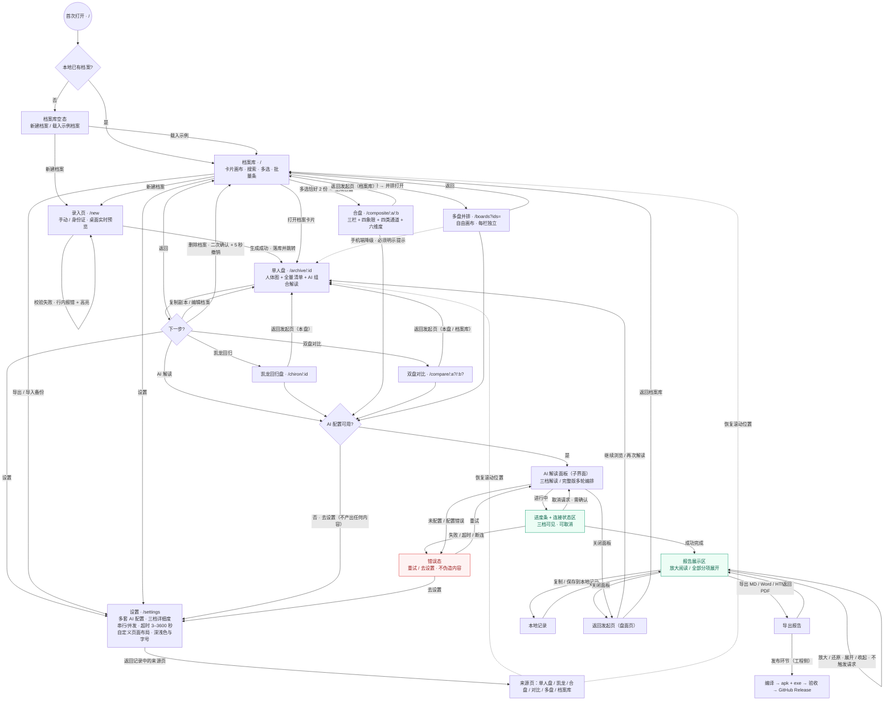

# HumanDesignTool v2.3.0 · 全站页面重设计 PRD

> **文档性质**：产品分析与设计输入（本阶段仅产出文档，**未修改任何现有代码或配置**）
> **撰写人**：产品经理 许清楚（Xu）
> **目标版本**：v2.3.0（当前 v2.2.1；版本号单一来源为根 `package.json`，发布前由工程侧统一）
> **适用语言**：简体中文
> **技术栈（保持现状）**：Vue 3 + TypeScript + Vite + vue-router（hash 模式）+ Pinia；桌面壳 / Android WebView 双端
> **项目名（snake_case）**：`human_design_tool_ui_redesign`
> **下游读者**：架构师高见远 → 工程师 → 编译打包与发布环节

---

## 0. 原始需求复述与硬约束

### 0.1 用户原始需求（逐字要点）

> 请重做现有全部页面的设计并更新对应实现，先梳理完整业务流程，明确每个业务节点对应的页面目标、信息层级、操作入口、状态反馈和跳转关系，使页面顺序与交互适配业务流程。在保持现有业务功能和数据含义不变、不新增无关功能的前提下，统一调整所有页面的布局与操作反馈。重点优化 AI 解读页面：降低误触风险，区分展示区域与可交互区域，解决放大或展开后仅显示一小部分内容的问题，确保主要内容在放大状态下完整、清晰、可读且易操作，ai 解读时候，增加进度条，或者显示目前和 ai 的连接怎么样了。交付更新后的页面设计、流程与页面对应关系、AI 解读页面关键调整点，以及可验证的验收标准。在全部完成之后记得编译，然后制作成 apk，打包编译制作成 apk 和 exe，验收，然后上传 git hub 到上面发布。

### 0.2 硬约束（本次设计不得突破）

| 编号 | 约束 | 本 PRD 的落实方式 |
| --- | --- | --- |
| C-1 | 保持现有业务功能与数据含义不变，不新增无关功能 | 第 7 章把「保持现状」与「明确不做」分开列全；所有调整只作用于布局、层级、反馈、跳转、状态可见性 |
| C-2 | 不改动人类图计算规则与数据结构；`MANDALA_OFFSET=29.875`、Gate 41 = `302.000°` 锁定 | 第 9 章 AC-25～AC-28 做冻结验收；本文档不提出任何引擎/类型改动 |
| C-3 | 未配置 AI 时不得伪造解读内容 | 第 6 章 AI-11、第 9 章 AC-24；连接状态同样**不得伪造服务端状态**（见 6.4） |
| C-4 | 不删除或清空 `.workbuddy/` | 第 9 章 AC-32 明确列为交付检查项 |
| C-5 | 已确认口径不再重新提问；新增业务规则不清楚时集中列出待确认项，确认前不推断 | 第 10 章仅列 4 条「边界口径」待确认，已确认事项不重问 |
| C-6 | 本阶段 PM 只做产品分析与 PRD，不改代码/配置 | 全文为设计输入，编译/打包/发布由工程与发布环节执行（第 7 章 P0-8、第 9 章 AC-29～AC-32） |

### 0.3 本 PRD 的边界声明

- **做**：全站 8 个路由页 + AI 解读面板的布局、信息层级、操作入口、状态反馈、跳转关系、页面顺序的重设计；AI 面板专项优化；验收标准。
- **不做**：任何新业务模块（Penta、行运/流日、分享、时间不确定录入、关系落库、AI 记录页等）、任何计算规则或数据结构改动、任何业务字段的增删与语义变更、任何构建脚本改动。
- 历史文档 `docs/review/业务流程审计与体系合规校验-2026-10-27.md` 中的 PF-xxx 大多属于「新增业务功能 / 体系规则修正」，**本次一律不纳入范围**；仅吸收其中与「页面顺序、跳转、状态反馈合理性」直接相关且**不改变业务功能**的部分（如移动端静默降级、返回目标、误导文案）。

---

# 第 1 章　简单 PRD（产品定义）

## 1.1 项目信息

| 项 | 值 |
| --- | --- |
| Language | 简体中文（与用户语言一致） |
| Programming Language | Vue 3 + TypeScript + Vite（沿用现状，非默认 React 栈；用户项目已锁定） |
| Project Name | `human_design_tool_ui_redesign` |
| 目标版本 | v2.3.0 |
| 原始需求 | 见 0.1 |
| 覆盖界面 | 8 个路由页 + 1 个关键子界面（AI 解读面板） |

## 1.2 产品目标（3 个正交目标）

| 编号 | 目标 | 衡量方式 |
| --- | --- | --- |
| G1 **流程适配** | 页面顺序、跳转与返回关系严格对应真实业务链路，用户从任一派生视图返回时回到发起页，不迷路、不丢上下文 | 第 3 章跳转关系表 100% 落地；AC-1～AC-5 全通过 |
| G2 **全站一致** | 8 个页面共用一套页面骨架、工具栏层级、卡片层级与五态反馈规范，操作入口位置与确认规则可预测 | 第 5 章规范逐条可核；AC-6～AC-14 全通过 |
| G3 **AI 解读可读且安全** | 展示区与可交互区分离、误触成本降到最低、放大/展开态内容完整可读、进度与连接状态全程可见，且不产生任何伪造内容 | 第 6 章问题表逐条闭环；AC-15～AC-24 全通过 |

> 三个目标分别对应「流程 / 一致性 / AI 专项」，互不重叠；G1、G2 是全站改造，G3 是用户点名的重点。

## 1.3 用户故事（格式：作为 [角色]，我希望 [能力]，以便 [收益]；等价 As a / I want / so that）

| 编号 | 用户故事 |
| --- | --- |
| US-1 | 作为**首次使用者**，我希望从档案库空态一步步被引导到「建档 → 单人盘 → 派生视图 → AI 解读 → 导出」，以便在每一步都知道「我在哪、能去哪、怎么回去」 |
| US-2 | 作为**多档案使用者**，我希望合盘 / 多盘 / 对比 / 凯龙这些派生页面返回时回到我发起它的那一页，以便不丢失正在看的盘面上下文 |
| US-3 | 作为**桌面与手机双端使用者**，我希望所有页面的按钮位置、加载/空态/错误/成功反馈长得一致，以便不用为每个页面重新学习操作，也不误触删除或取消 |
| US-4 | 作为**阅读长篇 AI 报告的人**，我希望把报告放大后有足够大的、可完整滚动的阅读区，且放大/展开不会只露出一小段、不会误触关闭或重新生成，以便一次性读完全文并安心操作 |
| US-5 | 作为**等待 AI 结果的人**，我希望在精简/详细/完整三档下都能看到进度条和「现在与 AI 的连接处于什么阶段、等多久了、还能等多久」，以便判断是继续等、取消还是去检查配置 |

## 1.4 简单 PRD 要素索引

| 要素 | 所在章节 |
| --- | --- |
| 产品目标 / 用户故事 | 第 1 章 |
| 需求池（P0 / P1 / P2） | 第 7 章（1.5 给出摘要） |
| UI 设计稿（文字/表格描述） | 第 8 章 |
| 待确认问题 | 第 10 章 |
| 完整业务流程（Mermaid） | 第 2 章 |
| 业务节点 ↔ 页面对应关系 | 第 3 章 |
| 页面顺序与交互适配 | 第 4 章 |
| 统一布局与操作反馈规范 | 第 5 章 |
| AI 解读页面专项 | 第 6 章 |
| 可验证验收标准 AC-1…AC-32 | 第 9 章 |

## 1.5 需求池摘要

| 级别 | 含义 | 条目数 | 摘要 |
| --- | --- | --- | --- |
| **P0 必做** | 用户明确要求的设计与交付 | 8 组 | 全站重设计、流程与对应表、顺序/跳转适配、统一布局与反馈、AI 面板五项专项、验收标准、编译打包出 apk+exe、GitHub 发布 |
| **P1 保持现状** | 业务功能与数据含义不变，仅保证不回归 | 6 组 | 档案/盘面/派生/设置/AI/导出的既有能力清单；计算锚点；护栏 |
| **P2 明确不做** | 新增无关功能与业务规则改动 | 9 项 | Penta、行运、分享、AI 记录页、关系落库、时间不确定、导入校验链改造、体系字段删改、构建脚本改动 |

---

# 第 2 章　完整业务流程梳理

## 2.1 主流程图（Mermaid）



## 2.2 节点与分支条件说明

| 节点 | 业务节点 | 分支条件 | 回退 / 退出路径 |
| --- | --- | --- | --- |
| S / G0 | 首次打开 | 本地档案数 = 0 / > 0 | 空态可「载入示例」回到档案库有数据分支 |
| E0 / H0 | 档案库 | 有搜索词无结果 / 无档案 / 有档案 | 清除搜索、新建、载入示例 |
| N0 | 建立档案 | 校验失败（姓名/日期/时间/身份证同意）→ 就地报错；成功 → 落库并跳单人盘 | 返回档案库；身份证模式必须补填时分 |
| P1 / G1 | 查看单人盘 | 档案不存在 / 盘面重算失败 / 正常 | 空态返回档案库；删除后 5 秒可撤销 |
| P2～P5 | 派生视图 | 前置条件：凯龙需档案存在、合盘需恰好 2 份且不同人、对比需 ≥2 份、多盘需 N 份 | 一律返回**发起页**（第 4 章 R-1） |
| AIC / CFG | 配置与 AI 解读 | AI 配置可用 / 未配置 / 配置错误 | 未配置 → 去设置 → 返回来源页；错误 → 重试 / 去设置 |
| PRG / RPT / ERR | AI 解读过程 | 进行中 / 成功 / 失败 / 超时 / 取消 | 取消、重试、关闭面板均回到盘面页，不改数据 |
| EXP / SAVE | 导出与返回 | 四格式导出 / 复制 / 保存本地记录 | 导出后返回面板，关闭后回盘面页 |
| REL | 编译打包发布 | 构建通过 → 产出 apk + exe → 验收 → GitHub Release | 构建失败则回到修复，不得发布 |

## 2.3 流程中的三条「不可伪造」红线

1. 未配置 AI 时，AI 面板**不渲染任何解读正文**，只渲染错误态与「去设置」入口（现状已具备，必须保留）。
2. 请求失败 / 超时 / 取消时，不写入占位文本、不拼接离线释义冒充 AI 结论；重新生成失败时旧内容可保留，但必须带常驻错误条标明「以下为上一次结果」。
3. **连接状态不得伪造服务端状态**：只呈现客户端可观测事实（配置校验、请求已发出、等待响应计时、超时设置、已耗时、最后活动时间、终态），不写「AI 正在思考」「服务端已连上」等无法验证的表述（详见 6.4）。

---

# 第 3 章　业务节点 ↔ 页面对应关系表

## 3.1 信息层级与操作口径定义（全表通用）

| 层级 | 定义 | 典型内容 |
| --- | --- | --- |
| **一级** | 页面身份与核心对象，进入页面 1 秒内必须识别 | 页面标题、档案名/盘名、人体图主图或三栏主图、当前 AI 报告标题 |
| **二级** | 主要区块与功能区 | 信息卡、激活清单、维度条、中心四象限、进度/连接状态区、导出区 |
| **三级** | 明细条目与辅助说明 | 闸门/通道行、释义小字、星体表、跳过项、时区/DST 提示、字数统计 |

| 操作类别 | 定义 | 放置规则 |
| --- | --- | --- |
| **主操作** | 该页推进主流程的唯一动作，每页 ≤ 1 个 | 工具栏右侧或底部固定条最右/最显著位 |
| **次操作** | 查看、筛选、切换、复制、导出、设置 | 工具栏右侧次位或区块内工具条 |
| **危险操作** | 删除、清空、取消在途请求、重新生成（覆盖旧内容） | 独立分组、需二次确认；删除类必须提供 5 秒撤销 |

| 状态 | 统一表现 |
| --- | --- |
| 加载 | 骨架占位 + 明确的「正在做什么」文案；> 1 秒的操作必须带进度/连接状态与取消入口 |
| 空态 | 图示 + 一句原因 + 一个主操作 + 可选次操作（如「载入示例」） |
| 错误 | 原因 + 修复路径 + 「重试」/「去设置」；不得静默降级 |
| 成功 | toast（≤ 3 秒）；破坏性结果附 5 秒「撤销」 |
| 进行中 | 常驻状态区（进度条 / 连接阶段 / 已耗时 / 超时剩余 / 取消），不可被滚动隐藏 |

## 3.2 总览表（覆盖 8 路由 + 1 子界面）

| 节点 | 业务节点 | 页面 / 路由 | 页面目标（一句话） |
| --- | --- | --- | --- |
| B1 | 首次打开 / 档案库 | `ArchiveHomeView` · `/` | 找到并打开档案，或进入建档/派生流程 |
| B2 | 建立档案 | `EntryView` · `/new` | 采集出生信息并生成人类图，失败不落库 |
| B3 | 查看单人盘 | `SingleChartView` · `/archive/:id` | 完整阅读一张本命盘并触发派生与 AI 解读 |
| B4 | 凯龙回归 | `ChironView` · `/chiron/:id` | 阅读扩展层回归盘，明确「不替换本命盘」 |
| B5 | 多盘并排 | `MultiBoardView` · `/boards` | 同屏并列 N 张盘，每栏独立 |
| B6 | 合盘 | `CompositeView` · `/composite/:aId/:bId` | 阅读两人关系场的全部既有输出 |
| B7 | 双盘对比 | `CompareView` · `/compare/:aId?/:bId?` | 并排比较两份完整盘与关系差异 |
| B8 | 设置与数据 | `SettingsView` · `/settings` | 配置 AI / 外观 / 布局 / 备份，返回来源页 |
| B9 | **AI 解读面板** | `AiReadingPanel.vue`（Teleport 子界面，无独立路由；被 B3/B4/B5/B6/B7 共用） | 安全、完整、可读地呈现 AI 报告与全过程状态 |

## 3.3 B1　档案库 `/`

| 维度 | 内容 |
| --- | --- |
| 页面 / 路由 | `ArchiveHomeView.vue` · `/` |
| 页面目标 | 让用户找到档案、批量选择并进入任一业务分支；空库时给出明确起点 |
| 信息层级 | 一级：页面标题「档案库」+ 搜索框 + 档案卡片集合；二级：桌面自由画布 / 手机竖向列表、批量操作条、已选计数「已选 N / 2」；三级：卡片内的姓名、出生日期时间、出生地、类型摘要、示例档案提示 |
| 操作入口 | 主：新建档案；次：搜索、载入示例档案、打开卡片、勾选多选、批量「并排打开」「生成合盘」「清除选择」、设置、深浅色；危险：删除单份 / 批量删除（二次确认 + 5 秒撤销） |
| 状态反馈 | 加载：档案读取中骨架；空态：①「还没有档案」+ 新建 + 载入示例，②「没有匹配的档案」+ 清除搜索；错误：持久化失败 toast、数据读取失败顶部横幅；成功：载入示例 / 删除 / 撤销 toast；进行中：批量删除确认后的 5 秒撤销条 |
| 跳转关系 | 从：启动默认、任意页「返回档案库」、非法路径重定向；可去：`/new`、`/archive/:id`、`/boards?ids=`、`/composite/:a/:b`、`/settings`；返回：作为根，无上级；派生页统一返回此处或其发起页 |

## 3.4 B2　建立档案 `/new`

| 维度 | 内容 |
| --- | --- |
| 页面 / 路由 | `EntryView.vue` · `/new` |
| 页面目标 | 准确采集出生时刻并生成本命盘；写入失败不得提示成功、不得跳转 |
| 信息层级 | 一级：标题「新建档案」+ 录入模式切换（身份证快捷 / 手动录入）+ 桌面右侧实时预览；二级：身份证区、基本信息区、出生时间区、出生地区、提交条；三级：分钟精度警告、DST 说明、经纬度不参与排盘说明、隐私同意说明、字段级错误文案 |
| 操作入口 | 主：「生成人类图」（防重复提交）；次：解析身份证、切换模式、选择时区/省市、返回、设置；危险：无（本页不含删除类操作） |
| 状态反馈 | 加载：提交中按钮 loading + 「生成中…」；空态：预览区「填写出生日期与时间后自动预览」；错误：字段行内错误 + 首个错误滚动高亮 + toast、预览计算失败红字原因、保存失败 toast；成功：「已生成人类图」toast + 跳单人盘；进行中：实时预览随输入即时刷新（属轻量计算，不阻塞） |
| 跳转关系 | 从：档案库空态/工具栏新建、各页 `@new`、设置页新建；可去：`/archive/:id`（成功）、`/settings`；返回：`/`（返回按钮） |

## 3.5 B3　单人盘 `/archive/:id`

| 维度 | 内容 |
| --- | --- |
| 页面 / 路由 | `SingleChartView.vue` · `/archive/:id` |
| 页面目标 | 作为**流程枢纽**：完整呈现一张本命盘，并派生出凯龙 / 对比 / AI 解读 / 编辑 / 复制 |
| 信息层级 | 一级：档案名 + 人体图主图 + 显/潜两翼星体；二级：盘面信息（类型/权威/定义/角色）、激活通道/闸门/九中心清单、轮回交叉、人生轨迹、AI 综合解读组合条、对象详情卡；三级：小度数/色下调基开关、闸门释义、星体洞察、DST 告警黄条、模块拖拽顺序 |
| 操作入口 | 主：「全盘 AI 解读」（工具栏，全站唯一主操作）；次：编辑、复制副本、凯龙回归、双盘对比、点闸门/通道/中心看详情、批量选中后 AI 解读、设置、深浅色；危险：删除档案（二次确认 + 5 秒撤销）、重新生成 AI 结果（覆盖旧内容，需明确区分） |
| 状态反馈 | 加载：盘面补算中、AI 请求中骨架/进度；空态：档案不存在、盘面重算失败（含原因与修复路径）；错误：计算异常、AI 分类错误（HTTP/超时/网络/格式/未配置）；成功：复制副本、撤销删除、AI 完成；进行中：AI 面板常驻进度/连接状态区、完整版分项进度 |
| 跳转关系 | 从：`/` 打开卡片、`/new` 生成成功、设置页返回、派生页返回；可去：`/chiron/:id`、`/compare/:id`、`/settings`、`/new`、AI 面板（子界面）、复制副本到新 `/archive/:newId`；返回：`/`（工具栏返回）；**派生页应返回本页**（第 4 章 R-1） |

## 3.6 B4　凯龙回归 `/chiron/:id`

| 维度 | 内容 |
| --- | --- |
| 页面 / 路由 | `ChironView.vue` · `/chiron/:id` |
| 页面目标 | 阅读约 50 岁前后的独立周期盘，并始终明确「扩展层、不替换本命盘」 |
| 信息层级 | 一级：标题「凯龙回归图 · 档案名」+ 扩展层常驻标注 + 回归时刻信息；二级：人体图、回归盘结构（角色/中心/通道/闸门）、激活清单、AI 解读入口；三级：本命凯龙落点、回归年龄、口径约束小字 |
| 操作入口 | 主：「凯龙图 AI 解读」；次：返回本盘、设置、新建、点闸门看释义；危险：无删除类操作 |
| 状态反馈 | 加载：回归时刻求解中；空态：档案不存在、求解失败（提示检查出生时间）；错误：计算异常降级为空态 + 原因；成功：AI 解读完成；进行中：AI 面板进度/连接状态 |
| 跳转关系 | 从：`/archive/:id` 工具栏「凯龙回归」；可去：`/settings`、AI 面板；返回：**`/archive/:id`**（现状已正确，作为全站返回范例，保持不变） |

## 3.7 B5　多盘并排 `/boards`

| 维度 | 内容 |
| --- | --- |
| 页面 / 路由 | `MultiBoardView.vue` · `/boards`（`?ids=` 为准，store 兜底） |
| 页面目标 | 同屏并列 N 张独立盘面，每栏可独立收起星体表 / 关闭 |
| 信息层级 | 一级：标题「多盘并排」+ 并列栏头（姓名 + 出生信息）；二级：每栏人体图、星体表、盘面信息；三级：栏内收起/展开状态、单栏重算失败提示 |
| 操作入口 | 主：无新增（本页为阅读页，主操作在档案库「并排打开」）；次：收起/展开星体表、关闭单盘、点闸门看详情、AI 深度解读、返回、设置；危险：关闭该盘（不删数据，无需二次确认） |
| 状态反馈 | 加载：各栏盘面补算；空态：「没有可显示的盘」+ 返回档案库；错误：单栏「重算失败：原因」就地提示，不整栏消失；成功：关闭栏后 URL 同步；进行中：AI 面板进度/连接状态 |
| 跳转关系 | 从：`/` 批量「并排打开」；可去：`/settings`、AI 面板；返回：`/`；**手机端降级到 `/archive/:id` 时必须明示提示**（第 4 章 R-2） |

## 3.8 B6　合盘 `/composite/:aId/:bId`

| 维度 | 内容 |
| --- | --- |
| 页面 / 路由 | `CompositeView.vue` · `/composite/:aId/:bId` |
| 页面目标 | 完整呈现两人关系场的既有输出（三栏、四象限、四类通道、六解读维度） |
| 信息层级 | 一级：标题「合盘」+ A｜B｜合图 三栏（手机为 Tab + 单图）；二级：解读维度条（含自定义议题）、显示过滤器、关系主题、中心四象限、关系通道动力学、行星落点；三级：共享通道计数、维度所需读取内容、独立缓存说明、每类通道释义 |
| 操作入口 | 主：「生成「当前维度」解读」（工具栏/手机底部）；次：切换维度、切换 A/B/合图 Tab、仅看共享通道、点闸门看详情、单对象 AI 解读、返回、设置；危险：无删除类操作 |
| 状态反馈 | 加载：合盘计算、AI 请求；空态：同一人合盘「需要两位不同的人」、档案缺失「无法生成合盘」；错误：AI 分类错误；成功：解读完成；进行中：AI 面板进度/连接状态 |
| 跳转关系 | 从：`/` 多选恰好 2 份「生成合盘」；可去：`/settings`、AI 面板、对象详情面板；返回：**发起页 `/`**（第 4 章 R-1 统一口径） |

## 3.9 B7　双盘对比 `/compare/:aId?/:bId?`

| 维度 | 内容 |
| --- | --- |
| 页面 / 路由 | `CompareView.vue` · `/compare/:aId?/:bId?` |
| 页面目标 | 并排比较两份完整盘，并以关系场口径生成 AI 解读 |
| 信息层级 | 一级：标题「双盘对比」+ 左右两栏档案选择器与盘面元信息（类型/权威/角色）；二级：两张完整人体图、双盘 AI 解读入口；三级：单栏盘面缺失提示、同人自动规避提示 |
| 操作入口 | 主：「双盘 AI 解读」（条件：两份可用盘面）；次：左右档案下拉选择（就地更换）、返回、设置、点闸门看释义；危险：无删除类操作 |
| 状态反馈 | 加载：两栏盘面补算、AI 请求；空态：档案不足 2 份「请先新建或载入示例」、单栏盘面缺失就地提示；错误：AI 分类错误、未选择两份可用盘面 toast；成功：解读完成；进行中：AI 面板进度/连接状态 |
| 跳转关系 | 从：`/archive/:id` 工具栏「双盘对比」（此时仅带 aId）；可去：`/settings`、AI 面板；返回：**发起页**（从单人盘来则回该单人盘，从档案库来则回档案库；第 4 章 R-1） |

## 3.10 B8　设置与数据 `/settings`

| 维度 | 内容 |
| --- | --- |
| 页面 / 路由 | `SettingsView.vue` · `/settings` |
| 页面目标 | 完成 AI / 外观 / 布局 / 数据配置，并**返回进入设置前的那一页** |
| 信息层级 | 一级：标题「设置」+ 返回按钮（文案随来源页变化）；二级：多套 AI 配置、解读详细度三档、串行/并发、超时 3–3600 秒、自定义页面布局、深浅色/字号、导入导出备份、清空缓存/清空全部数据；三级：配置字段级校验、探测结果、导入被拒明细、版本号与说明小字 |
| 操作入口 | 主：保存 / 新增并启用当前 AI 配置；次：测试连接、切换详细度/步模式、调整布局与字号、导入、导出备份、返回、新建；危险：删除 AI 配置（确认）、清空 AI 缓存（确认）、清空全部本地档案与缓存（不可撤销，二次确认） |
| 状态反馈 | 加载：配置探测中；空态：无 AI 配置时显示引导（不填也能排盘与看离线释义）；错误：字段级错误 + toast、导入被拒明细面板、持久化失败提示；成功：配置已更新 / 已导入 N 份（跳过 M 份）/ 已导出备份 toast；进行中：测试连接状态 |
| 跳转关系 | 从：任意页工具栏齿轮、AI 面板「去设置」、档案库；可去：`/new`、AI 面板错误态返回；返回：**来源页**（现有 `SETTINGS_RETURN_KEY` 机制已实现「返回完整盘/凯龙盘/合盘/对比/多盘/档案库」，保持不变并作为全站范例） |

## 3.11 B9　AI 解读面板（关键子界面）

| 维度 | 内容 |
| --- | --- |
| 页面 / 路由 | `AiReadingPanel.vue`（`Teleport to="body"` 的 `role="dialog"` 子界面，**无独立路由**）；被 B3/B4/B5/B6/B7 五个盘面页共用，Props 一致 |
| 页面目标 | 在不误触、不伪造的前提下，完整清晰地呈现 AI 报告，并让全过程状态可见可操作 |
| 信息层级 | 一级：报告标题 + 档位标识（AI READING · 精简/详细/完整）+ 固定操作区；二级：**状态区**（进度条 + 连接状态）、导出区、报告工具条（共 N 个分项 · 约 X 字 · 全部展开/收起）、报告分组（一～五）；三级：分项标题与正文、跳过项提示、ETA、已耗时、字数、页眉上下文（范围/引用/盘面名） |
| 操作入口 | 主：放大 / 还原阅读（纯展示控件）；次：复制、保存到本地记录、四格式导出（MD/Word/HTML/PDF）、全部展开/收起、分项展开/收起、关闭；危险：**重新生成**（覆盖旧内容）、**取消请求**（中断在途）、删除类无；所有危险操作进行中需二次确认 |
| 状态反馈 | 加载：骨架 + 「正在…」+ 连接阶段 + 取消；空态：「暂无内容」；错误：常驻错误条（原因 + 「预留配置」说明 + 重试 / 去设置），重新生成失败时旧内容保留在下方并标注；成功：完成态 + 可导出；进行中：三档统一进度条 + 连接状态（完整版另有 done/total、当前项、ETA、跳过项） |
| 跳转关系 | 从：B3/B4/B5/B6/B7 任一 AI 触发点；可去：`/settings`（去设置）、四格式导出、复制到剪贴板、保存到本地记录；返回：关闭/取消后**回到发起它的盘面页**，且该页滚动位置与已选对象不被重置 |

> **B9 是本次唯一跨 5 个路由的共用子界面**，其布局与状态规范必须做成单一组件配置，不允许各页各写一套（避免 5 份实现漂移）。

---

# 第 4 章　页面顺序与交互适配建议

## 4.1 现状不合理之处与调整后顺序

> 前提：以下全部是**跳转关系、顺序、提示文案与反馈位置的调整**，不新增功能、不改数据、不改计算。

| 编号 | 现状问题（证据） | 调整后顺序 / 交互 | 为什么不新增功能 |
| --- | --- | --- | --- |
| **R-1** | 派生页返回目标不统一：凯龙返回 `/archive/:id`（正确），但合盘 / 对比 / 多盘 / 单人盘的返回一律落 `/`；用户从单人盘点「双盘对比」后回不到原盘 | 统一为「**返回发起页**」：记录进入派生页时的来源 fullPath（复用设置页已有 `SETTINGS_RETURN_KEY` 的同类机制），返回按钮文案随来源变化（「返回本盘」「返回档案库」）；设置页现存的来源记录逻辑保持不变并作为范例 | 只是路由返回目标与文案，不新增页面、不新增数据实体 |
| **R-2** | 多盘并排在手机端 `router.replace('/archive/:id')` **静默降级**，用户不知道「并排」为何变成「单张」 | 降级前给明确状态反馈：「手机端不提供并排，已为你打开第 1 份档案」，并提供「返回档案库」入口；不提供横向滑动版（那是新形态） | 只把已有降级从「静默」改为「明示」，不新增视图 |
| **R-3** | 双盘对比从单人盘进入只带 aId，bId 自动取 `archives[1]`，用户不知道当前在和谁比 | 进入时在两栏选择器上方明示「当前对比：A × B」，并提示「可直接在下方下拉框更换任一侧」；已有两个 `<select>` 保持不变，不新增选择器 | 仅增加状态说明与就地提示，复用已有控件 |
| **R-4** | AI 配置状态只在「点了 AI 解读 → 报错」后才暴露，属于流程末端才暴露前置条件 | 在 5 个盘面页的 AI 主操作旁统一显示「AI 配置状态」标识（已配置 / 未配置），未配置时把「去设置」作为明确次操作；AI 面板错误态保留「去设置」 | 只增加状态可见性，不改配置功能、不新增配置项 |
| **R-5** | 流程末端「导出」分散且易混：AI 报告四格式导出在面板，「导出备份 JSON」在设置页，两者都叫「导出」 | 统一文案与位置：面板内固定为「导出报告（MD/Word/HTML/PDF）」，设置页固定为「导出备份（档案 JSON，不含身份证号与 AI Key）」；两者返回目标各自明确 | 仅文案与分组，不改导出实现 |
| **R-6** | 档案库选中 >2 份时点卡片「加入合盘」提示「请再选择一份」，与实际条件矛盾 | 按 `length > 2` 给「合盘只能选 2 份，当前已选 N 份，请先取消多余的档案」；`length === 1` 才提示「请再选择一份」 | 仅反馈文案分支，不改合盘校验逻辑 |
| **R-7** | 代价操作（删除、取消在途请求、重新生成、关闭面板）与展示区/常用操作混排，且进行中关闭无保护 | 全部收拢到固定操作区并分组；进行中关闭/取消/重新生成需二次确认；点遮罩一律不关闭（第 5、6 章） | 仅布局与安全边界，不改操作语义 |
| **R-8** | 设置页已做到「返回来源页 + 恢复滚动位置」，但未推广 | 将 R-1 的返回机制推广到全部派生页；设置页实现保持不变 | 复用既有机制 |

## 4.2 调整后的推荐页面顺序（主链路，不新增页面）

```
① /  档案库（根 / 枢纽 A）
   ├─ 空态 → ② /new 录入 → ③ /archive/:id 单人盘（枢纽 B）
   └─ 有档案 → ③ /archive/:id
③ 单人盘
   ├─ ④ /chiron/:id 凯龙回归 ──返回──> ③
   ├─ ⑤ /compare/:a?/:b? 双盘对比 ──返回──> ③（或 ①，按来源）
   ├─ ⑥ /settings 设置 ──返回──> 来源页（现有机制）
   └─ ⑦ AI 解读面板（子界面）──关闭──> ③
① 档案库
   ├─ ⑧ /composite/:a/:b 合盘 ──返回──> ①
   ├─ ⑨ /boards?ids= 多盘并排 ──返回──> ①（手机明示降级到 ③）
   └─ ⑥ /settings 设置 / 备份导入导出
⑦ AI 解读面板
   ├─ 放大阅读 / 分项展开（纯展示，不触发请求）
   ├─ 导出报告 MD / Word / HTML / PDF ──返回──> ⑦
   ├─ 复制 / 保存到本地记录 ──返回──> ⑦
   └─ 错误 → 重试 → ⑦；去设置 → ⑥ → 返回来源页

末端交付（工程侧）：编译 → apk + exe → 验收 → GitHub Release
```

> 顺序原则：**档案库是根、单人盘是枢纽、派生视图是二级页、AI 面板是覆盖在盘面之上的子界面、导出/返回是终点**。任何一步的「返回」都指向用户实际发起该步的页面，而不是强制回到根。

---

# 第 5 章　统一布局与操作反馈规范（可直接实施）

> 编号规则：`SK` 页面骨架、`TB` 工具栏、`CD` 卡片层级、`BT` 按钮与确认、`FB` 状态反馈、`MB` 手机退化、`TX` 文案。数值沿用现有 CSS 变量与实现，避免与工程冲突。

## 5.1 页面骨架（SK）

| 编号 | 规则 |
| --- | --- |
| SK-1 | 所有 8 个页面统一为「全局层 + 页面层」：`WindowChrome`（桌面自绘标题栏）/ `GlassBackdrop` → `AppToolbar`（sticky 顶栏）→ `main.content`（唯一滚动区）→ 可选底部固定操作条 → 浮层。禁止页面内再嵌一层全局级滚动容器 |
| SK-2 | 浮层 z-index 顺序固定：`--z-toolbar` < `--z-drawer`（侧面板）< `--z-dialog`（抽屉/对话框，含 AI 面板）< `--z-toast`；AI 面板 mask 与 panel 必须成对（mask = dialog、panel = dialog+1） |
| SK-3 | 内容区最大宽度按页固定：档案库 1400px、录入 1200px、单人盘默认 840px（自定义布局时 ≤1400px）、合盘/对比 1280px、多盘 1500px、设置 880px；全部 `margin: 0 auto`、`box-sizing: border-box` |
| SK-4 | 页面底部为固定操作条时，`main` 的 `padding-bottom` 必须 ≥ 操作条高度 + `env(safe-area-inset-bottom)`，保证最后一条内容可完整滚出 |
| SK-5 | 页面级通知（数据读取失败、DST 告警、扩展层标注）统一为**紧贴工具栏下方的全宽横幅**，不覆盖内容、不自动消失（可手动关闭），且不随内容滚动隐藏 |

## 5.2 工具栏层级（TB）

| 编号 | 规则 |
| --- | --- |
| TB-1 | 高度固定：桌面 56px、手机 52px；左侧 = 返回按钮（带来源文案）+ 页面标题 + 可选上下文标签；右侧 = 搜索 → 次操作 → 主操作 → 设置/主题/帮助 |
| TB-2 | **每页主操作 ≤ 1 个**，位于右侧最显著位；次操作用 ghost / 图标按钮；危险操作不得占据主操作位 |
| TB-3 | 右侧按钮在 ≤768px 隐藏文字按钮并移入底部固定条（现状已如此，保持不变）；搜索框在手机端隐藏，但必须提供等价入口（档案库空态与列表内筛选） |
| TB-4 | 返回按钮文案必须反映真实目标（「返回本盘」「返回档案库」「返回合盘」…），不得一律写「返回」；标题超长省略号截断，不换行、不挤压右侧操作区 |

## 5.3 卡片层级（CD）

| 编号 | 规则 |
| --- | --- |
| CD-1 | 三级卡片视觉统一：L1 页面容器（无边框、只控宽度与间距）→ L2 区块卡（统一 `border`/`--radius-*`/`padding`/标题行）→ L3 卡内条目（清单行、chip、可展开行） |
| CD-2 | L2 区块卡必须有可见标题或功能标签（`t-title` / `t-xs` 标签），标题行右侧为「该区块专属次操作」，不得放置跨区块操作（如删除整份档案） |
| CD-3 | L3 可展开条目（人生轨迹、闸门/通道/中心、报告分项）统一为「标题行 + 展开箭头 + 正文区」，展开/收起只影响展示，不触发任何网络请求或内容改写 |
| CD-4 | 卡片之间间距统一用 `--sp-*` 变量；卡片内不出现横向滚动（长文本换行、`overflow-wrap`），除非是明确的代码/表格展示 |

## 5.4 按钮与确认（BT）

| 编号 | 规则 |
| --- | --- |
| BT-1 | 四类按钮语义固定：`主`（实心，推进主流程）、`次`（ghost/描边，查看与切换）、`危险`（danger 色，删除/清空/中断）、`图标`（仅图标时必须带 `aria-label` 与 tooltip） |
| BT-2 | 所有可点击元素手机端最小热区 ≥ 44×44px；相邻按钮间距 ≥ 8px；危险操作与常用操作分组间距 ≥ 12px |
| BT-3 | **危险操作一律二次确认**：删除档案、清空缓存、清空全部数据、删除 AI 配置、取消在途 AI 请求、进行中重新生成、进行中关闭 AI 面板；确认文案必须写明后果（例：「取消后本次结果不会生成，已生成内容保留」） |
| BT-4 | 删除类操作成功后必须提供 **5 秒撤销**（现状已具备，保持不变）；撤销期间 toast 常驻且不被新 toast 覆盖 |
| BT-5 | 任何会触发请求或写入的按钮，`loading` 期间一律 `disabled`；防重复提交窗口 ≥ 300ms；同一按钮 300ms 内连续点击只生效 1 次 |

## 5.5 五态反馈（FB）

| 编号 | 规则 |
| --- | --- |
| FB-1 **加载** | ≤ 1 秒用骨架占位；> 1 秒必须升级为「状态区」：明确的「正在做什么」文案 + 进度条或连接阶段 + 取消入口；禁止只显示静态「请稍候…」 |
| FB-2 **空态** | 统一三段式：一句原因 + 一个主操作 + 可选次操作（如「载入示例档案」）；区分「无数据」与「搜索无结果」两种空态 |
| FB-3 **错误** | 统一三段式：错误原因（人话，不裸露堆栈）+ 修复路径 + 行动按钮（重试 / 去设置 / 返回）；错误条常驻直到用户处理或成功覆盖；**禁止静默降级**（含预览计算失败、单栏重算失败、导入被拒） |
| FB-4 **成功** | toast ≤ 3 秒；破坏性结果附 5 秒撤销；写入失败时**绝不**提示成功、绝不跳转 |
| FB-5 **进行中** | 常驻状态区不可被内容滚动隐藏；至少含：当前阶段、进度（有明确总量时）、已耗时、超时上限/剩余、取消入口；终态（成功/失败/超时/已取消）保持可见 ≥ 3 秒或转为错误态，不得瞬间消失 |
| FB-6 **状态唯一源** | 同一时刻同一业务只显示一个进行中状态区，不允许骨架条 + 进度条 + toast 三种「进行中」表达同时出现造成歧义 |

## 5.6 手机端退化规则（MB）

| 编号 | 规则 |
| --- | --- |
| MB-1 | ≤768px 一律单列；合盘三栏退化为「A / B / 合盘」Tab + 单图；对比两栏上下堆叠；多盘明示降级（R-2） |
| MB-2 | 工具栏精简：隐藏搜索框、隐藏文字次操作，操作移入底部固定条；底部条必须带 `env(safe-area-inset-bottom)` 且不遮挡 `main` 末尾内容 |
| MB-3 | 抽屉/侧面板在手机端全宽（100vw），避开系统状态栏与刘海（`env(safe-area-inset-top)`）；AI 面板手机端**默认即为放大阅读态** |
| MB-4 | 手机端不渲染 `FloatingDock`（现状已如此）；任何浮层打开时，其下方交互必须被遮罩阻断，且遮罩点击不得触发破坏性关闭（R-7） |
| MB-5 | 放大/展开态下，操作区固定在顶部或底部，不随正文滚动；正文区独立滚动，首尾内容均可达 |
| MB-6 | 深浅色、字号（`--font-scale`）设置对所有页面与 AI 面板同步生效，放大态不覆盖用户字号选择 |

## 5.7 文案统一（TX）

| 编号 | 规则 |
| --- | --- |
| TX-1 | 状态文案模板：`正在{动作}…（已等待 Xs，超时设置 Ys）`；终态：`已完成 / 请求失败：{原因} / 已超时 / 已取消` |
| TX-2 | 连接状态只描述**客户端可观测事实**：「配置校验通过」「请求已发出，等待响应」「已等待 Xs」「最后一次活动 Xs 前」「超时上限 Ys」；禁止「AI 正在思考」「服务端已连接」「模型正在生成第 N 段」等无法验证的表述 |
| TX-3 | 同一对象全站同名：档案、本命盘、凯龙回归盘、合盘、双盘对比、多盘并排、AI 解读、导出报告、导出备份；危险操作文案含后果与可撤销性 |

---

# 第 6 章　AI 解读页面专项：问题清单与产品级调整点

## 6.1 现状定位（供架构师定位，不代表改动方案已定）

| 现状证据 | 对应用户痛点 |
| --- | --- |
| `AiReadingPanel.vue`：`<div class="mask" @click="emit('close')" />`，且 `useAiReading` 中 `watch(open)` 会在关闭时 `abort()` 在途请求 | **误触**：点遮罩即关闭并中断生成，无确认、无「最小化保留」 |
| 头部 `.actions` 把「复制 / 保存 / 重新生成 / 关闭」四个图标按钮密集并排；`.export-bar` 四个导出按钮紧贴；「取消」散落在 `.progress-top` 与 `.skeleton-block` 两处；「重试」在 `.error-state` | **误触 + 区域混排**：危险/常规/展示控制同级同区，无视觉分组 |
| 面板固定 `width: 520px; max-width: 92vw`，桌面右侧抽屉、手机 100%；`.body { flex:1; overflow-y:auto }`；`.report-item { overflow:hidden }`；完整版「全部展开」后长正文被压在窄抽屉内 | **放大/展开后只显示一小部分内容** |
| 无「放大 / 还原」阅读态；`.text` 字号随 `--font-scale`，但窄栏 + 无独立滚动容器 + 分项 `overflow:hidden` | **放大态可读性不足** |
| `v-if="progress"` 才渲染进度条（仅「完整」档多轮编排）；「精简/详细」档只有骨架 + `正在请求 AI 解读，请稍候…` 静态文案 | **进度不可见** |
| 只有 `loading: boolean` + `error: string`，无阶段、已耗时、超时剩余、最后活动、连接终态 | **看不到「目前和 AI 的连接怎么样了」** |
| 已有 `AiProgress { done,total,current,phase,elapsedMs,etaMs,skipped,failed }` 与 5 类 `AiError` 分类 | 可复用为状态数据源，**不需新增业务数据结构** |

## 6.2 展示区域 vs 可交互区域（明确划分）

| 区域 | 包含内容 | 允许的行为 | 禁止的行为 |
| --- | --- | --- | --- |
| **A. 固定头部区**（可交互） | 档位标识、报告标题、放大/还原、复制、保存、重新生成、关闭、四格式导出 | 点击操作区按钮；查看标题 | 放置正文；正文滚动时隐藏或位移到不可达 |
| **B. 状态区**（只读 + 1 个取消） | 进度条、连接阶段、已耗时、超时剩余、done/total、当前项、ETA、跳过项 | 查看；仅「取消请求」一个操作（需确认） | 放置导出/重试/关闭等其它操作；被正文滚动覆盖 |
| **C. 报告工具区**（展示控制） | 共 N 个分项 · 约 X 字、全部展开 / 全部收起、分项展开 / 收起 | 展开、收起（纯展示） | 触发任何 AI 请求、改写内容、清空报告 |
| **D. 展示区**（只读） | Markdown 正文、模块化分项正文、全盘整合、最终总结论、跳过项提示、页眉上下文 | 阅读、选中文本、滚动、通过 A 区按钮复制 | 内嵌关闭 / 取消 / 重新生成 / 删除 / 导出等任何破坏性或业务操作 |
| **E. 错误区**（可交互） | 错误原因、预留配置说明、重试、去设置 | 重试（复用上次参数）、去设置 | 生成任何占位或伪造正文；自动关闭 |

> **判定口径**：「展示控制」（放大/还原、展开/收起）属于 C 类，**不是业务操作**；凡会触发网络请求、中断请求、改写内容或删除数据的，一律归 A/B/E 区并遵守确认规则。A 区与 D 区之间必须有可测量的分隔（≥ 1px 边框，或 ≥ 8px 间距 + 不同背景色）。

## 6.3 问题 → 期望行为 → 可验证标准（逐条对应用户痛点）

| 编号 | 问题（用户痛点） | 期望行为 | 可验证标准 |
| --- | --- | --- | --- |
| **AI-01** | 误触：点遮罩直接关闭并中断在途请求 | 遮罩点击**一律不关闭**面板；关闭只能通过 A 区显式「关闭」按钮；进行中关闭需二次确认并告知「将中断本次生成」 | 面板打开后进行中单次点击遮罩 10 次：面板仍打开、请求未中断、内容未变；点「关闭」弹确认框，取消后面板保持、确认后才中断 |
| **AI-02** | 误触：头部 4 个图标按钮密集，重新生成与复制/保存/关闭同级 | A 区按「查看类（复制/保存/导出）」「代价类（重新生成/关闭）」分组，组间距 ≥ 12px；代价类用描边/警示样式且 `aria-label` 明确；手机端热区 ≥ 44×44px | 目视/量测分组间距 ≥ 12px；「重新生成」在 `loading` 期间 `disabled`；300ms 内连点 5 次只发起 1 次请求 |
| **AI-03** | 误触：进行中「取消」散落两处且无确认 | 取消统一收拢到 B 状态区**唯一入口**；进行中点击弹确认（写明「本次结果不会生成，旧内容保留」）；终态后取消入口隐藏 | 进行中面板内「取消」按钮数量 = 1；确认前请求不中断；取消后状态区显示「已取消」≥ 3 秒 |
| **AI-04** | 展示区与可交互区混在一起，无法一眼分清哪里能点 | 按 6.2 的 A/B/C/D/E 五区重排；D 区只读，A/B/C/E 固定不随正文滚动；A 与 D 之间有 ≥1px 分隔线或 ≥8px 间距 + 不同背景 | D 区内可点击的破坏性/业务控件数 = 0；滚动正文到任意位置，A/B 区始终可见且位置不变 |
| **AI-05** | 放大或展开后仅显示一小部分内容 | 提供「放大 / 还原」阅读态：桌面 ≥ 90vw × ≥ 85vh（扣除 `--chrome-h` 与安全区），手机 100% 视口；D 区独立 `overflow-y:auto`；分项展开后**不设 `overflow:hidden` 截断**，全部展开后一次连续滚动可读到最后一个分项末尾 | 「完整」档点「全部展开」后，从首段连续滚动到底部可读取全部 N 个分项 + 整合 + 总结论；任一时刻不存在「仅露出正文前 1/3 且无法继续滚动」的状态 |
| **AI-06** | 放大态主要内容不够完整、清晰、可读 | 放大态 D 区高度 ≥ 视口高度 65%（扣除固定 A/B/C/E 区），宽度 ≥ 视口宽度 90%（桌面）；`scrollWidth ≤ clientWidth`（**无横向溢出**）；字号沿用 `--font-scale`、行高 ≥ 1.7；长表格/长代码块允许局部横向滚动但不撑破容器 | 在 1280×800 与 390×844 两种视口实测：D 区高 ≥ 65vh、`scrollWidth - clientWidth ≤ 0`、正文末尾可见；放大/还原前后报告文本逐字一致 |
| **AI-07** | 放大态不易操作 | 放大/还原**不改变内容、不触发新请求、不重置已展开状态、不丢失滚动位置**（或明确回到顶部且首屏可见）；A/B/C 区在放大态仍全部可达且不遮挡 D 区首尾；`Esc` 只作用于确认框，不直接关闭面板 | 放大 → 滚动到中段 → 还原 → 放大：滚动位置与展开状态保持一致（或按明确规则归位且可见）；全程网络请求数 = 0 |
| **AI-08** | AI 解读时没有进度条 | **三档统一状态区**：精简/详细档显示「阶段 + 不确定进度条（条纹/循环动画，标明无总量）+ 已耗时 + 超时剩余 + 取消」；完整档保留既有 done/total、当前项、百分比、ETA、跳过项；状态刷新间隔 ≤ 1s | 三档各发起 1 次：从点击到状态区可见 ≤ 300ms；状态文案每 ≤ 1s 更新一次；完整档百分比从 0→100 单调不回退 |
| **AI-09** | 看不到「目前和 AI 的连接怎么样了」 | 状态区呈现**客户端可观测**的连接阶段：`配置校验通过 → 请求已发出，等待响应 → 接收中 / 已完成 → 失败 / 超时 / 已取消`；同时显示已耗时、超时上限（取设置 3–3600 秒）、剩余时间、最后活动时间；断连/超时后给「重试 / 去设置」 | 断网、超时（设 3 秒）、正常三种场景各跑 1 次：状态区分别以 `请求失败（网络）` / `已超时` / `已完成` 收尾；不出现「AI 正在思考」等未验证表述；未配置 AI 时不进入连接阶段 |
| **AI-10** | 放大/展开/取消/导出/重试的安全边界不清 | 见 6.4 安全边界表；任一展示控制不得触发请求或改写内容；任一中断/覆盖操作需确认；导出基于**当前展示的同一份内容** | 放大/展开/收起过程网络请求数 = 0、报告文本哈希不变；导出 4 种格式内容与 D 区展示内容一致；重试复用上次 scope/ref，不重复扣额度以外的额外请求 |
| **AI-11** | 未配置 AI 时可能被误认为「生成了内容」 | 未配置/配置错误时 D 区**不渲染任何解读正文**，只显示 E 区错误条 + 「预留配置」说明 + 「重试 / 去设置」；重新生成失败时旧内容可保留但必须带常驻错误条标注「以下为上一次结果」 | 未配置时 D 区正文节点数 = 0；错误条含「去设置」且点击后进入 `/settings` 并能返回来源页；失败重跑后旧内容仍带标注 |

## 6.4 安全边界表（放大 / 展开 / 取消 / 导出 / 重试 / 关闭）

| 操作 | 所属区 | 是否需二次确认 | 进行中是否可用 | 是否触发 AI 请求 | 是否改写/中断内容 | 失败或取消后的回退 |
| --- | --- | --- | --- | --- | --- | --- |
| 放大 / 还原 | A（展示控制） | 否 | 是（随时可用） | **否** | 否 | 保持原态；不改变滚动与展开状态 |
| 全部展开 / 收起、分项展开 / 收起 | C（展示控制） | 否 | 是 | **否** | 否 | 保持上一次展开状态 |
| 复制 / 保存到本地记录 | A（查看类） | 否 | 是（有内容时） | 否 | 否（只读当前内容） | 失败给 toast，不改内容 |
| 导出 MD / Word / HTML / PDF | A（查看类） | 否 | **否**（`loading` 时禁用） | 否 | 否 | 失败给 toast + 原因，可重试导出 |
| 重新生成 | A（代价类） | **是**（会覆盖旧内容） | 否（`loading` 时禁用） | 是 | 是（保留旧内容在下方并标注） | 失败保留旧内容 + 常驻错误条；可再重试 |
| 重试 | E（错误区） | 否 | 否 | 是（复用上次 scope/ref） | 是（成功才覆盖） | 再失败保持错误态，不写入占位内容 |
| 取消请求 | B（状态区唯一入口） | **是** | 是 | 否（中断在途） | 是（中断，不产出新内容） | 状态区显示「已取消」≥ 3 秒；旧内容保留 |
| 关闭面板 | A（代价类） | 进行中**是**，空闲否 | 是 | 否（中断在途） | 是（中断） | 回到发起页，盘面滚动位置与已选对象不重置 |
| 点遮罩 | — | — | — | — | **不允许任何行为** | 面板保持原状 |
| 去设置 | E / A | 否 | 是 | 否 | 否 | 进 `/settings`，返回时回到来源页 |

## 6.5 状态区信息架构（文案示例，非最终 UI）

```
┌─ A 固定头部区 ────────────────────────────────────────────┐
│ AI READING · 详细                      [复制][保存]│[重新生成][关闭] │
│ 张三 · 整体解读（详细） · 综合                                  │
│ 导出报告： [MD] [Word] [HTML] [PDF]        [放大阅读 ⇱]        │
├─ B 状态区（只读 + 唯一取消） ───────────────────────────────┤
│ ● 请求已发出，等待响应   已等待 12s   超时上限 60s（剩余 48s）  │
│ ▓▓▓▓▓▓▓▓░░░░░░░░░░░  （完整档：第 3/9 项 · 闸门 13 · ETA 42s）│
│ 最后活动 2s 前                                     [取消请求]   │
├─ C 报告工具区（展示控制） ───────────────────────────────────┤
│ 共 9 个分项 · 约 18420 字                 [全部展开][全部收起]  │
├─ D 展示区（只读，独立滚动） ─────────────────────────────────┤
│ 一、八大维度 … 二、逐闸门解读 … 三、逐通道解读 …                │
│ 四、全盘整合分析 … 五、最终总结论 …                            │
└──────────────────────────────────────────────────────────────┘
```

> 进度条语义：**有明确总量**（完整档）用确定进度条 + 百分比；**无明确总量**（精简/详细）用不确定进度动画并显式标注「单次请求，无分项进度」，不得以假百分比冒充真实进度（对应 C-3 的「不伪造」精神）。

---

# 第 7 章　需求池（P0 / P1 / P2）

## 7.1 P0　本次必做（用户明确要求）

| 编号 | 需求 | 交付物 / 落点 | 验收 |
| --- | --- | --- | --- |
| P0-1 | 梳理完整业务流程，标注节点、分支条件与回退路径 | 第 2 章 Mermaid 图 + 2.2 表 | AC-1 |
| P0-2 | 业务节点 ↔ 页面对应关系（覆盖 8 路由 + AI 面板） | 第 3 章总览表 + 9 张详表 | AC-2、AC-3 |
| P0-3 | 页面顺序与交互适配业务流程（不新增功能） | 第 4 章 R-1～R-8 | AC-3～AC-5 |
| P0-4 | 统一调整全部页面布局与操作反馈 | 第 5 章 SK/TB/CD/BT/FB/MB/TX 全量规范 + 第 8 章 UI 设计稿 | AC-6～AC-14 |
| P0-5 | AI 面板专项：降低误触、区分展示区与可交互区、放大/展开后内容完整、放大态清晰可读易操作、进度条与连接状态可见 | 第 6 章 AI-01～AI-11 + 6.2/6.4/6.5 | AC-15～AC-24 |
| P0-6 | 交付「更新后的页面设计 / 流程与页面对应关系 / AI 关键调整点 / 可验证验收标准」 | 本文档全文 | 文档齐备、编号可追溯 |
| P0-7 | 全部完成后**编译**（`npm run build`，含 `vue-tsc` 零错误 + 测试通过） | 工程侧执行 | AC-29 |
| P0-8 | 打包产出 **apk 与 exe**，验收后**上传 GitHub 发布** | 工程 / 发布侧执行；版本号以 `package.json` 为准 | AC-30～AC-32 |

> P0-7 / P0-8 属交付流程，PM 只定义验收口径，不实施、不改构建脚本。

## 7.2 P1　保持现状（业务功能与数据含义不变，仅保证不回归）

| 编号 | 必须原样保留的能力 | 不回归判据 |
| --- | --- | --- |
| P1-1 | 档案增删改 / 复制 / 删除与 5 秒撤销、导入导出备份、示例档案载入 | 全链路可用，删除撤销窗口 5 秒 |
| P1-2 | 单人盘：人体图 + 激活通道/闸门/九中心清单 + 类型详解 + 星体两翼 + 轮回交叉 + 人生轨迹；凯龙回归盘；多盘自由画布 | 模块数量与字段含义不变 |
| P1-3 | 合盘三栏 + 中心四象限 + 四类关系通道 + 六个解读维度；双盘对比 | 输出项数量与口径不变 |
| P1-4 | 设置：多套 AI 配置、解读详细度三档、串行/并发、超时 3–3600 秒、自定义页面布局、深浅色与字号 | 配置项与取值范围不变 |
| P1-5 | AI 三档解读、完整版多轮编排（进度/ETA/模块化报告/跳过项）、报告四格式导出（MD/Word/HTML/PDF） | 档位、编排、导出格式数不变 |
| P1-6 | 计算锚点 `MANDALA_OFFSET=29.875`、Gate 41 = `302.000°` 锁定；未配置 AI 不伪造解读内容；不删除/清空 `.workbuddy/` | AC-25～AC-28、AC-32 |

## 7.3 P2　明确不做（新增无关功能 / 业务规则改动）

| 编号 | 明确不做 | 原因 |
| --- | --- | --- |
| P2-1 | Penta 团体盘、行运/流日、分享（PNG / 分享卡 / 分享链接） | 新增业务模块，违反 C-1 |
| P2-2 | 「出生时间不确定」录入分支与稳定性报告 | 新增录入业务规则 |
| P2-3 | AI 记录页 / 保存后可查看闭环、关系落库与命名回看 | 新增页面与数据实体 |
| P2-4 | 导入 5 层校验链改造、存储损坏安全模式、AI 输出一致性校验 | 属业务规则/校验逻辑改动，非页面设计 |
| P2-5 | 删除或改写合盘「类型/权威/交叉」、凯龙盘字段、任何 `BodyGraph` / 数据结构拆分 | 改变数据含义，违反 C-1/C-2 |
| P2-6 | 任何计算内核、星历、曼陀罗映射、通道/中心判定规则改动 | 违反 C-2 |
| P2-7 | 新增路由、新增页面、新增 AI 配置项、新增导出格式 | 新增无关功能 |
| P2-8 | 修改构建脚本、CI、版本号策略（版本号单一来源保持不变） | 超出本次设计范围 |
| P2-9 | 修改 `router` 的 hash 模式与 `scrollBehavior` 现有语义 | 影响全局，非必要 |

---

# 第 8 章　UI 设计稿（文字 / 表格描述，无需图片）

## 8.1 全站页面区块布局

| 页面 | 区块（从上到下 / 从左到右） | 一级信息 | 二级信息 | 三级信息 | 主操作位置 | 手机退化 |
| --- | --- | --- | --- | --- | --- | --- |
| `/` 档案库 | 顶栏 → 全宽提示横幅（按需）→ 搜索/空态/卡片画布 → 桌面批量条 / 手机底部条 | 标题 + 搜索 + 档案集合 | 卡片画布、已选 N/2、批量动作 | 卡片内姓名/出生信息/类型摘要 | 顶栏右「新建」 | 竖向列表 + 底部固定「生成合盘 / 新建」 |
| `/new` 录入 | 顶栏 → 模式切换 → 表单四卡（身份证、基本信息、出生时间、出生地）→ 提交条；桌面右侧 sticky 实时预览 | 标题 + 模式切换 + 预览 | 四个表单卡、预览卡 | 警告/说明/字段错误 | 提交条「生成人类图」 | 单栏（预览隐藏，保持现状） |
| `/archive/:id` 单人盘 | 顶栏 → 提示横幅 → AI 综合解读组合条 → 人体图卡（含两翼星列）→ 盘面信息 → 激活清单 → 轮回交叉 → 人生轨迹 → 对象详情 | 档案名 + 人体图 | 各功能卡 + AI 组合条 | 开关、释义、DST 提示 | 顶栏右「全盘 AI 解读」 | 单列 + 底部固定 5 按钮；对象详情改底部抽屉 |
| `/chiron/:id` 凯龙 | 顶栏 → 扩展层常驻标注 → 回归时刻信息 → 人体图 → 结构清单 → 详情 | 标题 + 标注 + 回归时刻 | 人体图、结构卡 | 本命凯龙落点、口径小字 | 顶栏右「凯龙图 AI 解读」 | 单列 |
| `/boards` 多盘 | 顶栏 → N 栏网格（每栏：头 / 图 / 星体表 / 盘面信息）→ 对象详情侧面板 | 标题 + 并列栏头 | 每栏四段 | 收起状态、单栏失败提示 | 无（入口在档案库） | 明示降级到第 1 份单人盘 |
| `/composite/:a/:b` 合盘 | 顶栏 → 工具栏（过滤器 + AI 主操作）→ 解读维度条 → 三栏主图 → 四张结论卡（关系主题 / 四象限 / 通道动力学 / 行星落点）→ 对象详情 | 标题 + 三栏 | 维度条、结论卡 | 共享数、读取内容、缓存说明 | 顶栏「生成「当前维度」解读」 | Tab（A/B/合盘）+ 单图 + 闸门清单 + 底部固定主操作 |
| `/compare/:a?/:b?` 对比 | 顶栏 → 当前配对明示 → 左右两栏（选择器 + 元信息 + 完整人体图） | 标题 + 两栏 | 两栏图与元信息 | 单栏缺失提示、同人规避提示 | 顶栏右「双盘 AI 解读」 | 上下堆叠 |
| `/settings` 设置 | 顶栏（返回文案随来源）→ 单栏分节：AI 配置 → 详细度 → 步模式 → 超时 → 自定义布局 → 外观 → 数据（导入/导出/清空） | 标题 + 返回 | 七个分节 | 字段校验、探测结果、被拒明细 | 各分节内「保存 / 新增并启用」 | 同一套单栏 |
| **AI 面板** | A 固定头部 → B 状态区 → C 报告工具区 → D 只读展示区（独立滚动）→ E 错误区（按需）；放大态整体居中大窗 | 档位 + 标题 | 状态区、导出、工具区、报告分组 | 分项正文、ETA、跳过项、页眉上下文 | A 区「放大 / 还原」为展示主控件；AI 业务主操作在盘面页 | 默认 100% 视口放大阅读态，A/B/C 区固定 |

## 8.2 AI 面板放大态布局（桌面 / 手机）

| 项 | 桌面放大态 | 手机放大态（默认） |
| --- | --- | --- |
| 容器 | 居中模态大窗：宽 ≥ 90vw、高 ≥ 85vh（`top` 避让 `--chrome-h`） | 100% 视口宽高，避让 `safe-area-inset-top/bottom` |
| A 固定头部区 | 顶部固定，不随 D 滚动 | 顶部固定，图标按钮 ≥ 44×44px |
| B 状态区 | A 区下方固定 | A 区下方固定，行数 ≤ 3 且不遮挡 D 区首屏 |
| C 报告工具区 | B 区下方固定 | 可折叠为一行，不遮挡 D 区 |
| D 展示区 | 独立 `overflow-y:auto`，高 ≥ 65vh，`scrollWidth ≤ clientWidth` | 独立滚动，占剩余全部高度 |
| 遮罩 | 点击无任何行为；仅 Esc 作用于确认框 | 同左 |
| 关闭 / 返回 | A 区「还原」→「关闭」两步可达；进行中关闭需确认 | 同左 |

---

# 第 9 章　可验证的验收标准（AC-1 … AC-32）

> 每条均可观察、可测试；「全站」指 8 个路由页 + AI 面板；视口基线：桌面 1280×800、手机 390×844。

## 9.1 流程与跳转（AC-1～AC-5）

| 编号 | 验收标准 |
| --- | --- |
| **AC-1** | 第 2 章 Mermaid 主流程图可正确渲染，且图中每个业务节点（S/G0/E0/H0/N0/P1/P2/P3/P4/P5/CFG/AIC/AIR/PRG/RPT/ERR/EXP/SAVE/REL）都能在路由表或组件清单中找到唯一对应；分支条件与回退路径在 2.2 表中逐条可查 |
| **AC-2** | 第 3 章总览表覆盖 8 条路由（`/`、`/new`、`/archive/:id`、`/chiron/:id`、`/boards`、`/composite/:aId/:bId`、`/compare/:aId?/:bId?`、`/settings`）与 AI 解读面板，共 9 个节点；每个节点详表均含「页面目标 / 一级·二级·三级信息 / 主·次·危险操作 / 加载·空态·错误·成功·进行中 / 从哪里来·可去哪里·返回到哪里」六项，无缺项 |
| **AC-3** | 从单人盘进入「双盘对比」「凯龙回归」，点返回后回到**该单人盘**（URL 为 `/archive/原id`），滚动位置与已选闸门/通道对象不重置；从档案库进入「合盘」「多盘并排」，返回后回到 `/` |
| **AC-4** | 手机端从档案库进入 `/boards` 时，出现明确提示「手机端不提供并排，已为你打开第 1 份档案」及「返回档案库」入口，且 URL 变为 `/archive/第1份id`；不出现无任何提示的静默跳转 |
| **AC-5** | 从任一盘面页进入 `/settings` 后点返回，回到进入前的那一页（返回按钮文案正确，如「返回完整盘」「返回凯龙盘」「返回合盘」「返回双盘对比」「返回多盘」），并恢复原滚动位置；AI 面板「去设置」路径同样满足 |

## 9.2 全站布局与反馈统一（AC-6～AC-14）

| 编号 | 验收标准 |
| --- | --- |
| **AC-6** | 8 个页面均使用同一套骨架：顶栏 sticky、桌面 56px / 手机 52px、单一 `main` 滚动区、底部固定条带安全区；无页面出现第二层全局滚动容器 |
| **AC-7** | 浮层层级实测：AI 面板 / 对话框层级高于侧面板与工具栏、低于 toast；任意浮层打开时遮罩阻断其下方交互；mask 与 panel 成对出现 |
| **AC-8** | 每页主操作 ≤ 1 个且位于顶栏右侧或底部固定条显著位；危险操作（删除、清空、取消在途、进行中重新生成）均不在主操作位，且带二次确认 |
| **AC-9** | 危险操作与常用操作视觉分组间距 ≥ 12px；手机端所有可点击元素热区 ≥ 44×44px；图标按钮 100% 带 `aria-label` |
| **AC-10** | 五态反馈齐备：8 个页面逐一检查，均存在加载（骨架或状态区）、空态（区分「无数据 / 搜索无结果」）、错误（原因 + 修复路径 + 行动按钮）、成功（toast ≤ 3s）、进行中（常驻状态区）五种表现，且无「静默降级」（预览计算失败、单栏重算失败、导入被拒均有可见原因） |
| **AC-11** | 删除档案 / 批量删除成功后出现 5 秒「撤销」toast，撤销后档案数量与内容恢复；写入失败时无成功 toast、无跳转 |
| **AC-12** | 会触发请求或写入的按钮在 loading 期间 `disabled`；300ms 内对同一按钮连点 5 次，实际只生效 1 次（用网络请求数 / 档案数核对） |
| **AC-13** | 手机端 390×844 下，8 个页面均无横向溢出（`document.scrollWidth ≤ innerWidth`），底部固定条不遮挡 `main` 最后一条内容，AI 面板默认全宽且避开状态栏 |
| **AC-14** | 深浅色切换与字号设置（特小～特大 6 档）对 8 个页面与 AI 面板放大态同步生效，无局部失效或文字截断 |

## 9.3 AI 解读面板专项（AC-15～AC-24）

| 编号 | 验收标准 |
| --- | --- |
| **AC-15** | AI 面板打开且请求进行中，连续点击遮罩 10 次：面板保持打开、请求未中断、报告内容未变；仅 A 区「关闭」可关闭，进行中关闭弹二次确认 |
| **AC-16** | A 区按「查看类 / 代价类」分组，组间距 ≥ 12px；「重新生成」在 `loading` 期间禁用；300ms 内连点 5 次只发起 1 次请求 |
| **AC-17** | 进行中面板内「取消请求」按钮数量 = 1（位于 B 状态区）；点击弹确认，取消不中断、确认才中断；取消后「已取消」终态保持可见 ≥ 3 秒 |
| **AC-18** | 按 6.2 划分为 A/B/C/D/E 五区；D 展示区内破坏性/业务可点击控件数 = 0；正文滚动到任意位置，A/B/C 区始终可见且位置不变；A 与 D 之间有 ≥ 1px 分隔线或 ≥ 8px 间距 + 不同背景色 |
| **AC-19** | 放大态：桌面容器宽 ≥ 90vw、高 ≥ 85vh；手机 100% 视口；D 展示区高 ≥ 视口高度 65%（扣除固定区）、`scrollWidth ≤ clientWidth`（无横向溢出）、行高 ≥ 1.7、滚动条可用 |
| **AC-20** | 「完整」档点「全部展开」后，从报告首段一次连续滚动可读到「五、最终总结论」末尾，N 个分项正文均完整可见（无 `overflow:hidden` 截断、无「只露出前 1/3」）；分项展开/收起过程网络请求数 = 0 |
| **AC-21** | 放大 / 还原前后报告文本逐字一致（哈希相同）；不触发任何新 AI 请求；不重置已展开状态；滚动位置保持一致（或按明确规则归位且首屏可见）；A/B/C 区在放大态全部可达且不遮挡 D 区首尾 |
| **AC-22** | 精简 / 详细 / 完整三档各发起 1 次：从点击到状态区可见 ≤ 300ms；状态区每 ≤ 1s 刷新一次；精简/详细显示「阶段 + 不确定进度动画 + 已耗时 + 超时剩余 + 取消」并标注「单次请求，无分项进度」；完整档显示 done/total、当前项、百分比（0→100 单调不回退）、ETA、跳过项 |
| **AC-23** | 连接状态只含客户端可观测事实；断网 / 超时（设为 3 秒）/ 正常三种场景分别以「请求失败（网络）」「已超时」「已完成」收尾，且提供「重试 / 去设置」；全文不出现「AI 正在思考」「服务端已连接」等未验证表述；未配置 AI 时不进入连接阶段 |
| **AC-24** | 未配置 AI 时 D 区正文节点数 = 0，仅显示错误条 +「预留配置」说明 +「重试 / 去设置」；「去设置」进入 `/settings` 且可返回来源页；重新生成失败时旧内容保留在下方并带常驻标注「以下为上一次结果」；全程无任何伪造/占位解读正文 |

## 9.4 业务功能与数据不回归（AC-25～AC-28）

| 编号 | 验收标准 |
| --- | --- |
| **AC-25** | 用同一份 v2.2.1 备份 JSON 分别在 v2.2.1 与 v2.3.0 排盘，闸门、通道、九中心、类型、内在权威、定义、人生角色、轮回交叉逐字段一致；`MANDALA_OFFSET=29.875`、Gate 41 = `302.000°` 锚点检查脚本通过 |
| **AC-26** | P1-1～P1-5 全部既有能力逐项冒烟通过：档案 CRUD + 5 秒撤销、导入导出备份、示例档案、单人盘全部模块、凯龙、多盘、合盘四象限/四类通道/六维度、双盘对比、设置全部配置项、AI 三档与完整版编排、四格式导出；无功能缺失、无字段含义变化 |
| **AC-27** | 全库 diff 中不存在计算内核 / 数据结构 / 引擎常量的改动；不存在新增路由、新增页面、新增 AI 配置项、新增导出格式 |
| **AC-28** | 页面顺序调整（R-1～R-8）未改变任何业务前置条件与校验结果：合盘仍需恰好 2 份、对比仍需 ≥2 份、凯龙仍需档案存在、AI 未配置仍被拦截；R-6 在选中 3 份时提示「合盘只能选 2 份，当前已选 3 份」 |

## 9.5 编译、打包、发布（AC-29～AC-32）

| 编号 | 验收标准 |
| --- | --- |
| **AC-29** | `npm run test` 全绿、`npm run build` 中 `vue-tsc --noEmit` 零错误、Vite 构建成功产出 `dist/`；不改动构建脚本与版本号单一来源 |
| **AC-30** | 由 `dist/` 产出 **apk** 与 **exe** 两个安装包文件（文件名/版本号与 `package.json` 一致）；桌面与 Android 真机或模拟器安装后可启动并完成一次「建档 → 单人盘 → AI 面板放大阅读 → 导出报告」冒烟 |
| **AC-31** | 发布前按第 9 章全部 AC 复验通过；GitHub Release 已创建、apk 与 exe 均已上传且可下载、Release tag 与 `package.json` 版本号一致；发布说明注明「纯 UI 与交互重设计，计算结果不变」 |
| **AC-32** | 交付前后 `.workbuddy/` 目录完好、未被删除或清空；构建产物与发布过程中未写入任何伪造的 AI 解读内容 |

---

# 第 10 章　待确认问题（仅列新增边界口径，已确认事项不再重问）

> 按 C-5：以下 4 条为**新增边界口径**，确认前不推断、不写死实现；其余已确认口径不再提问。

| 编号 | 待确认项 | 为什么需要确认 | PM 的默认建议（确认前不作为结论） |
| --- | --- | --- | --- |
| **Q-1** | 「放大」的实现口径：现有 AI 面板**没有独立放大按钮**，只有窗口最大化与设置里的自定义布局缩放。用户所说「放大状态」是指新增「AI 面板放大/还原阅读模式」这一**纯展示控件**，还是仅优化「应用窗口最大化后」的布局？ | 决定第 6 章 AI-05/AI-06/AI-19 的容器定义与是否允许新增一个展示控件 | 建议按「新增放大/还原阅读模式（纯展示控件，不改数据、不触发请求）」处理；它被判为展示形态调整，不属于「新增无关功能」 |
| **Q-2** | 「与 AI 的连接状态」的数据来源：现有 `explain()` 单次请求只有 `AbortSignal` 与超时，没有流式事件/心跳。是否允许工程侧在**不改变业务功能**的前提下，于 `aiClient` 增加客户端计时与阶段回调以支撑状态区？ | 决定 AC-22/AC-23 是「客户端可观测状态」还是「真实连接事件」；避免推断服务端状态 | 建议一律以客户端可观测事实呈现（阶段 + 已耗时 + 超时剩余 + 最后活动），不宣称服务端状态；如工程侧可低成本提供真实阶段事件，可升级，但不得伪造 |
| **Q-3** | R-1「派生页返回发起页」需要记录来源 `fullPath`（与设置页 `SETTINGS_RETURN_KEY` 同类的路由级状态）。是否允许新增该轻量状态？ | 它不改变业务功能与数据，但涉及新增一个 session 级状态键 | 建议允许，且与设置页现有机制合并为一套「来源记录」工具，避免两套实现 |
| **Q-4** | 打包与发布的执行责任与凭据：apk / exe 构建脚本、Android 签名、GitHub 仓库与 Release 权限由谁提供？ | PM 只定义验收，不实施；需明确交接对象，避免 AC-30/31 悬空 | 建议由工程侧执行构建、发布侧提供仓库与凭据；PRD 仅保留 AC-29～AC-32 作为验收门槛 |

---

# 附录 A　约束与交付物对照表

| 用户要求 | 本 PRD 落点 |
| --- | --- |
| 重做全部页面设计并更新实现 | 第 5 章规范 + 第 8 章逐页 UI 设计稿 |
| 梳理完整业务流程 | 第 2 章 Mermaid + 2.2 节点/分支/回退表 |
| 每个业务节点的页面目标/信息层级/操作入口/状态反馈/跳转关系 | 第 3 章 9 张详表 |
| 页面顺序与交互适配业务流程 | 第 4 章 R-1～R-8 + 4.2 顺序 |
| 统一布局与操作反馈 | 第 5 章 SK/TB/CD/BT/FB/MB/TX |
| AI 解读页面：误触 / 展示与交互区分 / 放大展开只显示局部 / 放大态完整可读易操作 / 进度条与连接状态 | 第 6 章 AI-01～AI-11 + 6.2 区域划分 + 6.4 安全边界 + 6.5 状态区 |
| 可验证的验收标准 | 第 9 章 AC-1～AC-32 |
| 编译 → apk + exe → 验收 → GitHub 发布 | P0-7 / P0-8 + AC-29～AC-32 |
| 保持业务功能与数据含义不变、不新增无关功能 | 第 7 章 P1 / P2 + AC-25～AC-28 |
| 计算规则与锚点锁定、未配置 AI 不伪造、不删 `.workbuddy/` | 0.2 硬约束 + AC-24/25/27/32 |

# 附录 B　术语与编号

| 术语 | 含义 |
| --- | --- |
| 展示控制 | 放大/还原、全部展开/收起、分项展开/收起；只改变呈现，不触发请求、不改写内容 |
| 代价操作 | 会中断在途请求、覆盖已有内容或删除数据的操作；需二次确认 |
| 五态 | 加载 / 空态 / 错误 / 成功 / 进行中 |
| 发起页 | 用户触发进入当前页面时所在的那一页；是「返回」的唯一目标 |
| B1～B9 | 业务节点编号；B9 为 AI 解读面板子界面 |
| R-xx / SK-xx / AI-xx / AC-xx / Q-x | 分别为顺序建议、布局规范、AI 专项问题、验收标准、待确认问题编号 |

---

> **文档结束**。本阶段产出仅为本文档，未修改任何现有代码或配置；可直接作为架构师高见远的设计输入。
