# 人类图工具 · 业务流程审计与体系合规校验

> 审计对象：`D:/AIws/txgzml/rlt` v1.1.0（7 路由 / 7 视图 / 41 组件 / 13 服务 / 4 引擎模块）
> 审计日期：2026-10-27
> 审计范围：用户业务流程 · 后台运算流程 · 分支判断与边界场景 · 体系合规 · 流程缺陷与修改说明
> 判定基准：Jovian Archive 原版体系（L1）＞ Beaumont 传承（L2）＞ 开源实现（L3）＞ 中文衍生（L4）；与 `docs/review/人类图软件全量审查与重构规划-2026-10-27.md`（v2）共用同一套 A/B/C/D 判定规则。
> 编号体系：本篇流程问题用 `PF-xxx`，与规则类问题 `HD-xxx` 并列，不重复编号。

---

# 章节 0　结论摘要

## 0.1 三条"预设违规"的核查裁定

审计要求中直接点名的三条违规逻辑，逐条做了代码级核查。**结论：两条不成立，一条部分成立。**

| # | 预设违规 | 核查结论 | 证据 | 判定 |
| --- | --- | --- | --- | --- |
| 1 | 双人合盘支持 3/4 人 | **不存在**。合盘人数在 4 个层次被封死：①路由 `/composite/:aId/:bId` 只有两个参数槽；②`compositeStore` 只有 `aId`/`bId` 两个字段；③`ArchiveHomeView.makeComposite()` 显式 `if (ids.length !== 2) return`；④批量条 `:disabled="count !== 2"` | `router/index.ts:31`、`stores/board.ts:53`、`ArchiveHomeView.vue:59-64`、`BulkActionBar.vue` | **合规**（不判违规） |
| 2 | 任意闸门自由拼接生成通道 | **不存在**。通道判定只遍历固定表 `CHANNELS`（36 组硬编码配对），没有任何"取两个闸门 → 合成通道"的入口 | `engine/bodygraph.ts:235`、`engine/composite.ts:86`、`gateData.ts:36-42`；全库无 `channelKey(a,b)` 的调用点 | **合规**（但有 1 处隐患，见 PF-009） |
| 3 | 双人 Composite 与 Penta 混用 | **"混用"不成立（Penta 尚未实现），但隔离不合格**：合盘复用了单人盘的 `BodyGraph` 类型作为结果载体，且合盘页把"类型/权威/轮回交叉"当作合盘结论输出——这正是将来 Penta 接入时必然踩的同一个坑 | `composite.ts:176-198`（`mergedAsChart` 返回 `BodyGraph`）、`CompositeView.vue:401-435`（主卡片四项） | **部分成立**（P1，见 PF-003/PF-004） |

> 说明：本审计不为了凑结论而"制造违规"。三条预设中两条是干净的，这本身是好消息；但**替代它们的是三个更隐蔽的真实缺陷**：合盘可以对自己做（PF-001）、合盘缺两项法定输出（PF-002）、合盘的结论卡片越界（PF-003）。

## 0.2 本次审计新发现的高优先级问题（前 6 条）

| 编号 | 问题 | 优先级 | 为什么严重 |
| --- | --- | --- | --- |
| PF-001 | 合盘前置条件缺"不得为同一人"，手改 URL 即可 `/composite/X/X` | **P1** | 结果全部通道判为"同伴"、无电磁，AI 还会输出"高度同频"——**在体系上是伪结论** |
| PF-002 | 合盘缺"共同定义中心"与"关系主题"两项输出 | **P1** | 要求 1 的六项法定输出缺两项，合盘只能看"并集"，看不出"你给了我什么" |
| PF-003 | 合盘主卡片输出"能量类型 / 内在权威 / 轮回交叉" | **P1** | 把个体属性贴到关系上，属体系越界（B 类），且与本产品自己的"隔离"要求冲突 |
| PF-004 | 合盘复用 `BodyGraph` 作结果载体 | **P2** | 架构级：Penta 一旦照抄，混用不可避免（隔离要求 2 直接落空） |
| PF-005 | 导入备份不校验出生字段，`Date.UTC` 静默归一化 | **P1** | 2 月 30 日、25 点会被"算成"另一个日期，产出错误盘且零提示 |
| PF-006 | 备份文件解析失败 → 静默回退空数组 | **P1** | 用户看到"档案全没了"，无任何错误提示与恢复入口 |

## 0.3 流程完整度总览

| 业务 | 入口 | 参数校验 | 后台计算 | 分支 | 结果渲染 | 文案 | 报错 | 保存 | 分享 | 完整度 |
| --- | --- | --- | --- | --- | --- | --- | --- | --- | --- | --- |
| 本命排盘 | ✅ | ⚠️ 缺 DST/时间不确定 | ✅ | ⚠️ | ✅ | ✅ | ⚠️ 静默 | ✅ | ❌ | 78% |
| 双人合盘 | ⚠️ 缺前置校验 | ❌ 无同人拦截 | ✅ | ⚠️ | ⚠️ 缺 2 项 | ✅ | ❌ | ✅ | ❌ | 62% |
| 多盘并排 | ✅ | ⚠️ | ✅ | ⚠️ 移动端隐式降级 | ✅ | ✅ | ⚠️ | ✅ | ❌ | 80% |
| 双盘对比 | ⚠️ 随机配对 | ✅ 同人拦截 | ✅ | ✅ | ✅ | ✅ | ⚠️ | ✅ | ❌ | 72% |
| 凯龙回归 | ✅ | ✅ | ⚠️ 精度角分级 | ✅ | ⚠️ 越界展示 | ✅ | ✅ | ✅ | ❌ | 70% |
| AI 解读 | ✅ | ✅ 护栏 | ✅ | ✅ | ✅ | ✅ | ✅ 分类 | ⚠️ 保存后不可见 | ❌ | 75% |
| **Penta 团体盘** | ❌ | — | ❌ | — | ❌ | — | — | — | — | **0%** |
| **流日 / 行运** | ❌ | — | ⚠️ 引擎具备 | — | ❌ | ⚠️ 静态冒充 | — | — | — | **15%** |
| **Gene Keys** | ❌ | — | ❌ | — | ❌ | — | — | — | — | **0%（不适用）** |
| 设置 / 备份 | ✅ | ⚠️ | — | ✅ | ✅ | ✅ | ⚠️ | ✅ | ⚠️ 仅 JSON | 75% |

---

# 章节 1　审计范围、基准与方法

## 1.1 审计对象与边界

| 维度 | 覆盖 |
| --- | --- |
| 用户流程 | 建档录入（手动 / 身份证 / 实时预览）→ 档案库（画布 / 列表 / 多选）→ 单人盘（四区块 + 详情 + AI）→ 多盘 → 合盘 → 对比 → 凯龙 → 设置（AI / 外观 / 数据） |
| 后台流程 | 时间归一化 → 星历 → 曼陀罗映射 → 通道/中心 → 类型/权威/定义/角色/交叉 → 快照落库 → 合盘并集 → AI 请求/缓存 |
| 分支判断 | 输入校验 8 类、权限/配置护栏 2 类、结果可用性 3 类、异常兜底 5 类 |
| 边界场景 | 出生时间缺失/不确定、DST 空洞与歧义、时区非法、经纬度缺失、合盘条件不满足、同一人合盘、非法闸门数据、档案被删、存储满/损坏、AI 未配置/超时/CORS/幻觉 |
| 不在范围 | 打包与 CI 的实现细节（只在第 10 章给迭代说明）、UI 视觉细节（另见 v2 报告第 4 章） |

## 1.2 判定基准与证据分级

沿用 v2 的 L1–L4 与 A/B/C/D，本篇侧重**流程维度**，另加一类 `E`：

| 标签 | 含义 | 处置 |
| --- | --- | --- |
| **A** | 与 Jovian 原版冲突 | P0/P1 必修 |
| **B** | 原版不存在（衍生扩展） | 标注 + 产品决策 |
| **C** | 知识/流程单薄缺失 | 补 |
| **D** | 与 rave-engine / SharpAstrology 计算不一致 | 先核 L1 再定 |
| **E** | **流程缺陷**（跳转矛盾 / 分支不合理 / 边界遗漏 / 前置条件缺失）——本篇新增 | 按影响定 P0–P9 |

## 1.3 审计方法

1. **入口矩阵法**：把 7 条路由 × 所有 `router.push` 调用点列成矩阵，找"可达但没有前置校验"的路径（PF-001 就是这么找到的）。
2. **反向用例法**：对每条流程，先构造"最坏输入"，再看代码是否拦截。
3. **载体检查法**：对每个"结果对象"，检查它复用了哪个类型，判断未来模块接入时是否会混用（PF-004）。
4. **对照基准法**：把成熟工具（myBodyGraph / Maia Mechanics）的合盘/Penta 输出项逐条对照（第 3.1 节的六项表）。
5. **二次复核**：全部产出完成后，用"流程增/改/拆/删"四分类回溯（第 8 章）。

---

# 章节 2　现状盘点

## 2.1 路由与入口矩阵

| 路由 | 视图 | 可进入方式 | 前置校验 | 必填参数 | 缺失参数时行为 |
| --- | --- | --- | --- | --- | --- |
| `/` | ArchiveHomeView | 启动默认、面包屑返回 | — | — | — |
| `/new` | EntryView | 工具栏"新建"、空态按钮、各处 `@new` | 表单校验 | — | — |
| `/archive/:id` | SingleChartView | 卡片双击、批量"打开" | `archiveStore.byId` 存在性 | id | 空态"没有找到这份档案" |
| `/boards` | MultiBoardView | 批量"并排打开"、`?ids=` | 优先读 `route.query.ids`，无参数回落 `boardStore.openIds` | 无 | 空画布 |
| `/composite/:aId/:bId` | CompositeView | 批量"生成合盘"、手工 URL | **无同人校验、无存在性兜底以外的校验** | aId,bId | 若任一不存在 → ready=false → 空态 |
| `/compare/:aId?/:bId?` | CompareView | 单人盘"双盘对比" | 同人自动规避、id 存在性 | 可选 | 自动取 `archives[0..1]` |
| `/chiron/:id` | ChironView | 单人盘"凯龙回归" | 档案存在性 | id | 空态 |
| `/settings` | SettingsView | 工具栏齿轮 | — | — | — |
| `/:pathMatch(.*)*` | — | 任意非法路径 | — | — | 重定向 `/` |

**从矩阵看出的三个缺口**：
1. `/composite/:aId/:bId` 是唯一"参数完全来自 URL、且没有语义校验"的重业务路由 → **任何两个 id 都能进，包括同一个**（PF-001）。对比之下 `/compare` 有同人规避逻辑，说明作者意识到了该问题，只是没同步到合盘。
2. `/boards` 的状态管理其实是**做得对的**：URL `?ids=` 为准、store 兜底、`closeOne()` 会 `router.replace` 同步 URL。唯一缺口是**移动端被静默重定向到首份单盘**（`MultiBoardView.vue:53`），用户不知道"并排"为什么变成了"单张"（PF-015）。
3. `/chiron/:id` 展示的是"另一张完整盘"，与单人盘共用同一套 `BodyGraph` 渲染，导致扩展层混入标准层（PF-013）。

## 2.2 全局状态与数据流

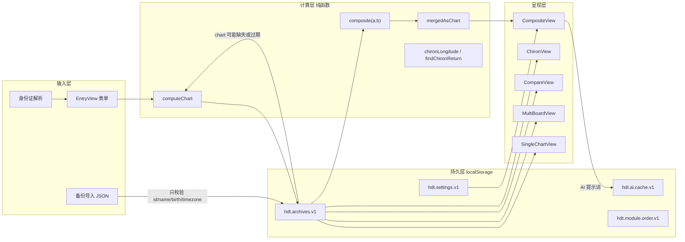

**数据流上的两个结构性问题**：
- **`A1 → SC` 的回流**：`ensureChart()` 会在读档案时补算，但不会判断"算出来的版本是否与当前算法一致"（v2 HD-004）。流程上表现为"用户打开档案 → 看到的是旧算法的结果 → 无任何提示"。
- **`IMP → A1` 的短路**：导入路径绕过了 `EntryView` 的全部校验，直接把外部 JSON 塞进 store（PF-005/PF-006）。

## 2.3 档案生命周期（现状）

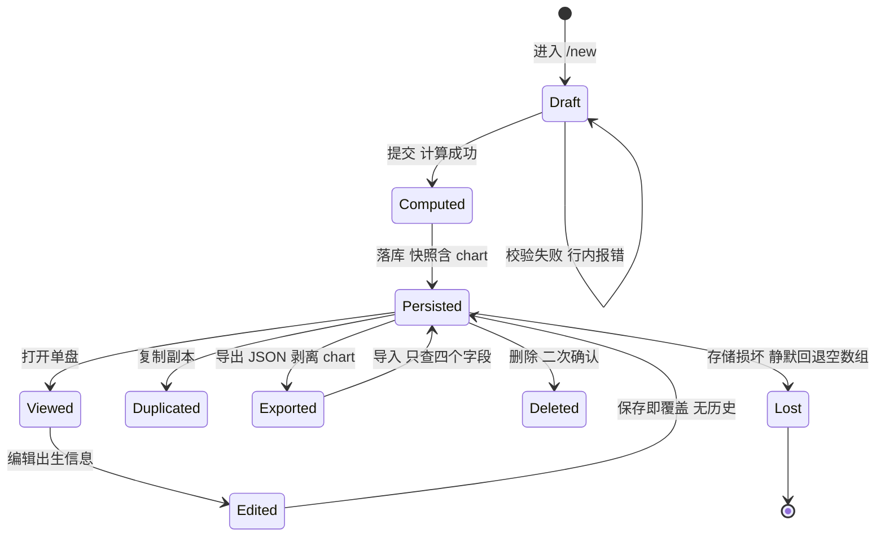

> `Lost` 这条状态是本次审计新增的：`loadJson` 在解析失败时 `return fallback`（空数组），用户看到的是"档案库空了"，而不是"加载失败"。这是**最坏的一种失败方式**——看起来像用户自己删光了。

---

# 章节 3　体系合规校验

## 3.1 双人合盘：要求 1 的六项输出逐条对照

要求原文：*"输出双方本命盘、复合盘、四类连接通道（电磁、同行、主导、妥协）、共同定义能量中心、关系主题；入口、参数、计算、输出须与成熟工具对齐。"*

| # | 法定输出 | 实现位置 | 现状 | 判定 |
| --- | --- | --- | --- | --- |
| 1 | 双方本命盘 | `CompositeView.vue:317-350` 三栏 A｜B｜合图 | ✅ 两张完整盘，可点开闸门/通道 | 合规 |
| 2 | 复合盘 | `composite.ts:110-117` 并集 → 九中心；`mergedAsChart` 渲染 | ✅ 有 | 合规（载体复用问题见 PF-004） |
| 3 | 四类连接通道 | `composite.ts:41-64` `classifyChannel` | ✅ 电磁 / 同伴 / 主导 / 妥协，判定逻辑正确 | 合规 |
| 4 | **共同定义能量中心** | — | ❌ **缺失**。只输出"并集定义"，没有"双方各自都定义"（交集）与"仅 A / 仅 B"的对比视图 | **P1 缺失（PF-002）** |
| 5 | **关系主题** | — | ❌ **缺失**。只有 5 个 AI 维度（`compositeDimensions.ts`），没有离线的关系主题结论 | **P1 缺失（PF-002）** |
| 6 | 入口/参数/计算/输出对齐成熟工具 | 入口两 id、参数 A/B、计算并集 | ⚠️ 入口与计算基本对齐；**输出多出 3 项不该有的**（类型/权威/交叉） | 部分合规（PF-003） |

### 3.1.1 第 4 项缺失的具体形态

当前只算了一种中心状态：

```ts
// composite.ts:112-117
const definedCenters = new Set<CenterId>()
for (const ch of unionChannels) { definedCenters.add(...); definedCenters.add(...) }
const centers = CENTER_IDS.map((id) => ({ id, defined: definedCenters.has(id) }))
```

**应该算的是 2×2 四象限**（这才是关系解读的核心）：

| 象限 | 含义 | 当前是否输出 |
| --- | --- | --- |
| 双方都定义 | 都不容易被对方影响；容易"谁也不让谁" | ❌ |
| 仅 A 定义 | A 稳定，B 在此处被 A 持续影响 | ❌ |
| 仅 B 定义 | 反向影响 | ❌ |
| 双方都开放 | 一起放大、一起失焦（最容易被环境带走的区域） | ❌ |
| （并集） | 合图被定义 | ✅ 只有这一个 |

改动量：`composite.ts` 增加 3 行集合运算，`CompositeView` 增加一个 2×2 小表。**这是本次审计里投入产出比最高的合盘改动。**

### 3.1.2 第 5 项缺失的具体形态

"关系主题"在成熟工具里是一个**离线可读的结论页**（这段关系的核心议题是什么、吸引从哪来、代价在哪），而不是"选一个维度让 AI 说"。当前 `compositeDimensions.ts` 的 5 个维度全部依赖 AI 才能产出内容——**未配置 AI 的用户在合盘页拿不到任何关系结论**。

## 3.2 Composite 与 Penta 的隔离审计

要求原文：*"两套独立流程，入口、计算引擎、结果页面完全隔离，不得混用合并。"*

### 3.2.1 现状

| 隔离维度 | 要求 | 现状 | 判定 |
| --- | --- | --- | --- |
| 入口 | 独立入口 | 合盘入口在档案库"生成合盘"；Penta **无入口** | Penta 未建，无冲突 |
| 路由 | 独立路由 | `/composite/:aId/:bId`；Penta 无路由 | 无冲突 |
| 计算引擎 | 独立引擎 | `composite(a,b)` 双人专用；Penta 无引擎 | 无冲突 |
| 结果页面 | 独立页面 | `CompositeView`；Penta 无页面 | 无冲突 |
| **结果载体类型** | 不得复用 | ❌ `mergedAsChart()` 把合盘结果包装成 `BodyGraph`，与单人盘**同一个类型** | **污染点 1** |
| **状态容器** | 不得共用 | ❌ `compositeStore` 是全局单例，只有 `aId/bId`；Penta 若加 3–5 人需另一容器，但当前 store 命名未预留边界 | **污染点 2** |
| **面板来源枚举** | 不得共用 | ❌ `PanelSource = 'a' \| 'b' \| 'merged' \| 'single'`，Penta 需要新值，否则只能借用 `merged` | **污染点 3** |

**结论**：当前"没有混用"是**因为 Penta 不存在**，不是因为架构上隔离了。一旦照着 `CompositeView` 复制一份 Penta 页面，这三个污染点会立刻变成"合盘有类型、Penta 也有类型、两者字段含义不同却共用一个类型"的混乱。

### 3.2.2 为什么"合盘有类型"本身就是混用的开始

`CompositeView.vue:401-435` 的主卡片：

| 字段 | 值来源 | 该不该出现在合盘 |
| --- | --- | --- |
| 能量类型 | `result.composite.type` → `decideType(并集中心)` | ❌ 类型是个体的气场属性 |
| 整体定义 | `decideDefinition(并集中心)` | ⚠️ 可作派生指标（"合起来是几分定义"），但不应叫"你们的定义" |
| 内在权威 | `decideAuthority(并集中心)` | ❌ 权威是个体的决策机制 |
| 轮回交叉 | `decideCross(交叉星, a.profile)` | ❌ 概念不成立 + 实现有 bug（v2 HD-003） |

**这与要求 2 的精神直接冲突**：要求把"Composite 与 Penta 隔离"，而合盘页现在做的恰恰是"把个体的属性赋予一个非个体对象"。Penta 的错误形态会是同一件事的放大版（"你们团队是投射者"）。

## 3.3 36 通道固定配对专项（要求 3）

### 3.3.1 结论：不存在自由拼接逻辑

逐点核查了所有可能"合成通道"的位置：

| 位置 | 代码 | 是否可能拼出非 36 组的通道 |
| --- | --- | --- |
| 通道判定 | `bodygraph.ts:235` `for (const ch of CHANNELS) if (activated.has(ch.gates[0]) && activated.has(ch.gates[1]))` | 否——只遍历固定表 |
| 合盘并集 | `composite.ts:86-90` 同上 | 否 |
| 关系通道分类 | `composite.ts:127-129` 只对 `unionChannelKeys`（来自 CHANNELS）分类 | 否 |
| 绘图 | `bodyGraphLayout.ts:297`、`V2:401` 只 map CHANNELS | 否 |
| 闸门→通道反查 | `GATE_CHANNELS[gate]` 由 CHANNELS 派生 | 否 |
| 面板 | `GateChannelPanel` 用 `GATE_CHANNELS` | 否 |
| `channelKey(a,b)` | `gateData.ts:91`，**全库无调用点**（仅在 `bodygraph.ts:345` 被 re-export） | **理论上是唯一能"凭空造 key"的函数，但当前是死代码** |

### 3.3.2 唯一隐患：一个可被误用的死函数

```ts
// gateData.ts:91-93
export function channelKey(a: number, b: number): string {
  return a < b ? `${a}-${b}` : `${b}-${a}`
}
```

它接受任意两个整数，返回 `"34-57"` 这种看起来合法的通道 key。目前没人调用，但：
- 它是 `export` 的，且从 `bodygraph.ts` 再导出一次（`export { channelKey, GATE_CENTER }`），等于对外承诺"这是个公共 API"；
- 将来任何人想写"自定义通道"或"快速比较"，第一个会找到它；
- 它没有校验 `(a,b)` 是否在 36 组之内。

**处置（PF-009）**：①删除该函数与再导出；②若确需保留，改为 `channelKeyOf(a,b): string | null`，内部查 `CHANNEL_BY_KEY`，不在表内返回 `null`；③加测试：把 1..64 的两两组合（2016 对）全部喂进去，断言只有 36 对返回非 null。

### 3.3.3 数据完整性（本次复核）

| 检查项 | 结果 |
| --- | --- |
| `CHANNEL_GATE_PAIRS` 条数 | 36 ✅ |
| 每条两端闸门是否落在正确的两个中心 | 36/36 ✅（用 `GATE_CENTER` 反查一致） |
| 配对是否有重复 / 自环 | 无 ✅ |
| 是否存在"通道两端同属一个中心" | 不存在 ✅（16-20 同属喉咙，是唯一的同中心通道，属正常） |
| 通道名与 Rave I'Ching 英文名 | 36/36 ✅（v2 已逐条比对） |

## 3.4 其他体系规则的流程侧复核

| 规则 | 流程上的体现 | 判定 |
| --- | --- | --- |
| 13 体 × 显/潜 = 26 激活点 | 建档即算，无缺项 | ✅ |
| 设计时刻 = 太阳 −88°（求根，非固定 88 天） | `findPreviousSunLongitude` | ✅ |
| 真交点（非平交点） | `trueNodeLongitude` | ✅ |
| 类型 = 骶骨 + 马达→喉 | `decideType` | ✅（与 L1 表述一致） |
| 权威层级 = 情绪→骶骨→脾→心→自我投射→心智→月亮 | `decideAuthority` | ✅ 顺序正确 |
| 定义 = 连通分量（4+1 种） | `decideDefinition` | ✅ 与 L1 词典逐字一致 |
| 角度 = 人格太阳爻位（4/1 并列、≥5 左角度） | `decideCross` | ✅（4/6 归右角度，经 L1 确认） |
| 合盘不得有类型/权威/交叉 | `CompositeView` 主卡片 | ❌ **违反**（PF-003） |
| 凯龙不参与类型/权威/通道 | `chironChart.ts` 却生成了 type/authority/cross | ❌ **违反**（PF-013） |
| 行运 = 当前/指定时刻的临时激活 | 无行运模块，"未来形势"为静态文案 | ❌ **缺失**（PF-012） |

---
# 章节 4　功能结构图（含模块边界）

> 图层规则：**实线框 = 已实现**；**虚线框 = 未建/待建**；红色 = 存在越界或污染。
> 边界铁律：**本命 → 合盘 → Penta → 行运** 四层各自拥有独立的「计算入口 / 结果类型 / 页面 / 状态容器」，上游结果只能作为**只读输入**被下游消费，下游不得把结果写回上游类型。

## 4.1 顶层功能结构（模块边界视图）

```mermaid
flowchart TD
    ROOT["人类图工具 v1.1.0"]

    ROOT --> M1["① 建档与档案库"]
    ROOT --> M2["② 本命盘模块"]
    ROOT --> M3["③ 双人合盘模块"]
    ROOT --> M4["④ 多盘 / 对比"]
    ROOT --> M5["⑤ Penta 团体盘"]:::todo
    ROOT --> M6["⑥ 行运 / 流日"]:::todo
    ROOT --> M7["⑦ Gene Keys"]:::todo
    ROOT --> M8["⑧ 扩展分析（凯龙）"]:::risk
    ROOT --> M9["⑨ AI 增强"]
    ROOT --> M10["⑩ 设置与数据"]

    M1 --> M1a["手动录入"]
    M1 --> M1b["身份证解析"]
    M1 --> M1c["实时预览（仅桌面）"]
    M1 --> M1d["档案库 画布/列表"]
    M1 --> M1e["多选与批量操作"]
    M1 --> M1f["导入 / 导出 / 清空"]

    M2 --> M2a["计算内核 星历+曼陀罗+体图"]
    M2 --> M2b["四区块呈现"]
    M2 --> M2c["对象详情（闸门/通道/中心）"]
    M2 --> M2d["离线解读库"]
    M2 --> M2e["人生轨迹"]

    M3 --> M3a["前置：选择恰好 2 份"]:::risk
    M3 --> M3b["计算：并集通道 + 四类关系"]
    M3 --> M3c["输出：A/B/合图 三栏"]
    M3 --> M3d["输出：四类连接通道"]
    M3 --> M3e["输出：共同定义中心"]:::miss
    M3 --> M3f["输出：关系主题"]:::miss
    M3 --> M3g["越界：合图类型/权威/交叉"]:::risk

    M5 --> M5a["前置：3–5 人 且互不相同"]:::todo
    M5 --> M5b["独立引擎 pentaCompute"]:::todo
    M5 --> M5c["Penta 图：下三角三中心 + 上三角两中心"]:::todo
    M5 --> M5d["被集体定义的中心 / 被指派的角色"]:::todo
    M5 --> M5e["独立结果页 /penta/:ids"]:::todo

    M6 --> M6a["当前时刻 13 体"]:::todo
    M6 --> M6b["与本命并集 → 临时通道/被点亮中心"]:::todo
    M6 --> M6c["独立结果页 /transit/:id"]:::todo

    M7 --> M7a["不适用：本产品无 GK 模块"]:::todo
    M7 --> M7b["边界：GK 不得复用 HD 闸门判定"]:::todo

    M8 --> M8a["凯龙回归盘"]:::risk
    M8 --> M8b["越界：凯龙盘输出类型/权威/交叉"]:::risk

    classDef todo stroke-dasharray: 5 4,fill:#f8fafc,stroke:#94a3b8,color:#475569;
    classDef risk fill:#fef2f2,stroke:#dc2626,color:#991b1b;
    classDef miss stroke-dasharray: 4 3,fill:#fffbeb,stroke:#d97706,color:#92400e;
```

## 4.2 模块边界规则表（本次审计的核心交付之一）

| 规则 | 内容 | 现状 | 违反后果 |
| --- | --- | --- | --- |
| R1 | 本命盘结果是**唯一真源**，合盘/Penta/行运只读 | ✅ | — |
| R2 | 合盘结果类型 `CompositeResult` **不得**是 `BodyGraph` | ❌ `mergedAsChart()` 返回 `BodyGraph` | Penta 照抄即混用 |
| R3 | Penta 必须有自己的 `PentaResult`、`pentaCompute`、`/penta/:ids`、`pentaStore` | ❌ 全无 | 若复用 composite → 3–5 人被压成"两人关系" |
| R4 | 行运是"本命 + 时刻"的叠加，**不改本命**，不产出类型/权威 | ❌ 无模块 | 用静态文案冒充行运（现"未来形势"） |
| R5 | Gene Keys 若接入，必须是独立引擎与页面，**不得**把 GK 的 Sphere 映射塞进 HD 解读 | — 无模块 | 两套体系互相污染（本次不适用） |
| R6 | 扩展层（凯龙）不得向标准层字段写值 | ❌ `chironChart` 产出 type/authority/cross | 用户以为凯龙盘有"类型" |
| R7 | 任何"关系/团体"结果不得声明个体的类型/权威/交叉 | ❌ 合盘页主卡片 | 体系性误导（B 类） |

## 4.3 本命盘模块结构

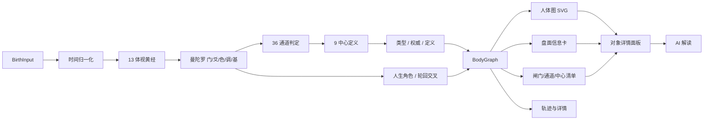

## 4.4 双人合盘模块结构（目标态，红色为待替换）

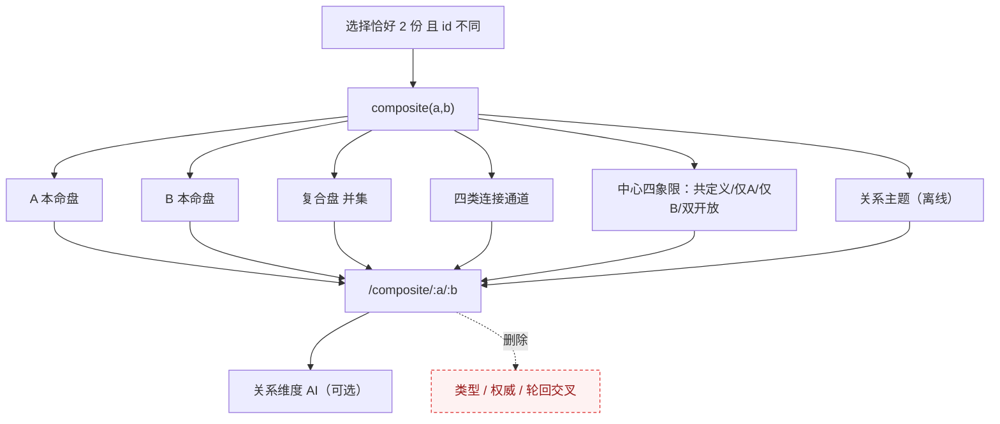

## 4.5 Penta 团体盘模块结构（待建）

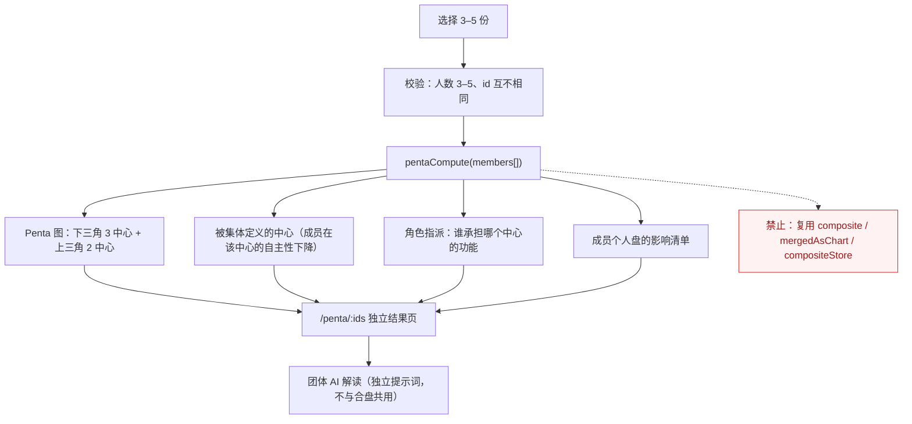

## 4.6 行运 / 流日模块结构（待建）

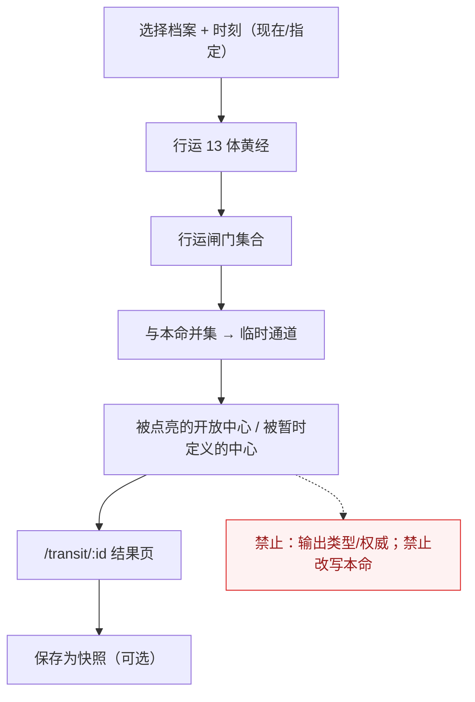

## 4.7 Gene Keys 模块（不适用 + 边界声明）

| 项 | 值 |
| --- | --- |
| 现状 | 产品**没有** Gene Keys 模块 |
| 判定 | 本轮**不适用**，无需校验 |
| 未来接入的边界 | ①GK 的 11 Sphere / Golden Path / Codon Rings 是独立体系，**不得**复用 HD 的「通道/中心/类型」判定；②GK 的闸门→基因钥匙映射是另一套对照表，**不得**与 HD 闸门文案混排；③必须独立路由 `/genekeys/:id`、独立引擎、独立结果类型 |
| 若混用会怎样 | 用户会看到"你的 Gate 34 既是力量通道又是基因钥匙 X"，两套体系互相解释，产生无法追溯的错误结论 |

## 4.8 模块 × 入口 × 结果页 一览

| 模块 | 入口 | 引擎 | 结果类型 | 路由 | 状态容器 | 状态 |
| --- | --- | --- | --- | --- | --- | --- |
| 本命盘 | 新建 / 档案卡 | `computeChart` | `BodyGraph` | `/archive/:id` | `archiveStore` | ✅ |
| 双人合盘 | 多选 2 份 | `composite` | `CompositeResult` + **误用 `BodyGraph`** | `/composite/:a/:b` | `compositeStore` | ⚠️ 需修 |
| 多盘 | 多选 N 份 | 复用本命 | `BodyGraph[]` | `/boards` | `boardStore` | ✅ |
| 对比 | 单人盘按钮 | 复用本命 | `BodyGraph × 2` | `/compare/:a?/:b?` | 局部 ref | ⚠️ 入口随机 |
| 凯龙 | 单人盘按钮 | `chiron.ts` | **误用 `BodyGraph`** | `/chiron/:id` | 无 | ⚠️ 越界 |
| Penta | — | — | — | — | — | ❌ 待建 |
| 行运 | — | （星历已具备） | — | — | — | ❌ 待建 |
| Gene Keys | — | — | — | — | — | 不适用 |

---

# 章节 5　操作逻辑清单（逐条拆解）

> 每条链路按固定 11 段拆解：**触发 → 输入 → 校验 → 计算 → 分支 → 跳转 → 渲染 → 文案 → 报错 → 保存 → 分享**。
> `✅` 已实现且合理；`⚠️` 已实现但有缺陷；`❌` 缺失。括号内为问题编号。

## OL-01　手动建档

| 段 | 内容 | 状态 |
| --- | --- | --- |
| 触发 | 工具栏「新建」/ 空态按钮 / 各页 `@new` | ✅ |
| 输入 | 姓名（必填）、性别、出生日期、出生时间（时:分[:秒]）、时区（17 选 1）、省/市、出生地备注 | ✅ |
| 校验 | 日期存在性与每月天数、年份 1900–今年、时分秒范围、姓名非空、时区合法 | ✅（`parseDraft`） |
| 计算 | 实时预览：合法即算 26 激活点 → 类型/角色/权威/通道数 | ✅ 仅桌面 |
| 分支 | 校验失败 → 行内错误 + toast；成功 → 建档 | ⚠️ 预览失败静默吞掉（PF-011） |
| 跳转 | `router.push('/archive/:id')`（桌面与移动端同一分支，死代码） | ⚠️ |
| 渲染 | 四区块 + 星体两翼 | ✅ |
| 文案 | 无「人类图只取决于出生时刻与时区」的总说明，散在三处小字 | ⚠️ |
| 报错 | 行内 + toast；计算抛错仅一个 toast | ⚠️ 无错误码 |
| 保存 | `archiveStore.create()` → localStorage 单键 | ✅ |
| 分享 | 无 | ❌（PF-010） |

**边界场景**：出生时间缺失 → 直接拦截（**没有"时间不确定"分支**，PF-008）；DST 歧义 → 计算了 warning 但被丢弃（PF-007）。

## OL-02　身份证建档

| 段 | 内容 | 状态 |
| --- | --- | --- |
| 触发 | 录入页切「身份证快捷」 | ✅ |
| 输入 | 18 位号码 + 隐私同意勾选 | ✅ |
| 校验 | 长度、`^\d{17}[\dX]$`、加权校验位、日期合法性、年份范围 | ✅ 四道，错误码齐全 |
| 计算 | 解析日期 → 回填；地区码 → 省/市/时区 | ✅ |
| 分支 | 解析失败 → 提示；成功但无时分 → 横幅提示补填 | ✅ |
| 跳转 | 停留本页，等待补录 | ✅ |
| 渲染 | 表单回填 | ✅ |
| 文案 | 明确"时分必须手填" | ✅ 做得好 |
| 报错 | E1001/E1002/E2001/E1003 | ✅ |
| 保存 | 仅在最终提交时落库，号码不落盘 | ✅ |
| 分享 | 无 | ❌ |

## OL-03　单人盘浏览与对象查看

| 段 | 内容 | 状态 |
| --- | --- | --- |
| 触发 | 卡片双击 / 批量「打开」 | ✅ |
| 输入 | 路由 id | ✅ |
| 校验 | 档案存在 + `ensureChart` 补算 | ⚠️ 不校验算法版本（PF-016） |
| 计算 | 读已存快照（不重算） | ✅ |
| 分支 | 档案不存在 → 空态；chart 缺失 → 补算 | ✅ |
| 跳转 | 无（同页交互） | ✅ |
| 渲染 | 四区块 + 详情卡就地展开 | ✅ |
| 文案 | 离线三态未区分（v2 HD-005） | ⚠️ |
| 报错 | 计算异常无兜底 | ❌（PF-017） |
| 保存 | 模块顺序存 localStorage | ✅ |
| 分享 | 无 | ❌ |

## OL-04　档案编辑 / 复制 / 删除

| 段 | 内容 | 状态 |
| --- | --- | --- |
| 触发 | 工具栏「编辑」「复制副本」/ 卡片删除 | ✅ |
| 输入 | 姓名、出生年月日时分、时区、出生地、经纬度 | ✅ |
| 校验 | 弹窗内仅有基础必填 | ⚠️ 不校验日期存在性 |
| 计算 | `update()` 无条件全量重算 | ⚠️ 只改姓名也重算 |
| 分支 | 无「差异预览」分支 | ❌（PF-014） |
| 跳转 | 复制副本 → 跳新 id | ✅ |
| 渲染 | 重算后刷新 | ✅ |
| 文案 | 无「你的类型从 X 变成 Y」提示 | ❌ |
| 报错 | 计算异常仅 toast | ⚠️ |
| 保存 | 直接覆盖，无历史快照 | ❌（PF-014） |
| 分享 | 无 | ❌ |

## OL-05　双人合盘

| 段 | 内容 | 状态 |
| --- | --- | --- |
| 触发 | 档案库多选 2 份 →「生成合盘」/ 批量条 | ✅ |
| 输入 | `aId`、`bId` | ✅ |
| 校验 | 仅「数量 = 2」；**不校验 a≠b、不校验两份都有 chart** | ❌（PF-001） |
| 计算 | 并集闸门 → 并集通道 → 九中心并集 → 四类关系通道 → （误）类型/权威/交叉 | ⚠️ |
| 分支 | 数量≠2 → toast；id 不存在 → 空态 | ⚠️ 文案误导（PF-018） |
| 跳转 | `/composite/:a/:b`；从移动端进入走 Tab 切换 | ✅ |
| 渲染 | A｜B｜合图 三栏；手机 Tab | ✅ |
| 文案 | 四类通道无解释（用户不知"妥协"是什么意思） | ⚠️ |
| 报错 | 无 | ❌ |
| 保存 | 不落库，路由即状态 | ⚠️ 无法回看 |
| 分享 | 无 | ❌ |

**缺失的法定输出**：共同定义中心（PF-002）、关系主题（PF-002）；**越界输出**：类型/权威/交叉（PF-003）。

## OL-06　多盘并排

| 段 | 内容 | 状态 |
| --- | --- | --- |
| 触发 | 批量条「并排打开」 | ✅ |
| 输入 | `selectedIds`（N 份） | ✅ |
| 校验 | 无上限、无去重（Set 已去重） | ⚠️ 4 份以上性能未测 |
| 计算 | 复用本命快照 | ✅ |
| 分支 | 移动端 → 跳首份单盘（**隐式降级，无提示**） | ⚠️（PF-015） |
| 跳转 | `/boards?ids=...`；URL 为准、store 兜底、关闭栏同步 URL | ✅ |
| 渲染 | 自由画布 + auto-fit | ✅ |
| 文案 | 无 | ✅ |
| 报错 | 无 | ⚠️ |
| 保存 | 不保存布局 | ⚠️ |
| 分享 | 无 | ❌ |

## OL-07　双盘对比

| 段 | 内容 | 状态 |
| --- | --- | --- |
| 触发 | 单人盘「双盘对比」 | ✅ |
| 输入 | 当前 id（单个） | ⚠️ 缺对比对象 |
| 校验 | 同人自动规避（换下一个可用档案）；id 存在性 | ✅ 有、但方向相反 |
| 计算 | 复用两份本命 | ✅ |
| 分支 | 只有 1 份档案 → bId=null → 空态 | ⚠️ 无引导 |
| 跳转 | `/compare/:a?/:b?` | ✅ |
| 渲染 | 并排 / 手机堆叠 | ✅ |
| 文案 | 无「请选择对比对象」 | ❌ |
| 报错 | 无 | ⚠️ |
| 保存 | 路由同步 | ✅ |
| 分享 | 无 | ❌ |

## OL-08　AI 解读（单对象 / 批量 / 全维度）

| 段 | 内容 | 状态 |
| --- | --- | --- |
| 触发 | 详情面板按钮 / 批量条 / 工具栏「全盘 AI 解读」/ 合盘维度 | ✅ |
| 输入 | 离线文案 + 盘面摘要 + 角度 + 自定义方向 | ✅ |
| 校验 | 接口地址/Key/模型非空 | ✅ 护栏齐全 |
| 计算 | 命中缓存 → 直接返回；否则 POST `/chat/completions` | ✅ |
| 分支 | 成功 / HTTP / 超时 / 网络CORS / 格式 | ✅ 五类齐全 |
| 跳转 | 打开右侧 AI 面板 | ✅ |
| 渲染 | Markdown 先转义再渲染 | ✅ 防注入 |
| 文案 | 有「不作命运/医疗承诺」约束 | ✅ |
| 报错 | 分类清晰、可重试 | ✅ |
| 保存 | 写 `hdt.ai.history.v1`，**全库无读取点** | ❌（PF-019） |
| 分享 | 仅复制文本 | ⚠️ |

## OL-09　凯龙回归

| 段 | 内容 | 状态 |
| --- | --- | --- |
| 触发 | 单人盘「凯龙回归」 | ✅ |
| 输入 | 路由 id | ✅ |
| 校验 | 档案存在 | ✅ |
| 计算 | 出生凯龙黄经 → 45–56 年逐日粗扫 → 二分 | ✅（精度角分级） |
| 分支 | 未找到 → 提示 | ✅ |
| 跳转 | `/chiron/:id` | ✅ |
| 渲染 | **完整 BodyGraph（含类型/权威/交叉）** | ❌（PF-013） |
| 文案 | 未说明"非标准层" | ⚠️ |
| 报错 | 无 | ⚠️ |
| 保存 | 不落库 | ✅ |
| 分享 | 无 | ❌ |

## OL-10　设置与备份（导出 / 导入 / 清空）

| 段 | 内容 | 状态 |
| --- | --- | --- |
| 触发 | 工具栏齿轮 | ✅ |
| 输入 | AI 配置；导入文件 | ✅ |
| 校验 | AI 三项非空；导入只校验 `id/name/birth/timezone` 存在 | ❌（PF-005） |
| 计算 | 导入后逐份 `ensureChart` 重算 | ⚠️ 非法出生值被静默归一化 |
| 分支 | 文件格式错 → 抛错；无可用户档 → 抛错 | ✅ 两分支 |
| 跳转 | 无 | ✅ |
| 渲染 | 列表刷新 | ✅ |
| 文案 | 「已导入 N 份」；**不报跳过 M 份** | ⚠️ |
| 报错 | 只有一条 toast | ⚠️ |
| 保存 | 覆盖写单键 | ❌ 无备份快照 |
| 分享 | 导出 JSON（剥离 chart、不含身份证） | ⚠️ 不含 Key 未验证 |

## OL-11　Penta 团体盘（目标态，待建）

| 段 | 目标设计 | 现状 |
| --- | --- | --- |
| 触发 | 档案库多选 3–5 份 →「生成团体盘」（与「生成合盘」并列且互斥置灰） | ❌ |
| 输入 | `memberIds[3..5]` | ❌ |
| 校验 | 人数 3–5；id 互不重复；每份都有 chart；超 5 人给明确上限提示 | ❌ |
| 计算 | `pentaCompute(members)`：5 中心结构 + 集体定义 + 角色指派 | ❌ |
| 分支 | 人数不合法 / 重复 / 缺 chart → 分别给不同提示 | ❌ |
| 跳转 | `/penta/:ids`（**独立路由**，不得复用 `/composite`） | ❌ |
| 渲染 | Penta 五边形图 + 角色卡 + 成员影响清单 | ❌ |
| 文案 | 必须说明"团体不是人格，不输出类型/权威" | ❌ |
| 报错 | 独立错误码 | ❌ |
| 保存 | 独立 `pentaStore`，可命名保存 | ❌ |
| 分享 | 独立分享卡 | ❌ |

## OL-12　行运 / 流日（目标态，待建）

| 段 | 目标设计 | 现状 |
| --- | --- | --- |
| 触发 | 单人盘「今日流日」/ 独立入口 | ❌ "未来形势"是静态文案 |
| 输入 | 档案 id + 时刻（默认 now，可改） | ❌ |
| 校验 | 时刻合法 | ❌ |
| 计算 | 行运 13 体 → 闸门 → 与本命并集 → 临时通道/被点亮中心 | ⚠️ 引擎已具备能力 |
| 分支 | 无行运碰触 / 有临时通道 / 有中心被点亮 → 三种文案 | ❌ |
| 跳转 | `/transit/:id` | ❌ |
| 渲染 | 双图层人体图（本命底 + 行运高亮） | ❌ |
| 文案 | 禁止输出类型/权威，禁止绝对化预测 | ❌ |
| 报错 | 时刻越界（1900 前/2100 后）明确提示 | ❌ |
| 保存 | 可选快照 | ❌ |
| 分享 | 可选 | ❌ |

## 5.13　异常场景矩阵（要求 5 点名覆盖）

| 场景 | 触发方式 | 现状行为 | 应有行为 | 判定 |
| --- | --- | --- | --- | --- |
| 出生时间缺失 | 不填时间直接提交 | 拦截 + 行内错误 | 提供「时间不确定」分支，输出稳定性报告 | ⚠️ PF-008 |
| 出生时间不确定 | 无法触发 | 无此路径 | 区间抽样 + 边界时刻 | ❌ PF-008 |
| DST 空洞（时刻不存在） | 如 NY 2021-03-14 02:30 | 静默映射到相邻时刻，**无提示** | 明确告知并建议修正 | ❌ PF-007 |
| DST 歧义（两个时刻） | 如 NY 2021-11-07 01:30 | 默认取一个，**无提示** | 强制二选一 | ❌ PF-007 |
| 时区异常 | 手工构造非法 IANA | `isValidTimeZone` 存在但**未被调用**；`Intl` 抛错 → 计算异常 → 预览静默为空 | 提交前拦截 | ❌ PF-023 |
| 经纬度缺失 | 地区表未命中 | 回退省会坐标或 `(0,0)`，不提示 | 标注"位置未定位（不影响排盘）" | ⚠️ PF-020 |
| 不满足合盘条件（数量≠2） | 选 3 份点合盘 | 按钮置灰 + toast，但 3 份时点卡片「加入合盘」提示"请再选择一份"（误导） | 改为"合盘只能选 2 份，当前 3 份" | ⚠️ PF-018 |
| 不满足合盘条件（同一人） | 手改 URL `/composite/X/X` | **正常渲染**，全部通道判"同伴"，AI 输出"高度同频" | 拦截并回到选择态 | ❌ **PF-001** |
| 非法闸门数据 | 导入含 `gate: 0` 或 `65` 的 chart | 导出剥离 chart，导入重算 → 实际不可达 | 引擎层仍应加断言（防御性） | ⚠️ PF-021 |
| 非法出生字段 | 导入 `{month:13, hour:25}` | `Date.UTC` 静默归一化 → 错误盘 | 校验并拒绝该条 | ❌ **PF-005** |
| 档案被删后访问 | 删档后点历史链接 | 空态 + 返回按钮 | 同 | ✅ |
| 存储损坏 | 手工破坏 localStorage | 静默回退空数组 → "档案全没了" | 报错 + 提供 .bak 恢复 | ❌ **PF-006** |
| AI 未配置 | 直接点 AI | 护栏提示 + 跳设置 | 同 | ✅ |
| AI 超时 / CORS | 断网或代理 | 分类错误 + 重试 | 同 | ✅ |
| AI 返回与盘面冲突 | 模型幻觉 | 原样渲染 | 一致性校验 + 警示条 | ❌ PF-022 |

---
# 章节 6　BPMN 业务流程图（每项业务独立绘制）

> **符号映射**（Mermaid 无原生 BPMN，按 BPMN 2.0 语义等价）：
> | BPMN | 本图 | 写法 |
> | --- | --- | --- |
> | 开始事件 | 圆形 | `S(("开始"))` |
> | 结束事件 | 圆形 | `E(("结束"))` |
> | 用户任务 | 矩形·泳道「用户」 | `T["任务"]` |
> | 系统任务 | 矩形·泳道「系统」 | `T["任务"]` |
> | 排他网关 XOR | 菱形 | `G{"条件"}` |
> | 并行网关 AND | 六边形 | `P{{"并行"}}` |
> | 边界异常事件 | 虚线 + 警示色 | `T["异常"]:::err` |
> | 泳道 | 分区 | `subgraph LANE["泳道·角色"]` |
>
> 四张主流程（本命 / 合盘 / Penta / 流日）**各自独立成图，不共用子流程节点**，以图形本身证明"流程隔离"。

## 6.1　BPMN-P1　本命排盘

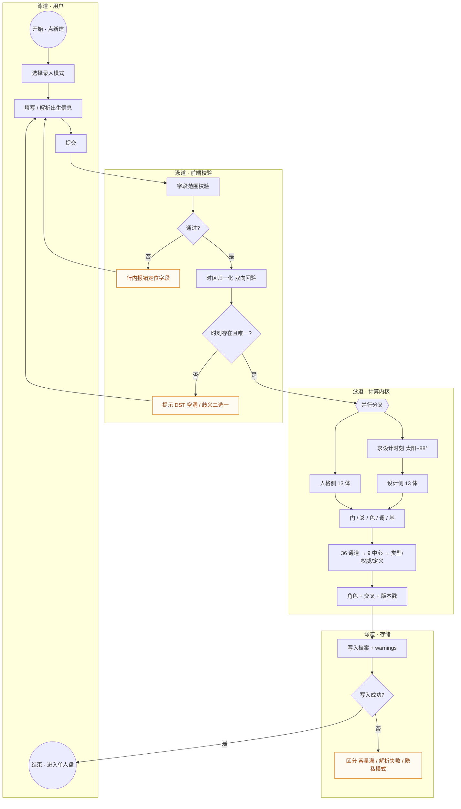

**元素清单**

| 类型 | 元素 | 说明 |
| --- | --- | --- |
| 开始 | 点新建 | 唯一起点 |
| 用户任务 | 选模式 / 填信息 / 提交 | 3 个 |
| 系统任务 | 校验 / 归一化 / 并行取星历 / 求设计时刻 / 映射 / 推导 / 落库 | 7 个 |
| 排他网关 | 校验通过？ / 时刻唯一？ / 写入成功？ | 3 个 |
| 并行网关 | 人格侧 ∥ 设计侧 | 1 个（实现为顺序，语义等价） |
| 边界异常 | 字段错误 / DST 空洞或歧义 / 写入失败 | 3 条 |
| 结束 | 进入单人盘 | 1 个 |

## 6.2　BPMN-P2　双人合盘（修正后）

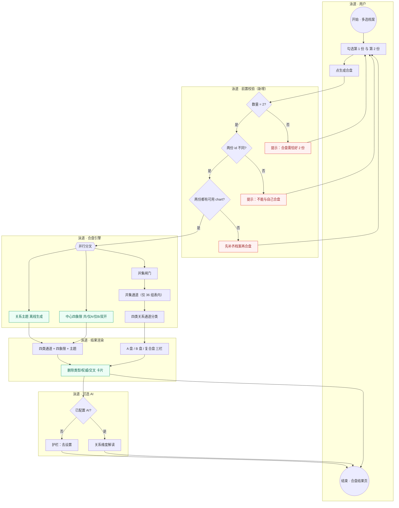

**与现状的差异（必须照此修改）**

| 差异 | 现状 | 修正 |
| --- | --- | --- |
| 前置校验 | 只有"数量=2"，且入口在档案库 | 增加 **id 不同**、**chart 可用** 两道 XOR，且合盘页自身也要复核（防手改 URL） |
| 输出 | 只有并集中心 | 增加 **中心四象限** 与 **关系主题** |
| 越界卡片 | 类型/权威/交叉 | **整块删除**，替换为"关系主题 + 四象限" |
| 异常分支 | 无 | 3 条边界异常事件，各自不同文案 |

## 6.3　BPMN-P3　Penta 团体盘（目标态，独立流程）

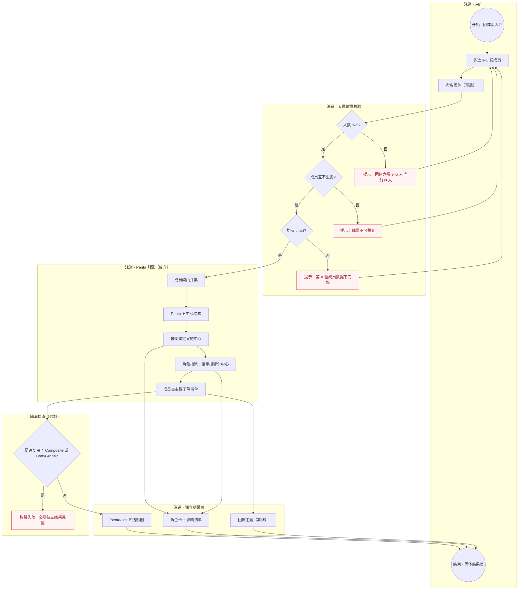

**为何必须独立成图（而不是合盘的一个分支）**

| 维度 | 双人合盘 | Penta |
| --- | --- | --- |
| 人数 | 固定 2 | 3–5 |
| 核心问题 | "你给了我什么 / 我给了你什么" | "这个团体把谁变成了什么角色" |
| 计算对象 | 两人闸门并集 | 成员闸门并集 **+ 五中心结构约束** |
| 结果形态 | 三栏对比 | 单一五边形 + 角色指派 |
| 是否有个体属性 | 不应有（当前越界） | 不应有 |
| 关键风险 | 同人合盘 | 成员被"指派"角色后失去自主性 |

> 隔离检查节点 `G33` 是一个**架构守门**：代码评审时用它问一句"Penta 有没有 import composite 或 mergedAsChart？"——有就拒绝合并。

## 6.4　BPMN-P4　流日 / 行运（目标态，独立流程）

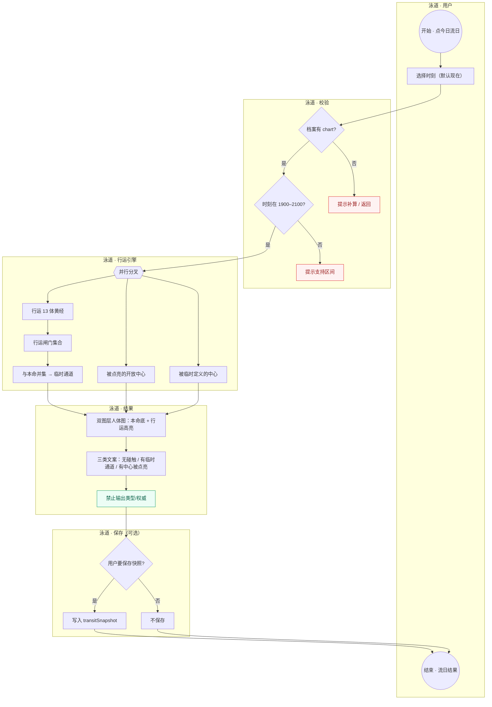

**与"未来形势"的关键区别**

| 项 | 现状（未来形势） | 目标（流日） |
| --- | --- | --- |
| 数据来源 | 本命盘 + 模板句 | 真实行运星历 |
| 时间性 | 假的 1–3 年刻度 | 指定时刻的真实激活 |
| 结论 | "你未来会……" | "此刻哪些中心被点亮、哪些通道临时成立" |
| 风险 | 无依据的时间预测 | 有依据的临时状态观察 |

## 6.5　BPMN-P5　异常拦截总图（横切流程）

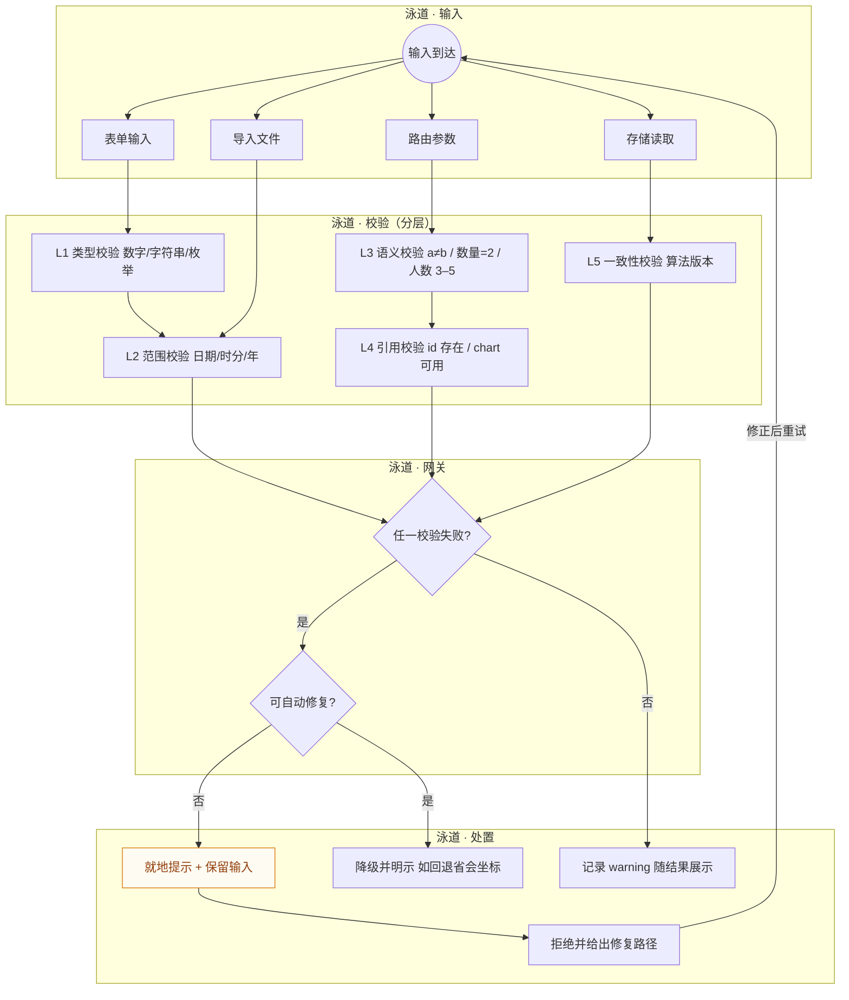

**这张图是本次审计的方法论产物**：把 5 个关卡固定下来，任何新入口（Penta / 流日 / 分享链接）都必须过 L1–L5，不允许像现在这样"路由参数直接进引擎"。

## 6.6　BPMN-P6　备份导入（异常最密集的流程）

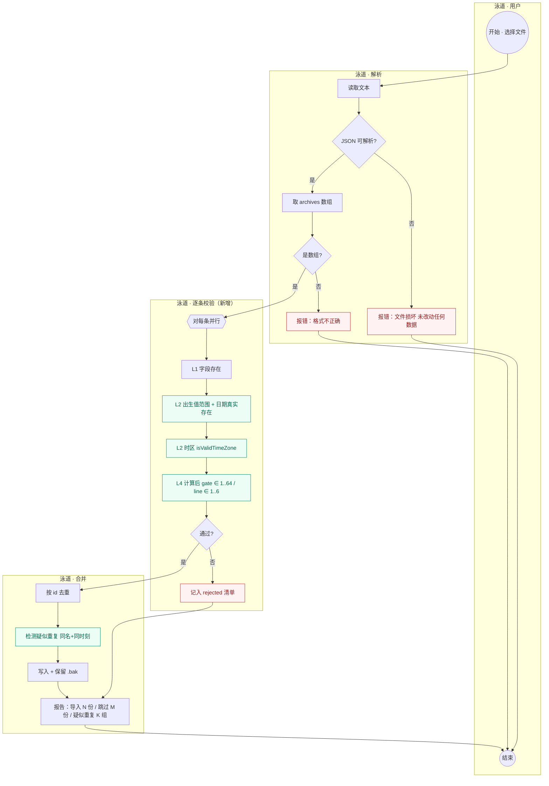

**现状 vs 目标**：现状只有 `G60`（可解析）与 `G61`（是数组）两个网关，之后只查四个字段，其余全部直通。目标是 5 道关卡 + 拒绝清单 + 去重报告。

---
# 章节 7　流程问题总清单

> 编号 `PF-xxx`（Process Finding）。分类沿用 E/A/B/C/D：**E** 流程缺陷、**A** 体系冲突、**B** 衍生越界、**C** 缺失、**D** 计算不一致。
> 每条含：分类 · 描述 · 原因 · 可落地方案 · 优先级。

## 7.1　P1（核心流程缺陷，必须优先修）

### PF-001　合盘可与自己合盘（前置条件缺"两人不同"）
- **【分类】** E（前置校验缺失）+ A（产出伪结论）
- **【问题描述】** `/composite/:aId/:bId` 是唯一"参数完全来自 URL 且无业务语义校验"的重路由。手改 URL 为 `/composite/X/X` 即可渲染：`composite(a,a)` 下所有通道被判为 **同伴（companionship）**、`sharedGates` 等于全部激活闸门、`sharedChannels` 等于全部通道、无任何电磁通道；合图中心 = 本人中心；AI 提示词会写"合盘双方：张三 × 张三"。用户看到的是"与自己高度同频"，这在体系上是无意义的伪结论。
- **【原因说明】** ①合盘校验只做在**入口**（档案库多选），没做在**页面**（`CompositeView` 只判断 `ready`）；②对比页 `CompareView` 已经实现了同人规避，说明作者意识到该问题，但没同步到合盘——典型的"校验写在调用方而不是被调用方"。
- **【方案】** 三层拦截：
  1. `CompositeView` 顶部：`if (!aId || !bId || aId === bId) → 渲染 `EmptyState`「合盘需要两位不同的人」，并提供"重新选择"按钮；
  2. `compositeStore.setPair()` 内部：`if (aId === bId) throw / return false`；
  3. `composite()` 纯函数：入口断言 `a !== b`（引用或 id 不同），否则抛 `CompositeError('SAME_PERSON')`。
  - 利弊：三层都做略啰嗦，但第 3 层是唯一能防住"未来新增入口"的位置，建议 1+3，第 2 层可选。
- **【优先级】** **P1**

### PF-002　合盘缺两项法定输出：共同定义中心、关系主题
- **【分类】** C（缺失）
- **【问题描述】** 要求 1 明确六项输出，当前只有四项。①**共同定义中心**缺失：只算并集（`composite.ts:112-117`），没有"双方各自都定义 / 仅 A / 仅 B / 双方都开放"的四象限；②**关系主题**缺失：`compositeDimensions.ts` 的 5 个维度全部是 AI 提示词框架，未配置 AI 的用户在合盘页**拿不到任何关系结论**。
- **【原因说明】** 合盘被当成"两张盘叠加的可视化"，而不是"一份有结论的关系报告"。四象限需要额外的集合运算（双方各自的 definedCenters 求交/差），作者只做了并集就停了。
- **【方案】**
  1. `composite.ts` 增加：`sharedDefinedCenters = A.defined ∩ B.defined`、`onlyA`、`onlyB`、`bothOpen = 9 − (A∪B)`，`CompositeResult` 增字段；
  2. `CompositeView` 用 2×2 小表展示四象限，每格一句"意味着什么"；
  3. 新增 `services/relationshipTheme.ts`：由 ①四类通道的分布 ②四象限 ③双方类型/权威组合 生成 3–5 段离线主题（**不新增理论，只做既有事实的组织**），AI 维度作为"加深"而非"唯一来源"。
- **【优先级】** **P1**（四象限 3 行代码即可，先做；关系主题次之）

### PF-003　合盘主卡片越界输出「类型 / 权威 / 轮回交叉」
- **【分类】** B（衍生越界）+ E（流程误导）
- **【问题描述】** `CompositeView.vue:401-435` 的"合图 · 第三个能量场"卡片展示四项：能量类型、整体定义、内在权威、轮回交叉。前三项中，类型与权威是**个体属性**；交叉在 v2 已判定为"概念不成立 + 实现 bug（`decideCross(crossStars, crossStars, a.profile)`）"。
- **【原因说明】** `mergedAsChart()` 为了让合图复用单人盘组件，把结果包成 `BodyGraph`，于是"必须填满字段"倒逼出了类型/权威/交叉。
- **【方案】** 把这张卡片**整块替换**为「关系主题 + 中心四象限 + 四类通道统计」。若产品坚持保留"整体定义"，只保留 `definition` 一项并改名为"合起来的定义（几分）"，其余删除。
- **【优先级】** **P1**

### PF-005　备份导入不校验出生字段，`Date.UTC` 静默归一化
- **【分类】** E（校验缺失）
- **【问题描述】** `SettingsView.importFile()` 只过滤 `a.id && a.name && a.birth && a.timezone`。若导入 `{month: 13, day: 32, hour: 25}`，`zonedToUtc` 里的 `Date.UTC(1990, 12, 32, 25, ...)` **不会报错**，而是滚动成 1991-02-01 02:00 —— 系统产出一张"合法但错误"的盘，用户毫不知情。
- **【原因说明】** 校验只写在 `EntryView.parseDraft()`（UI 路径），而被复用的 `computeChart()` 没有任何入参断言；导入路径绕过了 UI。
- **【方案】** ①把 `parseDraft` 的校验逻辑抽成 `validateBirth(input): string[]`，`computeChart` 开头调用，失败抛 `BirthInputError`；②导入时逐条调用，失败的进 `rejected[]` 并在结果 toast 里报数量与首条原因；③补测试：month=0/13、day=0/32、hour=24、minute=60、year=1899。
- **【优先级】** **P1**

### PF-006　存储解析失败静默回退空数组，表现为"档案全没了"
- **【分类】** E（错误处理）
- **【问题描述】** `utils/storage.ts` 的 `loadJson` 在 `JSON.parse` 失败时 `return fallback`。于是 localStorage 里只要有一个字符损坏，用户打开就是空档案库，**没有任何错误提示，也没有恢复引导**；后续任意一次写入会把损坏内容彻底覆盖。
- **【原因说明】** 把"容错"等同于"静默降级"。对只读配置可以这样，对用户资产（档案）不可以。
- **【方案】** ①`loadJson` 改为返回 `{ value, error }`；②`archiveStore` 初始化时若 `error` 非空：先把原始字符串备份到 `hdt.archives.corrupt.{ts}`，再进只读安全模式（禁止写入），页面顶部横幅"数据读取失败，已备份原始数据，可导出后重试"；③提供"尝试修复"（截断到最后一个完整对象）与"导出原始备份"。
- **【优先级】** **P1**

### PF-007　DST 空洞/歧义无提示（流程级）
- **【分类】** E（分支缺失）+ A（结果可能错 1 小时）
- **【问题描述】** `zonedToUtc` 计算了 `warning`，`computeChart` 丢弃；预览层 `catch` 后静默返回 null。流程上表现为"用户输了一个不存在的时刻，系统悄悄给了另一个时刻的盘"。
- **【原因说明】** 告警产生于计算层，但没有任何"告警上行通道"（store/路由/UI 均无承载位）。
- **【方案】** 见 v2 HD-002：`computeChart` 返回 `warnings[]` → 档案 `warnings` 字段 → 单盘页常驻黄条；歧义时刻强制二选一后才允许提交。
- **【优先级】** **P1**

### PF-016　档案无算法版本，打开即看旧结果
- **【分类】** E（数据一致性流程）
- **【问题描述】** `ensureChart` 只在 `chart` 缺失时补算。算法升级（例如修正曼陀罗偏移）后，老档案永远显示旧结果，且无任何提示。
- **【方案】** `BodyGraph.meta.engineVersion` + 启动比对 + 后台重算 + 角标（v2 HD-004）。
- **【优先级】** **P1**

## 7.2　P2（主流程重大缺失）

### PF-004　合盘复用 `BodyGraph` 作结果载体，隔离不合格
- **【分类】** E（架构）
- **【问题描述】** `mergedAsChart()` 返回 `BodyGraph`，与单人盘同一类型。这直接导致 PF-003（字段填满的倒逼），并使 Penta 接入时"复用同一套渲染"成为最省事的错误路径。
- **【原因说明】** 为了复用 SVG 组件与详情面板，把"关系结果"塞进"个体结果"的类型里。
- **【方案】** 引入两类型：
  ```ts
  interface ChartResult { kind: 'natal'; ... }        // 个体
  interface RelationshipResult { kind: 'composite'; a: ChartResult; b: ChartResult; merged: MergedView; channels: RelChannel[]; centers4: CenterQuadrant[]; theme: ThemeBlock[] }
  interface PentaResult { kind: 'penta'; members: ChartResult[]; ... }
  ```
  渲染层改为接受 `kind` 分支：`merged` 视图只传入**并集中心 + 通道**这两个渲染所需的最小结构（`MergedRenderModel`），**不传类型/权威/交叉**。
- **【优先级】** **P2**（但必须在 Penta 开发前完成）

### PF-008　无"出生时间不确定"分支
- **【分类】** C（缺失）
- **【问题描述】** 强制必填时分；无区间/未知流程。L1 基准工具（Maia）有 Birth Time Reliability Score。
- **【方案】** 三模式录入 + 15 分钟抽样 + 稳定性报告（v2 HD-016）。
- **【优先级】** **P2**

### PF-010　全流程无分享能力
- **【分类】** C（缺失）
- **【问题描述】** 要求 5 把"分享"列为链路末端环节，当前只有 AI 文本复制与 JSON 备份。人类图是社交产物，无法分享 = 无法传播。
- **【方案】** 三档：①PNG 导出（SVG→canvas，注意中文字体）；②分享卡（隐去姓名与精确时刻）；③分享链接（出生信息 base64url 放 fragment，打开即算、不落库），并在链接页提示"链接含出生信息"。
- **【优先级】** **P2**

### PF-012　无行运模块，"未来形势"用静态文案冒充
- **【分类】** E（流程缺失）+ B（越界预测）
- **【问题描述】** `destinyText` 的"近期/中期/长期"完全由本命盘推导，无任何 transit 计算；而产品文案暗示时间性结论。
- **【方案】** 短期改标题为"阶段主题（非行运预测）"；中期按 BPMN-P4 建独立 `/transit/:id`。
- **【优先级】** **P2**

### PF-019　AI 解读"保存到本地记录"后无任何入口可看
- **【分类】** E（虚假承诺）
- **【问题描述】** 写 `hdt.ai.history.v1`，全库无读取点。
- **【方案】** 补"AI 记录"页或在设置内加记录区；或删按钮。
- **【优先级】** **P2**

## 7.3　P3（重要优化 / 缺失模块）

### PF-009　`channelKey()` 是一个能凭空造通道的死函数
- **【分类】** E（隐患）
- **【问题描述】** `gateData.ts:91` 接受任意整数对并返回 `"a-b"`；全库无调用点，但被 `bodygraph.ts:345` 再导出，等于对外承诺公共 API。任何后续"自定义通道/快速比较"的改动都会先找到它，而它**不校验是否属于 36 组**。
- **【方案】** 删除；若保留则改为 `channelKeyOf(a,b): string | null`（内部查表），并加"2016 种组合只允许 36 个非 null"的测试。
- **【优先级】** **P3**（当前无实际违规，但属于"未来违规的入口"，建议在 Penta 开发前一并清理）

### PF-013　凯龙盘越界输出类型/权威/交叉，且未标注非标准层
- **【分类】** B + E
- **【问题描述】** `chironChart.ts` 为凯龙生成完整 `BodyGraph`（含 type/authority/cross），页面与单人盘同构，用户会以为凯龙盘有"类型"。
- **【方案】** 删除这三个字段；页面顶部常驻"扩展层：凯龙非 13 体，不参与类型/权威/通道判定"；入口移入"扩展分析"分组。
- **【优先级】** **P3**

### PF-011　实时预览静默吞掉计算异常
- **【分类】** E
- **【问题描述】** `preview` 的 `try/catch` 返回 `null`，非法时区/极端日期都表现为"预览区空白"，用户不知道是没填完还是算错了。
- **【方案】** 区分"未填完"（灰字提示）与"计算失败"（红字 + 原因）。
- **【优先级】** **P3**

### PF-017　无全局错误边界
- **【分类】** E
- **【问题描述】** 无 `app.config.errorHandler` / `onErrorCaptured`；任一组件抛错 → 白屏，无日志、无恢复按钮。
- **【方案】** 顶层 `<ErrorBoundary>` + `errorHandler` 写 ring buffer（最近 20 条）到 localStorage，设置页提供"导出诊断信息"。
- **【优先级】** **P3**

### PF-021　计算引擎缺 gate/line 值域断言
- **【分类】** E（防御性）
- **【问题描述】** `mapLongitude` 用 `clampInt` 把越界值夹住，属于"掩盖错误"而非"暴露错误"；`computeChart` 不校验输出。当前因导出剥离 chart 而不可达，但一旦有"导入含 chart 的旧备份"或"第三方数据"，就会静默产出 0 号闸门。
- **【方案】** 开发环境断言 `1 ≤ gate ≤ 64`、`1 ≤ line ≤ 6`；生产环境记录诊断计数。
- **【优先级】** **P3**

### PF-022　AI 输出无一致性校验
- **【分类】** E
- **【问题描述】** 模型可能写出"你的 34-57 通道"而本盘并无该通道，产品原样渲染。
- **【方案】** 后处理抽取 `\d{1,2}-\d{1,2}` 与「闸门 N」，与 `chart.channels/gates` 比对，冲突则顶部警示条。成本约 40 行。
- **【优先级】** **P3**

### PF-023　时区输入固定 17 项，`isValidTimeZone` 写了但没调用
- **【分类】** E
- **【问题描述】** 17 项硬编码缺南美/南亚/非洲；`isValidTimeZone()` 存在但全库无调用点，非法时区会一路走到 `Intl` 抛错。
- **【方案】** `Intl.supportedValuesOf('timeZone')` 全量 + 可搜索；提交前调用 `isValidTimeZone`。
- **【优先级】** **P3**

### PF-024　Penta 模块完全缺失
- **【分类】** C（缺失，要求 2 明确要求独立新增）
- **【问题描述】** 无入口、无路由、无引擎、无页面、无 store。
- **【方案】** 按 BPMN-P3 + 章节 4.5 独立实现；四项隔离守门：独立类型 / 独立引擎 / 独立路由 / 独立 store，并加 ARCHITECTURE 文档的"禁止 import"清单。
- **【优先级】** **P3**（新增功能，但必须在 PF-004 之后）

## 7.4　P4 / P5（体验与一致性）

| 编号 | 分类 | 问题 | 方案 | 优先级 |
| --- | --- | --- | --- | --- |
| PF-014 | E | 编辑保存即覆盖，无差异预览与历史 | 新旧对比 + 5 版快照 + 类型变化二次确认 | P4 |
| PF-015 | E | 多盘在移动端被**静默重定向**到首份单盘（`router.replace('/archive/:id')`），用户不知为何"并排"变"单张" | 跳转前给明确提示 + "仍要看并排"入口；或提供横向滑动版 | P4 |
| PF-018 | E | 选中 3 份时点卡片「加入合盘」提示"请再选择一份"（应为"最多 2 份"） | 按 `length > 2` 给不同文案 | P4 |
| PF-020 | E | 地区未命中回退省会和 `(0,0)`，无提示 | 标注"位置未定位（不影响排盘）" | P4 |
| PF-025 | E | 单人盘「双盘对比」自动取 `archives[0]` 配对 | 弹选择器，不预选 | P4 |
| PF-026 | E | 四类通道无解释；「同行/同伴」命名不一 | 统一"同伴（Companionship）"+ 每个词一句释义 | P5 |
| PF-027 | E | 合盘不落库，无法命名与回看 | `Relationship` 实体 | P5 |
| PF-028 | E | 首次使用无引导（正确的判读顺序未传达） | 5 步引导 | P5 |

## 7.5　统计

| 优先级 | 数量 | 编号 |
| --- | --- | --- |
| P1 | 7 | PF-001/002/003/005/006/007/016 |
| P2 | 5 | PF-004/008/010/012/019 |
| P3 | 8 | PF-009/011/013/017/021/022/023/024 |
| P4 | 6 | PF-014/015/018/020/025/027 |
| P5 | 2 | PF-026/028 |
| **合计** | **28** | PF-001 ~ PF-028（无缺号） |

---

# 章节 8　二次复核：流程的新增 / 修改 / 拆分 / 删除

> 复核方法：把第 4–6 章的结构图与 BPMN 再对着第 0 章的三条判定过一遍，检查"是否还有以合盘之名行个体之实""是否有绕过 L1–L5 校验的入口""是否有该独立却复用的模块"。

## 8.1　需新增的流程（6 项）

| 编号 | 流程 | 触发原因 | 依赖 |
| --- | --- | --- | --- |
| N-01 | **Penta 团体盘全流程**（入口→校验→引擎→页面→保存） | 要求 2/6 明确要求独立新增；当前 0% | PF-004 必须先完成 |
| N-02 | **流日 / 行运全流程** | 当前用静态文案冒充；要求 6 要求独立绘制 | 引擎已具备 80% |
| N-03 | **出生时间不确定分支** | L1 基准工具有 Birth Time Reliability Score | 无 |
| N-04 | **分享流程**（PNG / 分享卡 / 分享链接） | 要求 5 的链路末端环节为空 | 需定隐私策略 |
| N-05 | **导入校验链**（L1–L5 五关卡 + 拒绝清单） | PF-005/PF-006 | 无 |
| N-06 | **异常拦截横切层**（BPMN-P5） | 当前校验散落各处、路由参数直通引擎 | 无 |

## 8.2　需修改的流程（8 项）

| 编号 | 流程 | 改什么 | 关联 |
| --- | --- | --- | --- |
| M-01 | 合盘前置校验 | 增加"id 不同"与"chart 可用"两道网关，且校验下沉到页面与纯函数 | PF-001 |
| M-02 | 合盘输出 | 增加中心四象限与关系主题 | PF-002 |
| M-03 | 合盘主卡片 | 删除类型/权威/交叉，替换为关系指标 | PF-003 |
| M-04 | 对比入口 | 从"自动配对"改为"选择对象" | PF-025 |
| M-05 | 多盘移动端 | 从静默重定向改为"提示 + 可选继续" | PF-015 |
| M-06 | 编辑保存 | 增加差异预览、二次确认、历史快照 | PF-014 |
| M-07 | AI 记录 | 补读取入口，形成"保存→可查看→可删除"闭环 | PF-019 |
| M-08 | 存储读取 | 从静默回退改为"报错 + 备份 + 安全模式" | PF-006 |

## 8.3　需拆分的流程（3 项）

| 编号 | 原来是什么 | 拆成什么 | 为什么 |
| --- | --- | --- | --- |
| S-01 | `composite()` 一个函数承担"关系分析" | `composite()`（双人）+ `pentaCompute()`（3–5 人）两个独立引擎，不共享内部实现 | 计算对象与结论形态完全不同（见 BPMN-P3 对照表） |
| S-02 | `BodyGraph` 一个类型承载"个体 / 合图 / 凯龙盘" | `ChartResult`（个体）/ `RelationshipResult`（合盘）/ `PentaResult`（团体）/ `ExtensionChart`（凯龙） | 类型混用是所有越界的根因 |
| S-03 | `destinyText` 的"未来形势"段落 | `phaseTheme`（本命阶段，明确标注非行运）+ `transitReading`（真实行运） | 一个函数不能既讲本命又讲时间 |

## 8.4　需删除的流程与逻辑（3 项）

| 编号 | 删除什么 | 位置 | 理由 |
| --- | --- | --- | --- |
| D-01 | 合图类型 / 权威 / 轮回交叉的计算与展示 | `CompositeView.vue:401-435`、`composite.ts:150-151`、`mergedAsChart` 的对应字段 | 体系越界 + 实现 bug（v2 HD-003） |
| D-02 | `channelKey(a,b)` 及再导出 | `gateData.ts:91`、`bodygraph.ts:345` | 唯一能凭空造通道的入口（PF-009） |
| D-03 | 凯龙盘的 type/authority/cross | `services/chironChart.ts` | 扩展层不应产出个体属性（PF-013） |

## 8.5　四分类汇总（按用户要求的归类维度）

### ① 本命盘优化（10 项）
PF-007 DST 提示 · PF-008 时间不确定 · PF-011 预览静默 · PF-014 编辑差异 · PF-016 算法版本 · PF-017 错误边界 · PF-020 经纬度提示 · PF-021 值域断言 · PF-023 时区全量 · PF-028 新手引导

### ② 双人合盘修正（8 项）
PF-001 同人拦截 · PF-002 两项缺失输出 · PF-003 越界卡片 · PF-004 载体拆分 · PF-018 数量文案 · PF-025 对比入口 · PF-026 四类通道命名 · PF-027 关系落库

### ③ Penta 独立新增（4 项）
PF-024 模块缺失 · S-01 引擎拆分 · S-02 类型拆分 · R3/R4 隔离守门（章节 4.2）

### ④ 异常拦截补充（6 项）
PF-005 导入校验 · PF-006 存储损坏 · PF-009 死函数 · PF-010 分享缺失（含隐私拦截）· PF-022 AI 一致性 · N-05/N-06 校验链与横切层

---

# 章节 9　修改说明文档（代码调整与资源替换依据）

> 本章是给"下一次迭代"用的施工单：每条给出**文件 → 改什么 → 依赖 → 验收**。按执行顺序排列，前 5 条必须在 Penta 开工前完成（否则会复制错误架构）。

## 9.1　第一批：类型与引擎拆分（架构地基）

| # | 文件 | 改动 | 依赖 | 验收 |
| --- | --- | --- | --- | --- |
| 1 | `src/types/hd.ts` | 拆分 `BodyGraph` → `ChartResult`（个体，保留 type/authority/cross）+ `MergedRenderModel`（仅 centers/channels）+ `RelationshipResult`（含 centers4/theme）+ `PentaResult` | 无 | `vue-tsc --noEmit` 通过；合盘页不再能取到 `type` |
| 2 | `src/engine/composite.ts` | ①删除 `decideCross` 调用与 `composite.incarnationCross`；②`composite()` 增 `if (a===b) throw`；③增四象限集合运算；④`mergedAsChart` 改为 `toMergedRenderModel` | 1 | 单测：同人抛错；四象限数量之和 = 9 |
| 3 | 新增 `src/engine/penta.ts` | `pentaCompute(members[3..5])`，**不 import composite** | 1 | 单测：3/4/5 人各一例；2 人或 6 人抛错 |
| 4 | `src/engine/gateData.ts` | 删除 `channelKey`；`bodygraph.ts` 删除再导出 | 无 | 全库 grep 无 `channelKey` |
| 5 | `src/services/chironChart.ts` | 移除 type/authority/cross 字段 | 1 | 凯龙页不再显示"类型" |

## 9.2　第二批：合盘流程修正

| # | 文件 | 改动 | 验收 |
| --- | --- | --- | --- |
| 6 | `src/views/CompositeView.vue` | ①`aId===bId` → 空态"需要两位不同的人"；②删除主卡片四项，替换为"关系主题 + 四象限 + 四类通道统计"；③四类通道每类加一句释义 | 手改 URL 同 id 被拦；页面无"类型/权威/交叉"字样 |
| 7 | 新增 `src/services/relationshipTheme.ts` | 由四象限 + 四类通道 + 双方类型/权威组合生成 3–5 段离线主题；**只组织既有事实，不新增理论** | 无 AI 配置时合盘页也有结论 |
| 8 | `src/views/ArchiveHomeView.vue` | `length > 2` 时提示"合盘最多 2 份" | 3 份时不出现"请再选择一份" |
| 9 | 新增 `src/stores/penta.ts` + `src/views/PentaView.vue` + 路由 `/penta/:ids` | Penta 独立链路 | 与 composite 无 import 关系（用 `depcruise` 或 grep 断言） |

## 9.3　第三批：校验与异常

| # | 文件 | 改动 | 验收 |
| --- | --- | --- | --- |
| 10 | 新增 `src/services/validate.ts` | `validateBirth()`：日期真实存在、年份、时分秒、时区 `isValidTimeZone` | 单测 10 例 |
| 11 | `src/engine/bodygraph.ts` | `computeChart` 开头调用 `validateBirth`，失败抛 `BirthInputError`；返回 `{ chart, warnings }` | 非法输入不再静默归一化 |
| 12 | `src/utils/storage.ts` | `loadJson` 返回 `{ value, error }`；损坏时写 `.corrupt.{ts}` | 破坏 localStorage 后出现横幅而非空库 |
| 13 | `src/views/SettingsView.vue` | 导入逐条校验 + `rejected[]` + "导入 N / 跳过 M"；导出加 `schemaVersion` | 导入 month=13 的文件被拒并报原因 |
| 14 | `src/App.vue` | 顶层 `<ErrorBoundary>` + `app.config.errorHandler` + 诊断环形缓冲 | 人为抛错不白屏 |

## 9.4　第四批：分享与新增模块

| # | 文件 | 改动 | 验收 |
| --- | --- | --- | --- |
| 15 | 新增 `src/services/exportImage.ts` | SVG→PNG（字体转 path 或内嵌），A4 打印样式 | 导出图中文不掉字 |
| 16 | 新增 `src/services/shareLink.ts` | 出生信息 base64url 入 fragment，打开即算、不落库；页面提示"链接含出生信息" | 换设备打开得到同一盘 |
| 17 | 新增 `src/engine/transit.ts` + `src/views/TransitView.vue` + 路由 | 行运并集 → 临时通道/被点亮中心；**不输出类型/权威** | 指定日期可出结果 |
| 18 | `src/services/destinyText.ts` | "未来形势"改名"阶段主题（非行运）" | 文案无时间承诺 |

## 9.5　资源替换清单

| 资源 | 现状 | 处理 |
| --- | --- | --- |
| `src/services/interpretations.ts` 的 `GateText.defined` | 闸门两态 | 改三态 `inChannel / hanging / open`，补 `harmonicGate` |
| `src/services/gateInsight.ts` | 12 处中英混排 | 按 v2 §3.6 逐条替换 |
| `src/services/typeDetail.ts` | 4 处机制错误 | 按 v2 §3.5 重写 |
| `src/services/crossData.ts` | 含凯龙周期、三阶段泛用 | 删凯龙；按 profile 分支 |
| `src/data/regions.ts` | 约 80 城 | 补至地级市全集或改自由输入 |
| `README.md` / `CHANGELOG.md` | 版本漂移 | 版本号单一来源（package.json） |

## 9.6　测试补强

| 测试文件 | 新增用例 |
| --- | --- |
| `tests/engine.test.ts` | 四象限数量守恒；同人合盘抛错；`channelKeyOf` 2016 组合只 36 个非 null |
| 新增 `tests/validate.test.ts` | 出生字段 10 个非法用例；时区非法 |
| 新增 `tests/boundary.test.ts` | DST 空洞/歧义 3 例；存储损坏恢复；导入拒绝清单 |
| `tests/composite.test.ts` | 同行/电磁/主导/妥协各 2 例（现有）；新增"仅 A 定义 / 仅 B 定义 / 双方开放"断言 |
| 新增 `tests/isolation.test.ts` | 断言 `penta.ts` 不 import `composite`、`CompositeView` 不出现 `type` 字段（可用源码文本断言，简单有效） |

---

# 章节 10　编译打包、安装包产出与发布迭代说明

## 10.1　构建链路（现状，勿改）

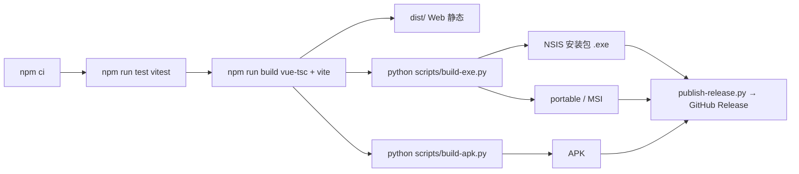

**版本号单一来源**：根 `package.json`。`build-apk.py` / `publish-release.py` 均读取该值，产物名、Android `versionName`、Release tag 自动跟随 —— 这条已有的设计很好，本次改动**不要破坏**它。

## 10.2　本次改动对构建的影响

| 改动类型 | 是否影响构建 | 说明 |
| --- | --- | --- |
| 类型拆分（`BodyGraph` → 多个） | 影响 | `vue-tsc --noEmit` 会全量报错，必须一次改完再提交，不能半途 |
| 新增路由（`/penta`、`/transit`） | 影响 | 懒加载分包，注意 hash 路由已配置，无需额外服务端配置 |
| 新增导出（PNG） | 影响 | 需要 canvas 2D，Electron/WebView 均支持；**注意 Android WebView 的字体**，建议导出前把文字转 path |
| 存储结构变更（`archives.v2`） | **强影响** | 必须写迁移：读 `v1` → 转换 → 写 `v2` → 保留 `v1` 只读 30 天 |
| Electron safeStorage | 影响桌面 | 需 `app.whenReady()` 之后调用；Web 端降级为会话存储 |
| APK 权限 | 无变化 | 分享链接若用 `navigator.share` 需在 WebView 内做可用性检测 |

## 10.3　发布检查单（每次发版）

| # | 检查项 | 通过标准 |
| --- | --- | --- |
| 1 | `npm run test` | 全绿，且新增用例数 ≥ 本次修复数 |
| 2 | `npm run build` | `vue-tsc` 零错误 |
| 3 | 隔离断言 | `penta.ts` 无 composite import；合盘页无 type/authority/cross |
| 4 | 曼陀罗锚点 | `node scripts/check-mandala-anchor.mjs` 输出 41.1 |
| 5 | 升级路径 | 用上一版导出的 JSON 导入，档案数量与盘面一致 |
| 6 | 桌面安装包 | NSIS 静默安装 → 启动 → 冒烟 29 项 |
| 7 | Android | 真机安装 → 打开 → 建档 → 导出 PNG |
| 8 | 版本一致性 | `package.json` = Android `versionName` = Release tag |
| 9 | 变更公告 | 若算法有变（如锚点修正），公告必须说明"旧盘会重算，结果可能变化" |

## 10.4　迭代节奏建议

| 版本 | 内容 | 是否 breaking |
| --- | --- | --- |
| **v1.2** | 曼陀罗锚点修正 + engineVersion + 同人合盘拦截 + 导入校验 + 存储损坏保护 | ⚠️ 盘面可能变化，需公告与"新旧对比" |
| **v1.3** | 合盘四象限 + 关系主题 + 删除越界卡片 + 类型拆分 | 否（但需迁移 stored chart） |
| **v1.4** | Penta 独立模块 + 隔离守门 + 发现函数清理 | 否 |
| **v1.5** | 行运流日 + 分享（PNG/卡片/链接） | 否 |
| **v2.0** | 知识库大补（角色/变量/爻）+ 三态闸门 + 标准层/扩展层分层 | 否（内容层） |

## 10.5　回滚预案

| 场景 | 动作 |
| --- | --- |
| v1.2 锚点修正后大量用户反馈"盘变了" | 保留 `engineVersion` 双算能力 30 天：设置里提供"按旧口径查看（已弃用）"开关，仅用于对照，不写回 |
| 存储迁移失败 | 迁移前自动导出 `.bak`；失败则回滚到 `v1` 键并提示 |
| Penta 引入后出现性能问题 | Penta 路由懒加载 + 人数上限 5，必要时降级为"仅计算 + 文本结果，不渲染 SVG" |

---

# 附录 A　参数校验表（L1–L5）

| 关卡 | 校验内容 | 当前实现 | 缺口 |
| --- | --- | --- | --- |
| L1 类型 | 数字/字符串/枚举/数组 | 部分（TS 编译期） | 运行时无（导入路径） |
| L2 范围 | 年 1900–今、月 1–12、日按月份、时 0–23、分/秒 0–59、时区合法 | 仅 `EntryView` | 导入路径缺失；`isValidTimeZone` 未调用 |
| L3 语义 | 合盘 2 人且不同、Penta 3–5 人且不同、对比 2 人且不同 | 合盘仅数量；对比有同人规避 | 合盘同人缺失；Penta 全缺 |
| L4 引用 | 档案 id 存在、chart 可用 | 合盘仅 `ready` 判断 | 无错误提示 |
| L5 一致性 | 算法版本、schema 版本 | 无 | 全缺 |

---

# 附录 B　验收用例（Given / When / Then）

| # | Given | When | Then |
| --- | --- | --- | --- |
| 1 | 档案 X 存在 | 访问 `/composite/X/X` | 显示"需要两位不同的人"，不渲染任何合盘结果 |
| 2 | 选 3 份档案 | 点卡片「加入合盘」 | 提示"合盘最多 2 份，当前 3 份" |
| 3 | 两位都有盘 | 生成合盘 | 页面出现"共定义/仅A/仅B/双开放"四格，四格计数之和 = 9 |
| 4 | 未配置 AI | 打开合盘 | 仍能看到"关系主题"离线结论 |
| 5 | 合盘页 | 截图全文搜索 | 不出现"能量类型""内在权威""轮回交叉" |
| 6 | 导入 `{month:13}` | 点导入 | 该条被拒，toast 报"跳过 1 份：出生月份非法" |
| 7 | 破坏 `hdt.archives.v1` | 刷新 | 出现横幅与"导出损坏数据"，不出现空档案库 |
| 8 | NY 2021-11-07 01:30 | 提交 | 弹出"该时刻有两个可能，请选择"，未选择不得建档 |
| 9 | 3 位成员 | 进入 Penta | `/penta/...` 出五边形图；正文无"类型"字样 |
| 10 | Penta 源码 | `grep "composite" src/engine/penta.ts` | 无结果 |
| 11 | 任意盘 | 点"今日流日" | 出双图层图 + 被点亮中心；无"你未来会…"句式 |
| 12 | 导出 PNG | 在 Android WebView 打开 | 中文完整、无方块 |

---

# 交付说明

**本文档定位**：业务流程审计 + 体系合规校验 + 修改施工单。与 `人类图软件全量审查与重构规划-2026-10-27.md`（v2，规则/知识库层）互补——那一份管"内容对不对"，这一份管"流程通不通、模块有没有串"。

**三句话结论**：
1. 用户预设的两条违规（3/4 人合盘、自由拼接通道）**不存在**，代码是干净的；真正的问题是**合盘可以对自己做**、**合盘缺两项法定输出**、**合盘把个体属性贴给关系**。
2. Composite 与 Penta 现在"没混用"只是因为 Penta 还没写；`mergedAsChart` 返回 `BodyGraph` 这个载体复用，是将来混用的种子，**必须在 Penta 开工前拆掉**。
3. 流程层最薄弱的一环不是计算，是**校验位置**——校验写在入口（UI），没写在被调用方（引擎/路由），所以每新增一个入口（导入、手改 URL、未来的分享链接）就漏一次。

**建议执行顺序**：第 9.1 批（类型与引擎拆分）→ 9.2（合盘修正）→ 9.3（校验与异常）→ 9.4（Penta / 行运 / 分享）。其中 **PF-001（同人合盘）可以今天就修**，成本约 10 行。

**审计过程中的自我更正（留痕）**：
- 初稿曾判定 `/boards` "刷新即丢失状态"，复核源码后发现 `MultiBoardView` 优先读 `route.query.ids`、`closeOne()` 会 `router.replace` 同步 URL —— **该判定错误，已撤回**；多盘的状态管理实际是本项目做得最规范的一处。PF-015 因此缩小为"移动端静默重定向"一条。
- 初稿曾把"时区异常"归到 PF-006（存储损坏），已更正为 PF-023（时区校验未调用）。
- 三条预设违规中，"3/4 人合盘"与"自由拼接通道"经代码核查**不成立**，未按违规计入清单，只保留其相邻的真实缺陷（PF-001 / PF-009）。
