# 人类图工具（HumanDesignTool）全量审查 · 校验 · 重构规划

> 评审对象：`D:/AIws/txgzml/rlt`（package.json v1.1.0，源码 15,107 行 TS/Vue，7 个视图 / 41 个组件 / 13 个服务 / 4 个引擎模块 / 5 个测试文件）
> 评审日期：2026-10-27
> 评审方式：源码逐文件走查 + 计算内核数理推演 + 权威资料比对 + 交互流程反推 + 结构/流程二次复核
> 结论摘要：**计算内核的星历层与拓扑层质量很高（36 条通道、64 门归心、类型/权威/定义判定与主流口径一致），但曼陀罗锚点存在 2′30″ 系统性偏移（P0），知识库存在"四大支柱缺两根"的结构性空洞，合盘存在被伪造的轮回交叉（P1），另有 6 项 P1 级流程/数据可信性缺陷。**

---

# 章节 0　基准对齐与判定重标定（v2 修订）

> 本章是按用户指定的《评审参考基准资料清单》对全文做的**重新标定**。原始结论保留不动（便于对照），凡判定发生变化者在本章 §0.4 逐条列出——包括**我撤回了自己的一条建议**（HD-028）。

## 0.1 基准落地方式与证据分级

基准清单的优先级是"Jovian 原版 > Beaumont 传承 > Gene Keys > 开源实现 > 中文衍生"。为了让"冲突"可判定，全文引入证据分级：

| 级别 | 来源 | 本报告用法 |
| --- | --- | --- |
| **L1** | jovianarchive.com（词典 / FAQ / 博客 / Just Now）、myBodyGraph、Maia Mechanics，以及原版出版物（Rave I'Ching、Incarnation Crosses by Profile、Rave Anatomy、Rave Psychology、BG5/Penta 文档） | **唯一判定基准**。与 L2–L4 冲突时，一律以 L1 为准 |
| **L2** | human.design（Richard Beaumont 直系传承） | 用于补充 L1 未覆盖的细节；与 L1 冲突则作废 |
| **L3** | rave-engine、SharpAstrology、human-design-redefined、hd-tools、swisseph | **仅用于校验计算实现**，不作为理论依据；若与 L1 冲突，判 L3 有缺陷 |
| **L4** | 中文衍生站点、商业解读站（含本报告 v1 引用过的 codesoflife / hdnavigator / humandesigncore 等） | 仅作旁证，不单独支撑"正确/错误"的结论 |

**一个必须先说清的判定冲突**：规则 D 说"与 rave-engine / SharpAstrology 不一致 → 判计算 bug"。但本次核验发现 **rave-engine 本身与 L1 不一致**（见 §0.2）。此时 D 与 A 冲突，按清单优先级（Jovian 最高）与规则 A 的措辞（"与 Jovian 原版体系冲突 → P0/P1 理论错误，必须修正"），结论是：
- 软件**忠实移植了 rave-engine**（因此不违反 D）；
- 但 **移植的对象本身错了**（违反 A）；
- 最终判定仍是计算错误，**责任在常数、不在移植**；
- 同时应向上游 rave-engine 提 issue（附录 E.3 附了可直接提交的缺陷报告草稿）。

## 0.2 本次新增的 L1 硬证据：Rave New Year 复算

L1 原文（Jovian 官方博客与产品页）给出两年精确时刻："当太阳进入第 41 闸门时，Rave New Year 开始（2024 年：1 月 22 日 13:18 UTC；2026 年：1 月 22 日 00:54 UTC）"，并明确"第 60 闸门是这一年的完成"。

用软件**自己的星历**（astronomy-engine，同一份 `ephemeris.ts` 逻辑）复算这两个时刻：

| 核验项 | L1 给定 | 软件星历复算 | 结论 |
| --- | --- | --- | --- |
| 2026 Rave New Year | 2026-01-22 **00:54 UTC** | 该时刻太阳视黄经 = **302.00016°** | 与 302.000° 差 0.01′ |
| 2024 Rave New Year | 2024-01-22 **13:18 UTC** | 该时刻太阳视黄经 = **302.00019°** | 第二年独立复现 |
| 反解"太阳到 302.000°"的时刻 | — | 2026-01-22 **00:53:46 UTC** | 与官方 00:54 **差 14 秒** |
| 反解"太阳到 302.0417°"的时刻 | — | 2026-01-22 **01:52:47 UTC** | 比官方晚 **58 分 47 秒**，直接排除 |
| 应然偏移 = 331.875 − 302.00016 | — | **29.87484** | 取 **29.875**（残差 0.7″，仅来自官方只公布到分钟） |

**结论（L1 级，不可辩驳）**：Gate 41 第 1 爻起点 = **302.000°**，`MANDALA_OFFSET` 应为 **29.875**，软件现值 29.8333 错了 **0.0417°（2′30″）**。

最直观的呈现：在 Jovian 公布的两个 Rave New Year 时刻，现实现返回 **Gate 60.6**，而 L1 明确是 **Gate 41.1**。⚠️ 注意这不代表"所有盘都错一个门"——偏离量恒定 0.0417°，只有落在边界附近的激活点会错（爻级约 4.4%，门级约 0.74%）；Rave New Year 恰好踩在边界上，所以呈现出整门错位。

复现：`node scripts/check-mandala-anchor.mjs`（已加入仓库，输出两个官方时刻、反算偏移、四个边界锚点的现实现 vs 修正后对比）。

同时确认：**rave-engine 的 `src/calc/mandala.js` 用的是同一个错误常数**（`2*line_width - 1*color_width - 1*tone_width + 3*base_width` + 5 门宽 = 1.7083 + 28.125 = 29.8333），因此"与 rave-engine 完全一致"这件事恰恰是**共犯证据**，不是正确性证明。上游 defect 报告草稿见附录 E.3。

## 0.3 判定规则 A/B/C/D 与优先级的对应

| 规则 | 判定含义 | 本报告标签 | 优先级映射 | 处置要求 |
| --- | --- | --- | --- | --- |
| **A** | 与 Jovian 原版体系冲突 | `【A·理论错误】` | P0 / P1 | 必须修正，不设"产品决策"选项 |
| **B** | 原版体系不存在（自创通道 / 自创规则 / 自创模块） | `【B·衍生扩展】` | 不自动判错，按影响给 P3–P9 | 界面标注"不属于正统 Ra 体系"，**交产品决策去留** |
| **C** | 单薄、缺原版描述、解读片面 | `【C·增补】` | P2 / P3 | 按原版出版物补全，不得用二手转述充数 |
| **D** | 与 rave-engine / SharpAstrology 排盘不一致 | `【D·计算bug】` | P0 / P1 | 先核 L1：若 L1 支持 rave-engine 则改本软件，若 L1 支持本软件则提上游 issue |
| — | 工程/体验/安全/文案问题，与理论无关 | `【—·工程】` | 原优先级 | 按工程优先级处理 |

## 0.4 v1 → v2 改判清单（含撤回）

| 条目 | v1 判定 | v2 判定 | 依据 | 变化 |
| --- | --- | --- | --- | --- |
| HD-001 | P0 逻辑矛盾（证据 L3） | **P0【A·理论错误】**，证据升至 **L1** | §0.2 两年 Rave New Year 复算 | 升级；并新增"上游 rave-engine 同缺陷"结论 |
| HD-003 | P1 逻辑矛盾 | **P1【B·衍生扩展】+【D/实现bug】** | L1 词典：交叉由 Personality 与 Design 的 **Sun/Earth 交叉极性**构成（属个体）；Maia 合盘以关系动力学为主 | 分类改为 B（去留交产品）+ 保留 bug 必修 |
| HD-005 | P1 知识库问题 | **P1【A·理论错误】** | L1 词典 `Defined Center` "fixed and reliable"；`Harmonic Gate` 定义 | 升级为 A；术语改用 L1 原词（见下） |
| HD-008 | P2 知识库问题 | **P2【C·增补】** | L1《Incarnation Crosses by Profile》；词典"Angles are derived from the twelve Profiles" | 降级为增补（不判错） |
| HD-009 | P2 待补充 | **P2【C·增补】** | L1《Rave Psychology》（Variable / Color-Tone-Base / PHS） | 降级为增补 |
| HD-010 | P2 待补充 | **P2【C·增补】** | L1《The Complete Rave I'Ching》（64 门 × 6 爻） | 降级为增补 |
| HD-011 | P2 知识库问题 | **P2【C·增补】** | L1 词典 `Definition`："four different kinds… and those without definition" | 降级为增补；软件现有 4+1 分类与 L1 **完全一致** |
| HD-013 | P2 知识库问题 | **P2【A·理论错误】** | L1：`Inner Authority` "**it is never the mind**"；`Defined Center` = "fixed and reliable"，且"defined 是学生、open 是课程" | 明确 A 类；并新增一条术语级修正（见下） |
| HD-014 | P2 知识库问题 | **P2【A·理论错误】** | 6 爻三阶段属 L1《Rave Psychology》爻位教学；凯龙不属 13 体 | 明确 A 类 |
| HD-015 | P2 知识库+流程 | **P2【C·增补 + B·标注】** | L1 有 Transit 基准（Just Now / Transit Connection Chart），本软件静态文案冒充行运 | 标签改；处置不变 |
| HD-016 | P2 新功能 | **P2【C·基准功能缺失】↑** | L1 FAQ 明确指引 Maia "**Birth Time Reliability Score**"：自动检测输入时间前后是否改变设计 | **升级**：从"创意"改为"对标 L1 基准的缺失功能" |
| HD-023 | P2 口径漂移 | **P3【B·衍生扩展】** | 原版无"前世姻缘" | 降为 P3（不判错，标注后交产品决策） |
| HD-024 | P2 体系边界 | **P3【B·衍生扩展】** | L1 明确 13 体不含 Chiron；`Lilith`/`Chiron` 非 bodygraph 组成 | 降为 P3（标注即可，不强制删除） |
| HD-028 | P3 建议"自建 192 交叉主题词" | **P3【C·增补】，并撤回自建方案** | 用户规则："不允许自行创造、杜撰人类图相关理论规则" | **撤回**：不得自造交叉名（详见下方"自我撤回"） |
| 新增（并入 HD-013 / T-04） | — | **P2【A·理论错误】** | L1 词典 `Authority`："There are two kinds of Authority: Inner Authority … never the mind; Outer Authority … the true and proper realm of mind" | 新增：软件把"心智权威"表述为"环境（脑中心）权威"与 L1 的 Inner/Outer 二分**不同源**，须改口径 |

### 自我撤回：HD-028 的"自建 192 交叉主题词"

v1 我建议"自建 64×3 主题词，标注非官方命名"。按新规则这属于**自创理论内容**，必须撤回。修正后的方案只有两条：

| 方案 | 做法 | 利 | 弊 |
| --- | --- | --- | --- |
| A（推荐） | **只展示结构**（角度 + 四闸门 + 每门的 L1 原版关键词），交叉名称留空并显示"该交叉名称未收录（属 Jovian 授权出版物）" | 绝对不越界；用户仍能读到四闸门的原版语义 | 少一个"好记的名字" |
| B（需授权） | 引入《Incarnation Crosses by Profile》授权内容做名称映射 | 完整、权威 | 需版权许可，成本高 |

**不得**采用"自己起名 + 标注非官方"的折中——那正是规则禁止的"自行创造"。

### 术语修正（L1 原词，替换 v1 的通行说法）

| 概念 | v1 用词 | L1 原词 | 说明 |
| --- | --- | --- | --- |
| 单端激活的**另一端** | （未区分） | **Harmonic Gate（谐波闸门）**："In a Channel where one Gate is activated, the unactivated Gate at the other end of the Channel is the Harmonic Gate." | 软件把"被激活的那一端"叫悬挂闸门（hanging gate，L1 词典未收录该词条，属通行叫法），把"未激活的另一端"完全忽略了——而 Harmonic Gate 恰是解读"我在等谁"的关键 |
| 定义中心 | "能量稳定、说到做到" | **"fixed and reliable"**，且"defined 是学生，open 是课程" | 直接改文案的锚句 |
| 权威 | "7 种权威"（并列） | **Inner Authority / Outer Authority 二分**，Inner "never the mind" | "7 种"是教学层细分（L1 出版物支持），但**不可把心智说成"内在权威"** |
| 类型 | "5 种类型"（并列） | 词典："Generators **and** Manifesting Generators … the largest **Type group**"（同一 Type group，未设独立词条） | 5 类展示可保留，但需标注 MG 属生产者亚型（B 类展示选择） |

## 0.5 基准清单中"本软件未覆盖"的模块

| 基准模块 | 软件现状 | 判定 | 说明 |
| --- | --- | --- | --- |
| **Variable / PHS**（Rave Psychology） | 无四箭头、无 Determination/Environment/Motivation/Perspective | **C·增补** | 数据层已算 color/tone/base，只缺 L1 对照表（HD-009） |
| **BG5** | 无 | 不适用 | 属 L1 商业分支体系；若未来新增，须以 BG5 文档为准，且**不得与个人盘解读混排** |
| **Penta** | 无 | **C·增补（P9）** | L1 词典在 `Rave Children` 词条中使用"conscious Pentas"，确认是原版概念；软件缺（HD-062） |
| **OC16** | 无 | 不适用 | Maia/BG5 专业功能；无对应数据结构，不建议自研 |
| **Gene Keys** | 无 | **不适用（本轮不校验）** | 软件不含 GK 模块。**重要提醒**：GK 的 11 Sphere / Golden Path / Codon Rings 是独立体系，其闸门-基因钥匙映射不可反向混入 HD 解读；若未来新增，须按清单第四段独立校验，且同样禁止自创 Sphere 规则 |
| **Transit / Just Now** | 只有静态"未来形势" | **C·增补** | L1 有 Just Now 基准（HD-015/HD-043） |
| **合盘 / 关系盘** | 有三栏合盘 + 四类关系通道 | **B·部分** | 四类关系通道是通行连接盘分析（L1 有 Relationship Chart 服务）；"合图类型/权威/交叉"无 L1 依据（HD-003） |

## 0.6 按基准逐项复核后的净结论

| 维度 | v1 结论 | v2 复核 | 变化 |
| --- | --- | --- | --- |
| 排盘计算 | 1 项 P0（锚点） | **P0 成立，且证据升级为 L1** | 强化 |
| 闸门/通道/中心拓扑 | 全对 | **全对，且与 L1 的 64 门/36 通道/9 中心表述一致** | 不变 |
| 类型/权威判定逻辑 | 基本正确 | **判定逻辑正确；权威"命名与二分框架"与 L1 不同源（A 类，需改口径）** | 新增 1 项 |
| 定义类型 | 只有标签 | **分类与 L1 完全一致（4+1），仅缺文案（C）** | 降级 |
| 轮回交叉 | 结构正确、名称为空 | **结构正确；名称不得自造（撤回原建议）** | 收紧 |
| 变量 / Penta / BG5 / GK | 缺失或未涉及 | **变量 C、Penta C、BG5 不适用、GK 不适用** | 细化 |
| 合盘 | 概念外推 | **B 类（交产品决策）+ 实现 bug** | 分类调整 |
| 凯龙 / 前世姻缘 | 体系混入 | **B 类（标注即可）** | 降级 |
| 时间可靠性 | 未涉及 | **L1 基准功能缺失，升级为 P2** | 升级 |

---

# 章节 1　评审概述 & 评审依据

## 1.1 评审范围

| 层次 | 覆盖内容 | 本次审查深度 |
| --- | --- | --- |
| 计算内核 | `src/engine/`（ephemeris / time / mandala / bodygraph / composite / chiron） | 逐行推演 + 数值反算 + 锚点校验 |
| 解读知识库 | `src/services/`（interpretations / gateInsight / crossData / typeDetail / destinyText / planetText / readingAngles） | 全量比对术语与机制，逐条勘误 |
| 交互与视图 | `src/views/` 7 个视图、`src/components/` 41 个组件 | 全链路反推，输出 1:1 操作逻辑图 |
| 数据与持久化 | `src/stores/`、`src/utils/storage.ts`、`src/types/hd.ts` | 数据模型、迁移能力、容量与安全 |
| 交付与分发 | Electron / Android 壳、`scripts/`、CI | 只做边界确认，不作为本次重点 |
| 测试体系 | `tests/` 5 个文件、README 的验证声明 | 校验方法论有效性 |

## 1.2 评审依据（权威资料清单）

判断"对/错"必须有口径。**判定基准以 §0.1 的 L1（Jovian 原版）为唯一准绳**；下表 R1–R10 是把 L1 口径翻译成"可计算的具体数值"的**交叉验证源（L2–L4）**，其作用仅限于"当 L1 只给了定性表述时，提供一个可编程的数值/清单"，凡与 L1 冲突处一律以 L1 为准（冲突记录见 §0.2、§0.4）。

| 编号 | 依据 | 用到的具体口径 | 来源 |
| --- | --- | --- | --- |
| R1 | Rave Mandala 几何 | 360°÷64 门 = 5.625°；门÷6 爻 = 0.9375°；**Gate 41 第 1 爻起于宝瓶座 2°00′00″ = 黄经 302.000°**；Gate 60 止于 302.000°。**该数值已用 L1 的 Rave New Year 时刻反算证实（§0.2），证据等级 L1** | L1：jovianarchive.com Rave New Year 2024/2026 时刻 + 本地星历复算；L3 旁证：thehumandesignsystem.com/astrology/rave-mandala、gethumandesign.com/docs/background/the-rave-mandala |
| R2 | 13 天体口径 | Sun / Earth(=−Sun) / Moon / 真交点（True Node，含其 180° 对位南交）/ Mercury…Pluto，共 13；**Chiron、Lilith 不属于标准 13 体，永不定义中心、永不成通道** | L1：Jovian 词典未收录 Chiron 为 bodygraph 组成；L3 旁证：gethumandesign.com/docs/background/lilith-and-chiron |
| R3 | 设计时刻 | 设计时刻 = 太阳视黄经恰比出生时刻少 88° 的时刻（因地球轨道椭圆，浮动约 86.6–92.0 天，**不是固定 88 天**） | asternym.com/human-design |
| R4 | 类型判定 | 4 类型 + 显化生产者（MG）作为生产者亚型；MG = 骶骨有定义 **且** 任一马达（骶骨/根/情绪/心）经完整通道直达或串联至喉咙；显示者 = 有马达→喉咙且骶骨未定义；投射者 = 二者皆无；反映者 = 九中心全开放 | humandesigncore.com/blog/throat-center；asternym.com/human-design |
| R5 | 七种内在权威 | 固定层级：情绪（太阳神经丛）→ 骶骨 → 脾 → 心（自我）→ 自我投射（G→喉咙）→ 心智/环境（仅投射者）→ 月亮（仅反映者）；"太阳神经丛有定义则一律情绪权威" | thehumandesignsystem.com/authorities；codesoflife.com/en/lexikon/human-design-authorities |
| R6 | 12 人生角色与三角度 | 右角度 7 个：1/3、1/4、2/4、2/5、3/5、3/6、**4/6**；并列仅 4/1；左角度 4 个：5/1、5/2、6/2、6/3；角度由人格太阳爻位决定 | codesoflife.com/en/lexikon/human-design-profiles；hdnavigator.ru/en/glossary/profile |
| R7 | 定义类型 | 单一定义 / 二分 / 三分 / 四分；无定义=反映者；判定=已定义中心之间经完整通道的连通分量数 | 同行通用（Jovian 术语） |
| R8 | 四箭头 Variable | 箭头方向由对应激活的 **Tone** 决定（1–3 左/主动，4–6 右/被动）；Color 决定主题：Determination（设计太阳/地球）6 种、Environment（设计南北交）6 种、Motivation（人格太阳/地球）6 种、Perspective（人格南北交）6 种 | gethumandesign.com/docs/variable；humandesignhub.app/en/library/variables-four-arrows |
| R9 | 连接盘（Connection Chart） | 两张盘叠加后读四种动力学：电磁 / 妥协 / 主导 / 同伴；**连接盘本身不是"第三个人"，没有类型/权威/轮回交叉** | thehumandesignsystem.com/astrology（Synastry 段） |
| R10 | 术语体系 | `defined/undefined` 只用于中心、通道、整图；闸门只有 `activated / not activated`，单端激活称悬挂闸门（hanging gate） | 通行术语（Jovian / IHDS） |

**流派分歧声明**（软件若采用另一种口径，只需明确标注，不计为错误）：
1. **4 类型 vs 5 类型**：Jovian 原体系为 4 类型，MG 属生产者亚型；中文社群普遍并列 5 类。本报告不判错，但要求界面至少出现一次"显化生产者是生产者的亚型"的说明（见 HD-013）。
2. **权威数量**：多数资料列 7 种；Jovian 细分出"自我投射权威 / 心智（环境）权威 / 月亮权威"之外，还把心（自我）权威拆为"自我显现 / 自我投射"两种。软件合并为 1 种可接受，但需在文案里说明差别。
3. **轮回交叉名称**：L1 词典明确"共 192 个基于角度的通用交叉"（"one hundred and ninety-two general Incarnation Crosses based on Angle"），但**名称本身属 Jovian 授权出版物**。按新规则"不允许自行创造"，**不得自建名称**；软件当前只给结构，方向正确（见 §0.4 对 HD-028 的撤回与修正）。

## 1.3 判定口径（软件必须固定的技术约定）

| 项 | 软件现状 | 应为 | 判定 |
| --- | --- | --- | --- |
| 黄道 | 视黄经 of date（真黄道 + 当日平分点），含章动 | 回归黄道、视黄经 | ✅ 正确 |
| 交点 | 真交点（Meeus 47 章平交点 + 5 项周期改正 + 章动） | True Node（非 Mean Node，二者可差 ±1.7°，跨门） | ✅ 正确且实现讲究 |
| 地球 | 太阳黄经 +180° | 同 | ✅ |
| 南交 | 北交 +180° | 同 | ✅ |
| 月亮的aberration | 不叠加恒星光行差 | 地心月亮不含光行差 | ✅ 正确（很多实现错在这） |
| 设计时刻 | 二分法求"太阳少 88°" | 同 | ✅ 正确（非固定 88 天） |
| 闸门盘序 | 偏移 29.8333° | **29.875°**（见 HD-001） | ❌ P0 |
| 类型/权威/定义 | 见 §2 | 见 R4/R5/R7 | ✅ 判定逻辑正确 |
| 轮回交叉角度 | 4/1=并列，人格爻≥5=左角度，其余右角度 | 同（4/6 属右角度） | ✅ 正确（易错点，实测无误） |

> 说明：4/6 属右角度这一点，社区流传两种说法。**L1 词典 `Angles` 条目已给出三类角度及各自对应的角色数量（Right Angle 7 / Juxtaposition 1 / Left Angle 4），并说明 "Angles are derived from the twelve Profiles"**；三角度合计 7+1+4=12，与"4/6 归右角度"完全吻合。软件现有 `if (profile === '4/1') 并列 else if (pl >= 5) 左角度` **正确，不需改**。

## 1.4 总体评分

| 维度 | 得分 | 说明 |
| --- | --- | --- |
| 星历与时间 | 9.0 / 10 | 真交点、月亮光行差、88° 求根都做对了；扣分在 DST 告警被丢弃（HD-002） |
| 曼陀罗映射 | 3.0 / 10 | 锚点偏移 2′30″，系统性、全局性（HD-001） |
| 体图拓扑数据 | 10 / 10 | 64 门归心、36 通道配对、GATE_CENTER 覆盖 100% 正确，无一处错 |
| 类型/权威/定义判定 | 9.0 / 10 | 主流程判定正确；心智权威命名与心权威细分可优化 |
| 解读知识库 | 4.0 / 10 | 64 门 + 36 通道 + 9 中心 + 5 类型 + 7 权威齐备，但**人生角色、定义类型、384 爻、四箭头四个支柱缺失或空壳** |
| 合盘 | 5.0 / 10 | 电磁/同伴/主导/妥协四分类正确；但合盘类型/权威/交叉的概念外推过度，且交叉实现有 bug |
| 数据与迁移 | 3.0 / 10 | 无算法版本、无迁移、无容量管理、无损坏恢复 |
| 交互体验 | 7.0 / 10 | 信息密度与布局用心；缺导出、缺不确定性流程、缺 AI 记录入口 |
| 可验证性 | 5.0 / 10 | 有 29 项测试与真机自检，但金标准同源，无法发现系统性偏差 |
| 工程与文档 | 7.5 / 10 | 结构清晰、注释认真；文档存在版本与数字漂移 |

---

# 章节 2　问题总清单

> 编号规则：`HD-xxx`；分类取值 = 优化点 / 逻辑矛盾 / 待补充 / 知识库问题 / 流程问题。
> 优先级按 P0→P9 排列。每条均给出可落地的文件名与行号。

## 2.1　P0 — 致命（必须立刻修复）

### HD-001　Rave Mandala 起始锚点偏移 2′30″，全局错一格风险
- **【问题分类】** 逻辑矛盾（计算内核 · 曼陀罗映射）
- **【按新基准判定】** **【A·理论错误】· P0**。附带结论：软件与 rave-engine **完全一致**（忠实移植），但 rave-engine 自身与 L1 冲突，所以"与基准引擎一致"在这里**不是正确性证明，而是共犯证据**（规则 D 让位于规则 A）。
- **【问题描述】** `MANDALA_OFFSET` 被算成 `5×5.625 + (2×0.9375 − 0.15625 − 0.0260417 + 3×0.0052083) = 29.8333°`，导致 Gate 41 第 1 爻起点落在 **302.0417°**，而权威口径是宝瓶 2°00′00″ = **302.000°**。64 个门边界、384 个爻边界整体平移 0.0417°。四处可自证的锚点全部对不上：
  | 锚点 | 权威值 | 软件实算 |
  | --- | --- | --- |
  | Gate 41 起点 | 302.000°（宝瓶 2°00′） | 302.0417° |
  | Gate 60 终点 | 302.000° | 302.0417° |
  | Gate 18 起点 | 183.875°（天秤 3°52′30″） | 183.9167° |
  | Gate 25 起点 | 358.250°（双鱼 28°15′） | 358.2917° |
- **【L1 硬证据】**（2026-10-27 补，可复现脚本：`scripts/check-mandala-anchor.mjs`）Jovian 官方公布 Rave New Year 的精确时刻：2024-01-22 13:18 UTC、2026-01-22 00:54 UTC（太阳进入第 41 闸门）。用**本项目自己的星历**复算：
  - 两个官方时刻的太阳视黄经 = **302.00019° / 302.00016°**（与 302.000° 差 0.01′）；
  - 反解"太阳到达 302.000°"= 2026-01-22 **00:53:46 UTC**，与官方 00:54 **相差 14 秒**；
  - 反解"太阳到达 302.0417°"= 2026-01-22 **01:52:47 UTC**，比官方 **晚 58 分 47 秒**，假设直接排除。
  - **最直观的一条**：在 Jovian 给出的两个 Rave New Year 时刻，现实现映射出的是 **Gate 60.6**，而 L1 明确那一刻是 **Gate 41.1** —— 不是"错一爻"，而是**整整错一个闸门**（因为正好落在边界上）。改成 29.875 后两个时刻均返回 41.1。
  结论：41 门起点 = 302.000°，应然偏移 = 331.875 − 302.000 = **29.875**。推导细节见 §0.2。
- **【产生原因说明】** 偏移量是从"同源实现"（free-human-design / rave-engine）反推出来的，而不是从 L1 锚点正推。原作者用"2 爻 − 1 色 − 1 音 + 3 基"凑出 1.7083° 这个数，算式自洽但没有依据 —— 它与正确值 1.75° 恰好差 **1/24°（= 0.04167°）**，这正是全部偏差的来源。同源实现使用同一常数，所以"26 个激活点完全一致"与"2600 个位置无分歧"两项验证**在数学上不可能发现该偏差**。
- **【具体可落地改进建议】**
  1. 方案 A（最小改动）：`src/engine/mandala.ts:26` 改为 `export const MANDALA_OFFSET = 5 * HEX + 1.75`，注释写明"41 门在 `ICHING_MAP` 中位于索引 59，起点 = 59×5.625 − 29.875 = 302.000°"。
  2. 方案 B（推荐，防再错）：改为正向算法 —— `const SEQ = [41,19,13,49,30,55,...]`（以 41 为首），`index = Math.floor(((lon - 302 + 360) % 360) / HEX)`，把锚点写成一个常量 `MANDALA_START = 302`。可读、可审计、与 L1 表述一一对应；代价是要重排 `ICHING_MAP`（把 55 开头的数组旋转 5 位，其余不动）。
  3. 无论选哪个方案，必须补 5 条锚点断言测试（41@302.0、60 末@302.0、18@183.875、25@358.25、25.2 跨 360°），并断言"任何门宽恰为 5.625°、任何爻宽恰为 0.9375°、64 门覆盖 0–360 无重叠无缝隙"。
  4. **把 Jovian 公布的 Rave New Year 时刻直接做成回归测试**（2024-01-22T13:18Z、2026-01-22T00:54Z → 断言映射结果恰为 Gate 41 / Line 1）。这是唯一一条不依赖任何第三方实现的 L1 断言，成本 6 行代码。
  5. 向上游 rave-engine 提 issue（草稿见附录 E.3）。
- **【优先级】** **P0**
- **【影响面】** 太阳 0.9856°/天 → 边缘人群相当于出生时间差约 1.0 小时；月亮 13.18°/天 → 差约 4.6 分钟。按 0.0417/0.9375 = 4.4% 计，约每 23 个激活点就有 1 个可能落错爻；爻错 → 人生角色错 → 轮回交叉角度错；闸门错（0.74%）→ 通道/中心/类型/权威连锁全错。

## 2.2　P1 — 核心逻辑缺陷 / 严重误导

### HD-002　本地时刻不存在或歧义（DST）的告警被静默丢弃
- **【问题分类】** 流程问题（也构成文档与实现不符）
- **【问题描述】** `zonedToUtc()` 明确返回 `{ date, warning }`（`src/engine/time.ts:84-93`），但唯一调用方 `computeChart()` 只解构了 `date`（`src/engine/bodygraph.ts:301`），`warning` 从未抵达任何 UI；`EntryView` 的实时预览还在 `try/catch` 里静默 `return null`（`src/views/EntryView.vue:118-126`）。而 README 第 60 行与 EntryView 第 282–285 行都白纸黑字承诺"若出生时刻落在夏令时切换点，系统会提示核实"。
- **【产生原因说明】** 告警是"计算层的返回值"，但没有设计"如何穿透 store → view"的通道；`ArchiveDraft` 里也没有存放 warnings 的位置，所以即使想显示也无处可取。
- **【具体可落地改进建议】**
  1. `computeChart` 改为返回 `{ chart, warnings: ChartWarning[] }`，或在 `BodyGraph.meta` 增加 `warnings`。
  2. 档案结构加 `warnings?: string[]`，`create/update` 时落库并在单盘页顶部以黄色条常驻显示。
  3. DST **春季跳变**（时刻不存在）：显示"该时刻在当地不存在（已跳过 1 小时），系统按 XX:XX 计算，请确认"。DTS **秋季回拨**（两个可能时刻）：必须让用户二选一，而不是默认取一个 —— 差 1 小时足以改写通道。方案 A：默认取较早一次并提示；方案 B：强制用户选择后才允许提交（推荐 B，因为这是"数据正确性"而非"体验优化"）。
  4. 增加测试：`America/New_York` 2021-03-14 02:30（不存在）、2021-11-07 01:30（歧义）、`Asia/Shanghai` 1990-05-06 02:30。
- **【优先级】** **P1**

### HD-003　合盘"轮回交叉"概念不成立，且实现把 A 的太阳/地球用了两遍
- **【问题分类】** 逻辑矛盾（违背人类图底层定义）
- **【按新基准判定】** **【B·衍生扩展】+【实现 bug】**。两层问题分开处置：①"合图有轮回交叉"在原版体系中**不存在**，属自创概念 → B 类，界面标注后**交产品决策**是否保留；②`decideCross` 的参数复用是**纯实现 bug**，无论保不保留都必须修。
- **【问题描述】** `src/engine/composite.ts:150-151`：
  ```ts
  const crossStars = [pSun, pEarth, dSun, dEarth]   // A.pSun, A.pEarth, B.pSun, B.pEarth
  const compositeCross = decideCross(crossStars, crossStars, a.profile)
  ```
  `decideCross(personality, design, profile)` 内部在 `personality` 与 `design` 两个数组里各找一次 Sun/Earth。因为两个参数传的是**同一个数组**，`design.find(Sun)` 返回的仍然是 A 的太阳 —— 于是"设计侧"变成"人格侧的复制"。更根本的问题：L1 词典明确"Incarnation Cross 由 Personality 与 Design 的 **Sun/Earth 交叉极性**构成"，这是**个体**的属性；两张盘叠加后没有"第三个交叉"。
- **【L1 依据】** 词典 `Incarnation Cross`："An Incarnation Cross is formed by the crossing polarities of the Personality and Design Sun/Earths… There are one hundred and ninety-two general Incarnation Crosses based on Angle." —— 主语是"一个人"的 Personality 与 Design，不是两个人的。
- **【产生原因说明】** `BodyGraph` 接口把 `incarnationCross` 设为必填（`src/types/hd.ts:170`），`mergedAsChart()` 为了让合图能复用同一套 SVG/文案组件，强行造了一个字段填进去。
- **【具体可落地改进建议】**
  - 方案 A（推荐）：`BodyGraph.incarnationCross` 改为可选；合图删除交叉与"合图类型/权威"的**结论性展示**，改为"关系场指标"：合图后新增定义了哪些中心、哪些开放中心被对方点亮、定义类型由几分变为几分、四类关系通道清单。这三项才是连接盘真正能推出来的东西。
  - 方案 B：保留交叉字段但只做"并置"：并列展示 A 的交叉与 B 的交叉（各带四闸门），不做合成，且标题写"双方交叉（并列参考）"。
  - 方案 C（不推荐）：修好参数（personality=A 侧，design=B 的**设计侧**）继续输出"合图交叉"。修好也仍是自造概念。
  - 利弊：A 最干净，需改 1 个类型字段 + 3 处 UI（CompositeView、BoardMeta、chartSummaryOf）；B 改动最小但用户仍会误读成"我们的交叉"。
- **【优先级】** **P1**

### HD-004　档案存"算完的盘"且无算法版本，修正算法后存量数据不会自动更新
- **【问题分类】** 流程问题（数据可信性）
- **【问题描述】** `Archive.chart` 是完整 `BodyGraph` 快照（`src/stores/archive.ts:64-80`）；`ensureChart()` 仅在 `chart` 缺失时补算；`regenerateAll()` 只在用户手动点设置页按钮时调用。整个结构里没有 `engineVersion` / `dataVersion`。这意味着 HD-001 修好之后，老用户的盘仍然是旧结果，界面不会提示、也无法判断某一份盘是不是可信的。
- **【产生原因说明】** 把"性能优化（缓存计算结果）"与"数据真源"混为一谈，缺少版本化意识。
- **【具体可落地改进建议】**
  1. 在 `BodyGraph.meta` 加 `engineVersion: string`（语义化版本 + 曼陀罗/星历数据的短哈希，例如 `1.2.0+mandala.29.875`）。
  2. 启动时遍历档案，`chart.meta.engineVersion !== CURRENT` 则后台重算并写回，同时在档案卡与单盘页打"已按 vX 重算"角标。
  3. 明确原则：**`birth`（年月日时分秒 + 时区 + 坐标）是唯一真源，`chart` 是可丢弃的派生数据**。导出 JSON 时同时写 `schemaVersion`，导入时走迁移函数。
  4. 给"重新生成全部图表"加二次确认（现在是一次点击全库重算，无撤销）。
- **【优先级】** **P1**

### HD-005　把"被激活的闸门"统称为"有定义（defined）"，术语级误用贯穿全站
- **【问题分类】** 知识库问题（违背术语定义）
- **【按新基准判定】** **【A·理论错误】· P1**。这不是措辞偏好，而是把 L1 明确区分的两个概念合并了。
- **【L1 依据】** 词典 `Defined Center`："the defined Center is colored in and **always connected to another defined Center via a Channel**. Defined Centers are what is **fixed and reliable** in your Design… what is defined is the 'student' and what is open is the 'course' of study." —— 定义指"经完整通道连接后的固定性"，与"行为保证"无关；且开口中心不是缺陷而是"课程"。
- **【问题描述】** `src/services/interpretations.ts:9-13` 定义 `GateText { defined, open }`，`getGate()` 对**任何被激活的闸门**都输出 `defined` 那段文案（"你有持续不断的创造性输出，作品本身就是你的名片"）。但在 HD 里 `defined` 只属于中心/通道/整张图；闸门只有"被激活/未被激活"。单端激活时，L1 把**未激活的那一端**称为 **Harmonic Gate（谐波闸门）**，而被激活的这一端才是通行的 "hanging gate"。当前软件既不区分"成通道 / 仅单端"，也完全没提 Harmonic Gate —— 而它恰是"我在等谁/什么来补全我"的解读入口。一个只激活 Gate 1 没有 Gate 8 的人，读到"你有持续不断的创造性输出"会得到与盘面相反的结论 —— 尤其对投射者与反映者。
- **【产生原因说明】** 早期只有"点亮/未点亮"二元表达，后来加了通道判定，但文案层没有跟着升级为三态；Harmonic Gate 这一层从未进入数据模型。
- **【具体可落地改进建议】**
  1. 抽出 `type GateState = 'in-channel' | 'hanging' | 'open'`，在渲染层统一计算，禁止各组件自行用 `defined` 判断闸门。
  2. 闸门文案改三态字段：`inChannel`（成通道：稳定、可持续）/ `hanging`（单端激活：被放大、易受环境牵引）/ `open`（未激活：他人能量的接收区）。
  3. **新增 `harmonicGate` 概念**：对每个悬挂闸门，显示其通道另一端（L1 `Harmonic Gate`），文案按 L1 语义写"这一端未激活，它代表你会被怎样的人/情境补全"。
  4. 闸门详情顶部加状态徽标：「悬挂 · 显意识」「通道内 · 潜/显双激活」「谐波：Gate 8 未激活」。
  5. 全站术语表统一："激活 / 未激活"（闸门）、"定义 / 未定义"（中心、通道、整图）、"悬挂（hanging）/ 谐波（harmonic）"。
- **【优先级】** **P1**（术语地基，改文案前必须先改数据形状，否则会二次返工）

### HD-006　验证基准与实现同源，无法发现系统性偏差（"全绿"掩盖 P0）
- **【问题分类】** 流程问题（质量保证方法）
- **【问题描述】** README 的核心验证声明是"26 个激活点与 free-human-design 完全一致""2600 个位置比对无分歧"。但本项目曼陀罗常数本身即来自该实现（`mandala.ts` 头部注释自述）。同源比对只能证明"移植没走样"，不能证明"与 Jovian 口径一致"。HD-001 正是在这种"全部通过"的状态下长期存在的。
- **【产生原因说明】** 把"参照实现"当成"金标准"；缺少来自权威公开数值的**绝对锚点断言**。
- **【具体可落地改进建议】** 建立三层验证：
  1. **绝对锚点层**（防系统性偏差）：直接把 R1 的 4 个角度写进测试，断言误差 < 1e-6°。
  2. **金标准层**（防逻辑错）：收集 ≥20 个可公开核对的盘（含 5 类型、7 权威、单/二/三分定义、12 角色各至少 1 例），把 26 个激活点、类型、权威、角色、定义、通道集合固化为 `tests/fixtures/golden/*.json`，CI 常跑。来源建议：Jovian/Genetic Matrix 的免费盘截图人工录入 + 公开名人盘（附来源与核对日期）。
  3. **自洽层**（防数据腐化）：64 门 × 5.625° 覆盖无重叠、每门恰 6 爻、每爻恰 6 色 6 音 5 基、`GATE_CENTER` 覆盖 64 个键且无重复、`CHANNELS` 恰 36 条且每条两端中心正确、192 个交叉四闸门组合唯一。
- **【优先级】** **P1**

### HD-007　AI 解读"保存到本地记录"后没有任何入口可以查看
- **【问题分类】** 流程问题（虚假功能承诺）
- **【问题描述】** `src/views/SingleChartView.vue:290-304` 把结果写入 `hdt.ai.history.v1` 并提示"已保存到本地记录"，但全项目**没有任何一处读取该键**（已全库 grep 确认）。用户点一次"保存"，得到成功提示，然后永远找不到它。
- **【产生原因说明】** 先做了写入侧，读取侧（列表页/详情页）没有排期，也没有测试用例覆盖"写入后可见"。
- **【具体可落地改进建议】** 方案 A（推荐）：设置页新增"AI 解读记录"区块（列表：标题/时间/来源档案；支持查看、复制、删除、导出 `.md`；容量上限 50 条不变）。方案 B：暂时移除按钮，避免虚假承诺。A 的成本约 1 个组件 + 1 个 store getter，收益是"用户投入的等待时间变得可回溯"。
- **【优先级】** **P1**

## 2.3　P2 — 主流程重大缺失 / 误导性解读

### HD-008　12 种人生角色零释义（四大支柱缺一根，且被伪覆盖）
- **【问题分类】** 知识库问题
- **【问题描述】** `profile` 只在 `BoardMeta.vue:54-56`、`ArchiveCard.vue:45`、`CompareView.vue:100/120` 以裸数字显示"1/3"。全项目不存在任何 profile 文案表。更严重的是 AI 综合解读把 `profile` 维度描述成"2/4、1/4 等及生产者类型"（`AiComposer.vue:29`），而实际拼进去的是**类型描述**（`SingleChartView.vue:114-118`），等于告诉用户"这条已覆盖人生角色"，实则没有。
- **【产生原因说明】** 人生角色被视为"显示字段"，未被当成与类型/权威并列的解读支柱。
- **【具体可落地改进建议】**
  1. 新增 `src/services/profileText.ts`：`Record<'1/3'|...|'6/3', { title, lines, theme, relation, work, trap, practice }>`，12 条，每条 5 字段。
  2. 补 6 爻通则（1 研究者 / 2 隐者 / 3 烈士 / 4 机会主义者 / 5 异端 / 6 榜样）与"爻=角色的姿态"这一层。
  3. 在 `BoardMeta` 的人生角色卡片上加"展开解读"入口；AI 维度拆为 `type` 与 `profile` 两个独立项。
  4. 补"三角度（右/并列/左）"与角色的关系说明，与 `crossData.ts` 的角度文案打通。
- **【优先级】** **P2**

### HD-009　四箭头 Variable（Determination / Environment / Motivation / Perspective）完全缺失
- **【问题分类】** 待补充（知识库 + 功能）
- **【问题描述】** 数据层已经算出了 `color / tone / base`（`types/hd.ts:139-147`、`mandala.ts:66-75`），设置里甚至已有"色/调/基"显示开关，但没有把它们翻译成 HD 的第四层结构。按 R8：箭头方向由 **Tone**（1–3 左/主动，4–6 右/被动）决定，Color 决定主题。四个箭头分别是：设计太阳/地球 → Determination（6 种消化方式）+ Cognition（6 种认知）；设计南北交 → Environment（洞穴/市场/厨房/山/谷/岸 6 种）；人格太阳/地球 → Motivation（恐惧/希望/欲望/需求/内疚/天真）；人格南北交 → Perspective（生存/可能/力量/欲望/概率/个人）。
- **【产生原因说明】** 变量层被视为"高级内容，后置"，但它的数据成本为零 —— 只差一张对照表。
- **【具体可落地改进建议】**
  1. 新增 `src/services/variable.ts`：输入 `chart.personality/design` 的 color/tone，输出四箭头 + 16 种组合编码（如 `PLLDRR`）+ 每项 3 句可实验建议。
  2. 在人体图顶部（或盘面信息卡）加四个小箭头，点击展开；与现有"色/调/基"开关合并成一个"高级层"开关。
  3. 文案必须写"这是实验假设，不是诊断"，避免变成健康建议。
- **【优先级】** **P2**（投入产出比最高的一项知识补全）

### HD-010　384 条爻（gate.line）释义缺失
- **【问题分类】** 待补充（知识库）
- **【问题描述】** 界面到处显示 `7.3`、`25.5`，点开只有闸门级解释。爻是 HD 分辨率的核心：同一闸门 6 个爻的表达差异极大，且人生角色、轮回交叉角度都由爻决定。当前"能看到爻、读不到爻"。
- **【产生原因说明】** 文案量级是 64×6=384 条，被排在"待办"（`功能与数据补全清单.md` §5.2 明确列为待办）。
- **【具体可落地改进建议】** 分两阶段，避免一次性堆 384 条低质文案：
  1. 阶段一（1 周）：6 爻通则 + "爻在门内的位置语义"（第 1 爻=基础/研究，第 6 爻=过渡/榜样）+ 在闸门详情里显示"本盘此门落在第 N 爻"的一段动态拼接说明。
  2. 阶段二（4–6 周）：64×6 表，按"主题 / 活出 / 卡点"三段式，先从 26 个高频激活点覆盖的门做起（实际命中率约 70%），其余显示"该爻释义待补充"而不是留空或编造。
- **【优先级】** **P2**

### HD-011　定义类型（单/二分/三分/四分）只有标签，没有解释与桥接策略
- **【问题分类】** 知识库问题
- **【问题描述】** `DEFINITION_LABELS` 只有"二分定义"四个字。而二分/三分定义的核心议题正是"分裂区域之间需要桥（借人、借环境、借议题）"，四分定义更极端。缺这一层，会导致两件事讲不清：①为什么这个人总在某些人面前"突然完整"；②合盘为什么有时"互补"有时"互相消耗"。这也是合盘分析的直接理论基础。
- **【具体可落地改进建议】** 新增 `definitionText.ts`：每型给"结构 / 体验 / 桥接策略 / 常见误用 / 与合盘的关系"；合盘页增加"定义变化"对比（A 单一定义 + B 二分定义 → 合图 N 分定义），并解释新增的桥。
- **【优先级】** **P2**

### HD-012　合盘把两人星体并集去重后丢失归属，详情里会把对方的星算成自己的
- **【问题分类】** 逻辑矛盾（数据模型）
- **【问题描述】** `src/engine/composite.ts:75-82` 把 A、B 两侧 `stars` 合并后 `new Set()` 去重，只保留 `Planet` 字符串。`DetailCard` 用 `g.stars` 渲染"由 X 激活"，在合盘语境下会把"B 的太阳"显示成这张盘自己的激活。另外单人盘里，同一星体在显意识与潜意识两侧激活同一闸门时，`stars` 数组会重复出现同一个名字（如 `Sun / Sun`），没有去重也没有侧别标注。
- **【具体可落地改进建议】** `GateActivation` 扩展为 `{ gate, stars, bySide?: { personality: Planet[]; design: Planet[] }, byOwner?: { a: Planet[]; b: Planet[] } }`；合盘详情文案改为"由 A 的太阳（显）/ B 的月亮（潜）激活"。渲染层统一按"侧别 + 归属"两维展示。
- **【优先级】** **P2**

### HD-013　类型/权威/中心文案中的机制性错误（4 处）
- **【问题分类】** 知识库问题（理论本身错误）
- **【问题描述】**
  1. **显示者出现"心智投影型"**（`typeDetail.ts:76`）："显示者的权威多为情绪或脾……心智投影型需要在对话中听见自己的立场。"显示者必须满足"马达→喉咙"，其权威层级必然落在情绪 / 脾 / 心，**不可能落到心智权威**（心智/环境权威只属于定义全在喉咙以上的纯投射者）。这句话在机制上不成立。
  2. **投射者的"看见"被归因于喉咙连接**（`typeDetail.ts:91`）："当喉咙或眉心与中心相连，你能穿透表象看到系统怎么运作"。投射者的洞察来自开放中心的接收与整合，与喉咙是否相连无必然关系；这句把"表达能力"误当"洞察力"。
  3. **"有定义"被等同于"能做到"**（`interpretations.ts:155`）："喉咙中心有定义：你的表达与行动是稳定的，说到就能做到。"定义只意味着"能量稳定输出"，与"守承诺"无关；有定义喉咙的人同样会说空话。
  4. **脾中心"免疫力稳定"**（`interpretations.ts:167`）：把"脾=免疫系统关联"的隐喻写成机制断言，属于过度医学化。
- **【产生原因说明】** 文案是"经验式转写"，缺少一道"是否违背机制"的审稿环节。
- **【具体可落地改进建议】** 建立文案三段式规范：**机制（为什么）→ 体验（你会在什么场景感到）→ 常见误读（不是……）**；禁止"就能 / 一定 / 等于 / 保证"等决定论句式；每条文案必须能回答"如果不这样，盘面怎么解释"。逐条改写上述 4 处，并在 CI 里加关键词 lint（`就能|一定|保证|必然`）。
- **【优先级】** **P2**

### HD-014　轮回交叉文案把"50 岁第三阶段"绑给所有角色，并混入凯龙周期
- **【问题分类】** 知识库问题（理论本身错误）
- **【问题描述】** `crossData.ts:200`："这是你人生第三阶段（约 50 岁后的凯龙周期）最自然的榜样状态。"两个问题：①"三阶段（0–30 试错 / 30–50 观察 / 50+ 榜样）"是**第 6 爻**的结构，只对含 6 的角色（3/6、4/6、6/2、6/3）成立，对 1/3、2/4、5/1 等角色无此说法；②凯龙回归是占星周期，不是 HD 结构（R2 明确：凯龙不属于 13 体）。
- **【具体可落地改进建议】** 按 profile 分支输出阶段文案：含 6 的角色讲三阶段，其余角色讲"该角色自身的节律"（如 1/3 讲"基础—试错"循环）；删除一切凯龙表述，凯龙只出现在明确标注"非标准扩展层"的独立页面（见 HD-029）。
- **【优先级】** **P2**

### HD-015　"未来形势"没有行运支撑，却给出 1–3 年的时间主题
- **【问题分类】** 知识库问题 + 流程缺失
- **【问题描述】** `destinyText.ts:132-162` 的"近期（0–12 个月）/ 中期（1–3 年）/ 长期（3 年以上）"全部由**本命盘**推导，没有任何 transit 计算。README 与 `功能与数据补全清单.md` §5.3 都把 Transit 列为待办，但 UI 已经以"未来形势"的名义给出了时间刻度结论。
- **【产生原因说明】** 先有"要有时间维度"的产品需求，后有"用模板句填时间词"的妥协实现。
- **【具体可落地改进建议】** 方案 A（立刻可做）：标题改为"**阶段主题（非行运预测）**"，删除具体时间刻度，文案改为"当下这一层在练什么"；在与 AI 的提示词里明确"不得声称行运"。方案 B（真做）：接入当前时刻星历（引擎已具备），计算行运闸门 → 被点亮的开放中心 / 与通道的合流，输出"今天的行运点亮了你的 X 中心"；这是同类工具的核心差异化，建议单独排期。
- **【优先级】** **P2**（方案 A 立即，方案 B 排在 P3 之后）

### HD-016　没有"出生时间不确定"的处理流程
- **【问题分类】** 流程问题 + 待补充
- **【按新基准判定】** **【C·基准功能缺失】· P2（由"创意"升级为"对标缺失"）**。L1 基准软件已把这件事做成正式功能，因此本项不再是"可选创新"。
- **【L1 依据】** Jovian FAQ（"I don't know my exact birth time—can I still get my chart?"）："For the most accurate chart, you'll need your exact birth time. Even a small time difference can change parts of your design… You can also use the free **Birth Time Reliability Score** tool at MaiaMechanics.com, which automatically **checks for design changes before and after your entered time**." —— 即"输入时刻前后自动比对设计是否改变"，这正是下面建议的核心机制。
- **【问题描述】** `EntryView.parseDraft()` 强制要求 `birthTime`，缺失即报错（`EntryView.vue:101`）。现实中大量用户只知道日期或"上午"。用户被迫猜一个时间，系统再按猜出来的时间给出**确定的**类型与权威，只有一句静态文案"约 4 分钟误差即可能改变通道判定"。
- **【产生原因说明】** 把"输入完整性"当成"数据确定性"。
- **【具体可落地改进建议】** 新增第三个录入模式"**时间不确定**"：
  1. 允许填区间（如 08:00–12:00）或"仅日期"（默认 00:00–23:59，最多 96 个样本）。
  2. 以 15 分钟步长抽样，计算"稳定项"与"不稳定项"两张表：类型是否变、权威是否变、哪些通道会闪现/消失、哪些闸门临界。
  3. 主结论区展示"最可能的类型（占比 X%）"+ "如果你的出生时间晚于 HH:MM，类型会变成 Y"。
  4. 档案标记"时间不确定"，所有解读文案降级为"可能/倾向"。
  这是本产品最容易做出差异化的功能，且完全复用现有引擎（纯前端循环）。
- **【优先级】** **P2**

### HD-017　没有任何导出能力（图片 / PDF / 分享卡）
- **【问题分类】** 待补充（主流程重大缺失）
- **【问题描述】** 只有设置页的 JSON 备份。人类图是"要拿给别人看"的物件：咨询师要打印、用户要发朋友、家长要给孩子存一份。当前不能截图（整页长图）、不能导出 SVG/PNG、不能打印排版。
- **【具体可落地改进建议】** 分批：
  1. PNG 导出：把现有 SVG 序列化 + `XMLSerializer` + `canvas.drawImage`，注意字体需内嵌或转 path，否则中文会掉字。
  2. 打印样式：`@media print` 单页 A4（图 + 类型/权威/角色/定义/通道清单），隐藏工具栏与 AI 面板。
  3. 分享卡：正方形或 3:4，隐去姓名与具体时刻（只保留日期与时区），带产品签名。
  4. 咨询报告（P5）：多盘 + 备注 + 分页目录。
- **【优先级】** **P2**（前两项）

### HD-018　API Key 明文存 localStorage，与档案数据同一存储域
- **【问题分类】** 流程问题（安全）
- **【问题描述】** `settings.ts:83` 把 `ai.apiKey` 与外观设置一起写进 `hdt.settings.v1`；桌面壳用 `app://` 协议加载，但没有任何 OS 级加密。任何能读到 `localStorage` 的脚本（包括注入的第三方内容，目前没有，但 AI 返回的 Markdown 是渲染进 DOM 的）都能拿到 key。
- **【具体可落地改进建议】** ①桌面端用 Electron `safeStorage` 加密后再落盘；②Web 端提供"仅本次会话保存"选项 + 明文存储的显式警示；③导出备份时必须排除 key（当前 `SettingsView` 已排除身份证，需补断言与测试）；④产品文案写明"建议使用可随时撤销的临时 key"。
- **【优先级】** **P2**

### HD-019　存储无容量管理、无损坏恢复、无备份提醒
- **【问题分类】** 流程问题
- **【问题描述】** 全库单键 `hdt.archives.v1`（`archive.ts:6`），一次 `JSON.parse` 失败（写入中断/超限）即整库丢失；没有 quota 检测、没有上一版快照、没有"上次备份时间"。
- **【具体可落地改进建议】** ①分片存储（`hdt.archive.{id}` + 索引键），单条损坏不影响全库；②写入前捕获 `QuotaExceededError` 并给出"导出后清理"的可操作提示；③每次成功写入保留 `hdt.archives.v1.bak`；④超过 30 天未导出时在档案库顶部提示。
- **【优先级】** **P2**

### HD-020　AI 无流式、无重试、无并发保护、无结果一致性校验
- **【问题分类】** 优化点 / 流程问题
- **【问题描述】** `aiClient.ts:119-182`：一次性返回、失败仅提示、`loading` 只作用在按钮上（连续点击可并发多个请求）、返回内容不做任何与盘面的一致性检查。在"知识准确性"是产品生命线的场景下，AI 幻觉是最大风险源。
- **【具体可落地改进建议】** ①接 SSE 流式（OpenAI 兼容 `stream: true`），先出首字再补全；②429/5xx 指数退避重试 2 次；③同 `ref` 复用 in-flight Promise，避免并发；④**后处理校验**：用正则抽出文中出现的闸门号、通道号、中心名、类型名，与本盘比对，冲突则在结果顶部插入警示条"AI 输出与盘面存在不符，请以盘面为准"。④ 是投入最小、收益最大的一条。
- **【优先级】** **P2**

### HD-021　知识库"四套闸门文案并存且互相冲突"，无单一数据源
- **【问题分类】** 知识库问题（结构）
- **【问题描述】** 同一个闸门在四个文件里各有一份描述，且关键词不一致：
  | 闸门 | `GATE_NAMES.zh` | `RAW.keyword` | `GATE_INSIGHT.trait` | `GATE_CROSS_THEME.keyword` |
  | --- | --- | --- | --- | --- |
  | 33 | 退隐 | 退隐 / 记忆整合 | 隐私：退出与咀嚼经验 | 隐私 |
  | 47 | 领悟 | 领悟 / 抽象 | 压迫：心智的领悟 | 领悟 |
  | 21 | 掌控 | 掌控 / 资源管理 | 控制：善用资源的猎人 | 掌控 |
  | 26 | 自我销售 | 自我销售 / 记忆技巧 | 推销员：诚信与操纵之间 | 推销者 |
  用户在不同入口看到同一个门的不同"名字"，会怀疑软件的专业性；未来做多语言或授权内容时也无法替换。
- **【具体可落地改进建议】** 建立 `src/data/gates.json`（或 `.ts`）单一数据源，字段：`number / nameEn / nameZh / center / keyword / circuit / inChannelText / hangingText / openText / lineIntros[6] / crossTheme / insight{trait,growth,grounding,drive}`。所有服务只读这一份，用 `getGate()` 统一出口。迁移脚本一次性生成，避免手抄出错。
- **【优先级】** **P2**

### HD-022　闸门/通道文案存在中英混杂、错别字与占位残留
- **【问题分类】** 知识库问题（内容质量）
- **【问题描述】** `gateInsight.ts` 中至少 12 处明显缺陷：
  | 位置 | 原文 | 问题 |
  | --- | --- | --- |
  | gate 2 | `接纳之 gate：高我指引方向` | 中英混排 + "高我"非 HD 术语 |
  | gate 6 | `冲突之 gate：亲密中的摩擦与界限` | 中英混排 |
  | gate 11 | `想法之 gate：点子仓库` | 中英混排 |
  | gate 24 | ` rational化：回顾与顿悟` | 前导空格 + 英文残留 |
  | gate 30 | `欲望之 gate：感受的强度` | 中英混排 |
  | gate 33 | ` retreat 是为了带着智慧回来` | 英文残留 |
  | gate 39 | `拨动情绪的 probing` | 英文残留 |
  | gate 42 | `增长：完成 cycles` | 英文残留 |
  | gate 53 | `开始：新的 cycles` | 英文残留 |
  | gate 55 | `精神的 Spirit / 自由` | 英文残留 |
  | gate 58 | `为热爱的事较真,是 Joy` | 半角逗号 + 英文残留 |
  | gate 45 | `聚集者：资源的 王 / 统领` | 多余空格 + 表述混乱 |
- **【具体可落地改进建议】** 全库正则扫描（`[A-Za-z]{2,}`、全角/半角混用、连续空格）生成待修清单；统一由一人过稿；在 CI 加中文文案 lint（禁止裸英文单词、禁止半角标点混排）。这些是"看起来不专业"的直接来源，成本极低。
- **【优先级】** **P2**（对外观感影响极大，且修复成本最低）

### HD-023　"前世姻缘"作为标准解读角度之一，与 HD 体系不符
- **【问题分类】** 知识库问题（口径漂移）
- **【按新基准判定】** **【B·衍生扩展】· P3（v1 为 P2，本次下调）**。原版体系不存在"前世姻缘"，因此**不判为理论错误**，只做标注与产品决策；下调理由：它不影响盘面正确性，也不构成对机制的误述（正文第二段本身写得没错）。
- **【问题描述】** `readingAngles.ts:52-56` 把"前世姻缘"列为八大角度之一，并作为离线内容四大板块之一（`destinyText.ts:163-189`）。HD 中"业力"只在左角度交叉（transpersonal karma）语境下使用，没有"前世姻缘"这一说法；把"设计侧=前世继承"讲成体系内结论，是把文化叙事冒充机制。
- **【产生原因说明】** 中文市场对"宿命/缘分"叙事有强需求，产品做了妥协。
- **【具体可落地改进建议】** 方案 A（推荐）：保留但改名"**关系剧本（设计侧的自动反应）**"，正文去掉"前世"表述，改为"未经这一生验证的自动反应模式"——这其实是当前文案第二段已经写对的内容，标题却把它拉回了宿命叙事。方案 B：移出标准角度，放到"扩展解读（非标准）"分组，并加"非人类图标准术语"标注。利弊：A 保留用户吸引力且不失准确；B 更干净但少了传播点。
- **【优先级】** **P2**

### HD-024　凯龙被当成一等公民（独立路由 + 独立盘 + 混入交叉文案）
- **【问题分类】** 知识库问题（体系边界）
- **【按新基准判定】** **【B·衍生扩展】· P3（v1 为 P2，本次下调）**。原版体系不含凯龙，所以它是"扩展层"而非"错误层"；保留与否交产品决策，但**必须标注**，否则会污染解读准确性。
- **【问题描述】** `router/index.ts:20-24` 有独立路由 `/chiron/:id`；`SingleChartView` 工具栏第一个次级按钮就是"凯龙回归"；`services/chironChart.ts` 为凯龙单独算了一张盘（含通道、九中心、轮回交叉、人生角色）；`crossData` 还引用"凯龙周期"。而 L1 的 13 体口径不含凯龙（词典亦未把 Chiron 列为 bodygraph 组成），凯龙"永不定义中心、永不成通道"，其轨道误差在角分级（`chiron.ts` 自述"个别边界情况爻位可能偏移一格"）。
- **【产生原因说明】** 用户需求驱动（想看点不一样的），但缺少"标准层 / 扩展层"的产品分层。
- **【具体可落地改进建议】** ①保留功能，但全面降级：入口移到"扩展分析（不属于正统 Ra 体系）"分组；页面顶部常驻说明"凯龙非人类图 13 体之一，此页为占星扩展，不参与类型/权威/通道判定"；②**删除"凯龙盘"的 type/authority/cross 字段**（这一步不是 B 类选择，而是必须做——把扩展层的数据塞进标准层字段，正是"混排"的根源）；③交叉文案里的凯龙表述一并删除（同 HD-014）。
- **【优先级】** **P3**（标注即可；但第 ② 项连带修复仍按 P2 执行）

## 2.4　P3 — 重要功能优化 / 知识库大块缺失

### HD-025　通道只有一句话，缺回路分组 / 主题分层 / 两端中心联动
- **【问题分类】** 知识库问题
- **【问题描述】** `CHANNEL_TEXT` 每条通道只有一句 30–50 字的描述（`interpretations.ts:99-136`）。通道是"稳定输出的天赋回路"，至少需要：所属回路（个体/部落/集体）、两端中心的组合含义、活出/卡点、与闸门的关系。当前 36 条全部一句话，且没有回路概念 —— 而回路是 HD 里解释"为什么这群通道会一起出现"的关键。
- **【具体可落地改进建议】** 通道数据升级为：`{ name, nameZh, circuit: 'individual'|'tribal'|'collective', subCircuit, centers, theme, gift, shadow, bodyText }`；36 条按回路分三组展示；在"已激活通道"列表里按回路分组，并给出"你以哪条回路为主"的占比。
- **【优先级】** **P3**

### HD-026　九中心缺"假我主题 / 被定义与未定义策略 / 生物关联"
- **【问题分类】** 知识库问题
- **【问题描述】** `CENTER_TEXT` 每中心两段（defined/open），各 1 句。缺：①每中心的**非自我主题**（如心中心的"证明自己"、喉中心的"抢注意力"）；②未定义中心的**正确使用方式**（不是"缺陷"而是"智慧接收器"）；③被谁定义（哪些通道定义了这个中心）—— 数据层已有，UI 未展示。
- **【具体可落地改进建议】** 每中心字段扩为 `{ defined, open, notSelf, wisdom, biology, definedBy }`；在中心详情里显示"本盘此中心由 X 通道定义 / 完全开放（受谁影响最强）"；开放中心加"环境选择"建议。
- **【优先级】** **P3**

### HD-027　缺 6 爻通则与"爻位在门内的含义"
- **【问题分类】** 知识库问题
- **【问题描述】** 全站没有任何"第 1 爻到第 6 爻分别是什么姿态"的说明，用户看到"3.5"完全无法理解后半段的含义。这是 384 条爻释义的前置基础，成本极低。
- **【具体可落地改进建议】** 新增 `lineText.ts`：6 条通则 + "爻在门内=角色姿态"的读法 + 与人生角色的关联；在星体表里点击 `7.3` 时先展示通则，再展示（未来的）逐爻释义。
- **【优先级】** **P3**

### HD-028　轮回交叉只有结构名，缺"主题名"与"四闸门合成语义"
- **【问题分类】** 知识库问题
- **【按新基准判定】** **【C·增补】· P3**。**本条的 v1 建议已被本人撤回**（见 §0.4"自我撤回"）：v1 提议"自建 192 主题词 + 标注非官方"，这属于规则明令禁止的"自行创造人类图理论内容"。
- **【问题描述】** `decideCross()` 输出"右角度交叉 · 41/31 | 44/28"这样的结构串。`crossData` 用四闸门的 keyword 拼出 summary/mission/high/low，但：①没有交叉名称（这是 L1 授权出版物内容，**不得自造**）；②四段拼接是模板句，读起来像四个独立段落而非一个整体；③缺"交叉与人生角色/权威的联动"；④L1 明确"192 个通用交叉基于角度"，软件只用角度做了展示，没有把"角度 × 角色"的关系讲清。
- **【具体可落地改进建议】**（修正后，只保留两条合规路径）
  - **方案 A（推荐）**：**只展示结构**。UI 呈现「右角度交叉 · 人格太阳 41 / 人格地球 31 / 设计太阳 44 / 设计地球 28」，四闸门各自附 L1 原版关键词（来自《The Complete Rave I'Ching》授权内容），交叉名称字段留空并显示"该交叉名称未收录（属 Jovian 授权出版物）"。**不合成、不起名、不猜。**
  - **方案 B（需授权）**：引入《Incarnation Crosses by Profile》授权内容，建立"角度 × 四闸门"→ 官方名称的映射表；无授权不得实施。
  - 两个方案都可做的部分：把 summary 从"四个主题的关系是……"改成"一条主线（人格太阳）+ 三个支点（人格地球 / 设计太阳 / 设计地球）"的叙述结构；补"交叉如何被角色染色"（角度已由人格太阳爻位决定，这一层是纯数理，可以讲）。
- **【优先级】** **P3**

### HD-029　缺少"标准层 / 扩展层"的产品分层与术语标注
- **【问题分类】** 优化点（体系治理）
- **【问题描述】** 当前凯龙（占星）、前世姻缘（文化叙事）、未来形势（无行运的预测）、高我/脉轮式表述混在标准 HD 内容里，用户无法分辨"哪部分是 Ra 体系、哪部分是扩展"。
- **【具体可落地改进建议】** 在数据层给每条文案加 `layer: 'standard' | 'extended'`，UI 用角标区分（"标准"/"扩展"），设置里提供"只显示标准层"开关。这是长期内容治理的地基，越晚做成本越高。
- **【优先级】** **P3**

### HD-030　数据完整性断言测试缺失
- **【问题分类】** 流程问题
- **【问题描述】** 现有 5 个测试文件覆盖几何、星历、合盘、Markdown，但**没有一条测试校验参考数据本身**：`GATE_CENTER` 是否恰好 64 键、`CHANNELS` 是否恰好 36 条、每条通道两端中心是否与 `GATE_CENTER` 一致、`ICHING_MAP` 是否 64 个不重复门号。这类"数据腐化"是最容易被一次手改破坏且最难发现的。
- **【具体可落地改进建议】** 新增 `tests/data-integrity.test.ts`：见 HD-006 三层验证的第 3 层，约 40 行代码，收益极高。
- **【优先级】** **P3**

### HD-031　两套绘图引擎并存，且"版式"是内部实现概念
- **【问题分类】** 优化点
- **【问题描述】** `bodyGraphLayout.ts`(414 行) + `bodyGraphLayoutV2.ts`(453 行) 两套坐标系统长期并存，双倍维护、双倍几何测试。设置里直接暴露"绘图程序 v1/v2"，用户不知道这是什么，也不知道该选哪个。
- **【具体可落地改进建议】** ①短期：把设置项改名为"人体图样式：经典 / 紧凑"，并加缩略图预览；②中期：抽出 `BodyGraphGeometry` 接口，让两套实现只提供坐标与样式 token，渲染层合并为一套（减少约 300 行重复）；③长期：只保留一套 + 主题变体。
- **【优先级】** **P3**

### HD-032　星历与时间的边界条件未定义
- **【问题分类】** 待补充
- **【问题描述】** ①`parseDraft` 限制 1900–今年（`EntryView.vue:111`），但 1900 年前的 ICU 时区数据质量差、ΔT 变化大；②没有 2035 年之后的行为定义（README 说验证到 2035）；③凯龙用 J2000 平根数线性传播，"1900–2050 误差角分级"，边界处爻位可能偏移一格；④`findPreviousSunLongitude` 在高纬度/极端日期下的收敛未测。
- **【具体可落地改进建议】** 明确支持区间（建议 1900–2100）并在 UI 标注；超出区间给"结果仅供参考"提示；凯龙页加"精度说明"；补边界测试（1900-01-01、2100-12-31、闰秒日、极地时区）。
- **【优先级】** **P3**

### HD-033　出生地必选但经纬度不参与计算，身份证地区表仅约 80 城
- **【问题分类】** 优化点（体验与期望管理）
- **【问题描述】** `EntryView` 强制省/市两级选择，但界面同时说明"经纬度不参与排盘"。用户会困惑："既然不影响，为什么必须填？"另外 `data/regions.ts` 只覆盖约 80 个地级市，其余回退省会坐标（`README` 已知限制第 3 条）。
- **【具体可落地改进建议】** ①把出生地改为**可选**（仅用于档案标注与分享卡），默认折叠；②保留时区为主要输入，并给出"出生地→时区"的智能推荐（选了城市自动带出 IANA 时区）；③地区表补全到地级市全集（约 340 个），或直接改为"城市名 + 经纬度"自由输入 + 时区下拉。
- **【优先级】** **P3**
## 2.5　P4 — 中等体验优化 / 次要知识补充

### HD-034　搜索只按姓名，无法按类型/闸门/角色筛选
- **【问题分类】** 优化点
- **【问题描述】** `archive.ts:44-50` 的 `filtered` 只做 `name.toLowerCase().includes(kw)`。当档案超过 20 份，用户找"所有投射者""所有有 34-57 的人""所有 1/3 角色"时无路可走。
- **【具体可落地改进建议】** 搜索框支持结构化 token（`type:投射者`、`gate:34`、`profile:1/3`、`center:sacral`），并在工具栏加筛选 chips（类型/权威/角色/定义）。索引可以在 `filtered` 里实时计算，成本可忽略（百份盘量级）。
- **【优先级】** **P4**

### HD-035　时区只有 17 个硬编码选项
- **【问题分类】** 优化点
- **【问题描述】** `EntryView.vue:31-49` 固定 17 项，缺南美、南亚、非洲、东欧等常见出生地时区（如 `Asia/Kolkata`、`America/Sao_Paulo`、`Africa/Cairo`、`Europe/Moscow`）。用户只能选最近的时区，导致 30 分钟/1 小时级偏差。
- **【具体可落地改进建议】** 用 `Intl.supportedValuesOf('timeZone')` 拿全量 IANA 列表（现代浏览器已支持），做可搜索下拉 + 显示当前 UTC 偏移 + 常用置顶；选中时区后实时显示"该时区在出生日的偏移"（这正是用户真正关心的数字）。
- **【优先级】** **P4**

### HD-036　移动端闸门命中区 38px、纯颜色编码
- **【问题分类】** 优化点（无障碍）
- **【问题描述】** README 已知限制第 5 条自述命中区约 38px（低于 44px 标准）；同时"已定义/未定义""显意识/潜意识"大量依赖颜色（填色 vs 白底、黑字 vs 蓝底）区分，色盲用户（约 8% 男性）无法分辨。
- **【具体可落地改进建议】** ①命中区外扩到 44px（透明热区，不影响视觉）；②颜色之外加冗余编码：定义中心用实心 + 未定义用斜纹/虚线描边，显/潜用字形前缀（●/○）或角标；③设置里已有 `high-contrast` palette，补一个"色盲友好"档（红/蓝替换 + 图案区分）。
- **【优先级】** **P4**

### HD-037　"双盘对比"从单人盘进入时会随机配对另一份档案
- **【问题分类】** 逻辑矛盾（交互）
- **【问题描述】** 单人盘工具栏按钮跳 `/compare/${id}`（`SingleChartView.vue:334`），`CompareView` 的 `bId` 默认取 `all[0]`（`CompareView.vue:32`），若与 aId 相同则取"下一个可用档案"。用户点"双盘对比"，系统自己挑了一个人 —— 但用户并没有选择对比对象。
- **【具体可落地改进建议】** 跳转后强制弹出"选择对比对象"抽屉（列表 + 搜索），不预选；或按钮改为下拉菜单直接选人。当前行为会让用户误以为已经对比了想对比的人。
- **【优先级】** **P4**

### HD-038　档案卡"关闭"实际是取消选择，语义误导
- **【问题分类】** 逻辑矛盾（文案/交互）
- **【问题描述】** `ArchiveHomeView.vue:67-70` 的 `closeCard()` 调 `toggleSelect()`，toast 写"已取消选择（档案仍保留在库中）"。按钮叫"关闭"，用户第一反应是"删除"或"关闭档案"，容易误操作或不敢点。
- **【具体可落地改进建议】** 按钮改名为"移出选择"/"×"（并加 tooltip "从当前选择中移除"）；真正的删除放在卡片菜单里并二次确认。
- **【优先级】** **P4**

### HD-039　编辑保存即重算，无撤销、无历史版本
- **【问题分类】** 流程问题
- **【问题描述】** `archive.ts:91-101` 的 `update()` 直接覆盖 `birth` 并重算，旧数据不可恢复。用户改错出生时间（很常见：时区选错、分钟打错）后，原来的盘永久丢失，且没有任何"上一版是什么"的痕迹。
- **【具体可落地改进建议】** ①保存前显示"变更摘要 + 结果差异"（类型/权威/角色是否改变，改变了就高亮提醒）；②保留最近 5 个版本快照（`archive.history[]`），可回滚；③对"类型/权威发生变化"的编辑强制二次确认。
- **【优先级】** **P4**

### HD-040　姓名必填、性别采集但完全不参与任何逻辑
- **【问题分类】** 优化点（不符合常理）
- **【问题描述】** `EntryView.submit()` 强制 `name` 非空（`EntryView.vue:159`），但人类图计算不需要姓名。`gender` 采集后存进档案，全项目**没有任何读取点**（`grep 'gender'` 仅出现在表单与类型定义）。用户会以为性别影响结果。
- **【具体可落地改进建议】** ①姓名改为可选，默认"未命名"（已有兜底逻辑）；②性别要么删除，要么明确标注"仅用于档案区分，不影响排盘"，并在合盘/Penta 场景（未来）真正使用；③在录入页加一句"人类图只取决于出生时刻与时区"的总说明（现在分散在三处小字里）。
- **【优先级】** **P4**

### HD-041　模块拖拽排序只存本机、无重置入口、无跨设备同步
- **【问题分类】** 优化点
- **【问题描述】** `ORDER_KEY = 'hdt.module.order.v1'` 直接读写 `localStorage`（`SingleChartView.vue:194-217`），绕过了 settings store；没有"恢复默认顺序"按钮；导出备份不含该设置。
- **【具体可落地改进建议】** 移入 `settings.appearance.moduleOrder`，随导出走；加"重置布局"按钮；拖拽时给更明确的落位指示（当前只有 `dragKey` 状态）。
- **【优先级】** **P4**

## 2.6　P5 — 可选新增功能

### HD-042　档案备注 / 标签 / 分组
- **【问题分类】** 待补充
- **【问题描述】** 档案只有姓名 + 出生信息，没有任何自由文本字段。咨询师无法记录"客户议题""解读日期""下次回访"。
- **【具体可落地改进建议】** `Archive` 增 `notes?: string`（Markdown）、`tags?: string[]`、`group?: string`；档案库支持按标签筛选与分组视图。
- **【优先级】** **P5**

### HD-043　行运（Transit）与流日
- **【问题分类】** 待补充
- **【问题描述】** 引擎已具备任意时刻星历能力，但只用于本命盘；没有"今天的行运点亮了你哪些中心/通道"。
- **【具体可落地改进建议】** 新增 `/transit/:id`：当前时刻 13 体 → 闸门 → 与本命盘并集 → 高亮"今日被点亮的开放中心""今日临时的通道"；可切换日期。这是 HD 实践里使用频率最高的功能之一。
- **【优先级】** **P5**（功能价值接近 P2，但依赖 HD-015 的口径先定清）

### HD-044　关系档案（把合盘存为对象）
- **【问题分类】** 待补充
- **【问题描述】** 合盘是"算完即走"的临时视图（`/composite/:aId/:bId`），无法命名、无法备注、无法回看历史。
- **【具体可落地改进建议】** 新增 `Relationship { id, aId, bId, label, notes, createdAt }`，档案库增加"关系"分区；支持同一人的多段关系并列对比。
- **【优先级】** **P5**

### HD-045　多语言（至少中英）
- **【问题分类】** 优化点
- **【问题描述】** 全站硬编码中文，术语表也是中文；而 HD 的一手术语全是英文，做双语反而能提升专业感（"Gate 34 / 力量"）。
- **【具体可落地改进建议】** 抽 `i18n/zh-CN.json`、`en.json`；知识库文案按语言分文件（英文可先用简明释义，不必等完整翻译）；术语统一 `闸门 Gate 34` 的展示格式。
- **【优先级】** **P5**

### HD-046　咨询报告模板（多盘 + 备注 + PDF）
- **【问题分类】** 待补充
- **【问题描述】** 面向从业者的付费场景完全空白：无法把"客户盘 + 合盘 + 备注 + 解读"打包成一份可交付文档。
- **【具体可落地改进建议】** 报告构建器：选择档案 → 勾选章节（盘面/类型/权威/角色/通道/交叉/变量/合盘）→ 预览 → 导出 PDF；模板可自定义封面与配色。
- **【优先级】** **P5**

### HD-047　全站术语悬浮解释（glossary tooltip）
- **【问题分类】** 优化点
- **【问题描述】** 新手面对"二分定义""悬挂闸门""自我投射权威"没有任何即时解释，必须去搜索。
- **【具体可落地改进建议】** 建 `glossary.ts`（约 60 个术语：中文名/英文名/一句话定义/常见误解），在文案里用 `<Term id="...">` 包裹，hover/tap 出卡片。与新用户引导共用同一份数据。
- **【优先级】** **P5**

### HD-048　新手引导与"判读顺序"路径
- **【问题分类】** 优化点
- **【问题描述】** 首次进入只有空态 + "载入示例档案"，没有任何"从哪看起"的引导。HD 的正确阅读顺序是 类型→权威→角色→定义→交叉→通道→闸门→变量，而当前 UI 是并行铺开的四列。
- **【具体可落地改进建议】** 加"引导模式"：按上述顺序逐块高亮 + 一段 60 字说明 + 下一步按钮；老用户可关闭。示例档案的解读文案里也按此顺序组织。
- **【优先级】** **P5**

### HD-049　分享链接（离线安全的编码方案）
- **【问题分类】** 待补充
- **【问题描述】** 无后端是产品的核心卖点，但也导致"无法把盘发给别人"。其实出生信息只有 6 个数字 + 时区，完全可以编码进 URL fragment。
- **【具体可落地改进建议】** `/#/s?d=19900521T1430&tz=Asia/Shanghai&n=...`（base64url），打开即算，不落库；提供"复制分享链接"与"生成二维码"。注意：**必须提示"链接含出生信息"**，并提供"仅分享盘面图（不含时间）"的替代方案。
- **【优先级】** **P5**

## 2.7　P6 — 体验细节 / 文案润色

### HD-050　文档版本与测试数量三处不一致
- **【问题分类】** 流程问题（文档漂移）
- **【问题描述】** `package.json` 是 `1.1.0`，`README.md` 标题写 `v1.0.1`；README 说测试 22 项，`功能与数据补全清单.md` 说 20 项，项目记忆说 29 项，`README` 另一处又说"29/29"是桌面自检项数（两个 29 含义不同，极易混淆）。
- **【具体可落地改进建议】** 版本号只在 `package.json` 与 `CHANGELOG.md` 出现，README 不写版本；测试数量改为 CI 徽章动态展示，不手写。
- **【优先级】** **P6**

### HD-051　`EntryView.submit()` 存在完全相同的双分支死代码
- **【问题分类】** 优化点（代码质量）
- **【问题描述】** `EntryView.vue:180-181`：
  ```ts
  if (isMobile.value) router.push(`/archive/${archive.id}`)
  else router.push(`/archive/${archive.id}`)
  ```
- **【具体可落地改进建议】** 合并为一行；顺带检查 `isMobile` 在该文件是否还有其他用途（若无，可移除导入）。
- **【优先级】** **P6**

### HD-052　字号 API 与档位值冲突
- **【问题分类】** 逻辑矛盾（细节）
- **【问题描述】** `FONT_SCALE_STEPS = [0.85, 0.92, 1, 1.1, 1.2, 1.35]`，但 `setFontScale()` 把值 clamp 在 `[0.9, 1.3]`（`settings.ts:135-138`）。通过 `setFontStep(0)` 可以设到 0.85，之后再走任何 `setFontScale(0.85)` 会被改成 0.9；同理 1.35 → 1.3。两条 API 打架。
- **【具体可落地改进建议】** 删除 `setFontScale`，只保留 `setFontStep`（档位制），或把 clamp 区间与档位极值对齐。
- **【优先级】** **P6**

### HD-053　全站文案存在决定论句式
- **【问题分类】** 知识库问题（表述不严谨）
- **【问题描述】** 抽样统计：出现"就能/一定/必然/等于/保证"类表述约 20 余处，例如"说到就能做到""按这个节奏生活，事情会自己对齐""一旦说「是」，你会全力投入"。
- **【具体可落地改进建议】** 统一改为"倾向/更容易/在多数情况下"；建立文案审稿 checklist（决定论、医学化、宿命化、评判性四类禁语）。
- **【优先级】** **P6**

### HD-054　设置页暴露内部概念"绘图程序 v1/v2"
- **【问题分类】** 优化点（文案）
- **【问题描述】** `SettingsForm` 里"绘图程序"是工程术语，用户无法判断差异。
- **【具体可落地改进建议】** 改为"人体图样式"，每项配 60×80 缩略图 + 一句差异（"经典：青色底板、纯色中心""紧凑：无底板、渐变中心"）。
- **【优先级】** **P6**

### HD-055　AI 面板 title/scope 命名与用户语言不一致
- **【问题分类】** 优化点（文案）
- **【问题描述】** `scope` 传 `'single' | 'gate' | 'channel' | 'center' | 'selection' | 'unified'`，这些内部枚举被拼进缓存键与标题；用户看到的标题有时是"闸门 34 · 力量 · AI 深度解读"，有时是"XXX · AI 综合解读"，层级混乱。
- **【具体可落地改进建议】** 统一标题模板：`{档案名} · {解读对象} · {角度}`；scope 只用于缓存，不进入 UI。
- **【优先级】** **P6**

## 2.8　P7 — 长期增值功能

### HD-056　结构化学习路径（从 0 到能自解读）
- **【问题分类】** 待补充
- **【问题描述】** 产品假设用户已经懂 HD，但大多数下载者是新手。
- **【具体可落地改进建议】** 12 节微课（每节 3 分钟 + 一个"在你的盘上找找看"任务），完成后解锁进阶内容；与 glossary、示例档案联动。
- **【优先级】** **P7**

### HD-057　关系地图（把多份档案连成网络）
- **【问题分类】** 待补充
- **【问题描述】** 多盘视图是"并排看"，不是"看关系"。真实需求是"我们一家四口谁定义了我的情绪中心"。
- **【具体可落地改进建议】** 图网络：节点=人，边=四种关系通道的数量/强度，点击边看"你给了他什么、他给了你什么"；支持家庭/团队分组。
- **【优先级】** **P7**

### HD-058　解读版本时间线（同一人不同时期的自我观察）
- **【问题分类】** 待补充
- **【问题描述】** 产品输出的是"一次性结论"，而 HD 是"实验"。没有地方记录"三个月后我发现自己确实是……"。
- **【具体可落地改进建议】** 档案内加"观察日志"：日期 + 主题 + 正文 + 关联的闸门/通道；年底生成"这一年我在哪些门上反复出现"。
- **【优先级】** **P7**

## 2.9　P8 — 探索型创意功能

### HD-059　语音陪读（分段 TTS + 逐块高亮）
- **【问题分类】** 待补充
- **【问题描述】** HD 内容长、术语多，阅读负担高；通勤场景有真实需求。
- **【具体可落地改进建议】** 用 Web Speech API 做离线 TTS，按"类型→权威→角色"分段朗读，图形同步高亮对应中心/通道；可导出音频（需注意 TTS 版权与音色授权）。
- **【优先级】** **P8**

### HD-060　盘面问答（RAG over 本地知识库，强制引用）
- **【问题分类】** 待补充
- **【问题描述】** 现有 AI 是"生成式"，容易编。若把本地知识库做检索、要求 AI 只能引用检索到的片段，可大幅降低幻觉。
- **【具体可落地改进建议】** 前端做 BM25/embedding-lite 检索（知识库只有几十 KB，可全量塞入上下文），prompt 强制"只允许引用【资料 N】，否则回答'库中无此内容'"；输出带引用角标，点击跳到对应闸门。
- **【优先级】** **P8**

### HD-061　"如果当初"对照（同一人不同出生时间的盘并排）
- **【问题分类】** 待补充
- **【问题描述】** 与 HD-016 互补：让用户直观看到"早 10 分钟 / 晚 10 分钟，盘会变成什么样"，本身就是一个极好的教学工具。
- **【具体可落地改进建议】** 双盘并排 + 差异高亮（哪些闸门/通道/中心变了），并把"最早/最晚仍同型"的边界时刻算出来给用户。
- **【优先级】** **P8**

## 2.10　P9 — 远期储备

### HD-062　Penta（3–5 人团队盘）与组织视角
- **【问题分类】** 待补充
- **【问题描述】** Penta 是 HD 里解释"小团体为什么会形成某种固定角色"的结构（第五个中心被定义后，个体会失去部分自主性）。产品有多盘与合盘，但没有 Penta。
- **【具体可落地改进建议】** 3–5 人选人后生成 Penta 图（下三角三中心 + 上三角两中心），标注"你在 Penta 里被指派了什么角色""哪个中心被集体定义后你失去了它"。需要独立的数据模型与教学，建议作为企业版功能。
- **【优先级】** **P9**

### HD-063　全球盘 / 时间机器（任意时刻的世界盘）
- **【问题分类】** 待补充
- **【问题描述】** 引擎已能算任意时刻，可支持"2027 年 1 月 1 日的行运盘""某次历史事件当天的盘"。
- **【具体可落地改进建议】** 时间轴视图：拖动日期看 13 体闸门移动、全球通道的开合；可叠加"人类图 2027 突变"叙事（需明确标注为体系叙事而非科学结论）。
- **【优先级】** **P9**

## 2.11　问题分布汇总

| 优先级 | 数量 | 主要构成 |
| --- | --- | --- |
| P0 | 1 | 曼陀罗锚点偏移（L1 证据已锁定） |
| P1 | 6 | DST 静默、合盘交叉、数据版本、术语 defined、验证同源、AI 记录失踪 |
| P2 | 15 | 角色/变量/爻/定义四大知识缺口、机制性文案错误、无导出、无时间可靠性流程、安全与存储（v2：HD-023/024 下调至 P3） |
| P3 | 11 | 通道回路、中心假我、6 爻通则、交叉（只补结构不自造名）、体系分层、数据断言、双引擎、边界、出生地、凯龙标注、前世姻缘标注 |
| P4 | 8 | 搜索、时区、无障碍、对比入口、关闭语义、编辑撤销、必填项、布局持久化 |
| P5 | 8 | 备注标签、行运、关系档案、i18n、报告、术语卡、引导、分享链接 |
| P6 | 6 | 文档漂移、死代码、字号 API、决定论句式、设置文案、AI 标题 |
| P7 | 3 | 学习路径、关系地图、观察日志 |
| P8 | 3 | 语音陪读、RAG 问答、"如果当初" |
| P9 | 2 | Penta、全球盘 |

---

# 章节 3　人类图知识库勘误 & 增补清单

> 本章只处理"内容本身"，不重复第 2 章的结构性问题。
> 判定原则：**英文原名 → 中文语义是否等价**；不等价的标"偏移"，语义反了的标"错误"。

## 3.1　术语层勘误（影响全站）

| 编号 | 现状 | 应为 | 类型 | 依据 | 优先级 |
| --- | --- | --- | --- | --- | --- |
| T-01 | 闸门用 `defined / open` 两态 | 闸门用 `activated / not activated`，细分为 `in-channel / hanging / open` | 错误 | R10 | P1 |
| T-02 | "9 大能量中心"中 `heart` 译"心（意志）中心" | 通行译法"心中心 / 意志力中心（Ego / Heart）"，首次出现给全称 | 偏移 | 通行 | P4 |
| T-03 | `solar` 译"情绪（太阳神经丛）中心" | 正确，但正文里简称混用"情绪中心 / 太阳神经丛"需统一 | 偏移 | 通行 | P6 |
| T-04 | `Mental` 权威译"环境（脑中心）权威" | "心智权威（外在权威 / Mental Authority）"；"环境权威"是另一层的说法 | 偏移 | R5 | P3 |
| T-05 | `SelfProjected` 译"自我投射权威" | 通行"自我投射权威（Self-Projected）"，正确但正文常与"自我权威"混 | 偏移 | R5 | P4 |
| T-06 | "多重显化生产者"（`typeDetail.ts:53`） | 生造词，应为"显化生产者（Manifesting Generator）" | 错误 | 通行 | P6 |
| T-07 | "开放的通道"（12-22 译"开放"） | 与"中心开放（undefined）"撞词，建议译"敞开（Openness）" | 偏移 | 语义 | P4 |
| T-08 | "高我指引方向"（gate 2 insight） | "高我"非 HD 术语，应删除 | 错误 | 体系 | P2 |
| T-09 | "能量类型"与"人生角色"混为一个 AI 维度 | 拆为 `type` 与 `profile` 两个维度 | 错误 | 概念 | P2 |
| T-10 | "合图 / 合盘"混用 | 统一为"合盘（Composite / Connection Chart）"，并在首次出现说明二者差别 | 偏移 | 通行 | P6 |

## 3.2　64 闸门名称勘误

> 现状取自 `gateData.ts:113-178`。英文原名是权威的；中文列若为"引申关键词"而非译名，会造成"同一个门在不同页面叫不同名字"（见 HD-021）。

| 闸门 | 英文原名 | 现中文 | 建议 | 说明 |
| --- | --- | --- | --- | --- |
| 6 | Friction | 摩擦 | 摩擦（冲突 / 摩擦） | 原名含"冲突"义，现译丢失"人与人之间的摩擦"这一层 |
| 18 | Work on What Has Been Spoiled | 修正 | 纠正（守成 / 修补） | "修正"偏中性；原文强调"对已损坏之物的修补工作" |
| 21 | The Hunter / Huntress | 掌控 | 猎人（掌控） | "掌控"是引申义，丢了"狩猎、争夺资源"的意象；同名通道 21-45 又叫"金钱"，易混 |
| 26 | The Egoist | 自我销售 | 利己者（推销 / 记忆） | "自我销售"不是译名，且与 26-44 "交付"通道语义重复 |
| 29 | Perseverance | 承诺 | 毅力（承诺） | 原名是"坚持、毅力"；"承诺"是 29 的行为结果，不是门名 |
| 34 | Power | 力量 | 力量（骶骨的力） | 与通道 34-57 "力量"、闸门 51 "震惊"易混，建议加限定 |
| 44 | Alertness | 警觉 | 警觉（守门人 / 嗅觉） | 现译可，但丢了"以嗅觉识人"的核心意象（正文有，名称没有） |
| 45 | The Gatherer | 主宰 | 聚集者（主宰） | "主宰"是引申；原名核心是"聚集资源与人" |
| 55 | Spirit | 丰盛 | 精神（丰盛 / 情绪高峰） | "丰盛"是通道 39-55 "情绪"侧的关键词，不是门名；55 的核心是 spirit/melancholy |
| 59 | Sexuality | 亲密 | 性（亲密 / 突破） | 原名直指性；译为"亲密"与 6 门"摩擦/亲密"、59 通道"亲密"三重撞词 |
| 47 | Realizing | 领悟 | 领悟（实现） | 现译可；注意 `gateInsight` 里写成"压迫"，属另一层阴影词，不要当门名 |
| 33 | Retreat | 退隐 | 退隐（隐私 / 回望） | 现译可；`crossData` 用"隐私"作关键词，两处需统一 |

## 3.3　36 通道名称校验

**结论：36 条通道的英文名与配对全部正确，无一处错误。**（逐条比对：1-8 Inspiration / 2-14 The Beat / 3-60 Mutation / 4-63 Logic / 5-15 Rhythm / 6-59 Mating / 7-31 The Alpha / 9-52 Concentration / 10-20 Awakening / 10-34 Exploration / 10-57 Perfected Form / 11-56 Curiosity / 12-22 Openness / 13-33 The Prodigal / 16-48 The Wavelength / 17-62 Acceptance / 18-58 Judgment / 19-49 Synthesis / 20-34 Charisma / 20-57 The Brainwave / 21-45 Money / 23-43 Structuring / 24-61 Awareness / 25-51 Initiation / 26-44 Surrender / 27-50 Preservation / 28-38 Struggle / 29-46 Discovery / 30-41 Recognition / 32-54 Transformation / 34-57 Power / 35-36 Transitoriness / 37-40 Community / 39-55 Emoting / 42-53 Maturation / 47-64 Abstraction）

需要修的是**中文名与内容深度**：

| 通道 | 现中文 | 建议 | 说明 |
| --- | --- | --- | --- |
| 6-59 | 亲密 | 结合（亲密 / 突破） | Mating 直指"交配/结合"，与 59 门撞词 |
| 12-22 | 开放 | 敞开 | 与"中心开放"撞词 |
| 20-34 | 魅力 | 魅力（当下的力量） | 现译可，但缺"忙碌即魅力"的机制说明 |
| 29-46 | 发现 | 发现（承诺后的身体） | 现译可，内容太薄（一句话） |
| 35-36 | 无常 | 无常（经历 / 危机） | 现译可，缺"情绪深度"这一层 |
| 47-64 | 抽象 | 抽象（困惑到领悟） | 现译可，缺"压力—灵感"的机制 |

## 3.4　九中心文案勘误

| 中心 | 现状（节选） | 问题 | 建议改写方向 | 优先级 |
| --- | --- | --- | --- | --- |
| 喉 | "你的表达与行动是稳定的，说到就能做到" | 把"定义"等同"守信"，决定论 | "表达方式稳定、有自己的节奏；但说什么、何时说，仍取决于你的权威与当下" | P2 |
| 脾 | "你的直觉与免疫力稳定，第一反应通常是对的" | 医学化断言（免疫力）+ 绝对化（通常对） | "生存直觉持续在线，反应快且安静；它只响一次，需要练习听见" | P2 |
| 心 | "你有稳定的意志与承诺能力，值得的事你会拼" | 可，但缺"心中心的资源是有限且需休息" | 补"意志力像肌肉，用尽需恢复；不要用它换认可" | P3 |
| 骶骨 | "回应「是/不是」就是你的决策方式" | 只对生产者/显化生产者成立，投射者读到会误解 | 加条件分支：有定义骶骨才是权威；开放骶骨是"知道何时够了" | P2 |
| 情绪 | "你通过情绪波获得清明" | 正确但太短，缺"波的长度 1–3 天/数周""不在波峰波谷决定" | 补波的周期与"等到平静"的操作性说明 | P3 |
| G | "你的方向感与身份感稳定" | 可，但缺"G 是爱与方向，不是人生目标" | 补"身份感来自身体位置，不来自想清楚" | P4 |
| 根 | "你有稳定的压力驱动" | 缺"根的压力需要被"用掉"，不是被消除" | 补"压力是燃料，不是焦虑" | P4 |
| 头顶 | "灵感与思考是稳定的压力源" | 可，但"压力源"易被读成负面 | 补"问题会一直来，你不需要回答全部" | P4 |
| 眉心 | "你有固定的思考方式与观点" | 可，缺"眉心是加工厂，不是真相" | 补"确定感不等于正确" | P4 |

## 3.5　类型 / 权威 文案勘误

| 条目 | 现状 | 问题 | 建议 | 优先级 |
| --- | --- | --- | --- | --- |
| 显示者·权威提示 | "心智投影型需要在对话中听见自己的立场" | **机制上不可能**（显示者必有马达连喉） | 删除；改为"显示者的权威只可能是情绪 / 脾 / 心" | P2 |
| 投射者·机制 | "当喉咙或眉心与中心相连，你能穿透表象" | 把表达能力当洞察力 | 改为"你的开放中心接收并放大环境，这让你看见系统如何运作" | P2 |
| 显化生产者·气场 | 与生产者相同："开放而包容" | 丢失"进入过程后气场关闭"的关键差异 | "静止时开放包容，进入过程后转为封闭（勿扰）" | P2 |
| 显化生产者·非自我 | "挫折与愤怒" | 正确 | 补"愤怒多来自'没说就动'" | P3 |
| 生产者·签名 | "满足" | 正确 | 补"满足 ≠ 兴奋；是'用对了力气'的踏实" | P4 |
| 投射者·策略 | "等待邀请" | 正确但缺"邀请的形式与'识别'的区别" | 补"邀请是 recognition，不是 permission；小事不需要" | P3 |
| 反映者·策略 | "等待完整的月亮周期（约 28 天）" | 正确 | 补"28 天是取样，不是拖延；期间与不同人讨论" | P4 |
| 权威·层级 | 7 种齐备，层级正确 | 正确 | 补"太阳神经丛有定义则一律情绪权威"这句总则，用户最需要 | P3 |
| 权威·心智 | "环境（脑中心）权威：决策不在自己身上" | 表述易被读成"没有主见" | 改为"你的清明来自把想法说出去、换环境验证，直到某个答案经得起重述" | P3 |

## 3.6　内容质量缺陷（可直接替换）

| 位置 | 原文 | 问题类型 | 建议文本 |
| --- | --- | --- | --- |
| gateInsight 2 | `接纳之 gate：高我指引方向` | 中英混排 + 伪术语 | `接纳：方向由内而来，不靠规划` |
| gateInsight 6 | `冲突之 gate：亲密中的摩擦与界限` | 中英混排 | `冲突：在亲密里练习划界` |
| gateInsight 11 | `想法之 gate：点子仓库` | 中英混排 | `想法：储存与分享的灵感库` |
| gateInsight 24 | ` rational化：回顾与顿悟` | 前导空格 + 英文 | `合理化：反复回味直到想通` |
| gateInsight 30 | `欲望之 gate：感受的强度` | 中英混排 | `欲望：感受的强度与方向` |
| gateInsight 33 | ` retreat 是为了带着智慧回来` | 英文残留 | `退隐是为了带着智慧回来` |
| gateInsight 39 | `拨动情绪的 probing` | 英文残留 | `试探：拨动他人真实情绪` |
| gateInsight 42 | `增长：完成 cycles` | 英文残留 | `成长：把一件事带到完成` |
| gateInsight 53 | `开始：新的 cycles` | 英文残留 | `开始：启动新的循环` |
| gateInsight 55 | `精神的 Spirit / 自由` | 英文残留 | `精神：情绪深处的自由` |
| gateInsight 58 | `为热爱的事较真,是 Joy` | 半角逗号 + 英文 | `为热爱的事较真，本身就是喜悦` |
| gateInsight 45 | `聚集者：资源的 王 / 统领` | 多余空格 + 表述乱 | `聚集者：为群体掌管资源` |
| crossData 200 | "约 50 岁后的凯龙周期" | 体系混入 | 删除（见 HD-014） |
| typeDetail 53 | "多重显化生产者" | 生造词 | "显化生产者" |
| readingAngles 53 | "前世姻缘" | 口径漂移 | "关系剧本（设计侧的自动反应）" |

## 3.7　缺失条目清单（按模块）

| 模块 | 现状 | 缺失内容 | 建议体量 | 优先级 |
| --- | --- | --- | --- | --- |
| 人生角色 | 仅显示 `1/3` | 12 角色 × 5 字段 + 6 爻通则 + 三角度 | 12 × 5 段 + 6 段 ≈ 5000 字 | P2 |
| 定义类型 | 仅 4 个标签 | 5 型 × 5 字段（结构/体验/桥接/误用/与合盘） | 25 段 ≈ 2500 字 | P2 |
| 爻 | 无 | 6 通则 + 384 条 | 6 + 384 段 | P2/P3 |
| 四箭头 | 无 | 4 × 6 主题 + 16 组合 + 6 认知 | ≈ 40 段 | P2 |
| 通道 | 36 × 1 句 | 回路分组 + 礼物/阴影 + 两端中心联动 | 36 × 3 段 | P3 |
| 九中心 | 9 × 2 句 | 假我主题 + 睿智 + 定义来源 + 生物关联 | 9 × 4 段 | P3 |
| 轮回交叉 | 结构名 + 四段拼接 | 192 主题词（自建命名）+ 整体叙事 | 192 条短名 + 64 段 | P3 |
| 星体 | 13 × 2 句 | 星体 × 闸门的组合读法（至少 26 个激活位的动态句） | 26 × 2 段 | P4 |
| 术语 | 无 | 60 词条（中/英/一句定义/常见误解） | 60 条 | P5 |
| 行运 | 无 | 行运闸门/通道/临时的中心点亮 | 需先定口径 | P5 |

## 3.8　数据源与许可建议

| 用途 | 可选项 | 许可/风险 | 建议 |
| --- | --- | --- | --- |
| 64 门 / 36 通道 / 9 中心拓扑 | 公开数理，无版权 | 安全 | 自建 JSON（已完成，且 100% 正确） |
| 闸门/通道释义 | 自行撰写 | 安全 | 保持自撰；避免整段翻译 Rave I'Ching |
| 192 交叉名称 | Jovian 出版资料 | 有版权风险 | **自建"结构名 + 合成主题词"**，并在 UI 标注"本工具命名，非官方名称" |
| 名人盘样本 | 公开报道 + 自算 | 需注明来源与核对日期 | 仅用于测试 fixtures，不入产品 |
| 中文术语 | 社区通行译法 | 无版权，但有流派差异 | 建"术语对照表"（英文 → 主译 → 别名），产品内统一主译 |

---
# 章节 4　软件完整功能结构图

> 说明：结构图按"用户可感知的功能"分层，而非按代码目录分层；括号内标注实现位置，便于 1:1 对照。
> 图例：实线 = 已实现；`:::gap` = 缺失或空壳；`:::bad` = 存在逻辑问题（对应第 2 章编号）。

## 4.1　顶层功能结构（L0–L1）

```mermaid
flowchart TD
    ROOT["人类图工具 v1.1.0"]

    ROOT --> A["A 建档录入"]
    ROOT --> B["B 盘面计算"]
    ROOT --> C["C 盘面呈现"]
    ROOT --> D["D 解读知识库"]
    ROOT --> E["E AI 增强解读"]
    ROOT --> F["F 关系与多人"]
    ROOT --> G["G 扩展分析"]
    ROOT --> H["H 数据与设置"]
    ROOT --> I["I 交付与分发"]

    A --> A1["手动录入 日期+时分秒+时区+出生地"]
    A --> A2["身份证快捷解析 仅取日期与地区"]
    A --> A3["实时预览 桌面双栏"]
    A --> A4["时间不确定流程"]:::gap
    A --> A5["DST 歧义提示"]:::bad

    B --> B1["星历 13 体 × 显/潜"]
    B --> B2["曼陀罗映射 门/爻/色/调/基"]:::bad
    B --> B3["通道 36 条判定"]
    B --> B4["九中心定义"]
    B --> B5["类型 / 权威 / 定义型 / 角色 / 交叉"]
    B --> B6["四箭头 Variable"]:::gap
    B --> B7["行运 Transit"]:::gap

    C --> C1["人体图 SVG 两套版式"]
    C --> C2["星体两翼 13×2 可点选"]
    C --> C3["盘面信息卡"]
    C --> C4["激活闸门 / 通道 / 中心清单"]
    C --> C5["人生轨迹四主题"]
    C --> C6["详情卡 就地展开"]
    C --> C7["导出 PNG / PDF / 分享卡"]:::gap

    D --> D1["64 闸门 三态释义"]:::bad
    D --> D2["36 通道 单句释义"]
    D --> D3["9 中心 定义/开放"]
    D --> D4["5 类型 七段解析"]
    D --> D5["7 权威"]
    D --> D6["13 星体含义"]
    D --> D7["12 人生角色"]:::gap
    D --> D8["定义类型解读"]:::gap
    D --> D9["384 爻"]:::gap
    D --> D10["轮回交叉 结构+合成"]
    D --> D11["南北交 / 人生轨迹"]
    D --> D12["术语表 / 引导"]:::gap

    E --> E1["单对象 AI 解读"]
    E --> E2["批量选择解读"]
    E --> E3["8 角度 + 自定义方向"]
    E --> E4["全维度综合解读"]
    E --> E5["结果缓存 / 复制"]
    E --> E6["保存到本地记录"]:::bad
    E --> E7["流式 / 重试 / 一致性校验"]:::gap

    F --> F1["合盘 A|B|合图 三栏"]
    F --> F2["四类关系通道"]
    F --> F3["共享/独有/互补视图"]
    F --> F4["合图类型与权威"]:::bad
    F --> F5["合图轮回交叉"]:::bad
    F --> F6["多盘自由画布"]
    F --> F7["双盘并排对比"]
    F --> F8["Penta 3–5 人"]:::gap

    G --> G1["凯龙回归盘"]
    G --> G2["前世姻缘 / 关系剧本"]
    G --> G3["未来形势 无行运"]

    H --> H1["档案 CRUD / 复制 / 编辑重算"]
    H --> H2["导入导出 JSON"]
    H --> H3["清空数据"]
    H --> H4["外观 主题/字号/配色/密度"]
    H --> H5["绘图程序切换"]
    H --> H6["AI 接口配置"]
    H --> H7["算法版本 / 迁移"]:::gap
    H --> H8["存储分片 / 恢复 / 备份提醒"]:::gap

    I --> I1["Web dist 静态托管"]
    I --> I2["Electron 桌面 NSIS"]
    I --> I3["Android WebView APK"]
    I --> I4["CI GitHub Actions"]

    classDef gap stroke-dasharray: 4 3,fill:#fff5f5,stroke:#d97706,color:#92400e;
    classDef bad fill:#fef2f2,stroke:#dc2626,color:#991b1b;
```

## 4.2　计算内核结构（代码级）

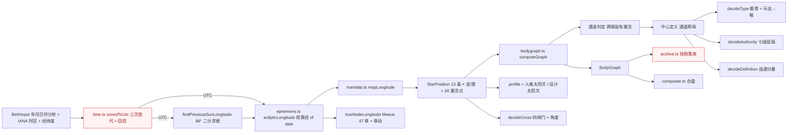

## 4.3　解读知识库结构（内容级）

```mermaid
flowchart TD
    KB["离线知识库 services/"]

    KB --> G["闸门层"]
    G --> G1["GATE_NAMES 64 门中英名 gateData.ts"]
    G --> G2["RAW 定义/开放 两态 interpretations.ts"]:::bad
    G --> G3["GATE_INSIGHT 特质/成长/扎根/驱动 gateInsight.ts"]
    G --> G4["GATE_CROSS_THEME 使命/高阶/低频 crossData.ts"]
    G --> G5["GATE_CHANNELS 归属通道"]

    KB --> CH["通道层"]
    CH --> CH1["名称 + 两端中心"]
    CH --> CH2["单句释义 36 条"]
    CH --> CH3["回路分组"]:::gap
    CH --> CH4["礼物 / 阴影 / 两端中心联动"]:::gap

    KB --> CT["中心层"]
    CT --> CT1["CENTER_TEXT 定义/开放"]
    CT --> CT2["假我主题 / 睿智"]:::gap
    CT --> CT3["由哪些通道定义"]:::gap

    KB --> TP["类型层"]
    TP --> TP1["TYPE_TEXT 策略/气场/签名/非我"]
    TP --> TP2["TYPE_DETAIL 七段"]
    TP --> TP3["显化生产者亚型说明"]:::gap

    KB --> AU["权威层"]
    AU --> AU1["AUTHORITY_TEXT 7 种"]
    AU --> AU2["层级总则"]:::gap

    KB --> PR["角色层"]
    PR --> PR1["12 角色文案"]:::gap
    PR --> PR2["6 爻通则"]:::gap

    KB --> DF["定义层"]
    DF --> DF1["5 个标签"]
    DF --> DF2["桥接策略"]:::gap

    KB --> CR["交叉层"]
    CR --> CR1["CROSS_ANGLES 三角度"]
    CR --> CR2["crossReadingOf 四段合成"]
    CR --> CR3["192 主题词"]:::gap

    KB --> DS["轨迹层"]
    DS --> DS1["destinyReadings 四主题 7 段"]
    DS --> DS2["行运支撑"]:::gap

    KB --> PL["星体层"]
    PL --> PL1["PLANET_TEXT 13 体 × 显/潜"]

    KB --> V["变量层"]
    V --> V1["四箭头 16 组合"]:::gap

    classDef gap stroke-dasharray: 4 3,fill:#fff5f5,stroke:#d97706,color:#92400e;
    classDef bad fill:#fef2f2,stroke:#dc2626,color:#991b1b;
```

## 4.4　视图与交互结构（路由级）

```mermaid
flowchart TD
    R["/ 档案库 ArchiveHomeView"]
    R --> R1["桌面 自由画布 ArchiveCanvas + 缩放 1/1.5/2"]
    R --> R2["手机 竖向列表 MobileArchiveList"]
    R --> R3["空态 新建 / 载入示例"]
    R --> R4["多选 BulkActionBar 合盘 / 多盘 / 删除"]

    R --> V1["/new 录入 EntryView"]
    R --> V2["/archive/:id 单人盘 SingleChartView"]
    R --> V3["/boards 多盘 MultiBoardView"]
    R --> V4["/composite/:a/:b 合盘 CompositeView"]
    R --> V5["/compare/:a?/:b? 对比 CompareView"]
    R --> V6["/chiron/:id 凯龙 ChironView"]
    R --> V7["/settings 设置 SettingsView"]

    V1 --> V1a["模式切换 身份证 / 手动"]
    V1 --> V1b["表单四段 基本信息/出生时间/出生地"]
    V1 --> V1c["右侧实时预览 仅桌面"]
    V1 --> V1d["提交 建档 + 跳转"]

    V2 --> V2a["工具栏 编辑/复制/凯龙/对比/全盘AI"]
    V2 --> V2b["AI 角度条 AiComposer 8 维度 + 8 角度"]
    V2 --> V2c["区块 1 图 + 星体两翼"]
    V2 --> V2d["区块 2 盘面信息 + 激活通道"]
    V2 --> V2e["区块 3 激活闸门 + 九中心"]
    V2 --> V2f["区块 4 人生轨迹 + 详情卡"]
    V2 --> V2g["模块拖拽排序 4 区块"]:::bad
    V2 --> V2h["编辑弹窗 ArchiveEditDialog"]
    V2 --> V2i["AI 面板 AiReadingPanel"]

    V4 --> V4a["移动端 Tab A/B/合图"]
    V4 --> V4b["四类关系通道清单"]
    V4 --> V4c["合图维度 AI compositeDimensions"]
    V4 --> V4d["仅看共享通道 过滤"]

    classDef bad stroke:#f59e0b,fill:#fffbeb,color:#92400e;
```

## 4.5　数据与状态结构

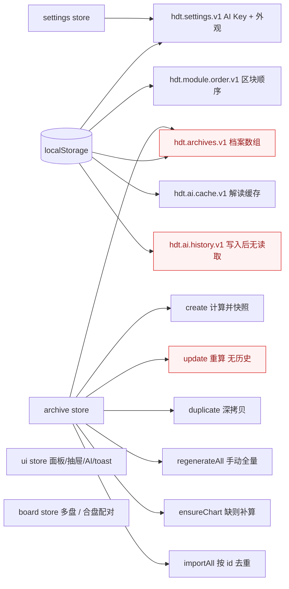

## 4.6　功能矩阵（现状 × 缺口）

| 模块 | 子功能 | 状态 | 问题编号 | 备注 |
| --- | --- | --- | --- | --- |
| 建档 | 手动录入 | ✅ | HD-033 | 字段齐全，但出生地强制 |
| 建档 | 身份证解析 | ✅ | — | 校验位、地区、性别齐全，隐私处理正确 |
| 建档 | 实时预览 | ✅ | — | 仅桌面；失败静默 |
| 建档 | DST 提示 | ❌ | HD-002 | 计算了但没显示 |
| 建档 | 时间不确定 | ❌ | HD-016 | 无任何处理 |
| 计算 | 星历 13 体 | ✅ | — | 真交点、月亮光行差都正确 |
| 计算 | 曼陀罗映射 | ⚠️ | HD-001 | 锚点偏 2′30″ |
| 计算 | 通道/中心/类型/权威/定义 | ✅ | — | 判定与主流一致 |
| 计算 | 角色/交叉角度 | ✅ | — | 4/6 判为右角度，正确 |
| 计算 | 四箭头 | ❌ | HD-009 | 数据已有，缺解释层 |
| 计算 | 行运 | ❌ | HD-043 | 引擎具备能力 |
| 呈现 | 人体图 | ✅ | HD-031 | 两套版式，命中区与配色需优化 |
| 呈现 | 星体两翼 | ✅ | HD-012 | 合盘下归属丢失 |
| 呈现 | 盘面信息 | ✅ | HD-008 | 角色只有数字 |
| 呈现 | 闸门/通道/中心清单 | ✅ | HD-005 | 术语与三态 |
| 呈现 | 人生轨迹 | ⚠️ | HD-014/015 | 模板化，混入凯龙与时间预测 |
| 呈现 | 导出 | ❌ | HD-017 | 除 JSON 外全无 |
| 知识库 | 64 门 | ⚠️ | HD-005/021/022 | 有内容，术语与质量需改 |
| 知识库 | 36 通道 | ⚠️ | HD-025 | 太薄，缺回路 |
| 知识库 | 9 中心 | ⚠️ | HD-026 | 缺假我/睿智 |
| 知识库 | 5 类型 | ⚠️ | HD-013 | 4 处机制错误 |
| 知识库 | 7 权威 | ✅ | — | 层级正确，缺总则 |
| 知识库 | 12 角色 | ❌ | HD-008 | 完全缺失 |
| 知识库 | 定义类型 | ❌ | HD-011 | 只有标签 |
| 知识库 | 384 爻 | ❌ | HD-010 | 完全缺失 |
| 知识库 | 轮回交叉 | ⚠️ | HD-028 | 有结构，缺主题 |
| 知识库 | 术语表 | ❌ | HD-047 | 无 |
| AI | 单对象 | ✅ | HD-020 | 无流式/重试 |
| AI | 批量 | ✅ | — | 缓存键设计合理 |
| AI | 8 角度 | ✅ | HD-023 | 含"前世姻缘" |
| AI | 全维度 | ⚠️ | HD-008 | profile 维度伪覆盖 |
| AI | 记录 | ❌ | HD-007 | 只写不读 |
| 关系 | 合盘三栏 | ✅ | — | 布局清晰 |
| 关系 | 四类通道 | ✅ | — | 分类正确 |
| 关系 | 合图类型/权威/交叉 | ❌ | HD-003 | 概念外推 + 实现 bug |
| 关系 | 多盘 | ✅ | — | 画布 + 自动适配 |
| 关系 | 对比 | ⚠️ | HD-037 | 入口随机配对 |
| 关系 | Penta | ❌ | HD-062 | 无 |
| 扩展 | 凯龙 | ⚠️ | HD-024 | 未标注非标准 |
| 数据 | CRUD | ✅ | HD-004/039 | 无版本、无撤销 |
| 数据 | 导入导出 | ⚠️ | HD-019 | 无 schema 版本 |
| 数据 | 存储健壮性 | ❌ | HD-019 | 单键、无备份 |
| 设置 | 外观 | ✅ | HD-052/054 | 档位冲突、术语外露 |
| 设置 | AI | ⚠️ | HD-018 | Key 明文 |

---

# 章节 5　全套重构后的操作逻辑图（1:1）

> 本章按"用户目标"而非"页面"组织。每个流程给出：触发 → 判定 → 动作 → 结果 → 异常。
> 与第 6 章的分工：本章是**产品交互逻辑**（谁在什么界面做什么），第 6 章是**业务规范流程**（BPMN 语义、含泳道与网关）。

## 5.1　全局导航与入口关系

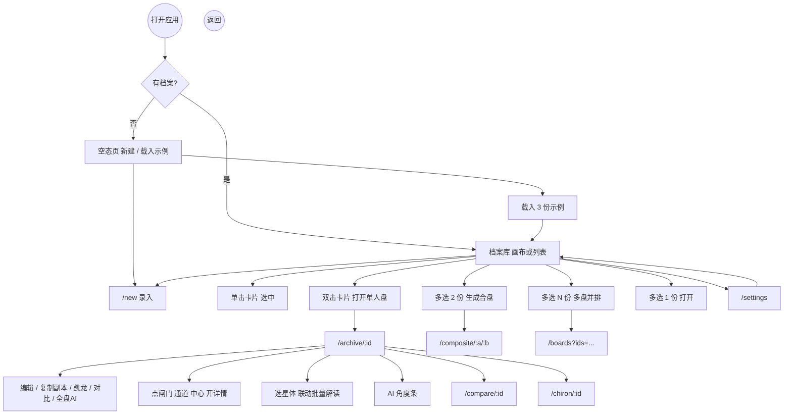

## 5.2　建档流程（重构后，含三模式）

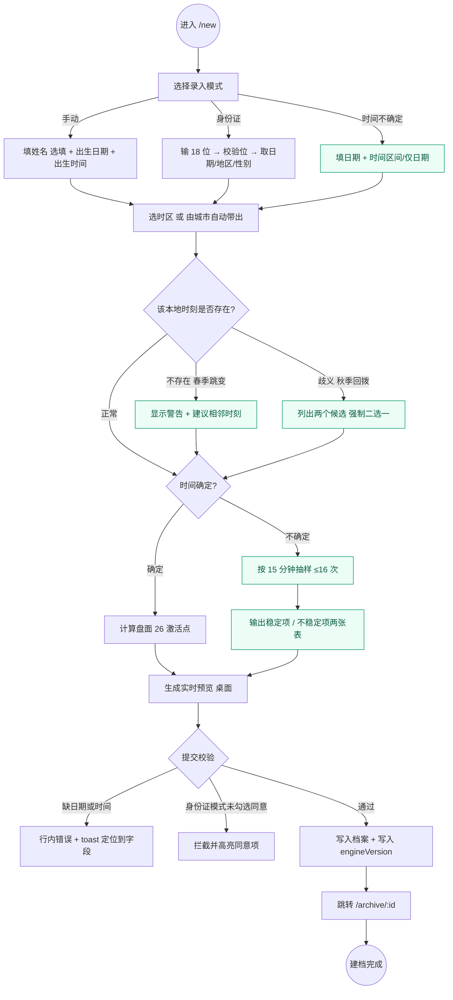

**步骤表**

| # | 触发 | 判定/校验 | 动作 | 结果 | 异常处理 |
| --- | --- | --- | --- | --- | --- |
| 1 | 进入录入页 | — | 渲染三模式切换，默认手动 | 表单可见 | — |
| 2 | 选身份证模式 | 18 位 + 校验位 | 解析日期/地区/性别，回填 | 日期与地区自动填好 | 校验失败给 E1002 并保留输入 |
| 3 | 填写时间 | 时分秒范围 | 实时预览 | 右侧图随输入更新 | 不合法则预览清空并保留上一次 |
| 4 | 选时区 | IANA 合法 | 计算该日偏移 | 显示"UTC+X" | 无效时区回退提示 |
| 5 | 提交 | 姓名（可选）+ 日期 + 时间 | `create()` → 计算 → 落库 | 跳转单盘 | 计算异常 → toast + 不落库 |
| 6 | 新：时间不确定 | 区间合法性 | 抽样计算 | 稳定性报告 | 区间跨日则提示分两次 |

## 5.3　单人盘浏览与解读流程

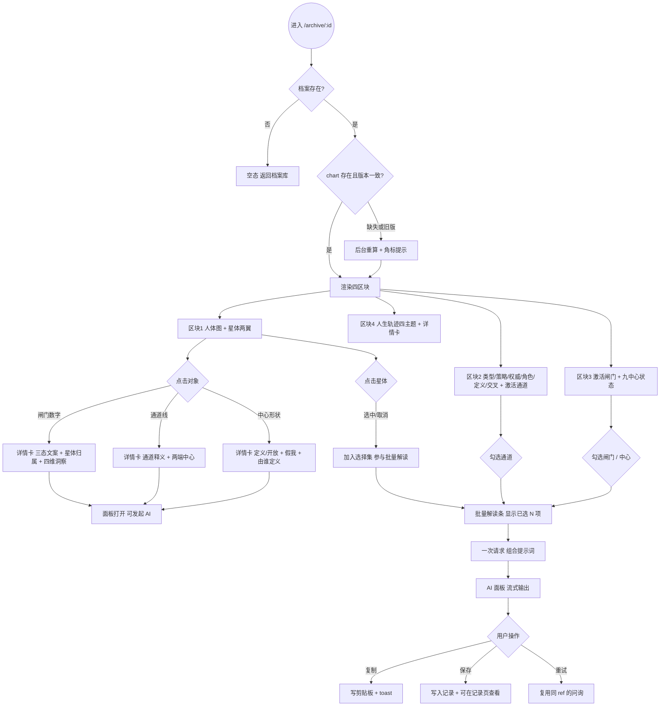

## 5.4　详情面板与 AI 解读流程

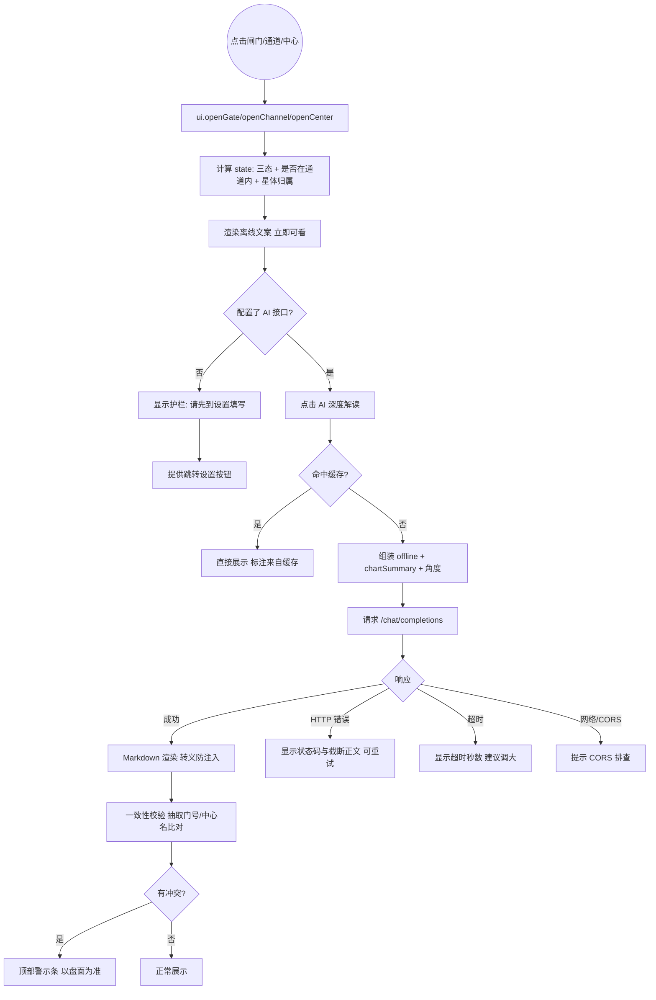

## 5.5　合盘流程（重构后）

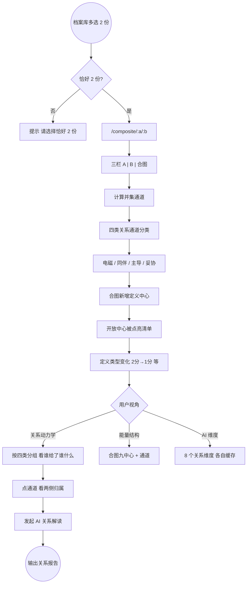

**与现状的差异**：删除"合图轮回交叉"与"合图类型=关系的类型"这两块结论性输出（HD-003），替换为"新增定义中心 / 被点亮中心 / 定义类型变化"三项可推导指标。

## 5.6　多盘与对比流程

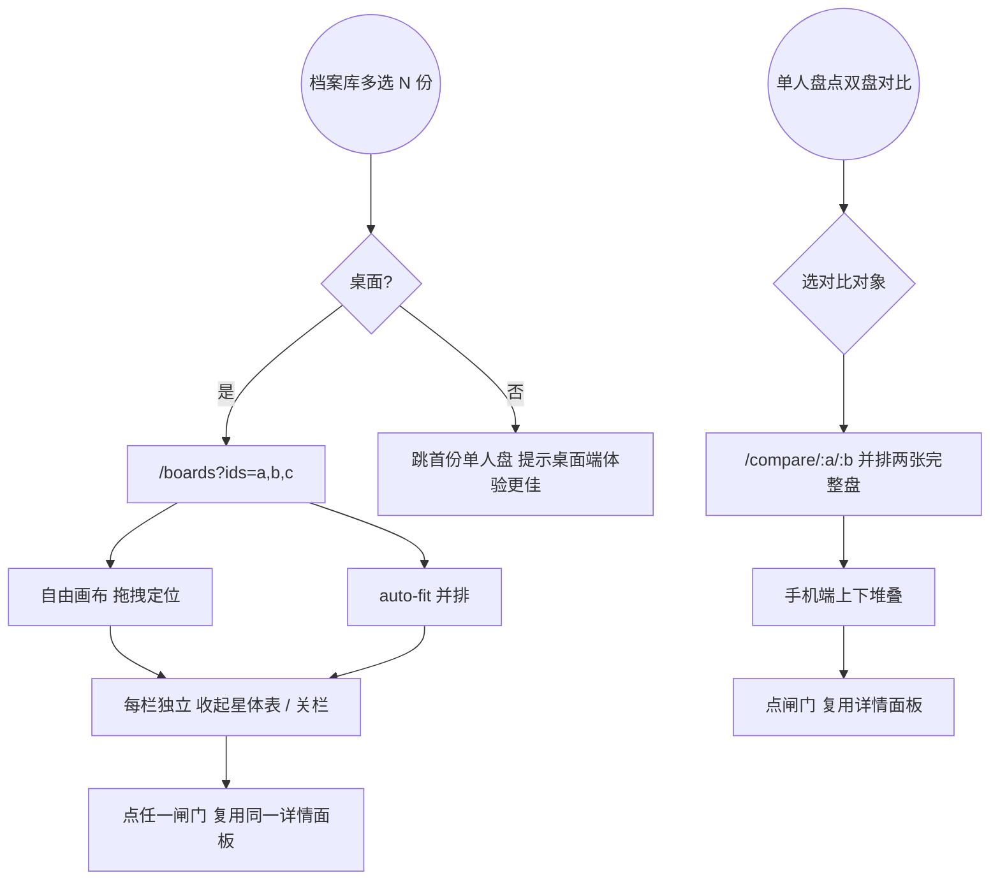

## 5.7　设置与数据管理流程

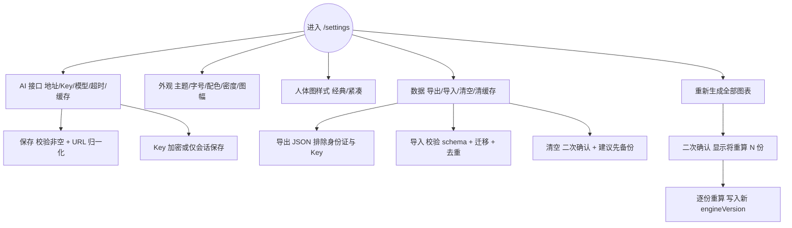

## 5.8　档案生命周期状态机

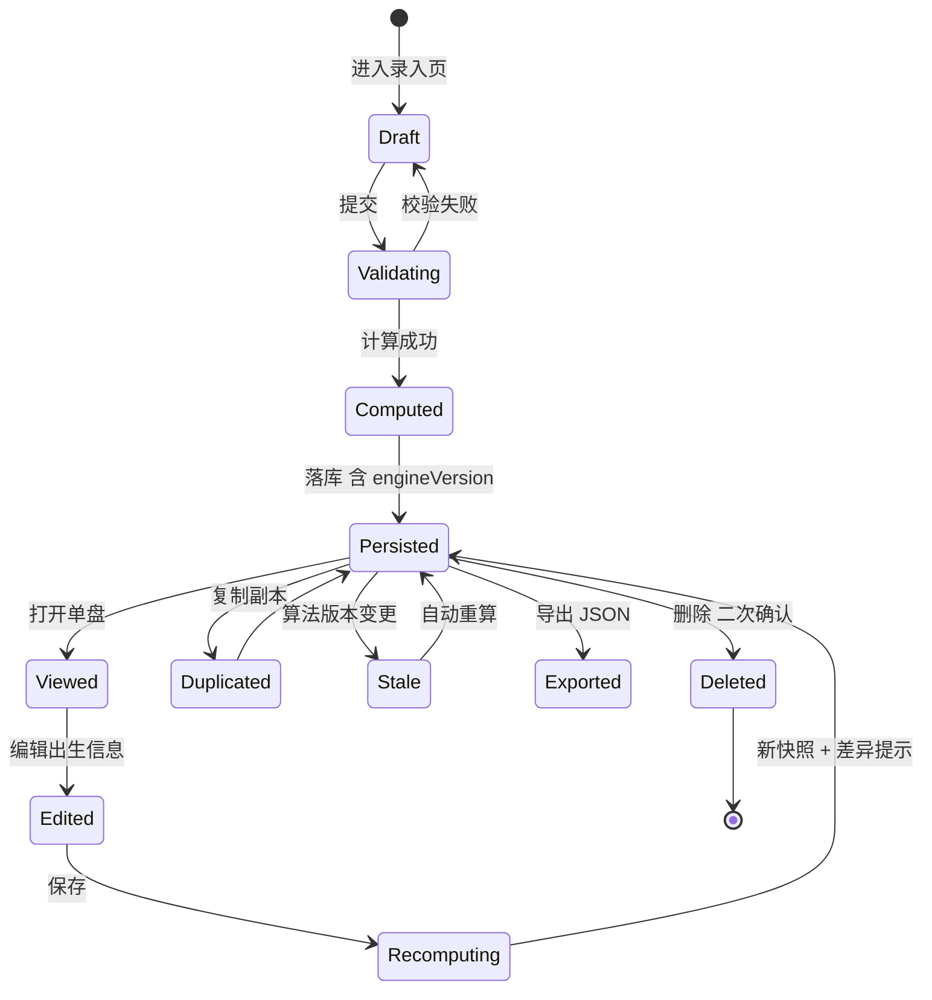

---
# 章节 6　全部业务 BPMN 流程图

> **符号映射**（Mermaid 无原生 BPMN，按 BPMN 2.0 语义等价绘制）：
> | BPMN 元素 | 本图符号 | Mermaid 写法 |
> | --- | --- | --- |
> | 开始事件 | 圆形 `开始` | `S(("开始"))` |
> | 结束事件 | 圆形 `结束` | `E(("结束"))` |
> | 任务 | 矩形 | `T["任务名"]` |
> | 排他网关（XOR） | 菱形 | `G{"条件?"}` |
> | 并行网关（AND） | 六边形 | `P{{"并行分叉"}}` |
> | 泳道 | 分区 | `subgraph LANE["泳道·角色"]` |
> | 消息流 | 虚线箭头 | `-.->` |
> | 异常/补偿 | 虚线 + 警示色 | `:::err` |
>
> 每个流程均标注：触发事件、任务序列、网关条件、异常补偿、结束状态。

## BPMN-01　建档排盘（核心主流程）

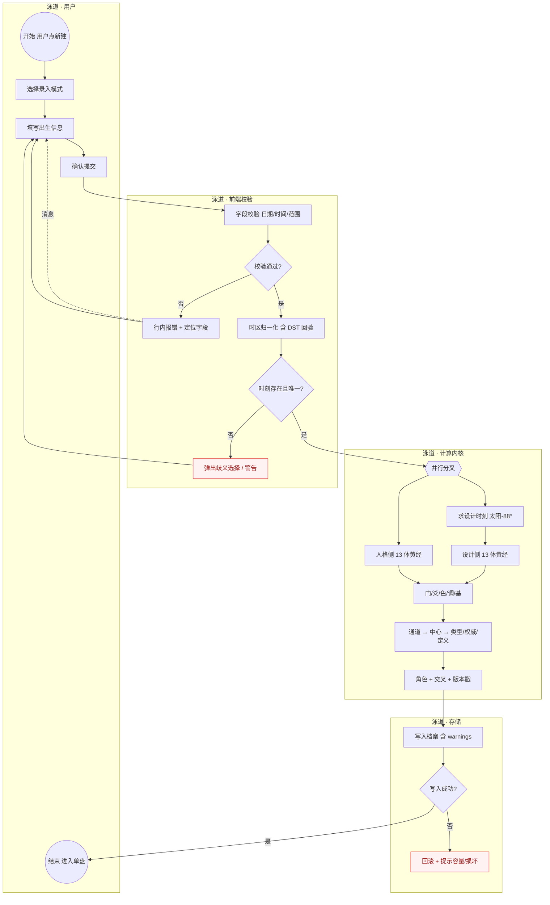

| 元素 | 内容 | 说明 |
| --- | --- | --- |
| 开始事件 | 用户点「新建」 | 唯一入口 |
| 排他网关 1 | 校验通过? | 触发 6 条字段规则（日期合法、年份 1900–今、时分秒范围、时区合法、姓名规则、同意项） |
| 排他网关 2 | 时刻存在且唯一? | **当前实现缺失该网关**（HD-002） |
| 并行网关 | 人格侧 / 设计侧并行 | 实现为顺序执行，语义等价，可并行化提速 |
| 异常路径 | 写入失败 | 需区分 QuotaExceeded 与 JSON 损坏（HD-019） |
| 结束事件 | 进入单盘 | 应携带 warnings 与 engineVersion |

## BPMN-02　身份证快捷录入

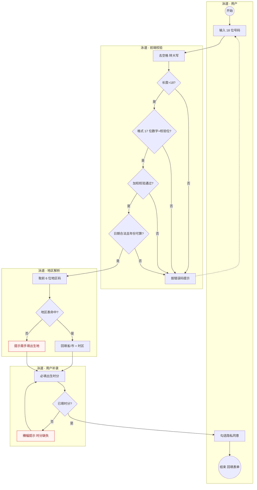

| 元素 | 内容 | 说明 |
| --- | --- | --- |
| 排他网关链 | 4 道校验 | 对应 `idcard.ts` 的 E1001/E1002/E2001/E1003，实现完整 |
| 异常 | 地区码未命中 | 回退省会坐标 + 提示（已有） |
| 缺口 | 同意项校验只在身份证模式生效 | 手动模式不采集身份证，无需同意，合理；但**导出/分享链接**场景需另一套同意（HD-049） |
| 结束 | 回填后仍需手填时分 | 这是产品的核心摩擦点，需在 UI 上把"时分"提到最显眼位置 |

## BPMN-03　出生时刻歧义处理（新增流程，修 HD-002）

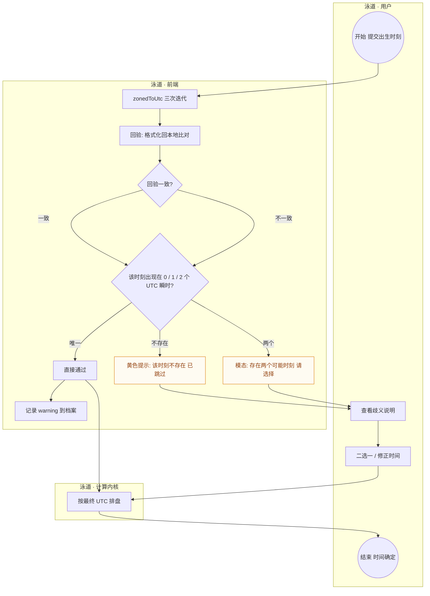

| 元素 | 内容 | 说明 |
| --- | --- | --- |
| 关键判定 | 本地时刻 → UTC 的映射是 0/1/2 值 | `Intl` 只能格式化，必须双向回验才能发现 |
| 处理策略 | 不存在 → 提示并允许修正；歧义 → **强制二选一** | 差 1 小时足以改变通道，不能默认 |
| 数据落地 | warning 写入档案，单盘页常驻显示 | 当前完全丢失（HD-002） |
| 测试用例 | NY 2021-03-14 02:30 / 2021-11-07 01:30 / 上海 1990-05-06 02:30 | 三条必须进 CI |

## BPMN-04　档案编辑与重算

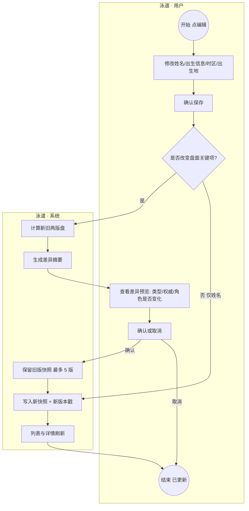

| 元素 | 内容 | 说明 |
| --- | --- | --- |
| 新增网关 | 是否改变盘面关键项 | 只改姓名不应触发全量重算（当前无条件重算） |
| 新增任务 | 新旧对比 | 目前只有"保存即覆盖"（HD-039） |
| 补偿 | 旧版快照 | 支持回滚，避免误改永久丢失 |
| 结束 | 已更新 | 需在 UI 上明确"你的类型从 X 变成了 Y"这类高影响变更 |

## BPMN-05　单人盘浏览与对象查看

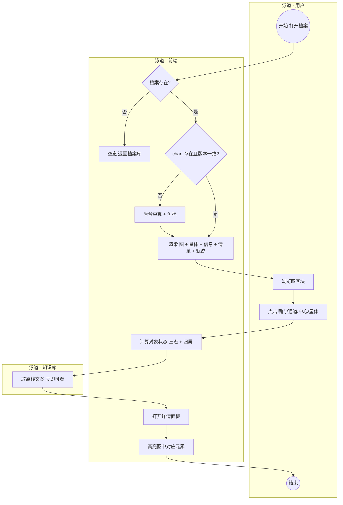

| 元素 | 内容 | 说明 |
| --- | --- | --- |
| 排他网关 | 档案存在? / 版本一致? | 第二个网关当前缺失（HD-004） |
| 任务 | 计算对象状态 | 需从"defined/open"升级为三态（HD-005） |
| 并行 | 图高亮 + 面板渲染 | 可并行，当前是同步串行 |
| 结束 | 用户关闭面板 | 面板状态在 ui store，跨页不持久 |

## BPMN-06　单对象 AI 解读

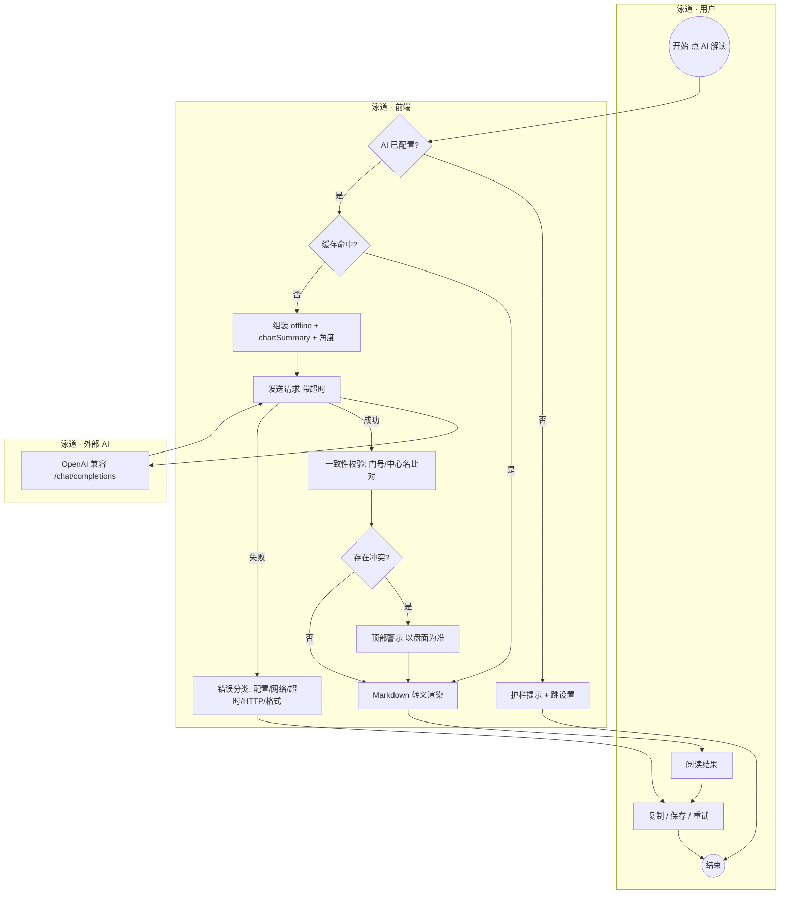

| 元素 | 内容 | 说明 |
| --- | --- | --- |
| 排他网关 | 配置/缓存/冲突 | 配置与缓存已有；冲突校验是新增护栏（HD-020） |
| 外部泳道 | AI 服务 | 无重试、无流式，是体验与稳定性的主要短板 |
| 异常 | 5 类错误 | 已分类，但缺"重试"按钮的实际上下文 |
| 结束 | 用户关闭 | 结果不持久（保存后也无处查看，HD-007） |

## BPMN-07　批量选择 AI 解读

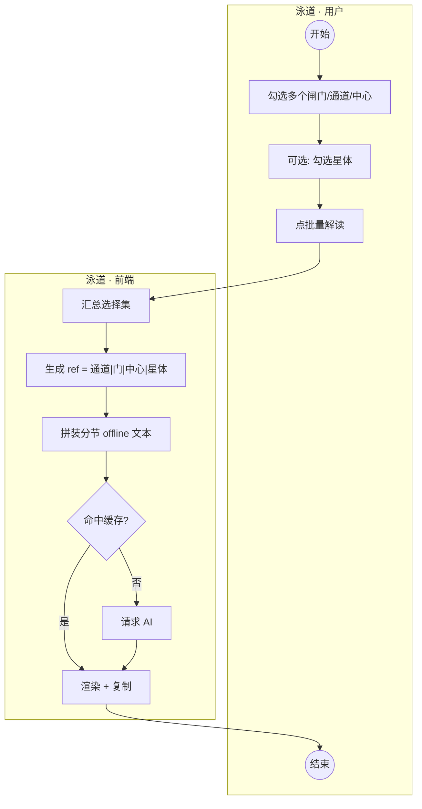

| 元素 | 内容 | 说明 |
| --- | --- | --- |
| 业务价值 | 一次问清"这几条通道怎么互相影响" | 当前实现在同类产品里是亮点 |
| 风险 | 选择集过大导致提示词超长 | 需加"最多 12 项"上限与提示 |
| 缺口 | 结果与选择集未建立可回看的关联 | 与 HD-007 同一问题 |

## BPMN-08　合盘生成

```mermaid
flowchart TD
    subgraph U["泳道 · 用户"]
        S(("开始 多选 2 份"))
        T1["进入三栏"]
        T2["切换 A/B/合图 或 手机 Tab"]
        T3["点关系通道查看"]
        E1(("结束"))
    end
    subgraph SYS["泳道 · 前端"]
        G1{"恰好 2 份?"}
        T4["提示选择数量"]
        T5["取 A、B 激活闸门并集"]
        T6["重算并集通道"]
        P1{{"并行分析"}}
        T7["四类关系通道分类"]
        T8["合图九中心定义"]
        T9["新增定义中心 / 被点亮中心"]:::new
        T10["定义类型变化"]:::new
        T11["共享 / 独有 / 互补视图"]
    end

    S --> G1
    G1 -->|"否"| T4
    G1 -->|"是"| T1 --> T5 --> T6 --> P1
    P1 --> T7
    P1 --> T8 --> T9
    P1 --> T10
    T7 --> T11
    T9 --> T11
    T10 --> T11
    T11 --> T2 --> T3 --> E1
```

| 元素 | 内容 | 说明 |
| --- | --- | --- |
| 并行网关 | 四类通道 / 中心 / 定义变化 | 三者互不依赖，可并行 |
| 删除项 | 合图类型、权威、轮回交叉 | 概念不成立（HD-003） |
| 业务规则 | 电磁=各持一端；同伴=双方都有整条；主导=单方有整条且对方无相关闸门；妥协=一方整条 + 一方单端 | 实现正确，需在 UI 解释四词含义 |
| 结束 | 用户离开 | 合盘不落库，无法回看（HD-044） |

## BPMN-09　关系维度 AI 分析

```mermaid
flowchart TD
    subgraph U["泳道 · 用户"]
        S(("开始"))
        T1["选择关系维度"]
        T2["阅读关系报告"]
        E1(("结束"))
    end
    subgraph SYS["泳道 · 前端"]
        T3["取双方盘 + 关系通道 + 维度要求字段"]
        T4["校验维度所需数据是否齐备"]
        G1{"数据齐备?"}
        T5["提示缺失项"]
        T6["组装提示词 含双方类型/权威/通道"]
        T7["请求 + 缓存"]
    end

    S --> T1 --> T3 --> T4 --> G1
    G1 -->|"否"| T5 --> T1
    G1 -->|"是"| T6 --> T7 --> T2 --> E1
```

| 元素 | 内容 | 说明 |
| --- | --- | --- |
| 数据依赖 | `compositeDimensions.ts` 定义了 8 个维度及 `requires` 字段 | 设计良好，但 `requires` 只用于提示词，未做真实校验 |
| 风险 | 关系结论容易被读成"该不该在一起" | 需在报告页加"不作关系建议"的护栏 |
| 缺口 | 无 Penta 视角 | 3 人以上团体无法分析（HD-062） |

## BPMN-10　多盘并排

```mermaid
flowchart TD
    subgraph U["泳道 · 用户"]
        S(("开始 多选 N 份"))
        T1["拖拽调整位置"]
        T2["收起某栏星体表 / 关栏"]
        E1(("结束"))
    end
    subgraph SYS["泳道 · 前端"]
        G1{"桌面端?"}
        T3["移动端降级: 打开首份单盘"]:::err
        T4["读取 ids 参数 校验有效性"]
        T5["auto-fit 计算栏宽与缩放"]
        T6["渲染 N 张 SVG"]
        T7["复用同一详情面板"]
    end

    S --> G1
    G1 -->|"否"| T3 --> T7
    G1 -->|"是"| T4 --> T5 --> T6 --> T1 --> T2 --> T7 --> E1

    classDef err fill:#fefbf2,stroke:#d97706,color:#92400e;
```

| 元素 | 内容 | 说明 |
| --- | --- | --- |
| 排他网关 | 桌面端? | 移动端目前直接跳单盘，属于隐式降级，需明确提示 |
| 性能风险 | N 张 SVG × 每张数百节点 | 超过 4 张需虚拟化或降采样 |
| 缺口 | 无"对比模式"（差异高亮） | 多盘只并排，不比较 |

## BPMN-11　双盘对比

```mermaid
flowchart TD
    subgraph U["泳道 · 用户"]
        S(("开始 点双盘对比"))
        T1["选择对比对象"]:::new
        T2["并排/堆叠查看"]
        E1(("结束"))
    end
    subgraph SYS["泳道 · 前端"]
        T3["从路由取 aId"]
        G1{"bId 已指定?"}
        T4["弹出选择器 不预选"]:::new
        T5["校验 bId ≠ aId"]
        T6["渲染两张完整盘"]
        T7["同步高亮同一闸门"]:::new
    end

    S --> T3 --> G1
    G1 -->|"否"| T4 --> T1
    G1 -->|"是"| T5
    T1 --> T5 --> T6 --> T7 --> T2 --> E1
```

| 元素 | 内容 | 说明 |
| --- | --- | --- |
| 现状问题 | 未指定 bId 时自动取 `archives[0]` | 用户以为对比的是自己想对比的人（HD-037） |
| 新增 | 选择器 + 同一闸门联动高亮 | 对比的产品价值在"差异"，而非"两张图并排" |

## BPMN-12　凯龙回归（扩展分析）

```mermaid
flowchart TD
    subgraph U["泳道 · 用户"]
        S(("开始 点凯龙回归"))
        T1["阅读扩展层声明"]:::new
        E1(("结束"))
    end
    subgraph SYS["泳道 · 前端"]
        T2["计算出生时凯龙黄经"]
        T3["搜索 45–56 年区间 逐日粗扫"]
        T4["二分细化到 60 秒"]
        G1{"找到回归时刻?"}
        T5["显示未找到 提示区间外"]:::err
        T6["以回归时刻重算一张参考盘"]
        T7["标注: 非标准层 不参与类型/权威"]:::new
    end

    S --> T2 --> T3 --> T4 --> G1
    G1 -->|"否"| T5 --> E1
    G1 -->|"是"| T6 --> T7 --> T1 --> E1

    classDef err fill:#fef2f2,stroke:#dc2626,color:#991b1b;
```

| 元素 | 内容 | 说明 |
| --- | --- | --- |
| 定位 | 占星扩展，不是 HD | 必须显式声明（HD-024） |
| 精度 | J2000 平根数线性传播，误差角分级 | 凯龙受土星摄动，长时间传播会漂；边界处爻位可能差一格 |
| 建议 | 移除该盘的 type/authority/cross 展示 | 对凯龙盘无意义且与 HD 机制冲突 |

## BPMN-13　备份、导出与恢复

```mermaid
flowchart TD
    subgraph U["泳道 · 用户"]
        S(("开始 设置页"))
        T1["导出备份"]
        T2["选择文件导入"]
        T3["确认清空"]
        E1(("结束"))
    end
    subgraph SYS["泳道 · 前端"]
        T4["序列化档案 排除身份证/Key"]
        T5["下载 JSON 带 schemaVersion"]:::new
        T6["解析 + schema 校验"]
        G1{"版本兼容?"}
        T7["执行迁移函数"]:::new
        T8["按 id 去重合并"]
        T9["提示导入条数与跳过条数"]
        G2{"二次确认?"}
        T10["取消"]
        T11["清空 + 清缓存 + 保留设置"]:::new
    end

    S --> T1 --> T4 --> T5 --> E1
    S --> T2 --> T6 --> G1
    G1 -->|"旧版"| T7 --> T8
    G1 -->|"当前"| T8
    G1 -->|"未来版"| T10
    T8 --> T9 --> E1
    S --> T3 --> G2
    G2 -->|"否"| T10
    G2 -->|"是"| T11 --> E1
```

| 元素 | 内容 | 说明 |
| --- | --- | --- |
| 现状 | 导入只做 `id` 去重，无 schema、无迁移、无字段校验 | 一旦结构升级，老备份会静默丢字段 |
| 新增 | schemaVersion + 迁移 + "跳过 N 条"提示 | 数据资产化的最低要求 |
| 风险 | 用户误点清空 | 二次确认已有，但缺"自动先导出一份" |

## BPMN-14　设置变更与绘图引擎切换

```mermaid
flowchart TD
    subgraph U["泳道 · 用户"]
        S(("开始"))
        T1["修改外观/AI/样式"]
        T2["点重新生成全部图表"]
        E1(("结束"))
    end
    subgraph SYS["泳道 · 前端"]
        T3["写入 settings + applyToDom"]
        T4["全站 CSS 变量刷新"]
        G1{"变更影响盘面数据?"}
        T5["仅重绘 SVG"]:::new
        T6["弹出确认: 将重算 N 份"]:::new
        T7["逐份 computeChart + 写回"]
        T8["进度与结果提示"]
    end

    S --> T1 --> T3 --> T4 --> G1
    G1 -->|"否 仅样式"| T5 --> E1
    G1 -->|"是"| T6 --> T7 --> T8 --> E1
```

| 元素 | 内容 | 说明 |
| --- | --- | --- |
| 现状问题 | 绘图程序切换被当作"需要全量重算数据" | 版式切换只影响渲染，不应重算（当前按钮语义混乱） |
| 真正需要重算的场景 | 算法版本升级、曼陀罗偏移修正 | 应由系统自动触发，而非用户手动 |
| 缺口 | 无"设置项变更 → 影响范围"的映射 | 建议给每个设置项打 `affects: 'render' \| 'data'` 标签 |

---
# 章节 7　二次校验结论：基于人类图理论的新增 / 修改 / 删除

> 本章是"完成结构图 + 流程图之后，回到权威资料做的第二遍复核"。复核对象不是代码，而是**功能本身是否配得上 HD 的理论结构**。
> 判定只输出四类动作：**新增**（理论要求但产品没有）、**修改**（有但机制错）、**删除**（概念不成立）、**改口径**（保留但必须重命名/分层）。

## 7.1　必须修正：与人类图理论直接冲突

| # | 冲突点 | 软件现状 | 理论口径 | 结论 | 关联 |
| --- | --- | --- | --- | --- | --- |
| C-01 | 曼陀罗起始锚点 | Gate 41 起于 302.0417° | 宝瓶 2°00′00″ = 302.000° | **修改** | HD-001 |
| C-02 | `defined` 的适用范围 | 闸门被激活即称"有定义" | defined 只用于中心/通道/整图；闸门只有 activated，单端为悬挂 | **修改** | HD-005 |
| C-03 | 连接盘是否有人格属性 | 合图有类型、权威、轮回交叉 | 连接盘只读四种动力学 + 定义变化，没有"第三个人" | **删除** | HD-003 |
| C-04 | 轮回交叉的归属 | 由两人四闸门合成一个交叉，且实现把 A 的太阳用了两遍 | 交叉是个体产物（人格日/地 + 设计日/地） | **删除** | HD-003 |
| C-05 | 显示者的权威范围 | 文案称显示者可能"心智投影型" | 显示者必有马达→喉，权威只能是情绪/脾/心 | **修改** | HD-013 |
| C-06 | 投射者的洞察来源 | 归因于"喉咙或眉心与中心相连" | 来自开放中心的接收与整合，与喉连接无必然关系 | **修改** | HD-013 |
| C-07 | 中心定义的语义 | "说到就能做到""免疫力稳定" | 定义 = 能量稳定输出，不等于行为保证或生理指标 | **修改** | HD-013 |
| C-08 | 三阶段人生 | 所有角色都套"50 岁第三阶段" | 三阶段是第 6 爻结构，仅含 6 的角色适用 | **修改** | HD-014 |
| C-09 | 凯龙的体系位置 | 13 体之一、独立盘、参与交叉文案 | 凯龙不属于 13 体，永不定义中心/成通道 | **改口径** | HD-024 |
| C-10 | 时间预测的依据 | 用本命盘给出 1–3 年主题 | 时间维度必须来自行运，本命盘不含时间信息 | **改口径** | HD-015 |
| C-11 | 前世姻缘的叙事 | 作为标准角度，讲"设计侧继承前世" | HD 只在左角度交叉谈 karma，无"前世姻缘" | **改口径** | HD-023 |
| C-12 | 四箭头的完整性 | 完全缺失，但 color/tone 已算出 | 变量是 HD 第四层结构，缺它则"高级解读"无根 | **新增** | HD-009 |
| C-13 | 人生角色的完整性 | 只显示"1/3"，零释义 | 12 角色 + 6 爻是四大支柱之一 | **新增** | HD-008 |
| C-14 | 定义类型的完整性 | 只有 5 个标签 | 二分/三分/四分的核心议题是"桥" | **新增** | HD-011 |
| C-15 | 爻的完整性 | 显示却无释义 | 384 爻是分辨率核心，角色与交叉角度都由爻决定 | **新增** | HD-010 |

## 7.2　需要新增的功能（按理论完整性排序）

| 顺序 | 功能 | 理论依据 | 实现成本 | 建议优先级 |
| --- | --- | --- | --- | --- |
| 1 | 四箭头 Variable 面板 | R8：四箭头 × 16 组合 | 低（数据已有，只缺对照表） | P2 |
| 2 | 12 人生角色 + 6 爻通则 | R6：角色 = 人格爻/设计爻 | 中（12×5 段文案） | P2 |
| 3 | 定义类型解读 + 桥接策略 | R7：定义 = 连通分量 | 低（5 型文案） | P2 |
| 4 | 时间不确定抽样分析 | 计算对时间敏感（4 分钟可改通道） | 低（复用引擎循环） | P2 |
| 5 | 行运 Transit | 时间维度必须来自行运 | 中（引擎已有，需 UI + 口径） | P5 |
| 6 | 384 爻释义 | 爻是门内分辨率 | 高（384 条文案） | P2/P3 |
| 7 | 通道回路分组 | 个体/部落/集体三回路 | 低（36 条打标） | P3 |
| 8 | 九中心假我主题 / 睿智 | 每中心有 not-self 与 wisdom | 低（9×2 段） | P3 |
| 9 | 192 交叉主题词（自建命名） | 交叉 = 四闸门 + 角度 | 中（192 短名） | P3 |
| 10 | Penta 3–5 人 | 团体层结构 | 高（新模型 + 教学） | P9 |
| 11 | 导出（PNG/PDF/分享卡） | 产品可用性 | 中 | P2 |
| 12 | 术语表 + 引导 | 降低入门门槛 | 低 | P5 |

## 7.3　需要删除或降级的内容

| # | 内容 | 处置 | 理由 |
| --- | --- | --- | --- |
| D-01 | 合图"轮回交叉" | **删除** | 概念不成立，实现也有参数错误 |
| D-02 | 合图"类型 / 权威"作为结论 | **降级**为"合图派生指标（仅供参考）"或直接移除 | 类型/权威属于个体 |
| D-03 | 凯龙盘的 type / authority / cross | **删除**字段 | 对占星扩展层无意义，且与 HD 机制冲突 |
| D-04 | 交叉文案中的"凯龙周期" | **删除** | 体系混入 |
| D-05 | "多重显化生产者" | **删除**生造词 | 应为"显化生产者" |
| D-06 | "高我指引方向"（gate 2） | **删除** | 非 HD 术语 |
| D-07 | 设置里的"绘图程序 v1/v2" | **改名**为"人体图样式" | 内部实现概念外露 |
| D-08 | 档案卡"关闭"按钮 | **改名**为"移出选择" | 语义误导，易与删除混淆 |
| D-09 | "重新生成全部图表"的默认语义 | **降级**为高级操作 + 二次确认 | 用户不该手动维护数据一致性 |
| D-10 | 性别字段（若不做 Penta） | **删除**或明确标注无影响 | 采集但不使用，制造误解 |

## 7.4　需要改口径（保留功能，改说法与分层）

| # | 功能 | 现口径 | 建议口径 | 备注 |
| --- | --- | --- | --- | --- |
| R-01 | 凯龙回归 | "人类图的独立周期盘" | "占星扩展层：凯龙回归（不参与 HD 判定）" | 入口移到"扩展分析" |
| R-02 | 前世姻缘 | 标准解读角度 | "关系剧本（设计侧的自动反应）" | 去掉宿命叙事，保留洞察 |
| R-03 | 未来形势 | 1–3 年主题预测 | "阶段主题（非行运预测）" 或接真实行运 | 二选一 |
| R-04 | 显化生产者 | 与生产者并列的第 5 类型 | "生产者亚型（Gen 的一种）" | 首次出现处说明一次 |
| R-05 | 心智权威 | "环境（脑中心）权威" | "心智权威 / 外在权威（Mental）" | 与"环境"（Environment 变量）区分 |
| R-06 | 通道 12-22 "开放" | 开放 | "敞开（Openness）" | 避免与"中心开放"撞词 |
| R-07 | 类型气场 | MG 与 Generator 相同 | 补"进入过程后气场关闭" | 机制差异 |
| R-08 | 合盘命名 | 合盘 / 合图混用 | 统一"合盘（Composite）" | 术语一致 |

## 7.5　复核确认正确、不应改动（防止过度修改）

> 这一节很重要：审查容易"越改越错"。以下 10 项经逐条核对，确认与权威口径一致，**不要动**。

| # | 项目 | 核对结论 |
| --- | --- | --- |
| K-01 | 36 条通道的配对与英文名 | 36/36 全对，无一处错 |
| K-02 | 64 闸门 → 9 中心的归属 | 64/64 全对（3+6+11+8+4+7+9+7+9） |
| K-03 | 类型判定（含 MG 的马达→喉规则） | 与主流实现一致：骶骨定义 + 任一马达连喉 = MG；否则 Generator |
| K-04 | 七权威的层级顺序 | 情绪→骶骨→脾→心→自我投射→心智→月亮，正确 |
| K-05 | 定义类型 = 已定义中心的连通分量 | 正确；无定义 = 反映者 |
| K-06 | 人生角色 = 人格太阳爻 / 设计太阳爻 | 正确 |
| K-07 | 交叉角度规则（4/1 并列、人格爻≥5 左角度） | 正确（4/6 属右角度，是常见误判点，本实现无误） |
| K-08 | 设计时刻 = 太阳少 88° 求根 | 正确（非固定 88 天） |
| K-09 | 真交点实现（Meeus 47 章 + 章动） | 正确，且区分真/平交点这一关键点没有被搞错 |
| K-10 | 月亮不叠加恒星光行差 | 正确（多数自研实现会错在这里） |

## 7.6　复核后的功能增量汇总（净变化）

| 类型 | 数量 | 明细 |
| --- | --- | --- |
| 新增模块 | 3 | 变量层（四箭头）、角色层（12 角色）、定义层（5 型解读） |
| 新增页面 | 2 | 行运页、术语/引导页 |
| 新增能力 | 5 | 时间不确定分析、导出 PNG/PDF、AI 记录页、存储分片与迁移、AI 一致性校验 |
| 删除字段/概念 | 3 | 合图交叉、合图类型权威结论、凯龙盘人格属性 |
| 改口径 | 8 | 见 7.4 |
| 文案重写 | 约 120 条 | 闸门 64 + 通道 36 + 中心 9 + 类型 5 + 权威 7（含三态改造） |
| 新增文案 | 约 620 条 | 角色 12 + 爻 390 + 变量 40 + 交叉主题 192 + 定义 5 + 术语 60（含分句） |

---

# 章节 8　下一步落地执行计划（按优先级排序）

## 8.1　总体节奏（四波次）

```mermaid
flowchart LR
    W0["波次 0 止血<br/>1 周"] --> W1["波次 1 正确性<br/>2 周"]
    W1 --> W2["波次 2 知识补全<br/>4 周"]
    W2 --> W3["波次 3 体验与交付<br/>4 周"]
    W3 --> W4["波次 4 差异化<br/>持续"]
```

## 8.2　波次 0：止血（1 周，必须最先做）

| 序号 | 任务 | 产出 | 验收标准 | 对应 |
| --- | --- | --- | --- | --- |
| 0.1 | 修 `MANDALA_OFFSET` = 29.875（或改正向算法） | 1 行改动 + 5 条锚点测试 + **1 条 L1 断言** | 41@302.000°、60 末@302.000°、18@183.875°、25@358.250° 误差 < 1e-9；且 `2026-01-22T00:54Z` 与 `2024-01-22T13:18Z` 必须映射为 **Gate 41 / Line 1** | HD-001 |
| 0.2 | 加 `engineVersion` + 启动自动重算 | 存量档案自动更新 | 老档案打开后版本戳等于当前版本 | HD-004 |
| 0.3 | DST 告警打通到 UI | 警告条 + 歧义二选一 | 3 个 DST 用例在界面上可见 | HD-002 |
| 0.4 | 删除合图交叉（含字段与 UI） | 字段可选 + UI 移除 | 合盘页无"交叉"字样，类型检查通过 | HD-003 |
| 0.5 | 修 AI 记录（补入口或删按钮） | 记录抽屉 | 保存后可在列表中找到并打开 | HD-007 |
| 0.6 | 补 `data-integrity` 测试 | 40 行测试 | 64/36/9/192 的完整性断言全绿 | HD-030 |
| 0.7 | 提交上游 rave-engine issue | 附录 E.3 草稿 | issue 已提交并附复现脚本 | HD-001 附带 |

> **为什么先做这 7 项**：0.1 决定所有结论是否可信；0.2 决定 0.1 的修复能否真正到达用户；0.3/0.4 是"静默错误"，越晚发现用户流失越大；0.5/0.6 成本极低但直接改善信任。

## 8.3　波次 1：正确性与术语（2 周）

| 序号 | 任务 | 产出 | 验收标准 | 对应 |
| --- | --- | --- | --- | --- |
| 1.1 | 闸门三态改造（`in-channel / hanging / open`） | 类型 + 文案 + 徽标 | 悬挂闸门不再显示"有定义"文案 | HD-005 |
| 1.2 | 重写 4 处机制性错误文案 | 类型/中心文案 | 显示者不再出现"心智权威" | HD-013 |
| 1.3 | 交叉文案按角色分支 + 删凯龙 | `crossData` 改造 | 1/3 角色不再出现"50 岁第三阶段" | HD-014 |
| 1.4 | 闸门单一数据源 | `data/gates.ts` + 迁移脚本 | 四处调用统一走 `getGate()` | HD-021 |
| 1.5 | 中文文案 lint（中英混排/半角标点/决定论词） | CI 规则 | 现存 12 处缺陷清零 | HD-022/053 |
| 1.6 | 金标准样本入库（≥20 例） | `tests/fixtures/golden/` | 26 激活点 + 6 项判定逐例比对 | HD-006 |
| 1.7 | 存储分片 + 备份快照 | storage 层改造 | 单条损坏不影响全库；有 .bak | HD-019 |
| 1.8 | Key 保护（桌面 safeStorage / 会话保存） | settings 改造 | 导出备份不含 key（有测试） | HD-018 |

## 8.4　波次 2：知识库补全（4 周，可与波次 1 部分并行）

| 序号 | 任务 | 产出 | 验收标准 | 对应 |
| --- | --- | --- | --- | --- |
| 2.1 | 四箭头变量层 | `variable.ts` + 面板 | 16 种组合可算、四箭头可点开 | HD-009 |
| 2.2 | 12 人生角色 + 6 爻通则 | `profileText.ts` | 12 条齐全，角色卡片可展开 | HD-008 |
| 2.3 | 定义类型解读 | `definitionText.ts` | 5 型齐全，合盘显示定义变化 | HD-011 |
| 2.4 | 通道升级（回路 + 礼物/阴影） | 36 条重写 | 按回路分组展示 | HD-025 |
| 2.5 | 九中心升级（假我/睿智/定义来源） | 9×4 段 | 中心详情显示"由 X 通道定义" | HD-026 |
| 2.6 | 192 交叉主题词（自建） | 命名表 + 标注 | 交叉页有主题名，且标注"非官方" | HD-028 |
| 2.7 | 384 爻释义（先 26 个高频门） | `lineText.ts` | 覆盖 ≥70% 激活位，其余显式"待补充" | HD-010 |
| 2.8 | 时间不确定流程 | 抽样引擎 + 报告页 | 区间输入可出稳定性表 | HD-016 |
| 2.9 | AI 一致性校验 + 流式 | aiClient 改造 | 冲突时出现警示条；首字 < 2s | HD-020 |

## 8.5　波次 3：体验与交付（4 周）

| 序号 | 任务 | 产出 | 验收标准 | 对应 |
| --- | --- | --- | --- | --- |
| 3.1 | PNG / PDF 导出 | 导出模块 | 中文不掉字，A4 单页 | HD-017 |
| 3.2 | 分享卡 + 分享链接 | 编码方案 + 二维码 | 打开即算，不落库，有隐私提示 | HD-049 |
| 3.3 | 档案备注/标签/分组 | 数据 + UI | 可筛选 | HD-042 |
| 3.4 | 搜索结构化（type/gate/profile） | 查询语法 | 三种 token 可用 | HD-034 |
| 3.5 | 对比选择器 + 联动高亮 | CompareView 改造 | 不再随机配对 | HD-037/011 |
| 3.6 | 编辑差异预览 + 5 版历史 | archive 改造 | 类型变化时二次确认 | HD-039 |
| 3.7 | 术语表 + 引导模式 | glossary + 5 步引导 | 新用户 3 分钟内看完类型/权威 | HD-047/048 |
| 3.8 | 时区全量 + 无障碍 | 输入与配色 | 44px 命中区，色盲可辨 | HD-035/036 |
| 3.9 | 文档与版本治理 | README/CHANGELOG | 版本单一来源，测试数自动生成 | HD-050 |

## 8.6　波次 4：差异化（持续）

| 序号 | 任务 | 价值 | 依赖 |
| --- | --- | --- | --- |
| 4.1 | 行运 Transit + 流日 | 使用频率最高的进阶功能 | 需先定"未来形势"口径 |
| 4.2 | 关系地图（多档案网络） | 家庭/团队场景 | 依赖 Penta 数据模型 |
| 4.3 | 观察日志（自我实验记录） | 提升留存 | 档案数据模型扩展 |
| 4.4 | 咨询报告模板（多盘 + PDF） | 变现路径 | 依赖 3.1 |
| 4.5 | Penta / 组织盘 | 企业版 | 需独立教学 |

## 8.7　验收与回归策略

| 层次 | 手段 | 频率 |
| --- | --- | --- |
| 单元 | 数据完整性 + 曼陀罗锚点 + 星历边界 + 类型判定 | 每次提交 |
| 金标准 | 20+ 例 26 激活点与 6 项判定全等 | 每次提交 |
| 几何 | 闸门不重叠/不越界/落在所属中心内 | 每次提交 |
| 端到端 | 现有 29 项冒烟 + 新增 DST/版本迁移/导出 | 每次发布 |
| 人工 | 每波次结束用 3 份真实盘与商业软件逐项对比 | 每波次 |

## 8.8　风险与对策

| 风险 | 影响 | 对策 |
| --- | --- | --- |
| 修正曼陀罗后老用户盘面变化 | 用户质疑"你们之前算错了" | 提前公告 + 在档案上标注"已按 vX 重算"，并提供新旧对比 |
| 台标数据迁移失败 | 数据丢失 | 迁移前自动导出 `.bak`，迁移失败回滚 |
| 文案大批量重写引入新错 | 内容质量波动 | 单一数据源 + 术语表 + 双人过稿 + 抽检 10% |
| 384 爻文案成本低估 | 工期拖延 | 先做 26 个高频门，其余显式"待补充"，不编造 |
| 删除合图交叉引发老用户不满 | 功能"倒退" | 提供"双方交叉并置"作为过渡（方案 B） |
| AI 一致性校验误报 | 干扰阅读 | 只在"明确冲突"时提示，且可折叠 |

---

# 附录 A　现有软件"不符合常理"的点（20 条）

> 这一类不是"错"，而是"用户会停下来困惑一下"的地方。逐条给出建议。

| # | 现象 | 为什么不合理 | 建议 |
| --- | --- | --- | --- |
| A-01 | 姓名必填，但人类图不需要姓名 | 增加无意义的提交阻力 | 改为可选，默认"未命名" |
| A-02 | 采集性别，但任何逻辑都不用它 | 用户会以为性别影响盘面 | 删除，或标注"仅档案区分" |
| A-03 | 出生地必须选省市，但明确说明"不参与计算" | 必须填一个不影响结果的东西，违反直觉 | 改为可选，或用于自动带出时区 |
| A-04 | 身份证录入是高敏感操作，实际只省 8 位输入 | 风险/收益严重失衡 | 保留但默认折叠，且强化"不落盘"的可见证据 |
| A-05 | 身份证模式必须勾选隐私同意，手动模式不需要 | 同意逻辑不一致（手动模式也采集出生时间） | 统一为一次性隐私说明 + 首次同意 |
| A-06 | "凯龙回归"占据单人盘工具栏的显著位置 | 非标准扩展功能挤占核心入口 | 移到"扩展分析"分组 |
| A-07 | 合盘给出"你们的类型是投射者" | 关系不是一个"人"，没有类型 | 删除结论，改给"关系场指标" |
| A-08 | "前世姻缘"与"事业方向"并列在八个角度里 | 一个是文化叙事，一个是体系内分析 | 改名或移出标准角度 |
| A-09 | 点"双盘对比"后系统自己挑了一个人 | 用户没有选择对比对象 | 强制弹出选择器 |
| A-10 | 卡片上的"关闭"其实是取消选择 | 用户怕点（以为删除）或误以为删了 | 改名"移出选择" |
| A-11 | 编辑出生时间后原盘永久消失 | 没有撤销，也没有"原来是什么" | 差异预览 + 5 版历史 |
| A-12 | "保存到本地记录"后无处可看 | 功能承诺落空 | 补记录页或删按钮 |
| A-13 | 设置里"绘图程序 v1/v2" | 用户不知道这是什么 | 改名"人体图样式" + 缩略图 |
| A-14 | "未来形势"给出具体时间却没有任何行运依据 | 时间结论无来源 | 改标题或接真实行运 |
| A-15 | 同一闸门在四个页面有四个名字 | 用户怀疑专业性 | 单一数据源 |
| A-16 | 首次进入没有任何"从哪看起"的指引 | HD 的阅读顺序是有讲究的 | 引导模式 |
| A-17 | 字号有 6 档，但两套 API 的取值范围不一样 | 设到最小档后调一次又弹回来 | 只保留档位 API |
| A-18 | 手机端闸门点击区域 38px | 低于 44px 触摸标准，误触率高 | 透明热区外扩 |
| A-19 | 定义/开放只用颜色区分 | 色盲用户无法分辨 | 加图案冗余 |
| A-20 | 导入备份只按 id 去重，不看内容 | 同名同人不同 id 会产生重复档案 | 加"疑似重复"提示（姓名 + 出生时刻） |

---

# 附录 B　可新增功能点子（按投入产出比排序）

| # | 点子 | 一句话价值 | 成本 | 优先级 |
| --- | --- | --- | --- | --- |
| B-01 | 时间不确定分析 | 解决"我只知道大概几点"这个最大人群 | 低 | P2 |
| B-02 | 四箭头面板 | 数据已有，白捡一层深度 | 极低 | P2 |
| B-03 | 人生角色卡 | 补上四大支柱之一 | 低 | P2 |
| B-04 | 导出 PNG/PDF | 让盘"能被带走" | 中 | P2 |
| B-05 | "如果当初"双盘 | 教学神器：早 10 分钟盘会变什么样 | 低 | P8 |
| B-06 | 行运日历 | 每天打开的理由 | 中 | P5 |
| B-07 | 观察日志 | 从"看盘"到"做实验"，提升留存 | 低 | P7 |
| B-08 | 关系地图 | 家庭/团队的真实需求 | 中 | P7 |
| B-09 | 术语悬浮卡 | 新手留存 | 低 | P5 |
| B-10 | 分享链接/二维码 | 无后端也能传播 | 低 | P5 |
| B-11 | 咨询报告模板 | 面向从业者的变现 | 中 | P5 |
| B-12 | 盘面问答（RAG，强制引用） | 大幅降低 AI 幻觉 | 中 | P8 |
| B-13 | 语音陪读 | 通勤场景 | 中 | P8 |
| B-14 | Penta 团队盘 | 组织/家庭咨询 | 高 | P9 |
| B-15 | 全球盘时间机器 | 内容营销素材 | 中 | P9 |
| B-16 | 多语言 | 海外市场 | 中 | P5 |
| B-17 | 打印友好版式 | 咨询师刚需 | 低 | P2 |
| B-18 | "同一人的多份盘"（不同时间假设）并排 | 与研究型用户 | 低 | P8 |
| B-19 | 盘面标注（手写批注，可导出） | 咨询过程留痕 | 低 | P7 |
| B-20 | 学习路径（12 节微课） | 把工具变成入口 | 高 | P7 |

---

# 附录 C　知识库"新增 / 替换 / 修正"条目清单

## C.1　新增（原本没有）

| 模块 | 条目 | 数量 | 字段 |
| --- | --- | --- | --- |
| 人生角色 | 1/3、1/4、2/4、2/5、3/5、3/6、4/1、4/6、5/1、5/2、6/2、6/3 | 12 | 主题 / 两爻运作 / 关系 / 工作 / 陷阱 / 练习 |
| 爻通则 | 第 1–6 爻 | 6 | 名称（研究者/隐者/烈士/机会主义者/异端/榜样）/ 姿态 / 学习方式 / 阴影 |
| 定义类型 | 单一 / 二分 / 三分 / 四分 / 无定义 | 5 | 结构 / 体验 / 桥接 / 误用 / 合盘含义 |
| 变量 | Determination 6 / Environment 6 / Motivation 6 / Perspective 6 / Cognition 6 | 30 | 名称 / 机制 / 实验建议 / 常见误读 |
| 变量组合 | 16 种箭头组合 | 16 | 编码 / 一句话摘要 |
| 通道回路 | 个体 / 部落 / 集体（含 4 子回路） | 7 | 主题 / 共同特征 / 典型通道 |
| 中心假我 | 9 中心 × 非我主题 | 9 | 非我表现 / 回到自己的方法 |
| 中心睿智 | 9 中心 × 开放时的智慧 | 9 | 接收什么 / 如何用 |
| 交叉主题词 | 64 门 × 3 角度 | 192 | 结构 / 主题词（自建）/ 一句使命 |
| 术语 | 约 60 词 | 60 | 英文 / 主译 / 别名 / 一句定义 / 常见误解 |
| 行运 | 行运闸门对开放中心的影响 | 待定 | 机制 / 观察建议 |

## C.2　替换（有但必须重写）

| 模块 | 条目 | 现状问题 | 替换为 |
| --- | --- | --- | --- |
| 闸门 | 全部 64 条 `RAW` | 两态（defined/open），把激活当定义 | 三态：成通道 / 悬挂 / 未激活 |
| 闸门 | `gateInsight` 12 处 | 中英混排、错别字、伪术语 | 见 3.6 表逐条 |
| 通道 | 36 条单句 | 太薄，无回路、无阴影 | 四段式：机制 / 礼物 / 阴影 / 两端中心 |
| 中心 | 9 条 | 决定论、医学化 | 机制 / 体验 / 误读 三段式 |
| 类型 | Generator / MG / Manifestor / Projector | 4 处机制错误 | 重写 4 条 + 补 MG 气场差异 |
| 权威 | Mental | "环境（脑中心）权威" | "心智权威 / 外在权威" |
| 交叉 | `crossReadingOf` 输出 | 模板句拼接、含凯龙、含三阶段误用 | 一条主线 + 三支点 + 角色分支 |
| 轨迹 | 未来形势 | 无行运却给时间 | 改标题或重写 |
| 角度 | 前世姻缘 | 宿命叙事 | "关系剧本" |

## C.3　修正（只需改字/改词，不动结构）

| 类别 | 数量 | 示例 |
| --- | --- | --- |
| 闸门中文名 | 12 | 21 掌控→猎人、26 自我销售→利己者、45 主宰→聚集者、55 丰盛→精神、29 承诺→毅力、59 亲密→性 |
| 通道中文名 | 6 | 6-59 亲密→结合、12-22 开放→敞开、47-64 抽象→抽象（困惑到领悟） |
| 决论句式 | 约 20 | "说到就能做到"→"表达方式稳定"；"事情会自己对齐"→"更容易对齐" |
| 标点与空格 | 约 30 | 半角逗号、多余空格、连续空格 |
| 术语一致性 | 约 40 | 合盘/合图、能量类型/类型、脑中心/眉心 |

---

# 附录 D　63 条问题 × 基准判定规则映射表

> 规则：**A** = 与 Jovian 原版冲突（必修）；**B** = 原版不存在·衍生扩展（标注 + 产品决策）；**C** = 单薄/缺失·增补；**D** = 与开源引擎不一致（本次经 L1 复核后已并入 A）；**—** = 工程/体验/安全，与理论无关。
> 依据：**L1** = Jovian 官方或原版出版物；**L1′** = 由 L1 时刻/数据反算得出；**L2** = Beaumont；**L3** = 开源实现；**—** = 无需理论依据。

| 编号 | 规则 | 依据 | v2 优先级 | 动作 |
| --- | --- | --- | --- | --- |
| HD-001 | **A** | L1′ | **P0** | 改 `MANDALA_OFFSET`=29.875 + 加 L1 回归测试 + 提上游 issue |
| HD-002 | — | — | P1 | 打通 DST 告警到 UI，歧义强制二选一 |
| HD-003 | **B** + 实现 bug | L1 | P1 | 标注"非原版"交决策；参数 bug 必修 |
| HD-004 | — | — | P1 | 加 engineVersion + 自动重算 + schema 迁移 |
| HD-005 | **A** | L1 | P1 | 闸门三态 + Harmonic Gate + 术语表 |
| HD-006 | — | — | P1 | 三层验证（L1 锚点 / 金标准 / 自洽） |
| HD-007 | — | — | P1 | 补 AI 记录页或删按钮 |
| HD-008 | **C** | L1《Incarnation Crosses by Profile》 | P2 | 12 角色 + 6 爻通则 |
| HD-009 | **C** | L1《Rave Psychology》 | P2 | 四箭头 Variable 面板 |
| HD-010 | **C** | L1《The Complete Rave I'Ching》 | P2 | 384 爻（先高频门） |
| HD-011 | **C** | L1 词典 `Definition` | P2 | 定义类型解读 + 桥接 |
| HD-012 | — | 实现 | P2 | 星体归属（侧别 + A/B） |
| HD-013 | **A** | L1 `Inner Authority` / `Defined Center` | P2 | 4 处机制文案重写 + 权威二分框架 |
| HD-014 | **A** | L1（6 爻三阶段）；凯龙非 13 体 | P2 | 交叉文案按角色分支 + 删凯龙 |
| HD-015 | **C** + **B** | L1（Just Now / Transit） | P2 | 改标题或接真实行运 |
| HD-016 | **C** | L1 FAQ（Birth Time Reliability Score） | P2 | 时间区间抽样 + 稳定性报告 |
| HD-017 | — | — | P2 | PNG / PDF / 分享卡 |
| HD-018 | — | — | P2 | Key 加密或仅会话 |
| HD-019 | — | — | P2 | 分片存储 + .bak + 容量提示 |
| HD-020 | — | — | P2 | 流式 + 重试 + 一致性校验 |
| HD-021 | — | 内容架构 | P2 | 单一数据源 `data/gates.ts` |
| HD-022 | — | 内容质量 | P2 | 中英混排 / 错别字清理 + lint |
| HD-023 | **B** | — | P3 | 标注"衍生"或改名"关系剧本" |
| HD-024 | **B** | L1（13 体不含 Chiron） | P3 | 移入扩展层 + 删凯龙盘的 type/authority/cross |
| HD-025 | **C** | L1《Rave Anatomy》 | P3 | 通道回路 + 礼物/阴影 |
| HD-026 | **C** | L1 `Defined Center` / `Not-Self` | P3 | 中心假我 / 睿智 / 定义来源 |
| HD-027 | **C** | L1（6 爻） | P3 | 爻通则 |
| HD-028 | **C** | L1（192 交叉为授权内容） | P3 | **只补结构，不自造名称**（v1 建议已撤回） |
| HD-029 | — | 治理 | P3 | 标准层 / 扩展层字段与角标 |
| HD-030 | — | — | P3 | 数据完整性断言 |
| HD-031 | — | — | P3 | 合并两套绘图引擎 |
| HD-032 | — | — | P3 | 明确支持区间 + 精度说明 |
| HD-033 | — | 产品 | P3 | 出生地可选 + 城市→时区推荐 |
| HD-034 | — | — | P4 | 结构化搜索 |
| HD-035 | — | — | P4 | 全量 IANA 时区 |
| HD-036 | — | — | P4 | 44px 热区 + 图案冗余 |
| HD-037 | — | 交互 | P4 | 对比对象选择器 |
| HD-038 | — | 文案 | P4 | "移出选择" |
| HD-039 | — | — | P4 | 差异预览 + 5 版历史 |
| HD-040 | — | 产品 | P4 | 姓名可选；性别删除或标注 |
| HD-041 | — | — | P4 | 布局移入 settings |
| HD-042 | — | — | P5 | 备注 / 标签 / 分组 |
| HD-043 | **C** | L1（Just Now） | P5 | 行运页 |
| HD-044 | — | — | P5 | 关系档案 |
| HD-045 | — | — | P5 | i18n |
| HD-046 | — | — | P5 | 咨询报告模板 |
| HD-047 | — | — | P5 | 术语悬浮卡 |
| HD-048 | — | — | P5 | 引导模式 |
| HD-049 | — | — | P5 | 分享链接（含隐私提示） |
| HD-050 | — | — | P6 | 版本单一来源 |
| HD-051 | — | — | P6 | 删死代码 |
| HD-052 | — | — | P6 | 字号 API 统一 |
| HD-053 | — | — | P6 | 去决定论句式 |
| HD-054 | — | — | P6 | "人体图样式" |
| HD-055 | — | — | P6 | AI 标题模板 |
| HD-056 | — | — | P7 | 学习路径 |
| HD-057 | — | — | P7 | 关系地图 |
| HD-058 | — | — | P7 | 观察日志 |
| HD-059 | — | — | P8 | 语音陪读 |
| HD-060 | — | — | P8 | RAG 问答（强制引用） |
| HD-061 | — | — | P8 | "如果当初"双盘 |
| HD-062 | **C** | L1（Penta 为原版概念） | P9 | Penta 3–5 人盘 |
| HD-063 | — | — | P9 | 全球盘 / 时间机器 |

**统计**：A 类 7 条（HD-001/005/013/014 及并入 HD-013 的权威口径、HD-014 的凯龙表述、T-01/T-08）｜B 类 4 条（HD-003/023/024 + HD-015 的一半）｜C 类 11 条｜其余为工程与产品。

---

# 附录 E　L1 原文摘录、未覆盖说明与上游缺陷报告

## E.1 L1 原文摘录（本次判定的直接引用）

> 全部来自 jovianarchive.com，抓取日期 2026-10-27。引用仅用于评审举证。

**1) Authority（权威二分）** — `/pages/human-design-dictionary` 与 `/Software/Dictionary`
> "There are two kinds of Authority: **Inner Authority**: What you can trust to make decisions, and **it is never the mind**. **Outer Authority**: The true and proper realm of mind. When liberated from making decisions, Outer Authority becomes a source of knowledge for others."
>
> "Inner Authority is the key to living correctly, and it is never the mind."

**2) Definition（定义类型）**
> "When Centers are connected to each other, when the Gates at either end of the Channel are activated, a Definition is formed… There are four different kinds of Definition: Single Definition - A continuous connection. Split Definition - Two areas of definition separate from each other. Triple-Split Definition - Three separated areas. Quadruple-Split Definition - Four separate areas. Finally, there are those without definition."

**3) Incarnation Cross（轮回交叉）**
> "Incarnation Crosses reveal our life's purpose… An Incarnation Cross is formed by **the crossing polarities of the Personality and Design Sun/Earths**… There are **one hundred and ninety-two** general Incarnation Crosses based on Angle."

**4) Defined Center（定义中心）**
> "the defined Center is colored in and always connected to another defined Center via a Channel. Defined Centers are what is **fixed and reliable** in your Design; you can trust them. Metaphorically, you could say that **what is defined is the 'student' and what is open is the 'course' of study**."

**5) Harmonic Gate（谐波闸门）**
> "In a Channel where one Gate is activated, **the unactivated Gate at the other end of the Channel is the Harmonic Gate**."

**6) Generator（生产者）**
> "They are **not here to initiate but to wait** for the world to come to them, so they can **respond**… They have **open and enveloping auras**… Generators are the great builders… By learning to respond to what comes to them they can begin to eliminate this resistance and the **frustration** that comes from not living a life that honors their true nature. Only then will they experience **satisfaction**."

**7) Angles 与 Profile 的数量关系**
> "Angles are derived from **the twelve Profiles**."（并给出 Right Angle / Juxtaposition / Left Angle 三类及各自对应的角色数量 7 / 1 / 4）

**8) Rave New Year（本次 P0 判定的锚点来源）** — `/blogs/transits-global-cycles/the-rave-new-year-stage-1-and-2`、`/products/2026-rave-new-year-forecast`
> "when the Sun enters the 41st Gate (**this year: January 22, 2024, 13:18 UTC**), this signals the beginning of the Rave New Year."
> "The Gate before the 41 is the **60th Gate**, called Limitation. That's the completion, that is the end of the cycle each year."
> "For Rave New Year **2026**, that moment arrives on **January 22 (00:54 UTC)**."

**9) 出生时间可靠性** — `/pages/faq`
> "For the most accurate chart, you'll need your exact birth time. Even a small time difference can change parts of your design… You can also use the free **Birth Time Reliability Score** tool at MaiaMechanics.com, which automatically **checks for design changes before and after your entered time**."

**10) Transit（行运）** — `/pages/human-design-just-now-chart`
> "The Just Now Chart is the **Transit Chart of the current moment**… These planetary movements create **temporary activations** in your BodyGraph, defining Gates, Channels, and Centers that may not normally be active in your design."

## E.2 L1 词典"未收录"的术语（不得臆造，需以原版出版物为准）

抓取时点，下列词条**在官方词典页面未被检索到**（可能因页面截断或该术语本就不设词条）。按规则"不允许自行创造"，本报告对它们一律**只做结构性描述，不引用任何"官方定义"措辞**：

| 术语 | 状态 | 本报告的处理 |
| --- | --- | --- |
| Type（类型总数 4 还是 5） | 词典无独立词条；`Generator` 条目把 "Generators and Manifesting Generators" 合并称 "the largest **Type group**" | 只陈述"词典把 MG 与 Generator 归入同一 Type group"，**不断言总数**；软件 5 类展示标注为"产品展示选择（B 类）" |
| Projector / Manifestor | 词典未收录独立词条 | 不做 L1 措辞引用 |
| Profile（12 角色逐条） | 无独立词条，仅有"Angles are derived from the twelve Profiles" | 数量与角度关系有 L1 依据；逐条角色含义须以《Incarnation Crosses by Profile》为准 → 归 C 类增补 |
| Variable / Determination / Environment / Motivation / Perspective | 词典未收录 | 须以《Rave Psychology》为准 → 归 C 类增补；本报告不写"官方定义" |
| Penta / BG5 | 词典未收录（但 `Rave Children` 词条使用 "conscious Pentas"） | Penta 确认是原版概念（C 类缺失）；BG5 标注"不适用" |
| Hanging Gate | 词典未收录（只有 `Harmonic Gate`） | 保留通行叫法，但明确二者是通道两端的不同称呼 |

## E.3 上游 rave-engine 缺陷报告草稿（可直接提交 issue）

> 目标仓库：`https://github.com/adamblvck/rave-engine`　文件：`src/calc/mandala.js`

**Title**: `Mandala offset should be 1.75°, not 1.7083° — Gate 41 must start at 302.000°`

**Body**:

```
The offset in neutron_stream_pos() is computed as

  offset = 2 * line_width - 1 * color_width - 1 * tone_width + 3 * base_width
  offset_calc = (360deg/64) * 5 + offset

which evaluates to 28.125 + 1.708333 = 29.833333 degrees.
That puts the start of Gate 41 at 331.875 - 29.833333 = 302.041667 degrees.

The canonical Rave Mandala anchor is Gate 41, Line 1 at 2°00' Aquarius = 302.000 degrees,
and Gate 60 ends exactly there (302.000). The correct offset is therefore

  offset = 331.875 - 302.000 = 29.875 degrees   (= 5 gates + 1.75 deg)

Verification against Jovian's own published Rave New Year instants
(https://jovianarchive.com/blogs/transits-global-cycles/the-rave-new-year-stage-1-and-2,
 https://jovianarchive.com/products/2026-rave-new-year-forecast):

  2026-01-22 00:54 UTC -> Sun longitude = 302.00016 deg
  2024-01-22 13:18 UTC -> Sun longitude = 302.00019 deg

  Solving for 302.0000  -> 2026-01-22 00:53:46 UTC  (14 s from Jovian's time)
  Solving for 302.0417  -> 2026-01-22 01:52:47 UTC  (58 min 47 s off)

Impact: 0.041667 deg = 4.44% of a line (0.9375 deg) and 0.74% of a gate (5.625 deg).
At the Sun's ~0.9856 deg/day that is ~1.0 hour of birth time; for the Moon
(~13.18 deg/day) ~4.6 minutes. So ~4.4% of all activations can land one line off,
and downstream Profile / Incarnation Cross angle can flip.

Repro (astronomy-engine):

  const t = Astronomy.MakeTime(new Date('2026-01-22T00:54:00Z'))
  const e = Astronomy.RotateVector(Astronomy.Rotation_EQJ_ECT(t),
              Astronomy.GeoVector(Astronomy.Body.Sun, t, true))
  Astronomy.SphereFromVector(e).lon  // 302.00016

Suggested fix:

  const MANDALA_START_DEG = 302.0
  const offset_calc = (331.875 - MANDALA_START_DEG) * DEG_TO_RADIANS
  // or, equivalently: 5 * hex_width + 1.75 * DEG_TO_RADIANS

and add boundary tests at 302.000 (Gate 41.1), 296.375 (Gate 60.1), 183.875 (Gate 18.1),
358.250 (Gate 25.1).
```

## E.4 复现脚本（已入库）

仓库内已加入 `scripts/check-mandala-anchor.mjs`，无需额外依赖（复用项目 `astronomy-engine`）：

```bash
node scripts/check-mandala-anchor.mjs
```

实测输出（2026-10-27）：

```
── Jovian 公布的 Rave New Year 时刻 ──
Jovian 2026 Rave New Year  2026-01-22T00:54:00Z
  太阳视黄经        = 302.00016°  (与 302.000 差 0.01′)
  反算偏移          = 29.87484°
  现实现 29.8333 → Gate 60.6  ❌ 应为 41.1
  修正为 29.875  → Gate 41.1  ✅
Jovian 2024 Rave New Year  2024-01-22T13:18:00Z
  太阳视黄经        = 302.00019°  (与 302.000 差 0.01′)
  反算偏移          = 29.87481°
  现实现 29.8333 → Gate 60.6  ❌ 应为 41.1
  修正为 29.875  → Gate 41.1  ✅

── 四个边界锚点（应为 41.1 / 60 末 / 18.1 / 25.1）──
  302.000° → 现实现 60.6 ｜ 修正后 41.1 ✅
  296.375° → 现实现 61.6 ｜ 修正后 60.1 ✅
  183.875° → 现实现 46.6 ｜ 修正后 18.1 ✅
  358.250° → 现实现 36.6 ｜ 修正后 25.1 ✅
```

> 说明：四个锚点在"现实现"下全部落在**前一个门的第 6 爻**（60.6 / 61.6 / 46.6 / 36.6），这正是"整体后移 2′30″"的指纹 —— 边界处表现为整门错位，非边界处表现为约 4.4% 的爻位错分。

---


# 交付说明（v2 · 基准对齐版）

本文件为**评审与规划文档**，不含代码改动。建议的落地顺序严格按第 8 章四个波次执行，其中**波次 0 的 6 项必须在任何新功能之前完成** —— 因为曼陀罗偏移（HD-001）会让所有后续文案工作建立在错误的盘面上。

配套产物：
- `docs/review/人类图软件全量审查与重构规划-2026-10-27.md`（本文件=v2 基准对齐版：章节 0 + 八章 + 附录 A–E，共 63 条问题、28 张图）
- 功能结构图 5 张（第 4 章）、操作逻辑图 8 张（第 5 章）、BPMN 流程图 14 张（第 6 章）、节奏图 1 张（第 8 章）

**图表查看方式**：全部图表以 Mermaid 内联。可直接渲染的环境：VS Code（装 "Markdown Preview Mermaid Support" 插件）、Typora、Obsidian、GitHub/GitLab 网页、语雀/飞书文档导入。若只用纯文本编辑器，代码块本身也可作为结构说明阅读（节点名即功能名）。

**复核方法可复现**：
1. 判定基准 = 第 0 章 §0.1 的 L1–L4 分级 + §0.3 的 A/B/C/D 规则；
2. 每条"正确/错误"都对应第 1.2 节 R1–R10 或 §0.4 的 L1 依据编号；
3. 每个"问题"对应第 2 章 HD 编号，每个"动作"对应第 7 章 C/D/R/K 编号；
4. 全部 63 条的规则归类见附录 D；L1 原文引用见附录 E.1；P0 判定的复现脚本见附录 E.4。

**本次（v2）相对 v1 的三处自我修正**：
1. HD-001 从"L3 证据的 P0"升级为"**L1 硬证据的 P0**"（Jovian 两年 Rave New Year 时刻复算，误差 14 秒 vs 59 分钟）；
2. HD-028"自建 192 交叉主题词"的建议**已撤回**（违反"不得自行创造"规则），改为两条合规路径；
3. HD-023 / HD-024 从"知识库问题"降级为"**B·衍生扩展**"，交产品决策；HD-016 从"新功能"升级为"**L1 基准功能缺失**"。
